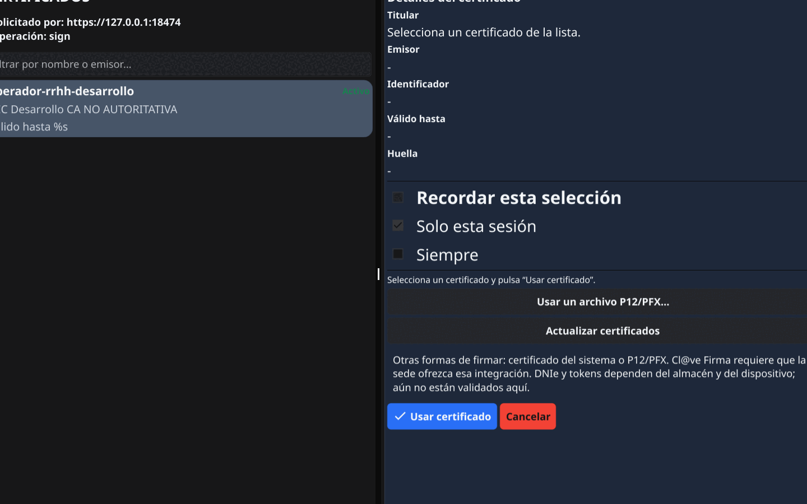
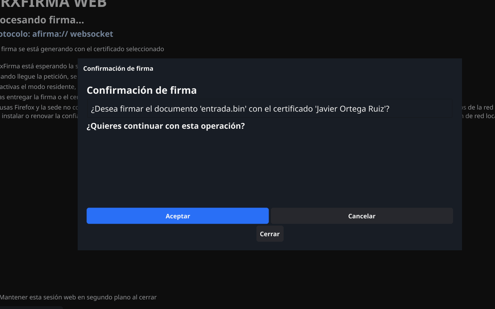
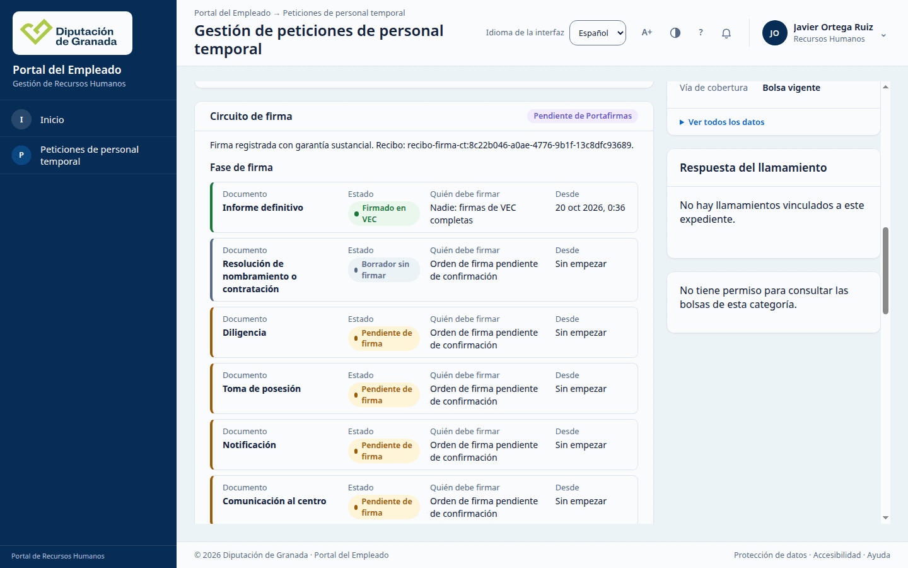
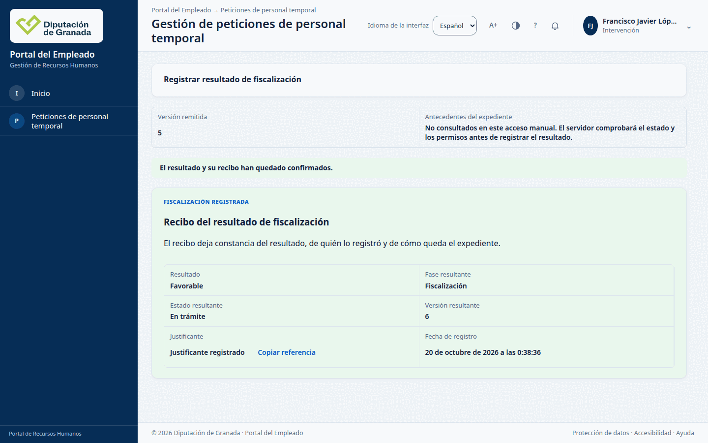
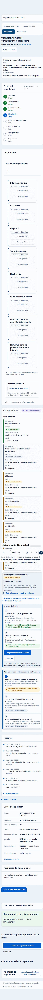

# F1-32: la copia local compone la firma (19 y 20/10/2026)

Tarea F1-32, con F1-86 incluida. Datos ficticios en una copia local; no se
tocó cidonia.

## Resultado

En una copia creada desde `main` (3fd5c049b), el paso 7b del
[caso 4.0](../producto/FLUJO_APP.md#40-caso-de-aceptación-de-la-presentación)
funciona en Chrome: el técnico de RRHH y la Jefatura firman el informe
definitivo con GrxFirma (`afirma://`), el verificador aparte da por válida
cada firma y la aplicación registra las dos con 201. Después Intervención
registra la fiscalización favorable con 201 y recibo, y el expediente pasa a
la versión 6. Tras reiniciar aplicación, PostgreSQL y verificador, la ficha
muestra lo mismo y la base no tiene filas nuevas.

Se hizo dos veces. La segunda, con el verificador ya arrancado por el
módulo nuevo `copia_local_firma.py`:

| Paso | Expediente | Persona | Respuesta | Recibo | Versión |
| --- | --- | --- | --- | --- | --- |
| 7b | 2026/92006 | Técnico (operador-rrhh-desarrollo) | `POST /firmas-documento/registro-vec` 201 | `recibo-firma-ct:210fc0aa…` | 5 |
| 7b | 2026/92006 | Jefatura (Javier Ortega Ruiz) | `POST /firmas-documento/registro-vec` 201 | `recibo-firma-ct:731f6be1…` | 5 |
| 8 | 2026/92006 | Intervención (Francisco Javier López Serrano) | `POST /fiscalizaciones/resultados` 201 | `recibo:ct-fiscalizacion:46bd6ed7…` | 6 |
| 7b | 2026/92007 | Técnico | `POST /firmas-documento/registro-vec` 201 | `recibo-firma-ct:537840ce…` | 5 |
| 7b | 2026/92007 | Jefatura | `POST /firmas-documento/registro-vec` 201 | `recibo-firma-ct:8c22b046…` | 5 |
| 8 | 2026/92007 | Intervención | `POST /fiscalizaciones/resultados` 201 | `recibo:ct-fiscalizacion:33bdd67a…` | 6 |

Las rutas cuelgan de `/api/vec/contratacion-temporal`. La respuesta de cada
firma trae `garantia_autenticacion: sustancial` y `firma_eficaz: false`: los
certificados son de la CA de desarrollo, que no es autoritativa.

Después de cada reinicio:

- Los recuentos de firma (registro, auditoría, custodia, salida y revisión
  del PDF) y de fiscalización (reserva y terminal) son idénticos antes y
  después: 5 firmas y 11 fiscalizaciones en el segundo reinicio.
- La ficha de 2026/92007 dice «Fase 4 de 8: Fiscalización», «La fiscalización
  favorable está registrada» y muestra las dos firmas del informe, a 1440 y a
  390 píxeles. Solo lecturas; sin desbordamiento horizontal, sin cookies ni
  almacenamiento web.

La copia llega, por tanto, al paso 8 del caso 4.0.

## Qué compone la firma

El camino corto no servía: el `firma-vec.json` del material de origen
apuntaba a asignaciones y admisiones que no estaban vigentes en la base
restaurada. Se siguió el camino largo de
`deploy/principal/candidata_hz39/firma/LEEME.md`:

1. Administración (fases H10 y gobierno 6) y `vec-admin` con los cuatro
   montajes de efectos: lote, plan de firma, cargos y certificados.
2. Identidad de los cuatro firmantes, 16 roles por AUT53, 16 asignaciones,
   correspondencia CA45 y empleados firmantes en Personal.
3. Selección de perfil de los dos administradores y 14 actos (cinco cargos,
   cinco enlaces y cuatro certificados).
4. Plan `ct.plan.firma.hz39.operativa` v1: lo crea el administrador A y lo
   publica el B.
5. Exportación de admisiones y `identidad/firma-vec.json`.
6. Plantillas v4 (F1-86), circuito RRHH v2, verificador y variables.
7. Reinicio y aprobación de los perfiles fijos de RRHH.

Los pasos 1 a 5 usan material privado (kits H6 y de firma hz39, certificados
y claves) y siguen fuera de Git. El paso 6 es igual en toda copia y ahora lo
hace la orden `firma` de `copia_local.py` (apartado 11 de
[la guía de la copia](../../deploy/principal/LEEME_copia_local.md)).

No se añadió SQL.

## Requisito de GrxFirma

El lanzador `afirma://` instalado (`/usr/bin/grxfirma-afirmauri`, versión
0.0.105) no sirve para la segunda firma, por dos fallos que GrxFirma ya
corrigió en la 0.0.106:

- al cofirmar duplica `/Version` en el catálogo y el verificador lo clasifica
  como objeto nuevo no clasificado (422 `firma_no_verificada`);
- la primera firma bloquea todos los campos (FieldMDP `/All`), así que
  cualquier firma posterior sale `fieldmdp_bloquea_campo`.

Las dos firmas de un mismo informe deben hacerse con GrxFirma 0.0.106 o
posterior. Aquí se usó un lanzador compilado desde el código de GrxFirma
(0.0.111). Un informe que el técnico firmó con la 0.0.105 ya no admite la
firma de Jefatura y hay que usar otro expediente. Es lo que pasó con
2026/94011, que se quedó con la firma del técnico.

En los dos rechazos la aplicación respondió 422 y no cambió nada.

## Observaciones

1. Una de las cuatro firmas de Jefatura no se registró: la página canceló la
   petición de registro mientras la enviaba. El servidor anotó 503
   `servicio_no_disponible` y la pantalla dijo «No se ha podido confirmar el
   registro». Al repetir, 201. La ficha también cancela la primera lectura de
   comunicaciones al abrirse (503 seguido de 200 a los 250 ms). Conviene
   revisar qué vuelve a pintar la ficha durante la firma y registrar las
   cancelaciones del cliente con otro código; no se ha abierto tarea.
2. El selector de GrxFirma 0.0.111 muestra «Válido hasta %s» sin la fecha.
   Es un fallo de GrxFirma, no de VEC.
3. Intervención sigue entrando por referencia técnica (P2 del
   [recorrido 4.0](recorrido_4_0_pasos_1_8_20261019.md#p2-intervención-no-tiene-bandeja)).
4. GrxFirma pide siempre elegir certificado y confirmar. En el ensayo
   automático esos dos botones se pulsaron en una pantalla virtual propia
   (Xvfb); en uso real los pulsa la persona que firma.

## Variables de las ocho

Son los ocho indicadores de módulos que vigila el relevo, no las ocho
variables de firma que añade la orden `firma`.

| Variable | Estado en la copia |
| --- | --- |
| `VEC_BOLSA_BORRADORES_ENABLED` | encendida |
| `VEC_BOLSA_PORTAL_CANDIDATO_ENABLED` | apagada |
| `VEC_DOCUMENTOS_ENABLED` | encendida |
| `VEC_BOLSA_CESE_CT_ENABLED` | apagada |
| `VEC_PERSONAL_B2_GOBIERNO_ENABLED` | apagada |
| `VEC_CT_INCORPORACION_ACREDITADA_ENABLED` | encendida |
| `VEC_FIRMA_VERIFICACION_ENABLED` | encendida |
| `VEC_RRHH_AUDITORIA_ENABLED` | apagada |

## Cómo se probó

- Chrome del sistema con Playwright, con interfaz, en una pantalla virtual
  propia. Cada persona tiene su certificado de cliente y su carpeta personal
  aislada. En el perfil de Chrome está permitido `afirma://` para el origen
  de la copia, y el escritorio de esa carpeta abre `afirma://` con un
  lanzador que solo ve el P12 de esa persona. GrxFirma tiene activada la
  confianza por decisión y el origen de la copia admitido. Sus ficheros de
  configuración deben tener permisos 600: con otros permisos GrxFirma los
  ignora y rechaza el origen con 403.
- El verificador es GrxFirma en modo solo verificación, en 127.0.0.1, con TLS
  de la CA de la copia, la CRL de clientes y una credencial propia. `/sign`
  responde 404.
- Reinicios: el primero con el guion de reinicio de la presentación y el
  verificador a mano; el segundo con `copia_local_firma.py`, que paró y
  arrancó el verificador junto con la aplicación.

## Capturas

| Momento | Captura |
| --- | --- |
| 7b, GrxFirma pide elegir certificado |  |
| 7b, GrxFirma pide confirmar |  |
| 7b, informe firmado por las dos personas |  |
| 8, recibo de la fiscalización |  |
| Tras reiniciar, 1440 px |  |
| Tras reiniciar, 390 px |  |

## Límites

- La orden `firma` ejecuta las etapas privadas que declara el manifiesto,
  pero no se ha repetido con ella el camino largo entero en una copia nueva.
  Aquí las etapas privadas se hicieron a mano, y la orden se probó con la
  lista de etapas vacía sobre la copia ya preparada: plantillas v4 en
  `replay`, verificador, variables y dos reinicios.
- Firma de desarrollo: `firma_eficaz: false`. No es firma legal.
- La copia y sus carpetas se borraron al terminar.
