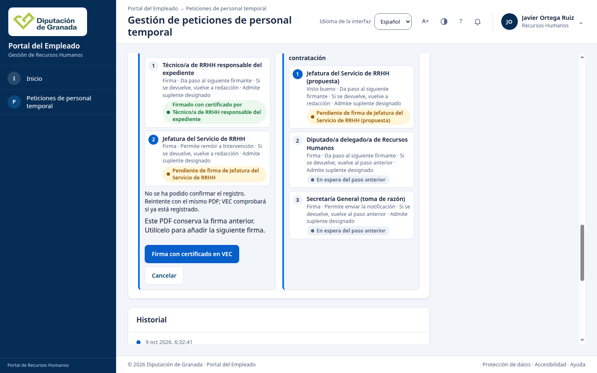
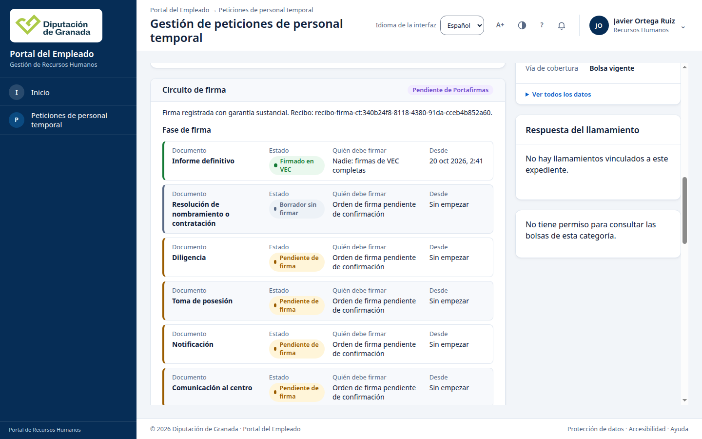
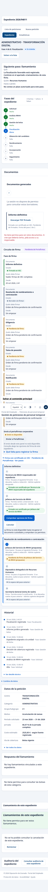

# F1-94: la firma de Jefatura se registra siempre desde la ficha (20/10/2026)

Tarea F1-94, que sale de la observación 1 de
[F1-32](firma_copia_f1_32_20261019.md). Datos ficticios en una copia local; no
se tocó cidonia.

## Causa

La ficha no cancelaba el registro. Chrome corta las peticiones que tiene en
curso cuando cambia la red del equipo y las da por fallidas con
`net::ERR_NETWORK_CHANGED`. En el equipo de desarrollo basta con que arranque
o se borre un contenedor Docker de otra copia: su interfaz gana o pierde una
dirección IPv6 de enlace y Chrome lo trata como un cambio de red. En una
oficina pasa lo mismo al cambiar de wifi o de conexión remota.

Lo que se vio en F1-32 encaja con esto y no con una cancelación de la página:

- La pantalla dijo «No se ha podido confirmar el registro» con los botones de
  firma todavía visibles. Ese aviso solo sale cuando la sesión de firma sigue
  viva y el envío falla sin respuesta. Si la página hubiera abortado, el aviso
  sería otro o ninguno.
- Playwright no recibió respuesta del registro.
- El servidor anotó 503 `servicio_no_disponible` a los 54 ms, después de 15
  consultas, con `centinela=no_clasificado`. Cortando el envío con `curl` a
  distintos tiempos se obtiene la misma huella: 503, 15 consultas y
  `no_clasificado` cuando el corte cae mientras se resuelve la autoridad;
  `context_canceled` en los demás momentos. El servidor no falla: responde a
  una petición que el navegador ya ha abandonado.

Comprobaciones en Chrome, con la versión de `main` (c2dba0f27):

| Prueba | Resultado |
| --- | --- |
| 249 registros repetidos (200 `ya_registrada`) durante 4 minutos, sin tocar nada | 12 fallos `ERR_NETWORK_CHANGED`, cada uno en el mismo segundo en que `ip monitor` anota una dirección IPv6 de enlace nueva o borrada en una interfaz de Docker |
| Contenedores breves cada 0,3 s durante 10 s | Fallan todos los registros de ese intervalo |
| Jefatura firma 2026/92008 con contenedores breves durante el registro | `ERR_NETWORK_CHANGED`, 503 en el servidor, firma sin registrar y «No se ha podido confirmar el registro» (captura 1) |
| Jefatura firma 2026/92006 y 2026/92007 sin cambios de red | 201 las dos |

La página sí cancelaba un registro ya enviado en tres casos menos frecuentes:
al pulsar «Comprobar» en otro documento, cuando un repintado de la ficha
cambiaba el contexto y al salir de la ficha. También se corrigen.

## Arreglo

En `circuito-firma-acciones.js`:

- Un registro enviado ya no depende de la señal de la sesión de firma.
  «Comprobar», el repintado o salir de la ficha no lo cancelan; si la ficha ya
  no está, el resultado no se pinta.
- Si el envío falla con `servicio_no_disponible` (sin respuesta, un 503 o un
  código que el cliente no conoce) o agota su plazo de 90 s, se repite solo
  dos veces, tras 1 s y 3 s, con la misma clave de idempotencia y una
  copia nueva de los mismos bytes. El servidor responde 200 `ya_registrada` si
  ya lo tenía o 201 si no, y nunca guarda dos firmas. Un rechazo del servidor
  (conflicto, firma no verificada, verificación no disponible, acceso
  denegado, resultado no confiable) no se repite.
- Si mientras tanto se pulsa «Comprobar opciones de firma» en otro
  documento, ese bloque avisa de que se está registrando otra firma del
  expediente y pide volver a comprobar cuando termine. Es un texto nuevo del
  catálogo, en castellano e inglés.
- Si los tres intentos fallan, el aviso y la recuperación son los de antes:
  la persona pulsa de nuevo y VEC envía el mismo PDF sin volver a firmarlo.

No cambian el servidor, el SQL ni los permisos. El servidor sigue
anotando como 503 el registro que el navegador abandona; distinguirlo de un
fallo real queda como mejora del registro técnico.

## Demostración con el arreglo

Copia nueva desde la rama (529da308d), con `crear` y `firma`:

| Expediente | Persona | Registro | Recibo |
| --- | --- | --- | --- |
| 2026/93001 | Técnico | 201 | `recibo-firma-ct:2ba857a8…` |
| 2026/93001 | Jefatura, con cambios de red | `ERR_NETWORK_CHANGED` dos veces (503, 503) y después 201, solo | `recibo-firma-ct:da43d673…` |
| 2026/94011 | Técnico | 201 | `recibo-firma-ct:fddcff92…` |
| 2026/94011 | Jefatura, con cambios de red | `ERR_NETWORK_CHANGED` dos veces (503, 503) y después 201, solo | `recibo-firma-ct:340b24f8…` |
| 2026/93001 | Intervención, fiscalización favorable | 201, versión 6 | `recibo:ct-fiscalizacion:96c96dea…` |
| 2026/94011 | Intervención, fiscalización favorable | 201, versión 6 | `recibo:ct-fiscalizacion:abb1f54c…` |

Cuatro de cuatro firmas registradas, una fila por firma (no hay duplicados
pese a los reintentos). Después se pararon y arrancaron la aplicación,
PostgreSQL y el verificador. Los recuentos de firma (registro, auditoría,
custodia, salida y revisión del PDF: 4 cada uno) y de fiscalización (reserva y
terminal: 11) son iguales antes y después. La ficha de los dos expedientes
dice «Fase 4 de 8: Fiscalización», «La fiscalización favorable está
registrada» y las dos firmas del informe, a 1440 y a 390 píxeles, sin
desbordamiento horizontal, cookies ni almacenamiento web.

| Captura | |
| --- | --- |
| 1. `main`: registro cortado por la red |  |
| 2. Arreglo: registro confirmado tras dos cortes |  |
| 3. Tras reiniciar, 390 píxeles |  |

## Camino largo con `firma` en una copia nueva

Funciona. Se compuso dos veces en copias nuevas desde `main` y desde la rama:
`crear` en 97 s y 89 s, y `firma` con sus siete etapas privadas sin pasos a
mano. Solo queda fuera, como dice la guía, la aprobación de los perfiles fijos
de RRHH, que se hizo después con dos reinicios. La primera vez hubo que
corregir las etapas privadas, que vienen de F1-32:

1. La etapa de `vec-admin` necesita `identidad_pg.json` en la copia (nombre,
   carpeta e identificador del sistema de PostgreSQL).
2. La verificación del gobierno de Administración puede no estar disponible
   todavía al terminar la preparación; hay que reintentarla.
3. La procedencia del plan está en `plan.procedencia` del documento de
   fuentes.
4. Las asignaciones de los firmantes deben terminar cuando se retira su
   certificado. Si acaban después, `exportar_admisiones` no devuelve a nadie.
5. La correspondencia CA45 hay que publicarla en la copia antes del plan.
6. El kit de Administración fija la revisión de la copia: hay que ajustarla en
   cada copia nueva.

Para firmar hace falta GrxFirma 0.0.106 o posterior. Aquí se usó el lanzador
0.0.111 compilado en F1-32.
