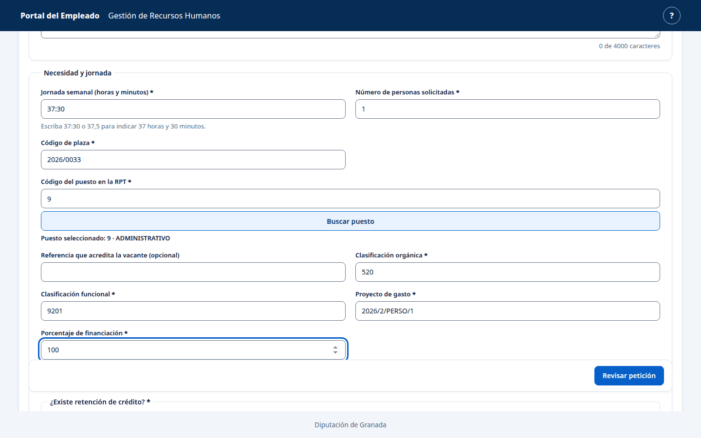
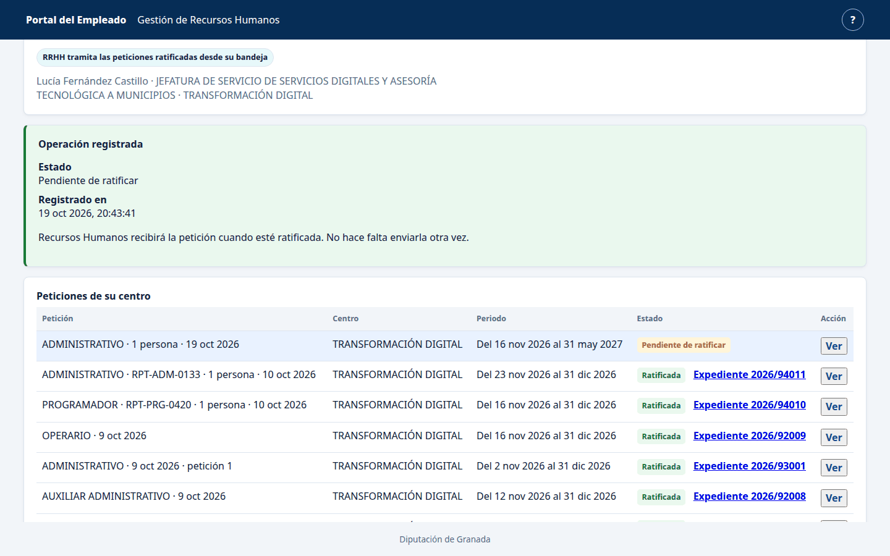
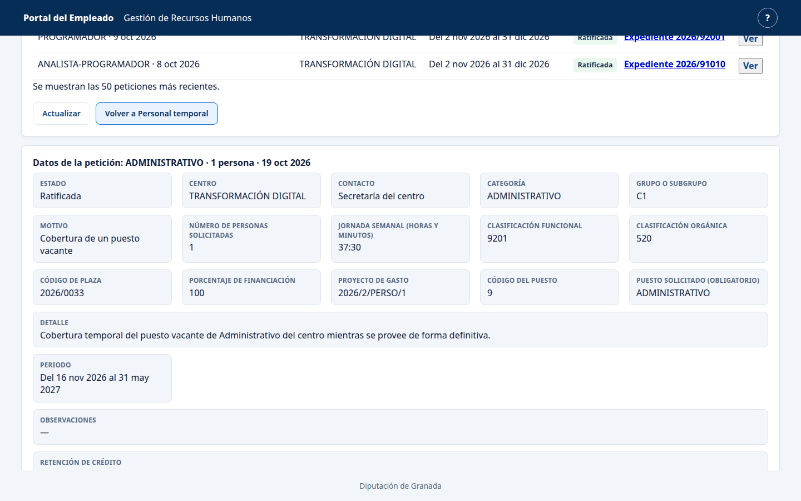
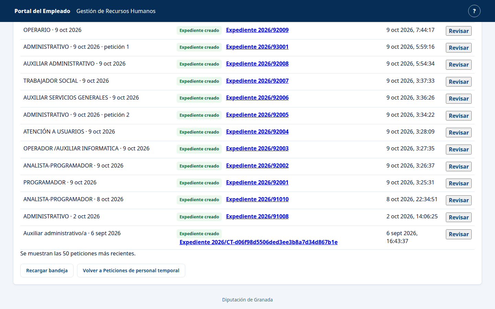
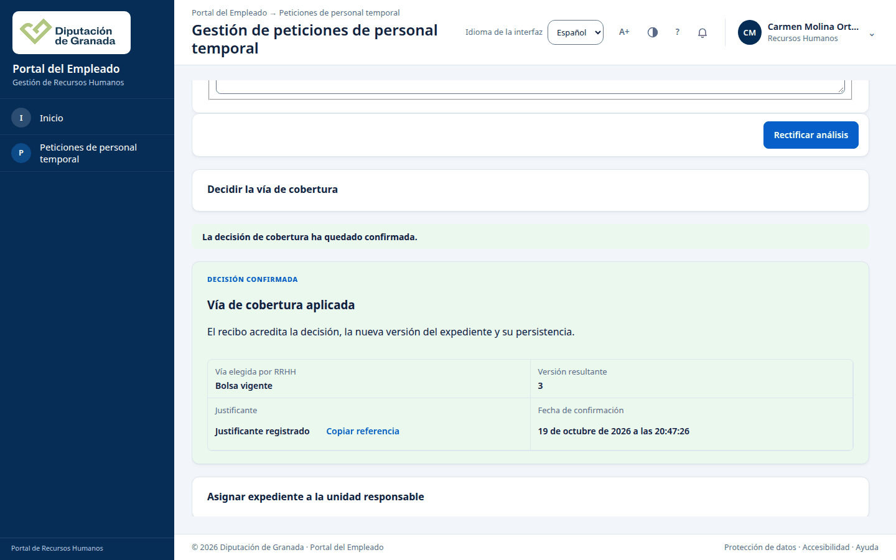
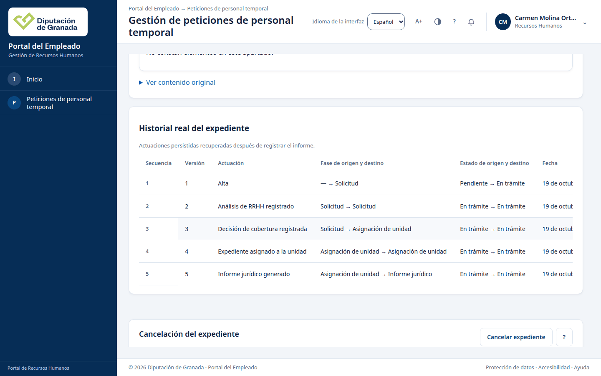
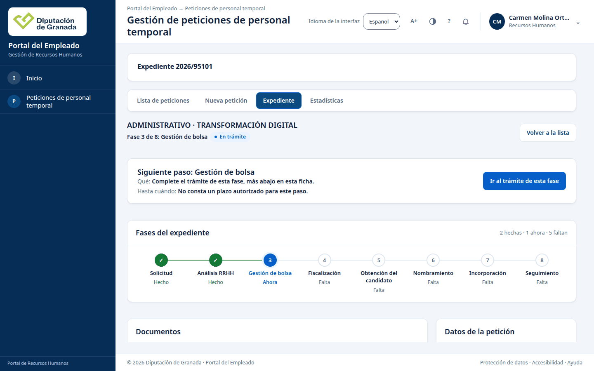
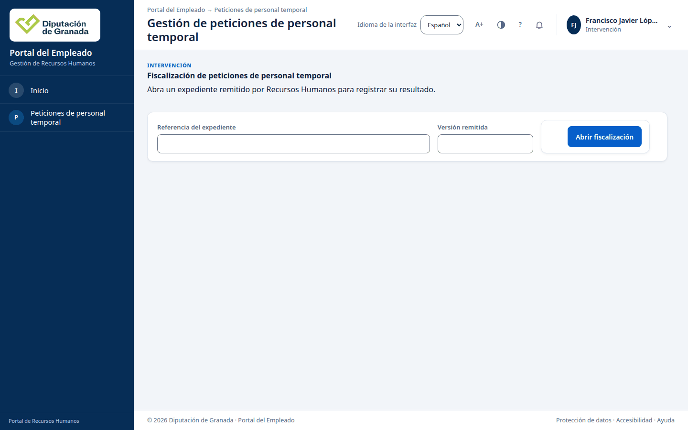
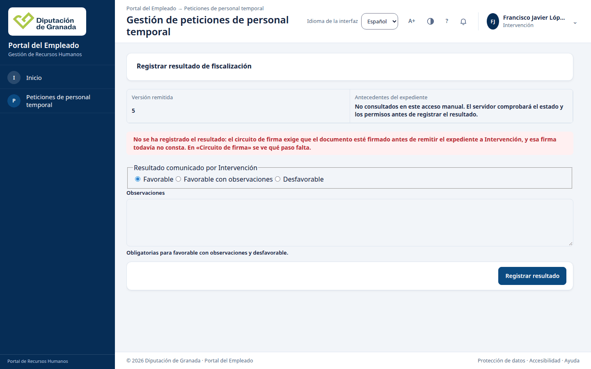
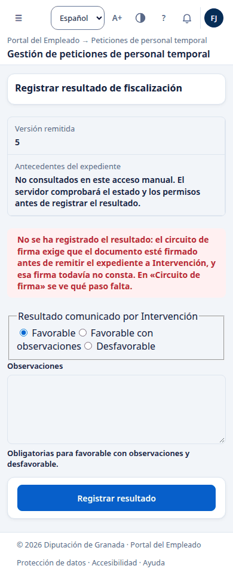

# Recorrido del caso 4.0, pasos 1 a 8, en la copia local (19/10/2026)

Tareas F1-23 (copia al día) y F1-24 (pasos 1 a 8 del
[caso 4.0](../producto/FLUJO_APP.md#40-caso-de-aceptación-de-la-presentación)).
Datos ficticios. No se tocó cidonia.

## Resumen

Los pasos 1 a 7 funcionan en Chrome con su recibo y su versión, y siguen
igual después de reiniciar la aplicación y PostgreSQL. El paso 7b (las dos
firmas del informe) no se puede hacer porque la copia no compone la firma.
Por eso el paso 8 (fiscalización) responde 409 `firma_remision_pendiente` y no
registra nada. La guarda hace lo que debe: la fiscalización espera a la firma.

| Paso | Persona | Respuesta | Estado y versión | Recibo | Resultado |
| --- | --- | --- | --- | --- | --- |
| 1 | Lucía (centro) | `POST /peticiones-centro/operaciones` 200 | `pendiente_ratificacion`, v1 | `recibo:peticion-centro:8b2fa315…` | Bien |
| 2 | Manuel (ratificador) | `POST /peticiones-centro/operaciones` 200 | `ratificada`, v2 | `recibo:peticion-centro:82bf0069…` | Bien |
| 3 | Carmen (RRHH) | `POST /peticiones-centro/rrhh` 201 | expediente 2026/95101, `solicitud/en_curso`, v1 | recibo histórico de alta | Bien |
| 4 | Carmen | `POST /analisis/registros` 201 | `solicitud/en_curso`, v2 | `rec_ct_an_6092e2c1…` | Bien |
| 5 | Carmen | `POST /cobertura/decisiones` 201 | `asignacion_unidad/en_curso`, v3 | `recibo:ct:cobertura:f24e9cfa…` | Bien |
| 6 | Carmen | `POST /asignaciones` 201 | `asignacion_unidad/en_curso`, v4 | `recibo:ct-asignacion:2aadd590…` | Bien |
| 7 | Carmen | `POST /informes-juridicos/preparaciones` 201 | `informe_juridico/en_curso`, v5 | `recibo:ct-informe-juridico:5bf02556…` | Bien |
| 7b | Carmen y Jefatura | no hay panel de firma | sigue en v5 | ninguno | Bloqueado por la copia (C4) |
| 8 | Francisco Javier (Intervención) | `POST /fiscalizaciones/resultados` 409 | sigue en v5 | ninguno | Bloqueado por 7b |

Las rutas de la tabla cuelgan de `/api/vec/contratacion-temporal`. En los
pasos 1, 2, 3 y 8 se miró la pantalla a 1440 y a 390 píxeles: sin
desbordamiento horizontal, sin cookies y sin almacenamiento web. La consola
solo muestra el 404 de preferencias (C6) y el error de certificado del
service worker, que es propio de Playwright con certificado de cliente y no
se atribuye al producto.

## Cómo se hizo

- Copia `d/claude-recorrido` sobre `main` a380ba708, creada con
  `deploy/principal/copia_local.py crear --equipo d --instancia claude-recorrido
  --puerto-pg 55473 --puerto-app 18473 --puerto-smtp 11073 --modulos
  --segundo-rrhh --rrhh-original <material>
  --lista-sql deploy/principal/lista_sql_main_tras_hz37.txt`. Tardó 92,8
  segundos. Los productores de roles y datos son los privados de la copia de
  presentación.
- Chrome del sistema con Playwright, un certificado por persona: centro
  solicitante, ratificador, RRHH e Intervención.
- Después del paso 8 se reinició con `copia_local.py reiniciar` y, tras el
  fallo C5, con `arrancar`. PostgreSQL arrancó en un contenedor nuevo con los
  mismos datos.

## Después del reinicio

- La ficha del expediente 2026/95101 devuelve exactamente lo mismo que antes:
  versión 5, `informe_juridico/en_curso` y cinco hitos (alta, análisis,
  cobertura, asignación e informe) con las mismas fechas.
- Las bandejas del centro, del ratificador y de RRHH responden 200 y son
  idénticas byte a byte a las de antes del reinicio.
- En la base no hay duplicados: un solo expediente 2026/95101, 32 revisiones de
  peticiones del centro y 16 entregas a RRHH, igual que antes.
- Repetir el paso 8 da el mismo 409 y no cambia nada.

## Fallos de la copia (F1-23)

### C1. Puertos del encargo ocupados

Los puertos 55496, 18496 y 11096 los usa otra copia (`r-f110-base`). Se usaron
55473, 18473 y 11073. No es un fallo del guion.

### C2. Dos perfiles fijos de RRHH quedan sin provisión

- Registro de arranque: `WARN perfil fijo de RRHH sin asignación consumible:
  sus peticiones se deniegan hasta la provisión perfil=firma_documento` y lo
  mismo para `lector_entrega_peticion`, con `estado=pendiente_provision`.
- Causa: `copia_local.py crear` no aprueba esa provisión. Se hizo con el acto
  privado de la copia de presentación (`aprobar_perfiles_rrhh.sh`), que da las
  variables de aprobación, reinicia y las retira. El aviso sale de
  `internal/app/bootstrap/contratacion_temporal_perfiles_fijos_rrhh_desarrollo.go:354`.
- Lo arreglaría F0-28 (guion único sin pasos a mano).

### C3. Los datos del recorrido no se cargan

`organizacion_520_administrativo.sql`, `antonio_disponible.sql` y
`cargo_manuel.sql` (lista `lista_sql_codexk_datos_recorrido_20261014.txt`) no
los aplica el guion. Se aplicaron a mano con `psql` y terminaron bien. Los
pasos 1 a 8 no los necesitan, pero el 9 y el 18 sí. Lo arreglaría F0-28.

### C4. La firma no se compone (bloquea 7b y 8)

- En la ficha: «El estado de las firmas no está disponible. Vuelva a
  intentarlo.» El detalle del expediente dice `firma_nominal: no_disponible`.
- Falta todo lo de la firma: el fichero `identidad/firma-vec.json`, la variable
  `VEC_CT_FIRMA_VEC_R5_ENABLED`, la variable `VEC_CT_CIRCUITO_RRHH_SOURCE_PATH`,
  el plan de firma publicado (la tabla `plan_firma_publicacion` está vacía) y
  las identidades de los firmantes: el certificado de Jefatura recibe 401 en
  `/api/vec/session`.
- Al encender la firma con el `firma-vec.json` del material, Contratación
  entera deja de estar disponible (503 en el cuadro). El registro solo dice
  `contratacion_temporal_no_disponible componente=contratacion_temporal causa=otro`.
- Con un binario de diagnóstico (fuera de Git) salieron dos causas en orden:
  1. `consultaCircuitoRRHH == nil`: falta `VEC_CT_CIRCUITO_RRHH_SOURCE_PATH`
     (`internal/app/bootstrap/contratacion_temporal_desarrollo.go:1001`).
  2. Después, `componente=ct_firma_vec_plan causa=configuracion`: no hay plan
     publicado en la base
     (`internal/app/bootstrap/contratacion_temporal_firma_v2_montaje.go:172`).
- Para seguir hacen falta los dos administradores de copia, publicar cargos,
  certificados nominales y plan, y cargar los empleados firmantes
  (apartado 4 de `deploy/principal/LEEME_copia_local.md` y
  `deploy/principal/candidata_hz39/firma/LEEME.md`). Es el resto de F1-23 y
  entra en F0-28.
- Falla del producto: los retornos sin marcar de esas dos funciones dejan
  `causa=otro` y no dicen qué falta. Lo arreglaría F1-32 (el aviso de
  dependencias debe decir qué falta).

### C5. `reiniciar` falla si el puerto de la aplicación sigue en espera

- Orden: `copia_local.py reiniciar --equipo d --instancia claude-recorrido`.
- Mensaje: `No se completó la copia; consulte los registros de su instancia.`
  Por debajo, `OSError: [Errno 98] Address already in use` en `puerto_libre`.
- Causa: `deploy/principal/copia_local.py:62` comprueba el puerto con un
  `bind` sin `SO_REUSEADDR`. Tras cerrar la aplicación, el puerto queda unos
  segundos en `TIME-WAIT` y el `bind` falla, aunque nadie escuche. PostgreSQL
  se reinicia y la aplicación no. Hubo que esperar y lanzar `arrancar`.
- Arreglo de una línea en el guion, en una PR aparte de F1-23.

### C6. La copia no monta las preferencias de usuario

Cada carga del portal pide `GET /api/vec/usuarios/mis-preferencias` y recibe
404, que aparece como error en la consola. La copia no configura las
preferencias del usuario interno. Lo arreglaría F0-28.

## Fallos del producto, de más a menos grave

### P1. El informe que hay que firmar en 7b no se puede generar en v5

- Paso 7b, ficha del expediente en v5, apartado Documentos: el «Informe
  definitivo» aparece como «Todavía no disponible», con los botones de
  descarga desactivados.
- El circuito de firma v2 pone el informe definitivo como el documento cuya
  segunda firma habilita la remisión a Intervención. FLUJO 4.3.4 dice que los
  borradores salen con el expediente en v7 o posterior. Así, aunque la firma
  estuviera compuesta, en v5 no habría documento que firmar.
- Causa probable: la disponibilidad la decide
  `internal/modules/contrataciontemporal/adapters/httpapi/plantillascatalogo/borradores.go:226`
  con `BorradorPreparable`
  (`internal/modules/contrataciontemporal/adapters/informejuridico/informe_definitivo_rrhh.go:75`).
  Falta comprobarlo con la firma compuesta.
- Ninguna tarea del tablero lo cubre: hace falta una nueva para decidir qué
  documento se firma en 7b y en qué versión.

### P2. Intervención no tiene bandeja

- Paso 8, `/portal-empleado/#contratacion-temporal` con el perfil de
  Intervención.
- Para fiscalizar hay que escribir la referencia técnica
  `expediente:ct:801235…` y la versión remitida. Una persona no conoce esa
  referencia. La pantalla dice además «Antecedentes del expediente: No
  consultados en este acceso manual», así que Intervención no ve el informe
  que fiscaliza.
- Pantalla: `web/static/portal-empleado/modulos/contratacion-temporal/vista-expedientes-fiscalizacion.js`.
- Lo arreglaría F1-50 (bandeja propia de Intervención), que espera la decisión
  de RRHH.

### P3. El centro no puede declarar la retención de crédito

- Paso 1. Al marcar «¿Existe retención de crédito?: Sí», la petición exige
  «Documento de RC incorporado», pero el desplegable no tiene opciones y la
  pantalla dice «No hay documentos incorporados disponibles.»
- Respuesta: el contexto de la petición devuelve `catalogos.documentos: []`.
  Se presentó la petición con «No».
- Causa probable: el catálogo de alta de la copia no publica documentos
  (`internal/app/bootstrap/contratacion_temporal_catalogos_alta_desarrollo.go`)
  y el formulario no permite adjuntar nada. Falta saber si es un dato de la
  copia o una función que no existe. Hace falta una tarea nueva para
  averiguarlo.

### P4. Referencias técnicas a la vista de la persona

- Pasos 5, 6 y 7: la confirmación es el cuadro nativo del navegador y termina
  en «Referencia: expediente:ct:80123594…»
  (`web/static/portal-empleado/modulos/contratacion-temporal/formulario-cobertura.js:410`
  y los formularios de asignación e informe).
- Paso 7: «Expediente expediente:ct:80123594…, versión asignada 4.»
  (`i18n.js:340`, clave `informe_resumen`).
- Documentos: «Recibo de publicación: recibo:155ab6a7-…»
  (`vista-borradores-publicados.js:38`).
- Habría que poner el número visible (2026/95101) en lugar de la referencia.
  Hace falta una tarea nueva de textos de la ficha.

### P5. La ficha orienta mal en algunos pasos

- Con el expediente en v5 (`informe_juridico/en_curso`) la cabecera dice
  «Fase 3 de 8: Gestión de bolsa» y «Siguiente paso: Gestión de bolsa». El
  siguiente paso del caso es la firma del informe.
- Tras el análisis (v2), «Fases del expediente» sigue en «0 hechas».
- «Rectificar análisis» no conserva el grupo ni la retención elegidos y los
  vuelve a pedir.
- En el historial, la columna Fecha sale cortada a 1440 píxeles («19 de
  octub»).
- Hace falta una tarea nueva de la ficha, con revisión de usabilidad.

### P6. El caso habla del puesto 9/01 y el centro busca por 9

- Paso 1. FLUJO 4.0 dice «puesto 9/01», pero la RPT publicada que ve el centro
  usa el código `9`. Si se escribe `9/01`, el buscador dice «No aparece ese
  puesto en la RPT publicada» sin consultar al servidor, porque rechaza la
  barra (`web/static/portal-empleado/peticiones-centro/peticiones-centro.js:839`).
  El puesto 9/01 es el de Personal, que se usa en el paso 18.
- Basta con corregir FLUJO 4.0; no hace falta tarea nueva.

### P7. Menores

- Pasos 1 y 2: la confirmación dice «Operación registrada» con estado y hora,
  pero no enseña el número de recibo.
- Paso 1: la lista «Categoría» mezcla denominaciones que no son categorías
  («HORARIOS DE TRABAJO», «PROYECTOS DE GASTO») y repite «ADMINISTRATIVO» y
  «Administrativo/a». Viene de los datos de la RPT importada.
- Lentitud: la decisión de cobertura tardó 571 ms y el cuadro hasta 336 ms.
  Lo mide F1-34.

## Qué falta

1. Componer la firma en la copia (C4): administradores, cargos, plan,
   certificados nominales, empleados firmantes y las dos variables. Después,
   repetir 7b y 8 sobre este mismo expediente o uno nuevo.
2. Decidir P1 antes de recorrer 7b: qué documento se firma y en qué versión.
3. Recorrer 7b y 8 y repetir las consultas tras reiniciar.

## Capturas

| Paso | Captura |
| --- | --- |
| 1, formulario |  |
| 1, recibo |  |
| 2, recibo |  |
| 3, recibo |  |
| 5, recibo |  |
| 7, historial |  |
| 7b, ficha |  |
| 8, entrada |  |
| 8, 409 |  |
| 8, 390 px |  |
| Reinicio |  |
