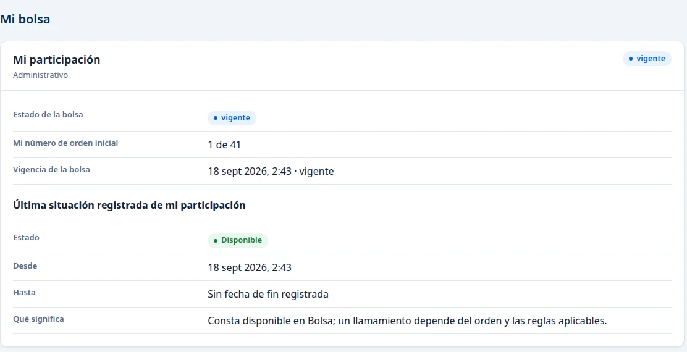
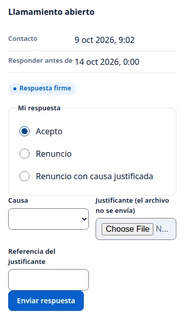
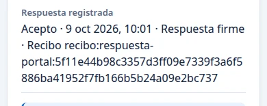

# Mi bolsa: consultar la situación y aceptar un llamamiento

**Comprobado el 9 de octubre de 2026.** Las imágenes muestran un ejemplo. Su bolsa, número de orden y fechas pueden ser distintos.

## Inscribirse en una bolsa

**Comprobado el 20 de octubre de 2026** en una copia de desarrollo.

1. En el menú, dentro de **Tramitación**, pulse **Inscribirme en una bolsa**. Verá las bolsas con plazo abierto, con su plazo de inscripción, el número de categorías, cómo se presenta la solicitud y los requisitos.
2. Pulse **Consultar bolsa** en la que le interese. La ficha muestra la categoría y cada requisito. Si un requisito figura como **Cumple (comprobado)**, no tiene que hacer nada con él.
3. Pulse **Solicitar inscripción**. En **Revise su solicitud** compruebe la bolsa, la categoría y el plazo.
4. Pulse **Presentar solicitud** una sola vez. Aparece «Solicitud presentada. Guarde su número de recibo», con el estado **Pendiente de revisión** y el número de recibo.

Para ver después lo que ha presentado, vuelva a **Inscribirme en una bolsa** y pulse **Mis solicitudes**. Cada solicitud muestra la bolsa, la categoría, la fecha y su estado; **Ver solicitud** abre el detalle con el mismo recibo. La tarjeta de la bolsa también indica el estado y cambia **Consultar bolsa** por **Ver solicitud**.

Recursos Humanos revisa la solicitud. Cuando la resuelva, el estado cambiará a **Admitida. Pendiente de incorporación a la bolsa**, **Incorporada a la bolsa** o **Rechazada**.

Si la conexión se corta al presentar, abra **Mis solicitudes** antes de repetir. Si la solicitud aparece, ya está presentada: VEC no crea una segunda solicitud para la misma bolsa y categoría.

## Ver su situación

Entre en [Mi área personal](https://vec.cidonia.cloud/area-personal/?lang=es) con su acceso y pulse **Mi bolsa** en el menú. La pantalla se titula «Disponibilidad y llamamientos». En **Mi participación** verá la bolsa, su número de orden inicial y la última situación registrada. **Disponible** significa que consta como disponible en esa bolsa. Recibir un llamamiento depende del orden y de las reglas que se apliquen.

## Elegir qué ofertas quiere ver

En **Mi bolsa**, el apartado **Ofertas que me interesan** sirve para decidir de qué tipos de contrato (sustitución, vacante, acumulación de tareas, programa temporal o relevo) quiere ver ofertas publicadas y recibir sus avisos por correo.

1. Elija **De todos los tipos**, **Solo de los tipos que marque** o **De ninguno**. Si elige la segunda, marque al menos un tipo.
2. Pulse **Guardar elección**. Debajo aparecerá «Elección guardada el …» con la fecha.

Si elige **De ninguno**, la pantalla le avisa antes de guardar: no verá ofertas nuevas ni recibirá avisos de ofertas. Esta elección no cambia su puesto en la bolsa ni cuenta como renuncia, y RRHH le puede seguir llamando por orden de bolsa. Las ofertas que ya respondió se siguen viendo.

Cuando la lista de ofertas tiene en cuenta su elección, aparece el botón **Ver todas las ofertas**. Le enseña también las de los tipos que no eligió, sin cambiar lo guardado. **Ver solo las que me interesan** vuelve a la lista filtrada.

Si aparece «Su elección cambió desde otra ventana o dispositivo», alguien guardó otra elección con su acceso mientras usted la cambiaba. La pantalla muestra la que está guardada ahora: revísela y guarde de nuevo si quiere. Si aparece «No sabemos si su elección se guardó», pulse **Reintentar el guardado**; no se guardará dos veces.

Si no ve el apartado, la función todavía no está activada para su acceso.

## Responder cuando RRHH registre el contacto

Espere a que aparezca **Llamamiento abierto**. Revise la fecha de **Contacto** y la de **Responder antes de**. La etiqueta **Respuesta firme** que aparece debajo indica que su respuesta será definitiva en cuanto la envíe: se registra directamente en la bolsa, sin que RRHH tenga que confirmarla. Si en su lugar aparece «RRHH confirmará la respuesta», su respuesta quedará pendiente hasta que RRHH la confirme. Un correo con resultado **Enviado** no confirma que le haya llegado ni que haya una respuesta registrada.

Para aceptar el llamamiento:

1. En **Mi respuesta**, marque **Acepto**.
2. Pulse **Enviar respuesta** una sola vez.
3. Espere a que aparezca **Respuesta registrada**.

Para aceptar no hace falta rellenar **Causa**, **Justificante** ni **Referencia del justificante**. Esos campos son para renunciar con causa justificada.

La confirmación muestra **Acepto**, la fecha, **Respuesta firme** y un recibo. Conserve ese recibo para consultar su respuesta. Después de actualizar la página, debe ver la misma confirmación y el mismo recibo.

Que la respuesta quede registrada no cambia en ese momento su situación en la bolsa: puede seguir viendo **Disponible** mientras RRHH continúa el trámite.

## Si algo sale mal

Si aparece «No se ha podido confirmar el resultado. Consulte Mi bolsa antes de volver a enviar la petición», vuelva a **Mi bolsa** y compruebe si figura **Respuesta registrada** con un recibo. Si no aparece, comunique a RRHH el mensaje que vio antes de intentar otro envío.

Si todavía no aparece **Llamamiento abierto**, espere a que RRHH registre el contacto. La indicación **Enviado** del correo, por sí sola, no abre una respuesta en esta pantalla.
