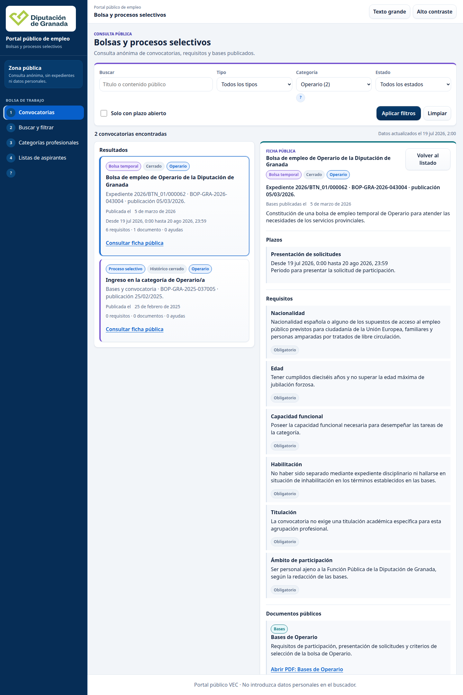
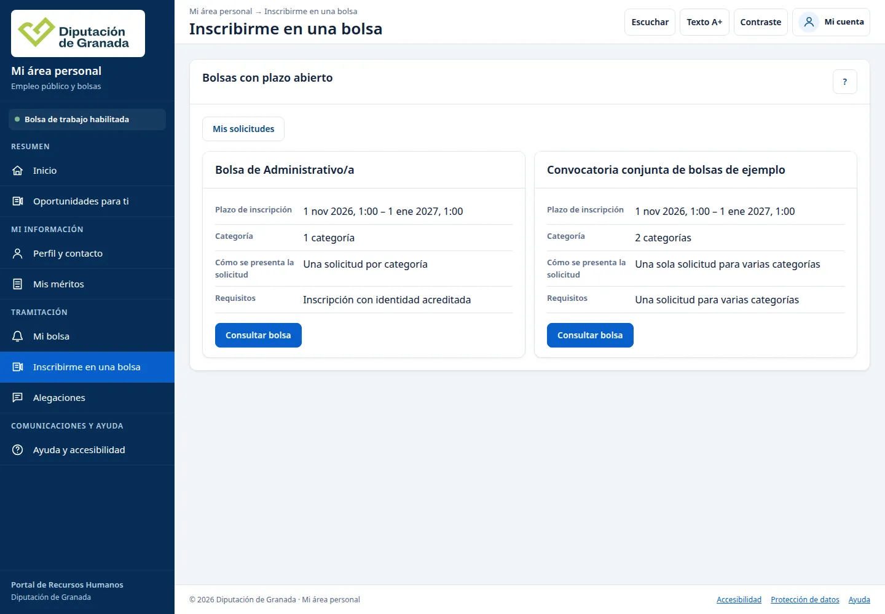
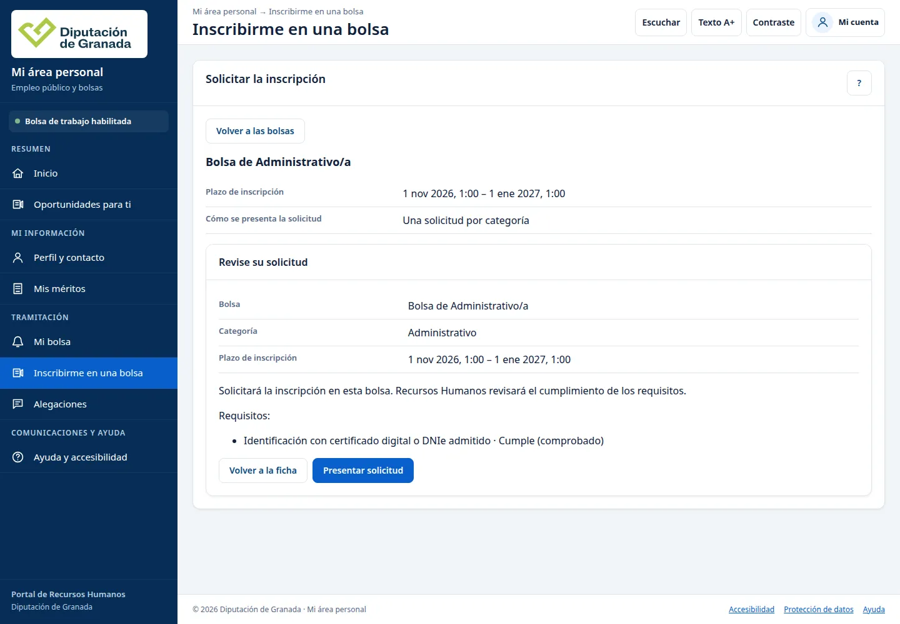
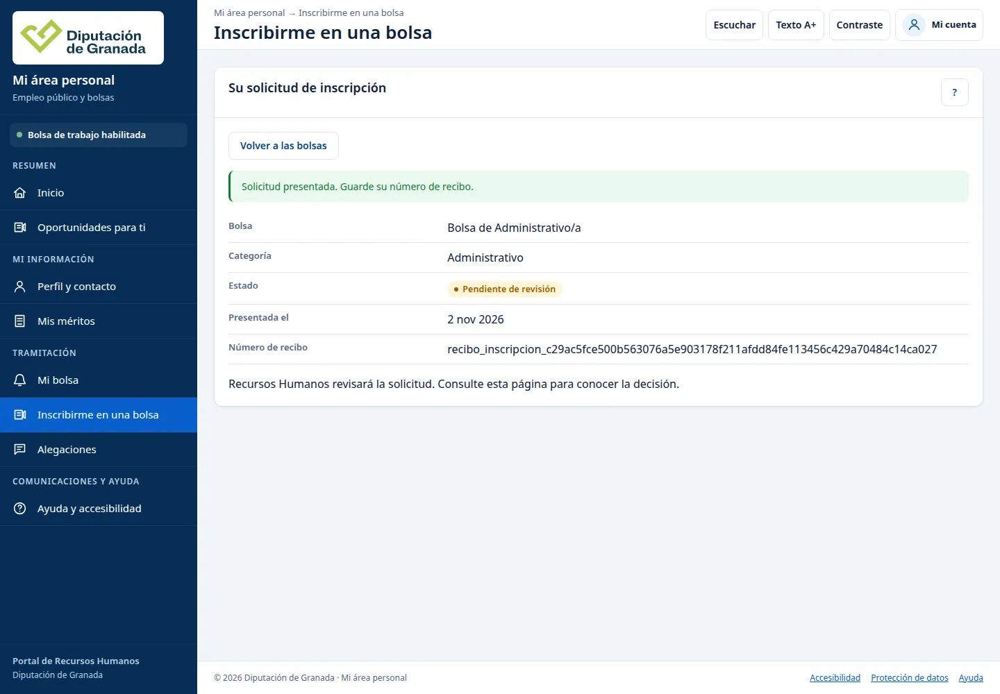
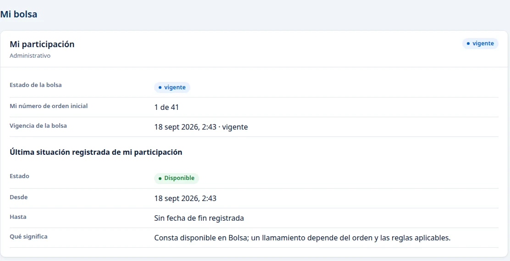
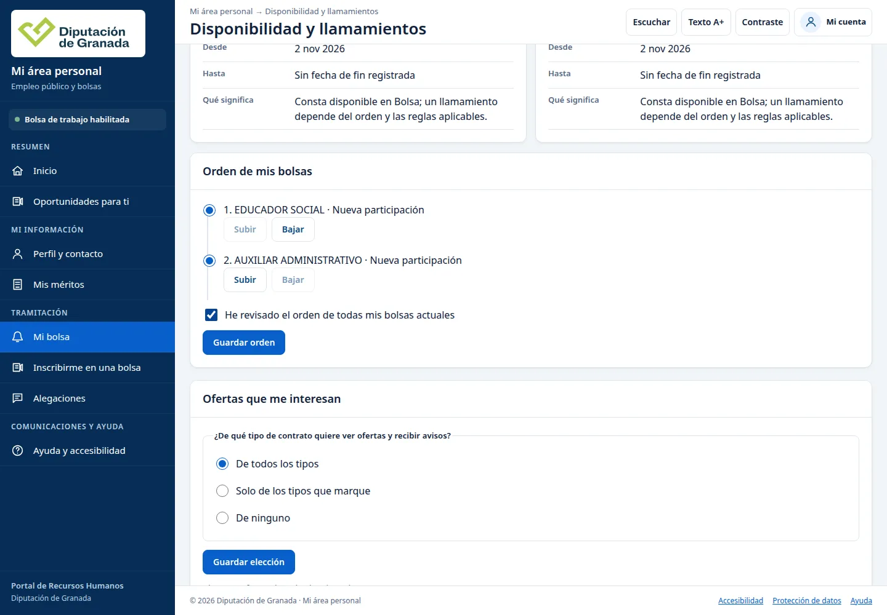
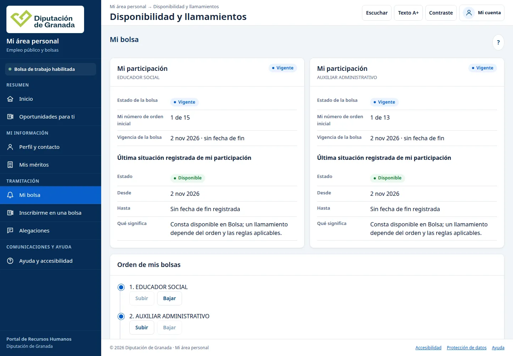
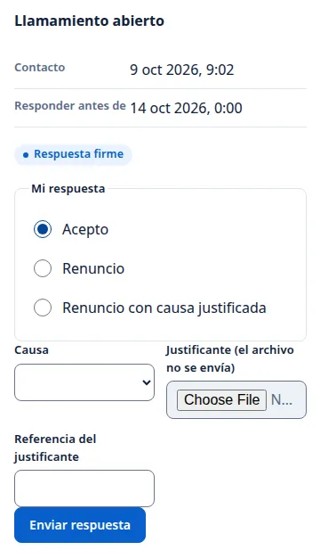
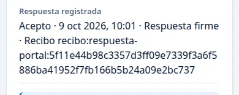

# Mi bolsa: consultar la situación y aceptar un llamamiento

Actualizado el 4 de noviembre de 2026. Las imágenes muestran datos inventados. Su bolsa, número de orden y fechas pueden ser distintos.

## Consultar las convocatorias y descargar las bases

Procedimiento visto el 26 de octubre de 2026 en una copia de desarrollo. La comprobación completa de publicación, plazos y descarga de bases sigue abierta en el tablero; se conserva aquí para consulta y en [Pendientes](PENDIENTES.md).

Para consultar las convocatorias no hace falta certificado ni ningún otro acceso. Abra el portal público de convocatorias; la página se titula «Bolsas y procesos selectivos».

1. En **Resultados** verá las convocatorias publicadas. Cada una indica la situación de su plazo, **Abierto**, **Cerrado** o **Próximo**, y sus fechas («Desde … hasta …»).
2. Pulse **Consultar ficha pública** en la que le interese. La ficha reúne los plazos, los requisitos y los documentos de esa convocatoria.
3. En **Documentos públicos**, pulse el enlace que empieza por «Abrir PDF:» seguido del título de las bases. El PDF se abre en el navegador y desde allí puede guardarlo o imprimirlo.
4. Pulse **Volver al listado** para ver de nuevo todas las convocatorias.

Si aparece «No se ha podido cargar la información», pulse **Reintentar**. Si una convocatoria no tiene bases publicadas, la ficha indica «No hay documentos públicos asociados.».

## Inscribirse en una bolsa

**Comprobado de nuevo el 27 de octubre y el 2 de noviembre de 2026** en copias de desarrollo.

1. En el menú, dentro de **Tramitación**, pulse **Inscribirme en una bolsa**. Verá las bolsas con plazo abierto, con su plazo de inscripción, el número de categorías, cómo se presenta la solicitud y los requisitos.
2. Pulse **Consultar bolsa** en la que le interese. La ficha muestra la categoría y cada requisito. Si un requisito figura como **Cumple (comprobado)**, no tiene que hacer nada con él.
3. Pulse **Solicitar inscripción**. En **Revise su solicitud** compruebe la bolsa, la categoría y el plazo.
4. Pulse **Presentar solicitud** una sola vez. Aparece «Solicitud presentada. Guarde su número de recibo», con el estado **Pendiente de revisión** y el número de recibo.

Para ver después lo que ha presentado, vuelva a **Inscribirme en una bolsa** y pulse **Mis solicitudes**. Cada solicitud muestra la bolsa, la categoría, la fecha y su estado; **Ver solicitud** abre el detalle con el mismo recibo. La tarjeta de la bolsa también indica el estado y cambia **Consultar bolsa** por **Ver solicitud**.

El 2 de noviembre de 2026 se repitió este recorrido en una copia nueva, con las mismas pantallas:

En la bolsa conjunta, una sola solicitud sirve para las dos categorías. En la otra, se presenta una solicitud por categoría.

Recursos Humanos revisa la solicitud. Cuando la resuelva, el estado cambiará a **Admitida. Pendiente de incorporación a la bolsa**, **Incorporada a la bolsa** o **Rechazada**.

Si la conexión se corta al presentar, abra **Mis solicitudes** antes de repetir. Si la solicitud aparece, ya está presentada: VEC no crea una segunda solicitud para la misma bolsa y categoría.

## Ver su situación

Entre en Mi área personal de la copia local con su acceso y pulse **Mi bolsa** en el menú. La pantalla se titula «Disponibilidad y llamamientos». En **Mi participación** verá la bolsa, su número de orden inicial y la última situación registrada. **Disponible** significa que consta como disponible en esa bolsa. Recibir un llamamiento depende del orden y de las reglas que se apliquen.

Si la fecha o la situación no coinciden con su justificante, comuníquelo a Recursos Humanos; no responda otra vez a una oferta para intentar corregirlas.

## Ordenar sus bolsas

Comprobado de nuevo el 2 de noviembre de 2026 con dos bolsas: el orden se conservó al guardar y volver a entrar.

En **Mi bolsa**, el apartado **Orden de mis bolsas** muestra numeradas las bolsas en las que participa, por orden de preferencia. Cada una aparece con el nombre de su categoría, por ejemplo «Auxiliar administrativo».

1. Con **Subir** y **Bajar** mueva cada bolsa hasta dejar arriba la que más le interesa.
2. Si alguna bolsa lleva la marca **Nueva participación**, marque **He revisado el orden de todas mis bolsas actuales**. Sin esa marca no se puede guardar. Una vez guardado el orden, la marca desaparece y en los cambios siguientes ya no hace falta la casilla.
3. Pulse **Guardar orden**. Debajo aparecerá **Orden guardado** con la fecha y la hora. Cuando vuelva a la pantalla, verá **Último orden guardado** con la misma fecha.

Mientras no cambie el orden, **Guardar orden** puede aparecer desactivado.

El 2 de noviembre de 2026 se vio de nuevo en una copia nueva, con dos bolsas. Las dos llevan la marca **Nueva participación**, así que antes de guardar hay que marcar la casilla de revisión:

Tras guardar y volver a la pantalla, el orden elegido seguía igual y aparecía **Último orden guardado** con su fecha:

Si no se pueden leer los nombres de sus bolsas, no cambie el orden hasta poder distinguirlas. Este caso sigue pendiente de comprobar.

Si aparece «No se pudo confirmar si se guardó el orden», pulse **Reintentar guardado**; se repite la misma solicitud. Si aparece «Sus bolsas han cambiado», pulse **Volver a consultar** y revise el orden antes de guardarlo.

Si todavía no participa en ninguna bolsa, el apartado lo indica y no hay nada que ordenar.

## Elegir qué ofertas quiere ver

Procedimiento visto el 27 de octubre de 2026 en una copia de desarrollo. Su comprobación completa sigue pendiente; se conservan las instrucciones de la pantalla. Véase [Pendientes](PENDIENTES.md).

En **Mi bolsa**, el apartado **Ofertas que me interesan** sirve para decidir de qué tipos de contrato (sustitución, vacante, acumulación de tareas, programa temporal o relevo) quiere ver ofertas publicadas y recibir sus avisos por correo.

1. Elija **De todos los tipos**, **Solo de los tipos que marque** o **De ninguno**. Si elige la segunda, marque al menos un tipo.
2. Pulse **Guardar elección**. Debajo aparecerá «Elección guardada el …» con la fecha.

Si elige **De ninguno**, la pantalla le avisa antes de guardar: no verá ofertas nuevas ni recibirá avisos de ofertas. Esta elección no cambia su puesto en la bolsa ni cuenta como renuncia, y RRHH le puede seguir llamando por orden de bolsa. Las ofertas que ya respondió se siguen viendo.

Cuando la lista de ofertas tiene en cuenta su elección, aparece el botón **Ver todas las ofertas**. Le enseña también las de los tipos que no eligió, sin cambiar lo guardado. **Ver solo las que me interesan** vuelve a la lista filtrada.

Si aparece «Su elección cambió desde otra ventana o dispositivo», alguien guardó otra elección con su acceso mientras usted la cambiaba. La pantalla muestra la que está guardada ahora: revísela y guarde de nuevo si quiere. Si aparece «No sabemos si su elección se guardó», pulse **Reintentar el guardado**; no se guardará dos veces.

Si no ve el apartado, la función todavía no está activada para su acceso.

## Ver su cartera de méritos

En **Mi bolsa**, abra **Mi cartera de méritos**. La pantalla agrupa por categoría los méritos que usted ha declarado y dice el estado de cada uno, por ejemplo **Disponible**. Todavía no da puntos: la valoración llegará con el baremo.

Si la pantalla dice que no puede consultar la cartera, pulse **Volver a consultar**. Si sigue igual, avise a Recursos Humanos.

## Después de un contrato

Cuando termina un contrato, **Mi bolsa** pasa por tres estados. El día del cese dice **Trabajando**, con el aviso «Hoy es su último día trabajado». Después aparece **Sin ofertas hasta** una fecha, según la regla de espera. El día indicado vuelve a **Disponible** y recupera su sitio en la bolsa. Mientras dura la espera no recibe ofertas por turno.

## Aceptar una oferta publicada

1. Entre en **Mi bolsa** y abra **Ofertas publicadas**.
2. Revise categoría, **Centro**, **Inicio**, **Fin**, **Descripción** y el vencimiento de **Su plazo termina** o **Aceptar antes de**.
3. Si le interesa y sigue en plazo, pulse **Aceptar** una sola vez.
4. Compruebe **Aceptó el** con la fecha que muestra la pantalla. Conserve el justificante que reciba.

Aceptar no le adjudica automáticamente el puesto ni cambia su situación en ese momento. Al terminar el plazo, Recursos Humanos formaliza con quien corresponde por orden de bolsa. Si no acepta, conserva su orden y situación. En el caso comprobado aceptaron dos personas para una plaza; la segunda siguió disponible.

Si el plazo depende del correo y aparece **Correo pendiente de envío** o **Envío sin confirmar**, espere a que Recursos Humanos revise el aviso.

Una oferta de varias plazas que Recursos Humanos publica desde un expediente aparece aquí igual que cualquier otra, con el plazo y el número de plazas. Cada persona acepta por su cuenta; aceptar no obliga a Recursos Humanos a elegirle.

## Lo que VEC hace por su cuenta

Hay cosas que VEC hace sin que usted pulse nada.

Cuando Recursos Humanos publica una oferta de su bolsa, VEC le manda un correo electrónico a la dirección que tiene registrada. El correo dice la categoría, el centro y el día de inicio, y trae un enlace a **Mi bolsa**. Si en **Mis preferencias** ha confirmado otra dirección, el correo va a esa.

En algunas ofertas, su plazo para responder empieza en el momento en que sale su correo. Hasta entonces, **Mi bolsa** le dice que podrá responder cuando el correo salga.

Cuando Recursos Humanos le llama, **Mi bolsa** muestra el llamamiento abierto con la fecha del contacto y la hora límite para responder. Cuando usted responde, VEC guarda su respuesta una sola vez y le da un recibo. Si vuelve a abrir la pantalla, ve la misma respuesta y el mismo recibo.

Si añade una dirección de correo en **Mis preferencias**, VEC le manda un código de ocho cifras. Vale una hora, se puede usar una vez y admite cinco intentos. Cuando confirma otra dirección como la de los avisos, VEC le manda un correo para decírselo.

Al terminar un contrato, VEC cambia sola su situación en **Mi bolsa**, como se explica en [Después de un contrato](#después-de-un-contrato).

Cada vez que usted o alguien consulta sus datos de contacto, VEC anota quién lo hizo y cuándo.

## Responder a un llamamiento después del contacto

Espere a que aparezca **Llamamiento abierto**. Revise la fecha de **Contacto** y la de **Responder antes de**. La etiqueta **Respuesta firme** que aparece debajo indica que su respuesta será definitiva en cuanto la envíe: se registra directamente en la bolsa, sin que RRHH tenga que confirmarla. Si en su lugar aparece «RRHH confirmará la respuesta», su respuesta quedará pendiente hasta que RRHH la confirme.

Para aceptar el llamamiento:

1. En **Mi respuesta**, marque **Acepto**.
2. Pulse **Enviar respuesta** una sola vez.
3. Espere a que aparezca **Respuesta registrada**.

Para aceptar no hace falta rellenar **Causa**, **Justificante** ni **Referencia del justificante**. Esos campos son para renunciar con causa justificada.

La confirmación muestra **Acepto**, la fecha, **Respuesta firme** y un recibo. Conserve ese recibo para consultar su respuesta. Después de actualizar la página, debe ver la misma confirmación y el mismo recibo.

Que la respuesta quede registrada no cambia en ese momento su situación en la bolsa: puede seguir viendo **Disponible** mientras RRHH continúa el trámite.

## Presentar una alegación sobre su solicitud

1. Abra **Alegaciones** y pulse **Presentar una alegación**.
2. En **Seleccione qué quiere revisar**, elija **Decisión sobre la solicitud** y la decisión de su solicitud de inscripción.
3. En **Qué solicita y por qué**, explique qué pide revisar y el motivo. Puede escribir hasta 4.000 caracteres.
4. Pulse **Presentar alegación** una sola vez. Espere **Presentada en VEC** y conserve el **Justificante de la alegación**.
5. Vuelva a **Mis alegaciones** y pulse **Ver alegación** para consultar lo presentado. **Ver solicitud** abre la solicitud a la que se refiere.

El justificante acredita la presentación en VEC. No es una resolución de su alegación ni un asiento de registro oficial. Recursos Humanos puede consultar el texto y su justificante; la resolución sigue pendiente.

## Si algo sale mal

Si aparece «No se ha podido confirmar el resultado. Consulte Mi bolsa antes de volver a enviar la petición», vuelva a **Mi bolsa** y compruebe si figura **Respuesta registrada** con un recibo. Si no aparece, comunique a RRHH el mensaje que vio antes de intentar otro envío.

Si todavía no aparece **Llamamiento abierto**, espere a que RRHH registre el contacto.
