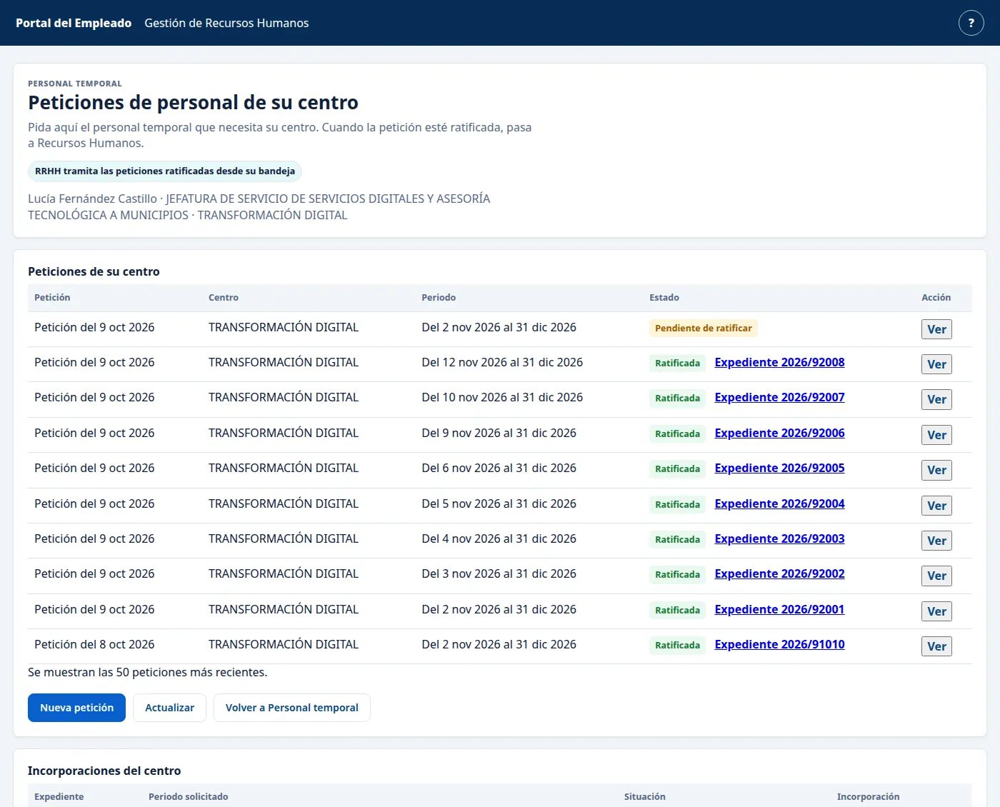
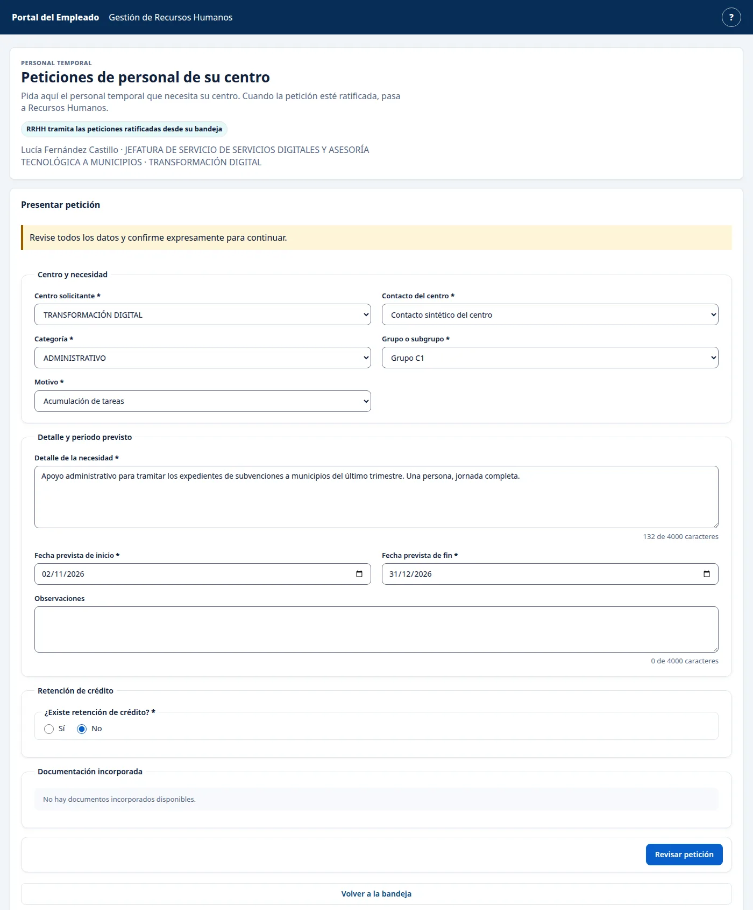
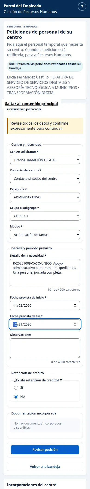
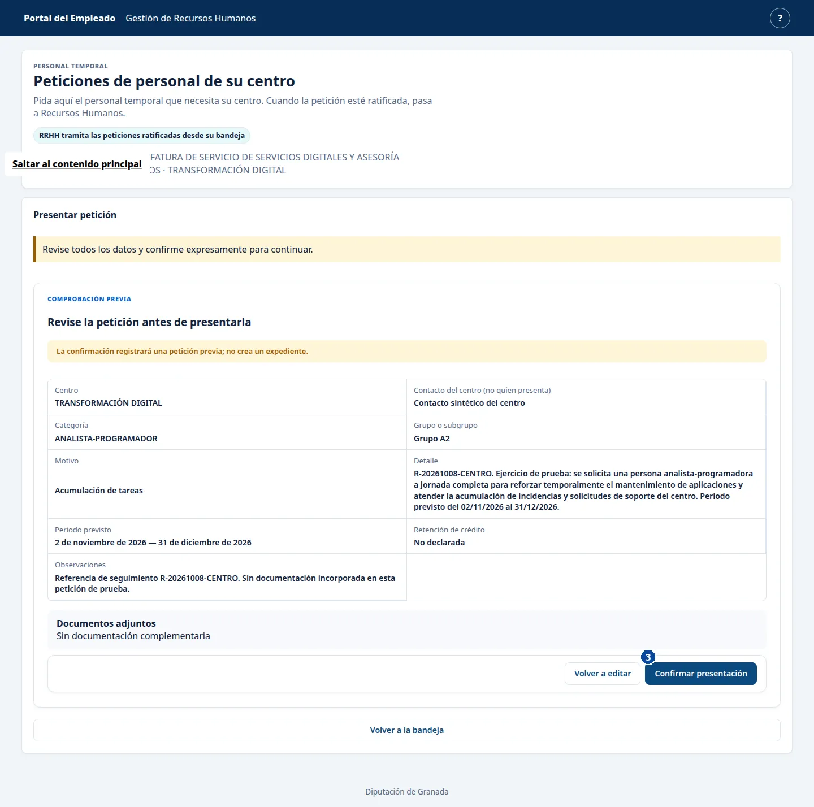
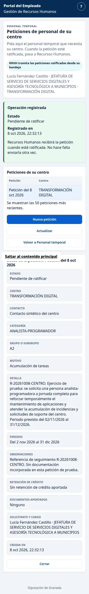
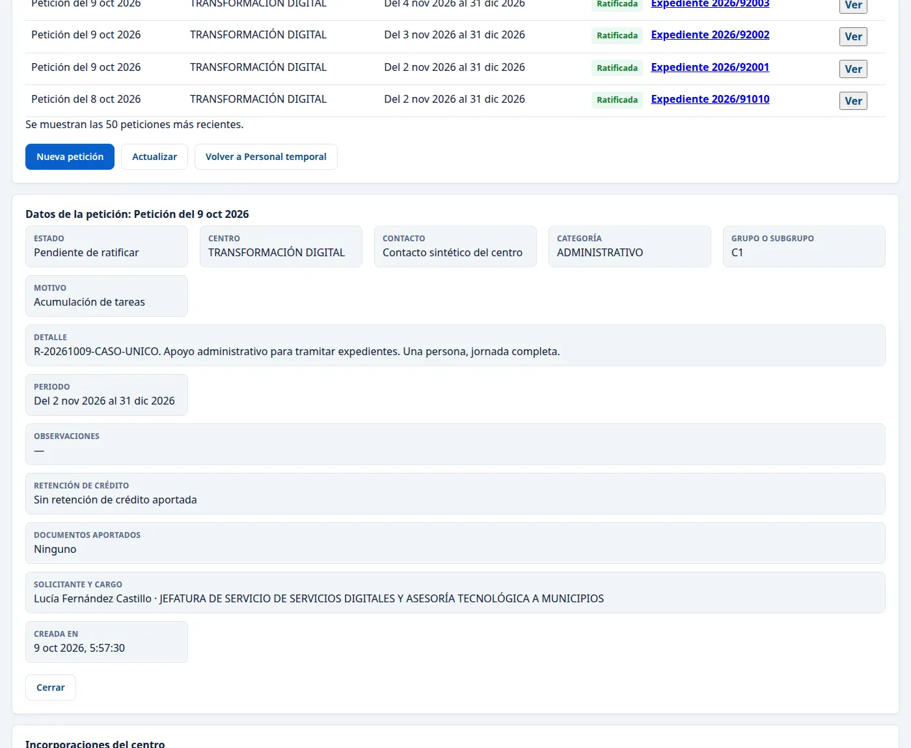

# Centro: presentar una petición de personal temporal

Actualizado el 20 de octubre de 2026. Use el acceso de Centro en la copia
local que le faciliten. Solo se emplean datos ficticios. Las imágenes y los
datos narrados como ejemplos son históricos, del 9 de octubre; pueden mostrar
campos distintos de los actuales. Los pasos de presentación y consulta se
comprobaron entonces. La incorporación del final sigue pendiente de recorrerse
junto al alta en Personal, el cese y el cierre del mismo caso.

## 1. Entrar en las peticiones del centro

Abra **Peticiones de personal de su centro** con su acceso de Centro. Compruebe su nombre, cargo y centro en la parte superior. Si esos datos no le corresponden, deténgase y avise a Informática.

En «Peticiones de su centro» pulse «Nueva petición».

## 2. Completar la petición

En «Centro y necesidad», elija su centro, el contacto, la categoría, el grupo o subgrupo y el motivo. El ejemplo usa **ADMINISTRATIVO**, **Grupo C1** y **Acumulación de tareas**. Escriba en «Detalle de la necesidad» qué apoyo necesita y para qué. En la imagen de ejemplo se escribió «Apoyo administrativo para tramitar los expedientes de subvenciones a municipios del último trimestre. Una persona, jornada completa.». La petición presentada ese día pedía también apoyo administrativo para tramitar expedientes.

Cuando el motivo pida un puesto de la relación de puestos de trabajo,
búsquelo en el catálogo publicado y selecciónelo; no sustituya la selección
por una descripción escrita. Compruebe categoría, centro y puesto antes de
seguir. En el caso de Administrativo del recorrido, el código publicado es
**9**. **9/01** es el código que se usará después en Personal, no el del
buscador del centro. Si el puesto no aparece, comuníquelo a RRHH.

Indique también cuántas personas necesita y la jornada. El recorrido principal
pide una persona; la petición de dos personas se comprueba como variante.

Indique las fechas previstas de inicio y fin. Se escriben como día, mes y año (por ejemplo, 02/11/2026) o se eligen en el calendario. En «Retención de crédito», responda **Sí** o **No** a «¿Existe retención de crédito?». Si marca **Sí**, escriba el número de operación en SICAL, sin espacios, con su fecha y su importe exacto. No hace falta adjuntar el documento de la RC: el número es un dato que declara el centro y RRHH o Intervención lo comprueban en SICAL. El botón **?** junto al campo lo recuerda. Si escribe algo con forma de DNI o NIE, la pantalla no lo admite. En el ejemplo se marcó **No**. Revise las observaciones y el apartado de documentación. Pulse «Revisar petición».

En una pantalla estrecha, los campos se colocan uno debajo de otro:

## 3. Revisar y presentar

Compruebe centro, contacto, categoría, motivo, detalle, fechas, retención y documentos. La pantalla avisa: **«La confirmación registrará una petición previa; no crea un expediente»**. Cuando los datos sean correctos, pulse **«Confirmar presentación» una sola vez**.

La pantalla muestra **«Operación registrada»**, **«Pendiente de ratificar»** y la fecha de registro. También dice que no hace falta enviarla otra vez. La imagen siguiente corresponde a la confirmación vista en móvil:

## 4. Consultar la misma petición

Vuelva a «Peticiones de su centro» y localice la fila por fecha, centro, periodo y estado. Pulse **«Ver»** para consultar el detalle. En el recorrido, la misma petición seguía visible después de actualizar la página y al entrar de nuevo; conservaba sus datos y el estado «Pendiente de ratificar».

**«Pendiente de ratificar»** significa que otra persona debe revisar la petición. Recursos Humanos la recibe cuando queda ratificada. La petición previa todavía no es un expediente.

## Si algo sale mal

Si la bandeja muestra **«Todavía no hay peticiones de su centro»** y esperaba encontrar una petición ya presentada, compruebe que aparece su nombre y centro. Si sigue sin verla, avise a Informática antes de presentar otra.

Si ve **«Operación registrada»** y **«No hace falta enviarla otra vez»**, consulte la petición desde «Ver» o vuelva a cargar la bandeja. No pulse de nuevo «Confirmar presentación».

## 5. Acreditar que la persona se ha incorporado

Esta actuación se hace cuando RRHH ha formalizado el nombramiento o contrato.
No basta con que la persona haya aceptado el llamamiento.

1. En la misma página, abra **Incorporaciones del centro** y localice el expediente.
2. Si indica **Aún no procede**, espere a RRHH. Si permite continuar, pulse **Confirmar la incorporación**.
3. Indique la fecha real de incorporación, que no puede ser futura, y la referencia del documento exigido. Seleccione el archivo que acredita la incorporación: la toma de posesión o el contrato firmado, según corresponda.
4. Revise los datos, marque la confirmación expresa y pulse **Registrar la confirmación**.
5. Espere **Incorporación confirmada** y conserve la referencia del recibo.

El archivo se comprueba en su equipo para calcular su código de comprobación;
esta pantalla no lo envía ni lo guarda en VEC. Conserve el original por el
cauce del centro. Este recibo acredita lo declarado por el centro: RRHH debe
continuar después el alta en Personal.

Si no se conoce el resultado del envío, conserve los mismos datos y use el
reintento de la pantalla; no prepare otra incorporación para resolver la duda.

Consulte [los pasos pendientes](PENDIENTES.md) antes de organizar el recorrido
completo. La incorporación está descrita en la pantalla actual, pero esta
actualización del manual no acredita un ensayo nuevo.
