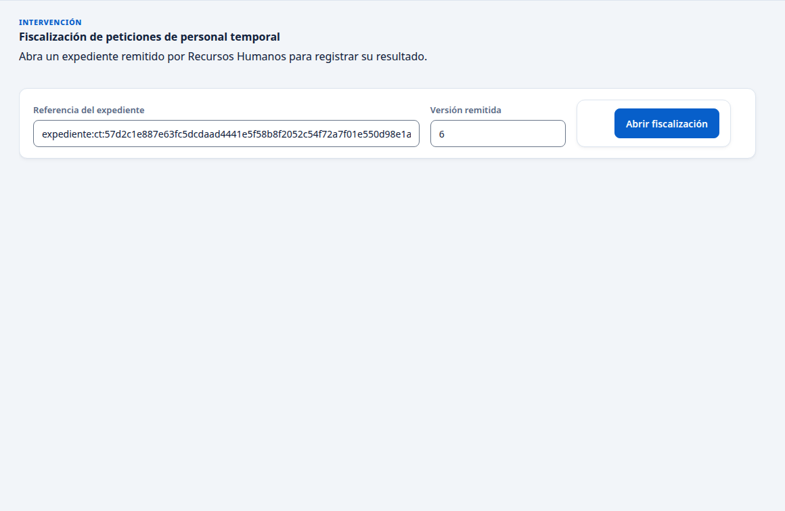
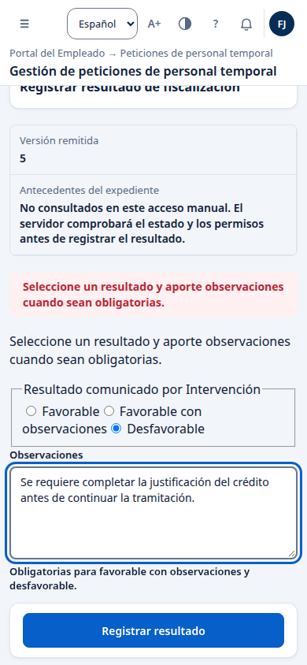
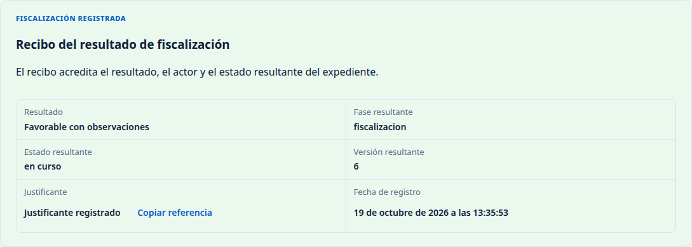
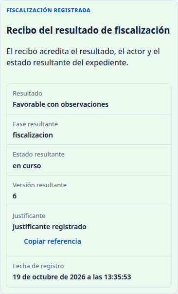

# Intervención

Comprobado el 19 de octubre de 2026 en una copia local, con datos inventados y Chrome a 1440 y 390 píxeles. Se registraron los tres resultados que ofrece la pantalla. Esta copia no tenía disponible el circuito de firma: estos pasos acreditan el registro de la fiscalización, pero queda pendiente comprobar aquí la remisión con el informe firmado y la nueva fiscalización tras subsanar.

## 1. Abrir la fiscalización

Entre en el Portal del Empleado con su certificado y compruebe que junto a su nombre aparece «Intervención». Abra «Peticiones de personal temporal». Verá «Fiscalización de peticiones de personal temporal».

Recursos Humanos debe facilitarle el enlace del expediente y su versión remitida. Al abrir un enlace completo, los campos «Referencia del expediente» y «Versión remitida» aparecen rellenos. Si entra desde el menú, pida a RRHH esos dos datos antes de completarlos. La referencia que pide esta pantalla es la de VEC; el número de expediente de MOAD por sí solo no la sustituye.

Pulse «Abrir fiscalización».

La pantalla muestra la versión remitida y avisa de que los antecedentes no se han consultado en este acceso manual. Abrir el formulario no confirma que el expediente esté listo. Revise la documentación remitida por RRHH antes de registrar su decisión; este acceso no ofrece su consulta.

## 2. Elegir el resultado

En «Resultado comunicado por Intervención», marque una opción:

| Opción | Qué completar | Resultado comprobado |
| --- | --- | --- |
| Favorable | El campo «Observaciones» queda desactivado. | Se registra la conformidad y el expediente queda en fiscalización, en curso. |
| Favorable con observaciones | Escriba las observaciones; son obligatorias. | Se registra este resultado y el expediente queda en fiscalización, en curso. |
| Desfavorable | Escriba el motivo del reparo en «Observaciones»; es obligatorio. | El expediente vuelve para subsanación, con incidencia. |

Si intenta registrar las dos últimas opciones sin observaciones, la pantalla pide completarlas y no envía el resultado.

## 3. Confirmar y conservar el justificante

Pulse «Registrar resultado». Lea la confirmación antes de aceptarla. Para el resultado desfavorable, avisa de que devolverá el expediente para subsanación y conservará su historial.

Espere a que aparezcan «El resultado y su recibo han quedado confirmados» y «Recibo del resultado de fiscalización». El recibo muestra resultado, fase, estado, versión resultante, justificante y fecha. «Copiar referencia» permite conservar la referencia del justificante.

El recibo también se muestra en una pantalla estrecha:

En la comprobación, los expedientes pasaron de la versión 5 a la 6. La versión de su expediente puede ser otra. Abrir el formulario o aceptar la confirmación todavía no acredita el registro: espere al recibo.

## 4. Qué ocurre después

Con un resultado favorable, RRHH continúa la tramitación. Después del recibo pueden aparecer avisos de que no tiene permiso para consultar los llamamientos. Esos avisos corresponden al apartado de llamamientos; si el recibo de fiscalización ya está confirmado, no vuelva a registrar el resultado por ese motivo.

Con un resultado desfavorable, RRHH debe subsanar y remitir de nuevo el expediente. Pida el nuevo enlace y la versión actualizada antes de volver a fiscalizar. La subsanación y esa nueva fiscalización no se completaron en este recorrido.

Tras reiniciar la aplicación y la base de datos, RRHH volvió a abrir desde su lista los expedientes con conformidad y reparo. Ambos conservaban la versión 6, la fecha de fiscalización y una sola anotación nueva en su historial. No se comprobó una consulta del recibo anterior desde el acceso propio de Intervención; conserve su referencia al recibirlo.

Si RRHH le comunica que el expediente ha cambiado, pida los datos actualizados. No cambie por su cuenta la versión remitida para intentar que se admita una operación.

## 5. Hoy, Falta, Al final

### Hoy

Intervención abre el formulario desde el menú o un enlace, elige el resultado, aporta observaciones cuando corresponden y recibe un justificante. Se comprobaron una conformidad, una conformidad con observaciones y un reparo en tres expedientes distintos. La conformidad y el reparo se conservaron en el historial después de reiniciar.

### Falta

Completar en un mismo expediente la remisión con las firmas verificadas del informe, el reparo, la subsanación, el nuevo informe firmado y una nueva fiscalización. También queda pendiente consultar los antecedentes y recuperar el recibo anterior desde el acceso propio de Intervención. Hoy este acceso pide la referencia y la versión; no muestra una bandeja de expedientes remitidos.

### Al final

Intervención deberá poder revisar la documentación y sus firmas, registrar la conformidad o el reparo, volver a fiscalizar tras la subsanación y consultar sus justificantes dentro del recorrido completo. Lo que queda por comprobar se recoge en [los recorridos pendientes](PENDIENTES.md).
