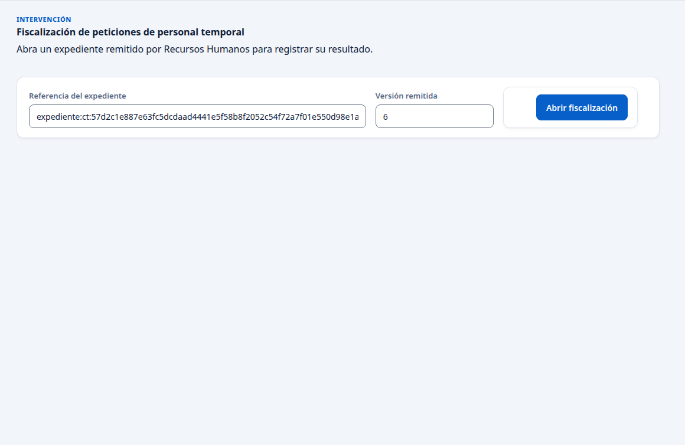
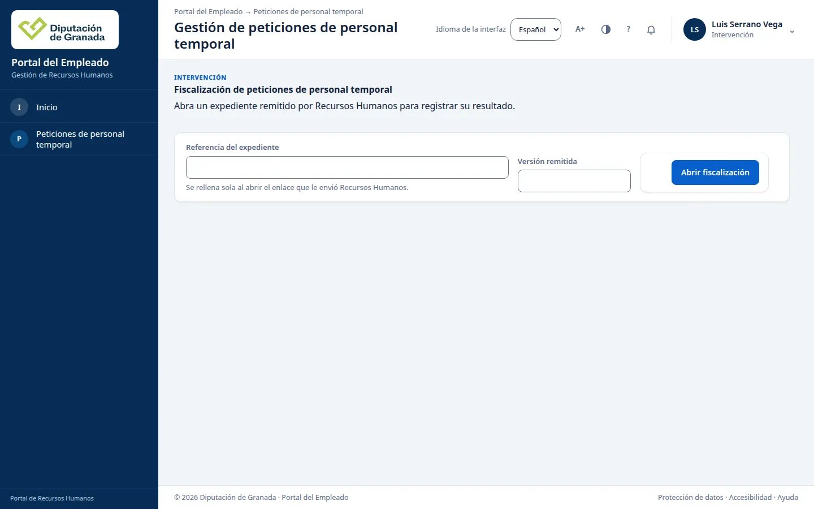
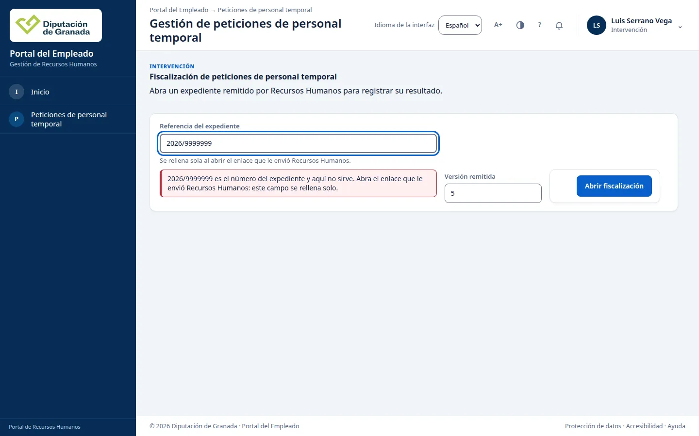
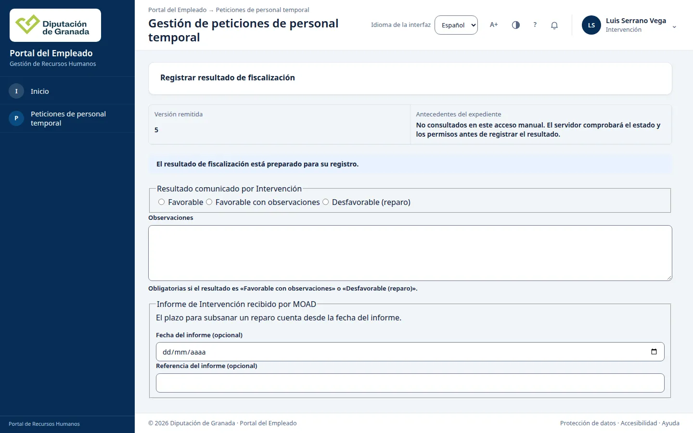
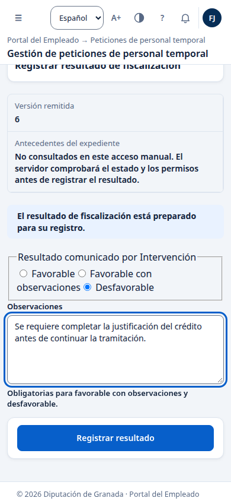
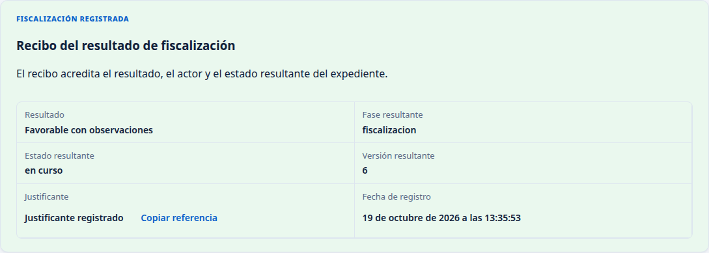
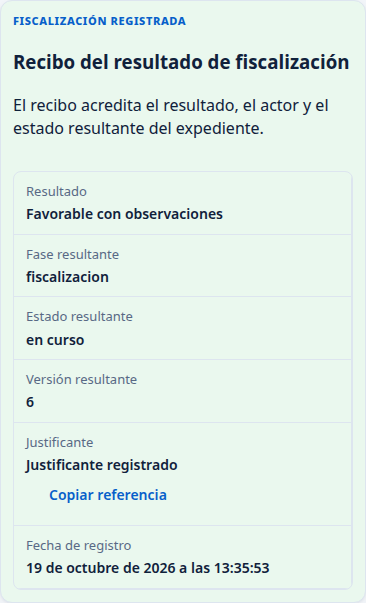
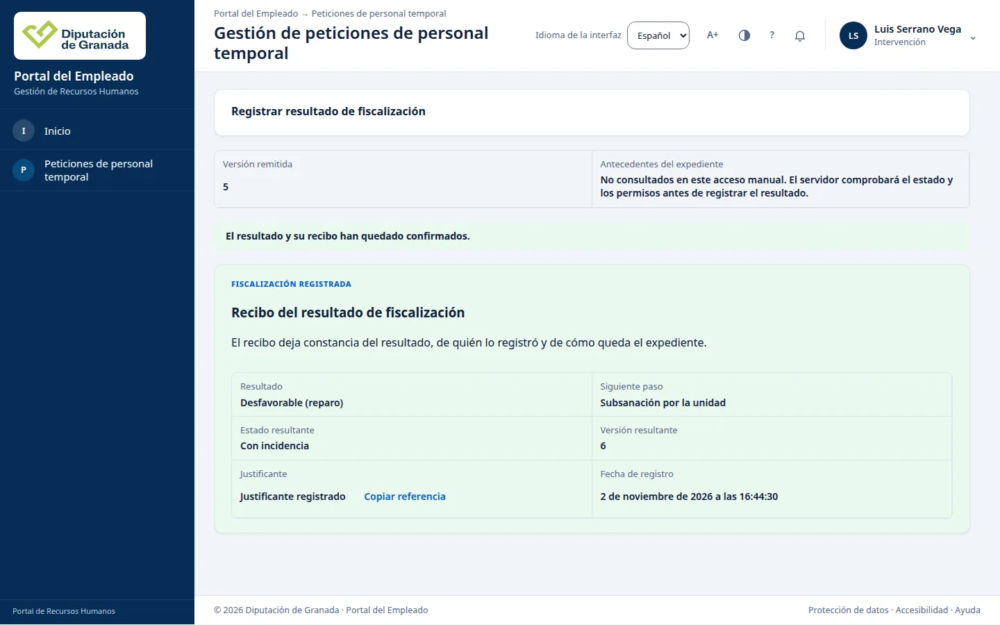
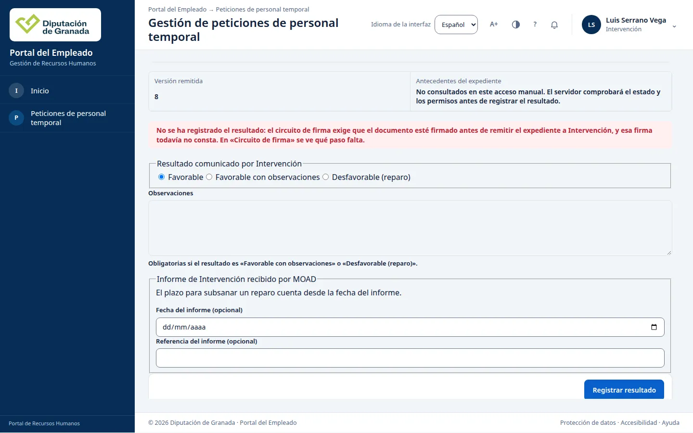

# Intervención

Actualizado el 4 de noviembre de 2026. Use su acceso en la copia local que le faciliten, con datos inventados. Intervención fiscaliza en Firmadoc y el Servicio de Recursos Humanos anota en VEC el resultado recibido por la plataforma de expedientes. Ese registro por Recursos Humanos ya está comprobado y se explica en [su manual](responsable_rrhh.md#anotar-el-resultado-recibido-de-intervención).

El registro directo por Intervención se conserva como opción. Los pasos siguientes corresponden a esa opción. Las imágenes del 19 y el 20 de octubre son ejemplos anteriores.

## 1. Abrir la fiscalización

Entre en el Portal del Empleado con su certificado y compruebe que junto a su nombre aparece «Intervención». Abra «Peticiones de personal temporal». Verá «Fiscalización de peticiones de personal temporal».

Recursos Humanos debe facilitarle el enlace del expediente y su versión remitida. Al abrir un enlace completo, los campos «Referencia del expediente» y «Versión remitida» aparecen rellenos. Si entra desde el menú, pida a RRHH esos dos datos antes de completarlos. La referencia que pide esta pantalla es la que da VEC al expediente; no sirve el número de expediente de la plataforma de expedientes electrónicos de la Diputación.

Pulse «Abrir fiscalización».

La pantalla muestra la versión remitida y avisa de que los antecedentes no se han consultado en este acceso manual. Abrir el formulario no confirma que el expediente esté listo. Revise la documentación remitida por RRHH antes de registrar su decisión; este acceso no ofrece su consulta.

El 2 de noviembre de 2026 se volvió a ver esta pantalla en una copia nueva. Si entra desde el menú, los dos campos salen vacíos:

Si escribe a mano el número de expediente, la pantalla no lo acepta y avisa de que ese número no sirve; pida a RRHH el enlace completo, que rellena los campos solo.

Con el enlace correcto, la pantalla dice «El resultado de fiscalización está preparado para su registro»:

El informe recibido por la plataforma de expedientes (fecha y referencia) es opcional. El plazo para subsanar un reparo cuenta desde la fecha de ese informe.

## 2. Elegir el resultado

En «Resultado comunicado por Intervención», marque una opción:

| Opción | Qué completar | Resultado comprobado |
| --- | --- | --- |
| Favorable | El campo «Observaciones» queda desactivado. | Se registra la conformidad y el expediente queda en fiscalización, en curso. |
| Favorable con observaciones | Escriba las observaciones; son obligatorias. | Se registra este resultado y el expediente queda en fiscalización, en curso. |
| Desfavorable (reparo) | Escriba el motivo del reparo en «Observaciones»; es obligatorio. | El expediente vuelve para subsanación, con incidencia. |

Si intenta registrar las dos últimas opciones sin observaciones, la pantalla pide completarlas y no envía el resultado.

## 3. Confirmar y conservar el justificante

Pulse «Registrar resultado». Lea la confirmación antes de aceptarla. Para el resultado desfavorable, avisa de que devolverá el expediente para subsanación y conservará su historial.

Espere a que aparezcan «El resultado y su recibo han quedado confirmados» y «Recibo del resultado de fiscalización». El recibo muestra resultado, fase, estado, versión resultante, justificante y fecha. «Copiar referencia» permite conservar la referencia del justificante.

El recibo también se muestra en una pantalla estrecha:

El 2 de noviembre de 2026 se registró un resultado desfavorable (reparo) en una copia nueva. El recibo indicó el resultado, el siguiente paso («Subsanación por la unidad»), el estado «Con incidencia», la versión resultante, el justificante y la fecha:

En la comprobación, los recibos mostraron la versión resultante 6. La versión de su expediente puede ser otra. Abrir el formulario o aceptar la confirmación todavía no acredita el registro: espere al recibo.

## 4. Qué ocurre después

Con un resultado favorable, RRHH continúa la tramitación. Por defecto, el llamamiento se abre después de la fiscalización favorable. Recursos Humanos pidió que se pueda ofrecer antes; ese orden es configurable y lo decide Administración con un acto firmado. La ficha de RRHH conserva la fase de fiscalización: eso no exige registrar otra conformidad para poder continuar. Su pantalla termina en el recibo.

Con un resultado desfavorable, RRHH subsana, emite un informe nuevo, lo firman de nuevo el técnico y la Jefatura del Servicio y se lo remiten otra vez. Pida la versión actualizada antes de volver a fiscalizar.

El 20 de octubre se recorrió todo en un mismo expediente de una copia local: reparo sobre la versión 5, subsanación, informe nuevo firmado en la versión 8 y fiscalización favorable sobre esa versión, con su recibo. Después de reiniciar, el expediente conservaba los dos resultados y las firmas.

En la comprobación anterior, del 19 de octubre, tras reiniciar la aplicación y la base de datos, RRHH volvió a abrir desde su lista los expedientes con conformidad y reparo. Ambos conservaban la versión 6, la fecha de fiscalización y una sola anotación nueva en su historial. No se comprobó una consulta del recibo anterior desde el acceso propio de Intervención; conserve su referencia al recibirlo.

Si RRHH le comunica que el expediente ha cambiado, pida los datos actualizados. No cambie por su cuenta la versión remitida para intentar que se admita una operación.

## Si el informe nuevo todavía no está firmado

Tras un reparo, RRHH emite un informe nuevo. Mientras no esté firmado, el registro del resultado favorable no se acepta. La pantalla avisa en rojo: «No se ha registrado el resultado: el circuito de firma exige que el documento esté firmado antes de remitir el expediente a Intervención, y esa firma todavía no consta». No vuelva a intentarlo: pida a RRHH que le avise cuando el informe esté firmado.

El reparo, la subsanación, el informe nuevo con las dos firmas y la nueva fiscalización favorable se completaron en un mismo expediente. Las firmas anteriores no sirven para el informe nuevo. Si el aviso rojo aparece con el informe ya firmado, avise a Recursos Humanos y conserve el mensaje; no repita la fiscalización.

## 5. Límites de la consulta

Este acceso permite registrar el resultado y conservar su justificante. En la revisión del menú se comprobó Fiscalización y la ausencia de entradas de dietas. Eso no acredita una lista de expedientes pendientes: para abrir el caso use el enlace remitido por Recursos Humanos.

Quedan pendientes la consulta de antecedentes y la recuperación del recibo anterior desde el acceso propio de Intervención. No cambie la versión remitida para intentar que se admita un resultado. Consulte [Pendientes](PENDIENTES.md) si la firma o la lectura fallan.
