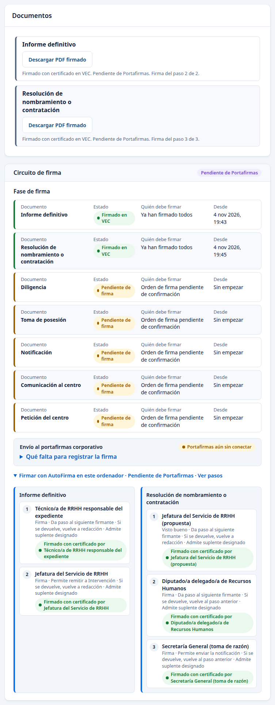

# VEC: cómo funciona

Manual para Recursos Humanos de la Diputación de Granada. Actualizado el 4 de noviembre de 2026.

## 1. Qué es VEC

VEC es la aplicación de Recursos Humanos de la Diputación. Empieza por dos tareas: las bolsas de trabajo y la contratación temporal. Después se irán añadiendo los demás módulos, que se describen en el apartado 8.

VEC sustituirá a Convoca: convocatorias, inscripción, méritos, baremación y bolsas. Mientras tanto, las bolsas que ya existen se cargan desde los Excel que exporta Convoca, sin volver a teclearlas.

VEC reúne la tramitación de un contrato temporal, desde la petición del centro hasta el cese. Hay recorridos anteriores comprobados hasta el cierre y hasta el cese. El recorrido nuevo del 2 de noviembre se detuvo al registrar la resolución. Cada paso queda registrado con quién lo hizo y cuándo.

Hoy VEC funciona en un entorno de pruebas con personas y datos inventados. El apartado 7 resume qué funciona hoy, qué falta y cómo será VEC cuando esté terminada.

## 2. Quién usa VEC

Cada persona entra con su certificado digital y ve solo lo que le corresponde por su puesto.

| Quién | Qué hace en VEC |
| --- | --- |
| Aspirante | Desde su área personal se inscribe en una bolsa, presenta sus méritos y alegaciones, consulta su situación y su posición, y responde a las ofertas. |
| Centro que pide personal | Presenta la petición de un contrato temporal y, cuando llega la persona, acredita que se ha incorporado. |
| Ratificador del centro | Revisa la petición. Con firma, primero firma la Jefatura de Servicio de la Delegación y después el Diputado o la Diputada. La ratificación sin firma se conserva según la configuración. |
| Técnico de RRHH | Lleva las bolsas y tramita los expedientes de contratación temporal de principio a fin. |
| Intervención | Fiscaliza fuera de VEC. Recursos Humanos anota el resultado recibido y la fecha del informe. El registro directo por Intervención se conserva como opción. |
| Firmantes | Jefatura del Servicio de RRHH, Diputado o Diputada de RRHH y Secretaría General firman los documentos que les tocan. |
| Administración de la aplicación | Da y quita perfiles a las personas. No ve expedientes ni bolsas. |

## 3. Ideas que sirven para todas las pantallas

- **Revisar y confirmar.** Antes de que algo tenga efecto, la pantalla enseña un resumen. Solo al pulsar «Confirmar» se guarda.
- **Recibo.** Cada acción confirmada da un recibo con su fecha. Si la conexión falla a mitad, el botón «Reintentar la misma operación» recupera el mismo recibo sin duplicar nada.
- **Todo queda registrado.** VEC guarda quién hizo cada cosa, cuándo y con qué perfil, también cuando solo se consulta. Nada se borra: una corrección se añade a lo anterior.
- **Datos personales protegidos.** En las listas, el teléfono y el correo de los candidatos aparecen tapados en parte. Completos solo se ven en la ficha de la persona, y queda constancia de quién los consultó.
- **Las reglas las decide RRHH.** Plazos, reglas de la bolsa, textos de los correos y plantillas de documentos no están fijos en la aplicación. RRHH puede cambiarlos desde sus pantallas. Cada cambio crea una versión nueva, con su motivo, y lo ya tramitado conserva la regla con la que se hizo.
- **Si falla Contratación temporal al iniciar.** El portal conserva la entrada con certificado y la consulta pública de convocatorias. Las funciones que dependen de Contratación temporal quedan temporalmente sin servicio.
- **Las cifras se pueden pulsar.** En los resúmenes, al pulsar un número se abre la lista de expedientes o personas que lo forman.
- **Un recibo de VEC no es un asiento de registro oficial.** Descargar un documento no lo firma ni lo envía.

## 4. Las bolsas de trabajo

### 4.1 Cómo se forma una bolsa

Una bolsa se forma de una de estas dos maneras:

- **Carga desde Convoca.** La carga desde «Importación Convoca» está pendiente de completar su comprobación. No se da por disponible en esta guía; véase [Pendientes](PENDIENTES.md).
- **Convocatoria en VEC.** El aspirante se inscribe desde su área personal: elige la convocatoria, declara que cumple cada requisito y presenta su solicitud. La declaración y revisión de méritos quedan en [Pendientes](PENDIENTES.md). El técnico revisa cada solicitud y la admite o la rechaza con un motivo. La incorporación con el acta de la lista definitiva sigue pendiente de comprobación correcta. El aspirante puede presentar alegaciones y RRHH las ve en su bandeja.

Cada persona entra en la bolsa con su posición y como «Disponible».

El cuadro de Bolsas muestra las cifras por situación. Los nombres largos de categoría ocupan varias líneas; si faltan columnas a la vista, desplace la tabla horizontalmente dentro del panel.

### 4.2 La situación de cada candidato

Cada persona tiene una situación en cada bolsa. Consulte la situación de cada bolsa antes de ofrecer un puesto; las reglas entre bolsas aún tienen comprobaciones pendientes. Las etiquetas de la lista, la ficha y los filtros usan el mismo nombre en singular: «Disponible», «No disponible», «Trabajando» o «Excluido».

| Situación | Cuándo se da |
| --- | --- |
| Disponible | Puede recibir ofertas. |
| No disponible | No puede recibir ofertas por una causa que ha registrado Recursos Humanos. No hay pausa a petición propia: Recursos Humanos decidió el 2 de octubre que no existe la suspensión temporal. |
| Pendiente de incorporación | Aceptó una oferta, RRHH comprobó que le corresponde y aún no se ha incorporado. Las demás personas que aceptaron siguen como estaban. |
| Trabajando | Tiene un contrato en curso por esa bolsa. |
| Renuncia | Ha renunciado a una oferta y no ha justificado la causa. Mientras no la justifique sigue en renuncia y no recibe ofertas de esa bolsa; no hay plazo para justificarla. Hoy VEC aún da diez días hábiles; quitar ese plazo está pendiente. La renuncia solo afecta a la bolsa de la que vino la oferta. |
| En revisión | Recursos Humanos espera o comprueba un documento justificativo para regularizar su situación en la bolsa. |
| Sin ofertas hasta una fecha | Ha cesado y no puede recibir ofertas hasta esa fecha. El plazo general del Reglamento de bolsas es de cinco meses, y de nueve si el contrato fue por acumulación de tareas. |
| Excluido | Ha salido de la bolsa. Solo vuelve si RRHH valida una reincorporación justificada. |

Para registrar un cambio permitido:

1. Abra la ficha de la persona en la bolsa y pulse «Cambiar situación».
2. Elija la situación de destino, complete la fecha cuando corresponda y escriba el motivo.
3. Pulse «Revisar cambio de situación» y compruebe persona, bolsa y consecuencia.
4. Pulse «Confirmar cambio de situación» una sola vez y conserve el recibo.

La mayoría de los cambios ocurren solos, según avanza el expediente: la confirmación por RRHH de la persona elegida, la incorporación y el cese. Aceptar una oferta no cambia por sí solo la situación de nadie. Las renuncias justificadas quedan en revisión hasta que el técnico valida el justificante. La publicación de cambios en las reglas sigue en [Pendientes](PENDIENTES.md).

### 4.3 Lo que ve el aspirante: Mi bolsa

En «Mi bolsa» el aspirante ve, por cada bolsa, la categoría, su posición (por ejemplo, «12 de 140»), su situación y su historial de llamamientos, contratos y renuncias. También ordena sus bolsas por preferencia y responde a las ofertas que le llegan. La elección de modalidades de contrato sigue en [Pendientes](PENDIENTES.md).

La inscripción, la consulta de solicitudes propias y el orden de dos bolsas se comprobaron de nuevo el 2 de noviembre. En «Orden de mis bolsas», use «Subir» y «Bajar», revise todas las bolsas nuevas y pulse «Guardar orden». Al volver, «Último orden guardado» conserva la fecha y la elección.

La persona también puede alegar sobre una decisión de su solicitud y conservar el justificante. El [manual del aspirante](aspirante.md) explica la inscripción, el orden, las alegaciones y las respuestas.

### 4.4 Lo que VEC hace por su cuenta

Esta lista resume lo que ocurre sin que nadie pulse. Está pensada para quien responde ante la Diputación de lo que hace la aplicación.

1. **Correos.** Al publicar una oferta, VEC manda un correo electrónico a todas las personas disponibles. Al emitir un llamamiento, manda un correo a la persona llamada. Al dar de alta una dirección, manda un código de ocho cifras, y al cambiar la dirección activa, manda un aviso. Los textos no están en el programa: RRHH puede cambiarlos y cada cambio crea una versión.
2. **Plazos.** VEC los calcula al abrir la pantalla. Un plazo vencido no cambia ninguna situación por sí solo: VEC propone y RRHH confirma.
3. **Situación de las personas.** Cambia sola con la confirmación de una aceptación, la incorporación, el cese y la fecha de vuelta tras la espera.
4. **Fase del expediente.** Avanza con cada paso confirmado y retrocede a Fiscalización cuando una segunda persona confirma una no incorporación.
5. **Registro.** Cada paso deja un justificante. Todo lo que hace cada persona, también consultar, queda en la auditoría encadenada. El teléfono y el correo completos solo se ven en la ficha y dejan constancia de quién los consultó.
6. **Documentos.** La oferta al Servicio Andaluz de Empleo se prepara sola cuando la bolsa se agota. El resto se prepara a petición, con la plantilla publicada y un código de comprobación.

### 4.5 Lo que ve RRHH

En «Bolsas», el técnico tiene un resumen con cuántas personas hay disponibles, en renuncia y en cada situación, y al pulsar cada cifra sale la lista. Desde ahí abre la ficha de cada candidato, revisa solicitudes, méritos y alegaciones, consulta los llamamientos y cambia las reglas de cada bolsa.

Las comprobaciones pendientes de méritos, justificantes de renuncia y cambios de reglas se recogen en [Pendientes](PENDIENTES.md).

Desde el 27 de octubre, RRHH ve también las solicitudes de inscripción que presentan los aspirantes: la lista de convocatorias con las solicitudes pendientes, la bandeja de cada convocatoria y el detalle de cada solicitud. Se ha comprobado en una copia de desarrollo, a 1440 y 1024 píxeles. Admitir, rechazar y consultar la alegación ya están comprobados. La incorporación con acta sigue fallando; no debe darse por terminada.

### 4.6 Modalidad de inscripción de una convocatoria

La convocatoria muestra si corresponde una solicitud por categoría o una para
varias categorías. Desde el 2 de noviembre de 2026, RRHH elige la modalidad al
preparar el borrador de la convocatoria, en la pregunta «¿Cómo presentan su
solicitud las personas aspirantes?», y la aspirante la ve en la lista de bolsas
abiertas: una bolsa conjunta ofrece una sola solicitud para varias categorías.
Se vio en una copia nueva. Los pasos están en la [guía del técnico](tecnico_rrhh.md).
Las bases no quedan aprobadas ni publicadas por preparar el borrador.

### 4.7 Publicación de las bases

Preparar una convocatoria no aprueba sus bases ni publica el anuncio oficial. La anotación de esa publicación y el cálculo del plazo siguen en [Pendientes](PENDIENTES.md), aunque ya se hayan visto partes de la pantalla.

## 5. Contratación temporal: pasos comprobados

### 5.1 Petición del centro y firma

El centro presenta su petición desde «Peticiones de personal de su centro». Elige el puesto publicado, categoría, motivo, fechas, jornada y número de personas. Declara si hay retención de crédito: el número declarado no acredita por sí solo que exista crédito.

Con firma, la petición pasa por dos personas: Jefatura de Servicio de la Delegación y Diputado o Diputada. Cada una usa «Firmar con certificado». Con las dos firmas queda ratificada y se descarga mediante «Descargar la petición firmada (PDF)». También se conserva la opción de ratificación sin firma. Los pasos están en los manuales de [Centro](centro.md) y [ratificación](ratificador.md).

### 5.2 Abrir y analizar el expediente

1. En «Peticiones de los centros», revise la petición ratificada.
2. Indique el número de expediente de la plataforma de expedientes y pulse «Crear expediente en RRHH».
3. En la ficha, compruebe los datos recibidos del centro. Registre el análisis, la vía de cobertura y la asignación.
4. Revise la jornada precargada y la retención elegida. La ficha distingue el número declarado por el centro del que comprueba Recursos Humanos.
5. Prepare el informe. El informe descargado como borrador lleva las normas por su nombre; no está firmado por descargarlo.

El análisis en expedientes nuevos y la petición de dos personas están comprobados. Las instrucciones de tramitación están en la [guía de la técnica](tecnico_rrhh.md).

### 5.3 Firmar el informe como Jefatura

1. Abra la ficha del expediente con su propio acceso y localice «Circuito de firma».
2. Compruebe «Informe definitivo» y pulse «Ver pasos». Debe constar la firma anterior del técnico.
3. Cuando le corresponda, pulse «Firmar con certificado» y firme en el programa de firma con el certificado de su acceso.
4. Espere el registro y compruebe su cargo en el paso firmado. Conserve el recibo.
5. Si necesita el documento y su acceso lo permite, pulse «Descargar PDF firmado».

Firmar un documento no envía por sí solo el expediente al sistema corporativo. Se comprobaron el informe con dos firmas y una resolución con tres firmas, en expedientes distintos. El recorrido actual de un mismo caso se detiene al registrar la resolución; véase [Pendientes](PENDIENTES.md).

### 5.4 Anotar la fiscalización y subsanar un reparo

Recursos Humanos ya puede anotar el resultado de Intervención recibido fuera de VEC. En «Registrar resultado de fiscalización» elige el resultado, completa las observaciones necesarias y anota la fecha y referencia del informe. «Registrar resultado» devuelve un justificante. El plazo de subsanación cuenta desde la fecha del informe.

Los plazos de fiscalización son 10 días hábiles, o 5 si es urgente, y el de subsanación es de 15 días hábiles. Proceden del Real Decreto 424/2017, artículos 10.2, 10.3 y 12.4, y no se editan desde la pantalla. Los expedientes anteriores conservan la versión de las reglas con la que se tramitaron.

Si hay reparo, se registra la subsanación y se pulsa «Emitir informe tras subsanación». El técnico y la Jefatura firman el informe nuevo. Sus firmas anteriores se conservan, pero no sustituyen a las nuevas. Después se anota la nueva fiscalización.

Este recorrido se completó en un expediente: reparo, subsanación, informe nuevo con dos firmas y fiscalización favorable. Si la firma del informe nuevo no consta, el resultado favorable no se acepta y no se debe repetir para intentar resolverlo. Los pasos completos están en [Recursos Humanos](responsable_rrhh.md#anotar-el-resultado-recibido-de-intervención) y en [Intervención](intervencion.md).

### 5.5 Oferta, aceptación y propuesta

La oferta a todas las personas disponibles ya tiene un caso comprobado: dos personas aceptan una plaza; al cierre se formaliza con la de mejor posición. La otra conserva su situación. Aceptar no cambia por sí solo la disponibilidad ni equivale a un contrato.

La oferta de varias plazas se publica desde la ficha del expediente: queda vinculada a él, con su fecha límite y un justificante por plaza. El [manual de Recursos Humanos](responsable_rrhh.md#ofrecer-a-todas-las-personas-disponibles) explica la consulta y la formalización. La formalización de varias plazas dentro de un solo expediente no está terminada.

En el llamamiento por orden se comprobó el contacto, la aceptación firme desde Mi bolsa y su confirmación por Recursos Humanos sin pedir un correo. La emisión que intenta saltarse a una persona disponible se rechaza sin guardar. La respuesta por otro canal se conserva con su justificante y «Ver seguimiento en Bolsa» abre la participación correspondiente.

Para anotar el contacto del llamamiento:

1. Tras hablar con la persona, abra su ficha en Bolsa y pulse «Registrar intento telefónico».
2. En «Registrar contacto», indique el resultado. «Contactado» abre la respuesta en Mi bolsa y el plazo que muestran las reglas vigentes. VEC guarda la fecha de la llamada; el correo por sí solo no abre esa respuesta.
3. Si VEC no puede confirmar el registro, conserva los datos bloqueados. Pulse «Reintentar el mismo registro» para recuperar el justificante de esa llamada sin anotar otra.

Si la selección empieza por debajo de una persona disponible que aún no ha sido llamada para esa necesidad, la pantalla indica quién va antes y su número de orden, y no guarda nada. Quien no contestó para otra necesidad conserva su turno. El salto exige uno de estos motivos y el documento que lo prueba: no acreditar un requisito del puesto, una incompatibilidad legal o no encontrarse en los casos del artículo 9 del Reglamento de bolsas que permiten ofrecer la vacante a quien ya trabaja.

Desde la aceptación confirmada, «Propuesta de nombramiento» permite revisar y «Guardar la propuesta». El recibo y la propuesta se conservaron tras reiniciar. Es un borrador sin firma. La resolución se registra, se firma y se sigue con la incorporación y el alta: el 4 de noviembre se recorrió todo en el mismo expediente de una copia nueva y se conservó tras reiniciar.

### 5.6 Firmar los documentos

Con un perfil de firma, abra Contratación temporal y la ficha del expediente.
Desde el panel de firma puede consultar y descargar el documento que le
corresponde. Las acciones de preparación y cancelación quedan en la vista
de tramitación de RRHH. El alta en Personal también se prepara desde esa
vista; no se carga en la ficha del perfil firmante. La tarjeta de documentos
aparece cuando hay un PDF firmado disponible para descargar.

Cada documento se firma con certificado, en el orden que fija la configuración:

| Documento | Quién firma, por orden |
| --- | --- |
| Informe definitivo | Técnico de RRHH y Jefatura del Servicio de RRHH |
| Resolución | Jefatura del Servicio (visto bueno), Diputado o Diputada de RRHH y Secretaría General (toma de razón) |
| Diligencia | Secretaría General |
| Toma de posesión | La persona nombrada, Jefatura y Secretaría General |
| Notificación y comunicación al centro | Jefatura |

Una misma persona no puede firmar dos pasos del mismo documento.

Para firmar desde VEC, el equipo necesita GrxFirma 0.0.106 o posterior. Con la 0.0.105, la segunda firma de un documento se rechaza. Informática instala la versión correcta.

Si la red del equipo cambia justo al registrar la firma, por ejemplo al cambiar de wifi o al conectar o desconectar la conexión remota de la Diputación, el navegador corta el envío. VEC lo repite solo hasta dos veces con el mismo PDF, y nunca guarda dos firmas. Si aun así no puede confirmarlo, la pantalla dice «No se ha podido confirmar el registro». Pulse otra vez **Firma con certificado en VEC**: VEC envía el mismo PDF sin firmarlo de nuevo y comprueba si ya estaba registrado.

El informe con dos firmas y la resolución con tres están comprobados. La tabla conserva el circuito de los demás documentos; no acredita que todas sus firmas se hayan recorrido. La firma legal externa y la conexión con el portafirmas corporativo siguen pendientes.

### 5.7 Incorporación y alta en Personal

El centro acredita la incorporación con la fecha y el documento, como explica el [manual del centro](centro.md#5-acreditar-que-la-persona-se-ha-incorporado). Después:

1. Revise el alta en Personal: categoría, puesto y plaza. Compruebe los datos y confirme el alta.
2. Descargue la ficha para grabar el contrato a mano en GINPIX, la aplicación de nóminas. La descarga no confirma el alta en esa aplicación.
3. Una vez grabado, en «Seguimiento del nombramiento» anote el número y la fecha de la grabación mediante «Confirmar la ficha de GINPIX». Conserve el justificante.

Si faltan pasos para preparar el alta en Personal, el aviso indica cuáles debe registrar Recursos Humanos en la ficha. Complételos y pulse «Actualizar las opciones». Cada apartado del seguimiento indica qué falta y quién lo registra. Si falla la consulta, vuelva a consultarla desde el panel.

Estos pasos se recorrieron el 4 de noviembre en el mismo expediente, desde la petición hasta el cierre, en una copia nueva: la incorporación del centro, el alta en Personal, la ficha de GINPIX confirmada y el cese con efecto ese día.

### 5.8 Si la persona no se incorpora

Esta variante se recorrió el 3 de noviembre con una segunda persona de Recursos Humanos que entra con su propio certificado.

1. En la ficha, abra «Seguimiento del nombramiento». Elija el motivo e indique la fecha de notificación y la referencia de la resolución.
2. Seleccione el archivo original. VEC calcula su código de comprobación, pero no guarda su contenido. Conserve el documento.
3. Si la regla exige otra revisión, pulse «Proponer que no se incorpora» y después «Copiar enlace de revisión». VEC no avisa a nadie: haga llegar ese enlace a otra persona de Recursos Humanos.
4. La otra persona abre el enlace con su propio certificado, comprueba el motivo, la resolución y la fecha y confirma o rechaza. Solo ve los datos de esa actuación. La propuesta no produce efectos hasta su confirmación.

Quien propone no puede confirmar ni rechazar su propia propuesta; la pantalla lo avisa y rechaza el intento por otra vía. Tras confirmar, la revisión indica que el expediente vuelve a Fiscalización y que el llamamiento puede seguir con la siguiente persona. Ofrece volver a Peticiones de personal temporal. El historial muestra «Propuesta de no incorporación registrada» y «No incorporación confirmada».

### 5.9 Cese, vuelta a la bolsa y cierre

1. Al terminar el contrato, abra «Seguimiento del nombramiento» y «Registrar el cese». Indique la causa, la fecha de efecto y el justificante. La fecha de efecto es el último día trabajado. Revise y confirme.
2. Consulte la situación en la bolsa: «Disponible» o «Sin ofertas hasta una fecha», según la regla. Durante la espera no recibe ofertas por turno ni cuenta como trabajando; «Vuelve a recibir ofertas el» indica el día previsto. Ese día pasa a «Disponible». El día siguiente al cese, con la espera ya cumplida, no se ha visto todavía: hace falta cambiar el reloj de la copia.
3. Con el cese registrado y la ficha de GINPIX confirmada cuando se exige, abra «Cerrar el expediente». Revise las condiciones, confirme y conserve el recibo.

El 4 de noviembre se recorrió el expediente entero hasta el cierre en una copia nueva, con los mismos datos antes y después de reiniciar.

Recursos Humanos pidió que el ofrecimiento y la adjudicación puedan ir antes de la fiscalización de Intervención. VEC lo permite como regla configurable: por defecto el ofrecimiento va después de la fiscalización favorable, y Administración cambia el orden con un acto firmado.

### 5.10 Documentos tras el cese

En un expediente ya cesado se comprobó el cese en PDF y Word, con su persona, número y fecha de efectos. En «Documentos generados», busque el cese y pulse «Descargar PDF» o «Descargar Word». Abra el archivo y coteje esos datos.

También se descargó una resolución firmada después del cese con un acceso autorizado. La descarga de documentos firmados por la técnica y la comunicación al centro siguen con incidencias. Esta comprobación no completa el recorrido desde una petición nueva hasta el cese.

## 6. Consultar las reglas

Los plazos, la forma de ofrecer, los cambios de situación y las plantillas dependen de las reglas vigentes. Consulte la regla y el vencimiento que muestra cada expediente u oferta. No dé por hecho un plazo de 48 horas para todas las bolsas.

La administración de reglas y los cambios que afectan a varios expedientes requieren su propio circuito. Las publicaciones pendientes de comprobar están en [Pendientes](PENDIENTES.md). La persona que tramita decide lo que corresponde a su expediente; no cambia por ello las reglas generales.

En «Reglas vigentes», desde la cabecera de «Bolsas de trabajo», consulte el valor, la procedencia y la versión de cada plazo. Para los plazos organizativos editables, como el análisis o los informes:

1. Pulse «Cambiar plazo», escriba la cantidad, elija la unidad e indique el motivo.
2. Pulse «Revisar cambio» y, tras comprobarlo, «Guardar cambio».
3. Consulte las versiones anteriores en «Ver historial». El valor nuevo se aplica a los plazos que empiecen después.

El formulario se ha visto; guardar el cambio sigue sin comprobarse. La base de plazos de desarrollo requiere la aprobación de Recursos Humanos para su uso real. Esta edición no permite cambiar los plazos normativos de fiscalización y subsanación.

Para consultar la política de una bolsa, abra «Llamamientos automáticos», pulse «Gestionar ofertas» y vaya a «Política de ofertas». Allí se indican el plazo y el inicio de su cómputo. Los ejemplos revisados usan 48 horas y aviso por correo. Recursos Humanos fijó «dos días desde la notificación por correo», sin precisar si son hábiles o naturales; VEC cuenta hoy 48 horas naturales. Guardar un cambio de política sigue sin comprobarse. La preparación con «Revisar oferta» no acredita ese guardado.

En la ficha de Personal se ve la última versión de cada relación, ocupación, situación y servicio. Abra «Ver N revisiones anteriores», donde N es la cantidad indicada en pantalla, para consultar las anteriores. Esta consulta está comprobada el 2 de noviembre.

## 7. Lo que puede hacer Recursos Humanos y qué falta completar

### Hoy

Comprobado hasta el 4 de noviembre de 2026, con datos inventados:

- Petición del centro con puesto publicado y retención declarada; dos firmas de la petición, ratificación, descarga y consulta tras reiniciar.
- Inscripción del aspirante, también conjunta; consulta de sus solicitudes, admisión o rechazo y presentación y lectura de una alegación. La admisión no incorpora a la bolsa.
- Orden de dos bolsas del aspirante, guardado y recuperado al volver a entrar.
- Análisis de una petición nueva, jornada y retención precargadas, informe con las normas por su nombre y consulta de firmas por Recursos Humanos.
- Registro del resultado recibido de Intervención con fecha y referencia. Reparo, subsanación, informe nuevo con dos firmas y nueva fiscalización favorable en un mismo caso.
- Contacto propio conservado; contacto del llamamiento, aceptación firme en Mi bolsa, confirmación sin correo, respuesta por otro canal, comunicaciones y propuesta guardada. Los resultados comprobados tras reiniciar conservaron sus fechas y recibos.
- Oferta de una plaza a las personas disponibles, con dos aceptaciones y formalización por orden; la otra persona sigue disponible. No completa todas las variantes de oferta.
- Recorrido continuo en una copia nueva, el 4 de noviembre: petición, ratificación, expediente, análisis, informe con dos firmas, fiscalización, llamamiento, aceptación en Mi bolsa, propuesta, resolución con tres firmas, incorporación, alta en Personal, grabación manual en GINPIX, cese y cierre. La ficha y el área de la persona quedaron igual tras reiniciar.
- Oferta de dos plazas publicada desde el expediente y vinculada a él.
- Desistimiento antes de la firma de la persona, con vuelta a su posición en la bolsa, y no incorporación con segunda revisión.
- Oferta al Servicio Andaluz de Empleo con la bolsa agotada, en PDF y Word.
- Firma de documentos desde el móvil o sin AutoFirma: se descarga el documento, se firma con GrxFirma y se sube el PDF firmado, que el servidor verifica.
- Consulta de las revisiones anteriores de Personal y procedimientos de contacto y orden estricto recuperados en esta actualización.
- Descarga del cese en PDF y Word con datos propios y descarga de una resolución firmada tras el cese por un acceso autorizado, en un expediente distinto.

Los manuales de [Centro](centro.md), [ratificación](ratificador.md), [Recursos Humanos](responsable_rrhh.md), [Intervención](intervencion.md) y [aspirante](aspirante.md) explican los pasos correspondientes.

### Falta

Quedan por completar la formalización de varias plazas en un solo expediente, la mejora de empleo, guardar cambios de plazo o de política desde la pantalla, recuperar llamamientos cortados y el día siguiente al cese. En una copia nueva el primer paso de la ficha tardó en cargar documentos y firmas tras reiniciar; al recargar salió completa. Los cambios unidos al programa que aún no están comprobados se mantienen en [Pendientes](PENDIENTES.md).

### Al final

El objetivo sigue siendo tramitar desde la petición hasta el cese y la vuelta a la bolsa, conservando documentos, historia y justificantes. Ese objetivo no se declara terminado por haber comprobado pasos en expedientes distintos.

## 8. Los demás módulos de VEC

VEC se construye por partes. Primero bolsas y contratación temporal, con lo que necesitan para funcionar; después control horario y dietas; y luego, uno a uno, los demás módulos. Este es el orden previsto: procesos selectivos y provisión; formación y carrera; certificados; acción social; nóminas; y prevención, igualdad, incompatibilidades, régimen disciplinario, relaciones sindicales y canal interno. Para cada módulo se indica para qué sirve, qué hay hoy y cómo será al final.

### 8.1 Personal, organización y relación de puestos de trabajo

La consulta de puestos requiere que Sistemas prepare su configuración y que la
persona tenga permiso. Preparar esa configuración no confirma una selección
de personal; la selección se comprueba desde el expediente de contratación.

**Para qué sirve.** Es el registro de cada empleado: su relación con la Diputación, sus contratos y nombramientos, su puesto, su plaza, sus situaciones administrativas y su historia. También guarda la estructura de la Diputación (áreas, servicios, centros y unidades) y la relación de puestos de trabajo con sus categorías.

**Hoy.** Está programado lo que necesita la contratación temporal: el alta de la persona contratada, su ocupación del puesto y el cese. La relación de puestos se puede consultar y RRHH puede añadir o desactivar categorías; las que están en uso no se borran. La petición del centro selecciona el puesto del catálogo publicado.

**Al final.** El registro completo de personal: antigüedad, trienios, grados, situaciones con sus efectos, correcciones con su justificante y versiones de la relación de puestos aprobadas y publicadas, sin borrar las anteriores. Los demás módulos tomarán de aquí los datos de cada empleado.

La candidata permite consultar también la historia del puesto que necesita el
ofrecimiento a la bolsa. En la copia local se han comprobado el permiso de RRHH,
el recibo de lectura y su conservación tras reiniciar. Falta completar el
ofrecimiento desde la petición del centro.

### 8.2 Firmas

**Para qué sirve.** Que cada cargo firme los documentos con su certificado, en el orden fijado, y que VEC compruebe que la firma es válida.

**Hoy.** En la copia de ensayo, el informe ya tiene las firmas del técnico y de Jefatura, verificadas con GrxFirma y registradas con sus recibos. Intervención rechaza la fiscalización mientras falta la segunda firma y la admite después. La resolución tiene las firmas de Jefatura, Diputación y Secretaría General. Ambos PDF se han recuperado desde la ficha después de reiniciar. Los recibos conservan sus referencias y fechas originales. Los otros cuatro documentos se descargan en PDF y Word y conservan la firma pendiente.

El informe y la resolución se han comprobado en expedientes distintos. Los pasos de Jefatura están en el apartado 5.3. Las descargas dependen del permiso de cada cargo; la consulta por la técnica no le concede la descarga de todos los documentos firmados.

La firma de la resolución con sus tres cargos se completó el 4 de noviembre en el mismo expediente que el informe, con la firma real hecha en una máquina aparte. La conexión con el portafirmas corporativo sigue pendiente. Consulte [Pendientes](PENDIENTES.md).

### 8.3 Documentos y plantillas

**Para qué sirve.** Guardar los documentos que se suben o se generan, con su huella y su historia, y producir los documentos de cada trámite a partir de plantillas Word.

**Hoy.** Funciona la generación de borradores en PDF y Word desde el expediente, con plantillas que RRHH puede cambiar. Se está terminando una subida común de documentos para todos los módulos, que comprobará el tamaño, que el fichero sea de verdad un PDF y que no tenga virus.

En la copia local se ha comprobado que el portal sigue usando el catálogo
publicado para la organización y que el PDF firmado y sus recibos permanecen
disponibles después de reiniciar. El 20 de octubre se abrió en otra copia
la pantalla «Plantillas de documentos» desde su dirección, a 1440 y 390
píxeles, y se abrió la plantilla del informe definitivo para editarla. No se
guardó ninguna versión nueva. El enlace del menú solo aparece después de
entrar una vez en la pantalla de plantillas.

**Al final.** Un único sitio para los documentos de todos los módulos, con plantillas oficiales de RRHH, conservación según el Archivo y descarga controlada.

### 8.4 Acceso, perfiles y administración

**Para qué sirve.** Decidir quién entra y qué puede hacer cada persona. Hay dos tipos de administrador: el de la aplicación, que reparte perfiles y lleva la configuración, y el de sistemas, que instala y hace copias. Ninguno de los dos ve expedientes ni bolsas.

**Hoy.** Se entra con certificado de pruebas. Los perfiles están publicados y en la administración se ve la lista de personas y su ficha. Dar y quitar perfiles desde pantalla está a medias y los cambios delicados piden la aprobación de dos administradores.

Está preparada una comprobación para que, al preparar cambios de perfiles,
se rechace desde el principio una unidad que no figure en la configuración
aprobada. Se ha comprobado en la copia local: con la unidad configurada la
pantalla de cambio de perfiles se abre, y con otra unidad se rechaza sin
dejar cambios. Falta probarla junto con la asignación y retirada de perfiles.

**Falta.** Instalar el cierre que impide abrir la administración sin su configuración de usuarios aprobada. Si esa configuración falta o es incorrecta, la administración debe permanecer cerrada. La lista y la ficha conservan sus controles de acceso.

**Falta.** Activar el ajuste de vigencias en la candidata de dirección. En la copia local se preparan claves de 90 días para evitar la renovación diaria durante las pruebas. Cambiar su duración no da permisos nuevos ni prolonga una aprobación pendiente. En producción se conserva el límite de un día.

La renovación de la configuración de Administración admite hasta 90 días en desarrollo y conserva 24 horas como plazo máximo en producción. Se ha comprobado en una copia que el reinicio mantiene la publicación y sus recibos. Esto no amplía los permisos de las personas. Su instalación en el entorno compartido está pendiente.

**Al final.** Entrada con el usuario de la Diputación y certificado, reparto de perfiles desde pantalla con doble aprobación cuando toque, activar o desactivar módulos y ver el estado de las copias de seguridad.

### 8.5 Registro de actividad (auditoría)

**Para qué sirve.** Guardar todo lo que hace cada persona, también lo que solo consulta o descarga, sin que nadie pueda cambiarlo, de forma que valga como prueba ante un juzgado.

**Hoy.** El registro común guarda acciones y consultas. La consulta de actividad de RRHH requiere activar su configuración y el permiso de consulta; la [guía de activación](../../deploy/principal/habilitacion_auditoria_rrhh_20261013.md) describe cómo prepararlos en una copia local. La exportación para un juzgado está aparcada.

Para consultar, abra Bolsas → Auditoría y control → Auditoría y trazabilidad. Elija Persona, busque a la persona de Personal, seleccione el motivo e indique un intervalo de hasta 31 días. El resultado reúne sus actuaciones y lecturas. Cada consulta queda registrada; al repetirla puede comprobar también el acceso anterior.

**Al final.** Consulta de quién hizo qué y cuándo, y exportación firmada, que también queda registrada.

### 8.6 Área del empleado

**Para qué sirve.** Que cada empleado vea sus datos, sus documentos y sus solicitudes, y haga sus trámites en un solo sitio. Los responsables verán las tareas de su unidad.

**Hoy.** Está aparcada y oculta en el menú.

**Al final.** Una ficha de cada empleado con pestañas de empleo, tiempo, formación, economía, trámites y documentos, en la que cada dato dice de dónde sale y si está confirmado. Si una parte falla, las demás siguen viéndose.

### 8.7 Control horario (Cronos)

**Para qué sirve.** Fichajes, jornada y calendario, saldo de horas, permisos y vacaciones, teletrabajo, incidencias e informes del equipo.

**Hoy.** Se está rehaciendo. Aparece en el menú solo a quien tiene permiso de Cronos; los demás no lo ven. Las pestañas de servicios que aún no están encendidos no se muestran. Hay partes programadas pendientes de instalar. Si falla, el resto de la aplicación sigue funcionando.

**Al final.** El fichaje original no se modifica: las correcciones se añaden aparte. El saldo se ve como una lista de movimientos explicados. La solicitud de un permiso, el visto bueno de la jefatura y la resolución de RRHH son pasos distintos, y nadie resuelve su propia solicitud. Sigue el Estatuto Básico, el Convenio y la normativa de jornada de la Diputación. RRHH tiene que confirmar el catálogo de permisos.

### 8.8 Dietas

**Para qué sirve.** Comisiones de servicio, kilometraje, manutención y alojamiento: solicitud, justificantes, autorización y liquidación.

**Hoy.** La pantalla existe, pero en la copia comprobada aún no permite registrar una comisión porque falta completar su configuración y los permisos. Se ha comprobado la preparación opcional de la copia y sus permisos, también tras reiniciar la aplicación y la base de datos. Faltan la asignación de Personal y la solicitud desde la web. La liquidación económica y la confirmación del pago también están pendientes. El alojamiento espera a que RRHH fije la regla.

**Al final.** La persona abre la comisión y VEC calcula la manutención por tramos, el alojamiento y el kilometraje por la ruta. Muestra de dónde sale cada tarifa, recoge los justificantes, pasa por autorización, liquidación y fiscalización, y solo marca «pagado» cuando Tesorería lo confirma. Sigue el Real Decreto 462/2002 y las bases de ejecución del presupuesto.

### 8.9 Portal público

**Para qué sirve.** Lo que cualquiera puede ver sin identificarse: convocatorias, bolsas y sus listas, comprobación de documentos y enlace al canal interno de información.

**Hoy.** Las pantallas existen. Qué datos de cada persona se publican en las listas está pendiente de la delegada de protección de datos. La comprobación de documentos todavía no tiene el servicio detrás.

**Al final.** Publicación aprobada, accesible y con los datos mínimos, y comprobación de cualquier documento de VEC por su código.

### 8.10 Procesos selectivos y provisión de puestos

**Para qué sirve.** Oposiciones, concursos y concurso-oposición con su tribunal, pruebas, actas y listas; y la provisión de puestos (concurso, libre designación, comisiones y movilidad).

**Hoy.** Aparcados. Se adelanta lo que comparten con las bolsas: inscripción, méritos y baremación.

**Al final.** Todo el proceso en VEC, con un baremador común que cada convocatoria configura y resultados que se pueden reproducir.

### 8.11 Formación, carrera y certificados

**Para qué sirve.** Plan de formación, solicitudes, asistencia y certificados de los cursos; grado y progresión profesional; y certificados de servicios y otros que pide el personal.

**Hoy.** Aparcados.

**Al final.** Los certificados se hacen con plantilla, datos de Personal, firma y código de comprobación. Los cursos pasan como méritos sin dar puntos ni grado de forma automática.

### 8.12 Acción social

**Para qué sirve.** Convocatorias de ayudas, solicitudes con los datos familiares mínimos, resolución y pago.

**Hoy.** Aparcado. Empezará por una modalidad de ayuda con convocatoria vigente.

**Al final.** Todo el ciclo de las ayudas, con los datos familiares separados del resto.

### 8.13 Nóminas

**Para qué sirve.** Consulta de recibos y, más adelante, el cálculo de la nómina, la Seguridad Social y el IRPF.

**Hoy.** Aparcado. La nómina sigue en el sistema actual.

**Al final.** Primero cada empleado consulta sus recibos y certificados. El cálculo solo sustituirá al sistema actual tras varios meses comparando los dos en paralelo.

### 8.14 Otras materias

Prevención de riesgos laborales, igualdad, incompatibilidades, régimen disciplinario, relaciones sindicales y canal interno de información están aparcadas. Cuando se aborden, cada una irá en su compartimento: por ejemplo, los datos de salud solo los verá el personal sanitario, y RRHH solo recibirá la aptitud. El canal interno será un enlace al canal institucional que ya existe, sin crear otro.

### 8.15 Copias de seguridad

**Hoy.** Se hacen por órdenes del sistema, sin pantalla.

**Al final.** Desde la administración se verá qué copias están completas y cuáles se han restaurado bien. Restaurar una copia necesitará la aprobación de otra persona administradora.

## 9. Palabras que aparecen en la aplicación

| Palabra | Qué significa |
| --- | --- |
| Expediente | Todo lo que se hace para cubrir una petición, desde que llega hasta que se cierra. |
| Ficha | La pantalla de un expediente o de un candidato, con todos sus datos e historia. |
| Oferta | El ofrecimiento de un puesto, por correo, a todas las personas disponibles de la bolsa a la vez. |
| Llamamiento | El ofrecimiento de un puesto a una persona de la bolsa. RRHH lo reserva para el llamamiento directo por teléfono, cuando nadie acepta la oferta. |
| Situación | Si la persona está disponible, trabajando, en renuncia, etc., en cada bolsa. |
| Recibo | El justificante que da VEC al confirmar una acción. |
| Perfil | El papel con el que entra una persona: técnico de RRHH, centro, Intervención… |
| Regla | Un plazo o criterio que RRHH puede cambiar sin tocar la aplicación. |

Los nombres y datos que aparecen en VEC son inventados mientras la aplicación está en desarrollo.
