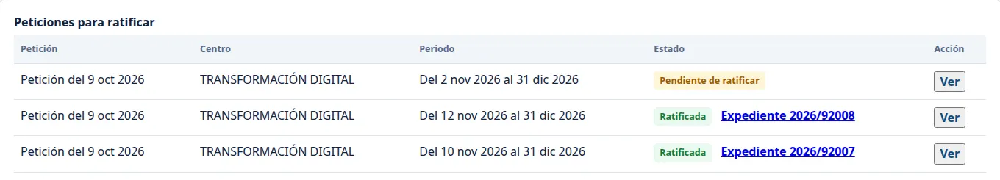
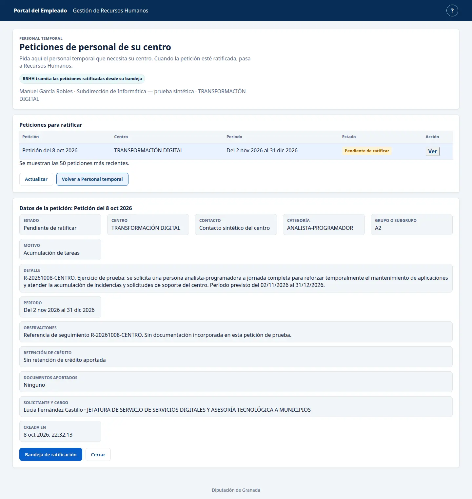
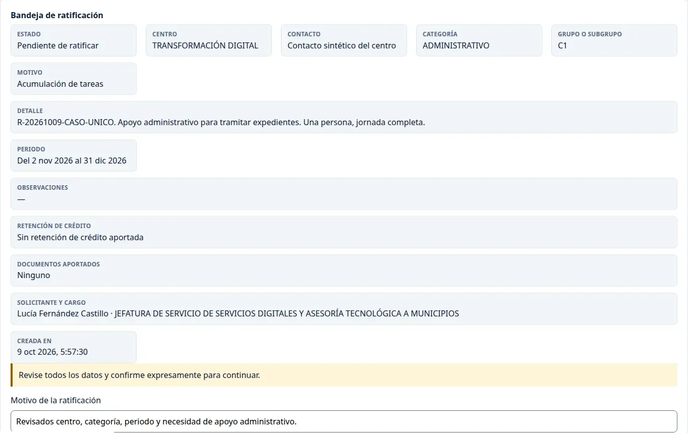
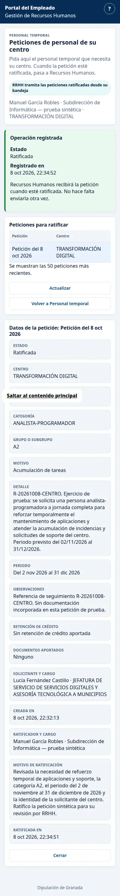
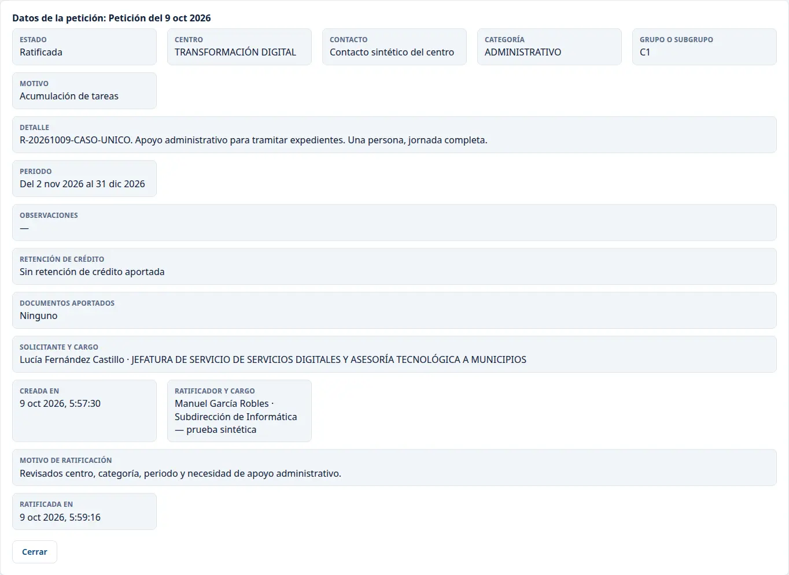

# Ratificar una petición de personal del centro

Actualizado el 4 de noviembre de 2026. Use el acceso que le hayan asignado en la copia local, con datos inventados. Entrar con certificado le identifica; firmar exige una actuación aparte.

La petición puede ratificarse con dos firmas con certificado o mediante la ratificación sin firma, según su configuración. El recorrido con dos firmas y la descarga de la petición firmada se comprobaron el 2 de noviembre. Las imágenes de la ratificación sin firma son anteriores y muestran esa alternativa.

## Encontrar la petición

1. Abra **Peticiones de personal de su centro** con su acceso de ratificador. Compruebe el nombre y el centro que aparecen bajo el título.
2. En **Peticiones para ratificar**, busque la fila por centro, periodo y estado **Pendiente de ratificar**. Pulse **Ver** en esa fila. Puede haber varias peticiones con la misma fecha; compruebe el detalle antes de continuar.

## Revisar los datos

En **Datos de la petición**, compruebe el centro, la persona solicitante y su cargo, la categoría y el grupo, el motivo, la necesidad descrita y el periodo. Revise las observaciones, el puesto de la relación de puestos de trabajo, el número de personas, la jornada, la retención de crédito y los documentos aportados. La persona que ratifica debe ser distinta de quien solicitó. Si algún dato no corresponde a la petición que debe tramitar, pulse **Cerrar** y consulte la diferencia antes de ratificar.

Si no se declaró retención, la pantalla actual indica **No hay retención de crédito**. Si no hay documentos, indica **Ninguno**. La imagen conservada es anterior y puede usar otro rótulo. Esos mensajes describen lo que constaba en la petición; no acreditan una retención ni un documento. Si el centro marcó **Sí**, verá **Declarada; la comprueba RRHH** seguido del número de operación de SICAL, la fecha y el importe: es lo que escribió el centro, todavía sin comprobar.

## Firmar la petición con certificado

1. Abra la petición con **Ver** y compruebe los datos de **Datos de la petición**.
2. En **Firma de la petición**, revise a quién corresponde cada paso. Primero firma **Jefatura de Servicio de la Delegación**; después, **Diputado o Diputada de la Delegación**.
3. Si le corresponde el paso disponible, pulse **Firmar con certificado**. En el programa de firma, use el mismo certificado con el que entró en el portal.
4. Espere **Firma registrada**. Tras la primera firma, la pantalla indica que debe firmar el Diputado o la Diputada. Cada persona entra con su propio acceso para firmar su paso.
5. Con las dos firmas, compruebe **Ratificada**. Pulse **Descargar la petición firmada (PDF)** y conserve el documento. La petición llega a Recursos Humanos sin volver a enviarla.

Si se corta la conexión al registrar, pulse **Reintentar el registro**: recupera la misma firma. No firme otra vez mientras su registro siga sin confirmar. Si aparece **En espera del paso anterior**, debe terminar el firmante anterior.

## Ratificar cuando la petición no exige firma

Si los datos coinciden, pulse **Ratificar esta petición**. Escriba en **Motivo de la ratificación** qué ha revisado. Marque **Confirmo expresamente esta operación** y pulse **Confirmar ratificación de esta petición** una sola vez.

La pantalla muestra **Operación registrada** y el estado **Ratificada**. Recursos Humanos continúa desde su bandeja; el centro no tiene que enviar la petición otra vez.

Para comprobar el resultado, actualice la página con F5 y pulse **Ver** en la misma petición. El detalle debe conservar **Ratificada**, la persona que ratificó, su motivo y la fecha.

## Devolver la petición para que la corrijan

Con la firma con certificado, la devolución corresponde al Diputado o la Diputada, antes o después de la primera firma. Si falta algo o hay que cambiar un dato, no la ratifique. En el detalle, pulse **Devolver para corregir**. Escriba en una línea, en **Qué hay que corregir**, lo que debe cambiar quien la presentó. Marque **Confirmo que devuelvo esta petición para que la corrijan** y pulse **Devolver la petición** una sola vez.

La petición queda **Devuelta para corregir** y Recursos Humanos no la recibe. Cuando la corrijan, aparecerá en su bandeja una petición nueva, pendiente de ratificar, que indica qué petición corrige. 

## Si algo sale mal

Si aparece **«Todavía no hay peticiones de su centro»**, pulse **Actualizar**. Si sigue vacío, pida a quien solicitó la petición que compruebe si quedó presentada y si corresponde al centro que muestra su sesión.

Si tras confirmar no aparece **«Operación registrada»**, actualice la bandeja y abra la misma petición con **Ver**. Si figura **Ratificada**, consulte el detalle y no confirme otra vez. Si sigue pendiente o no puede consultar el resultado, conserve el mensaje visible y la hora, y comuníquelo a Informática por el cauce habitual.
