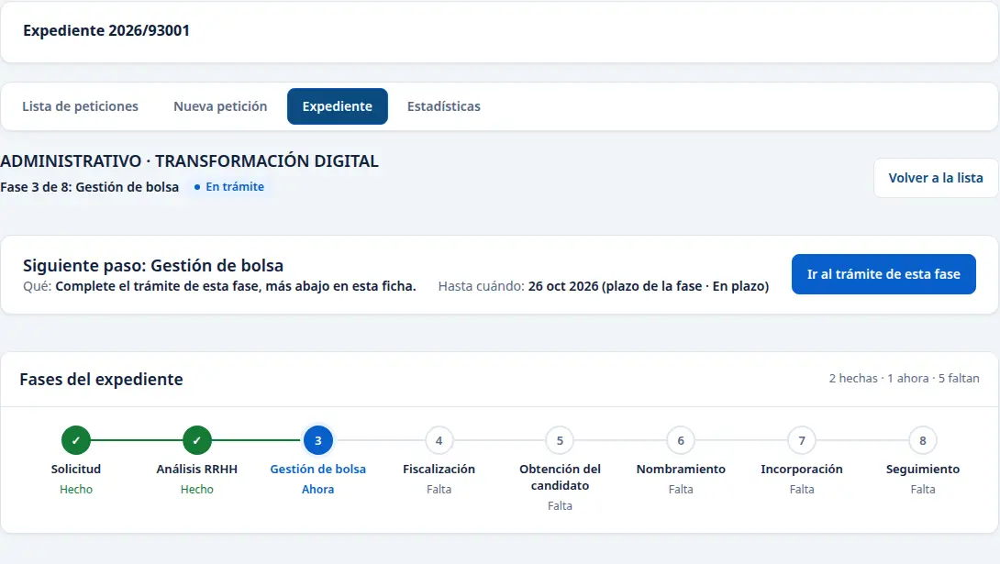
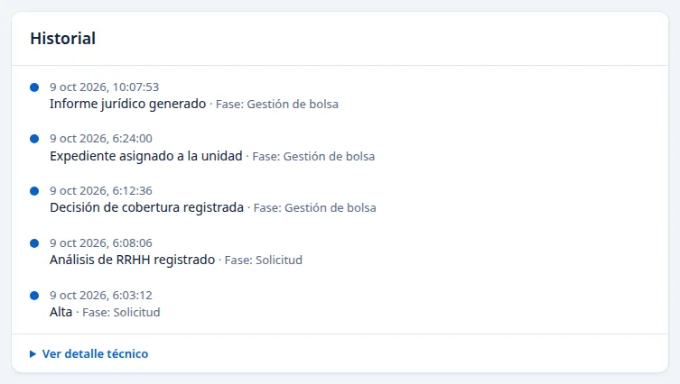
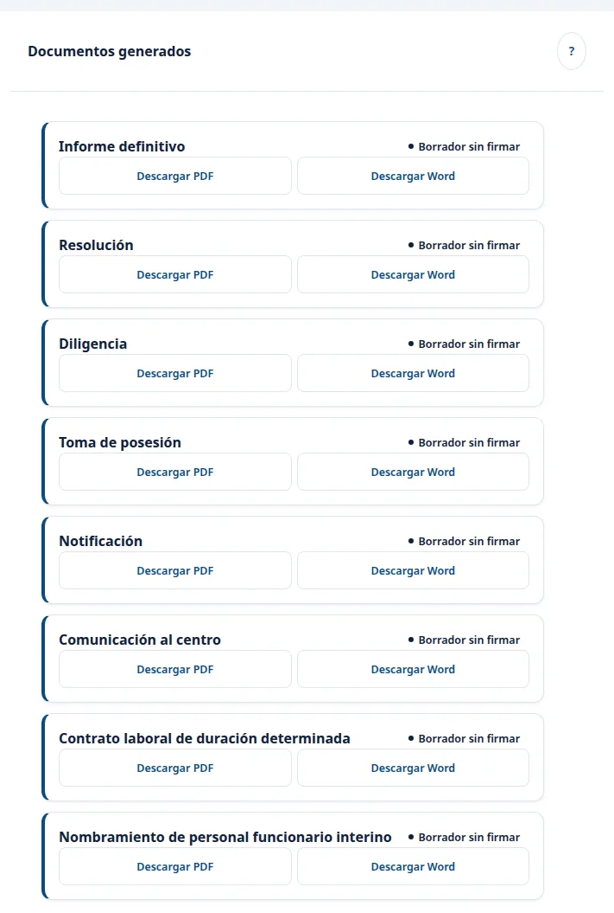
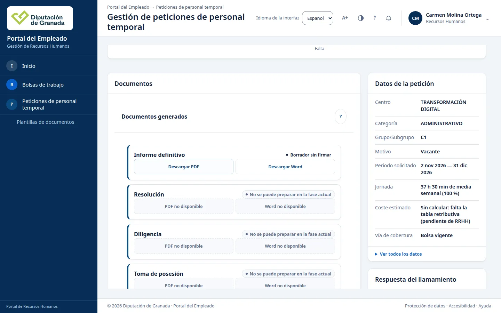
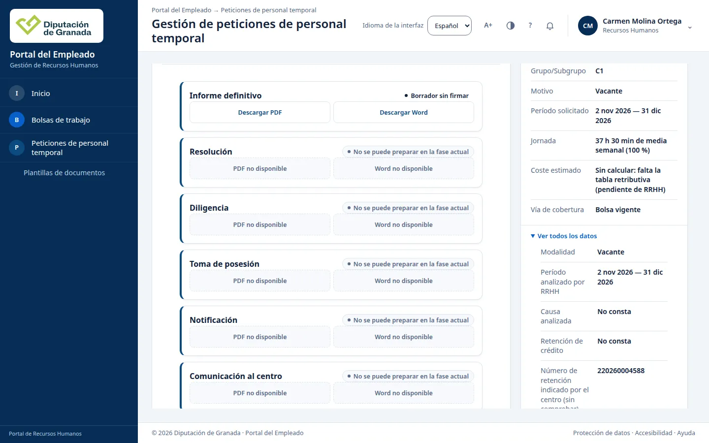
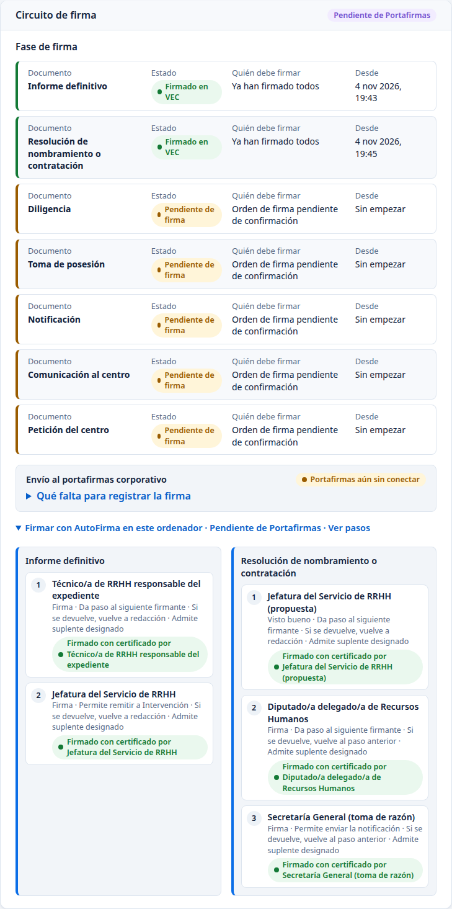
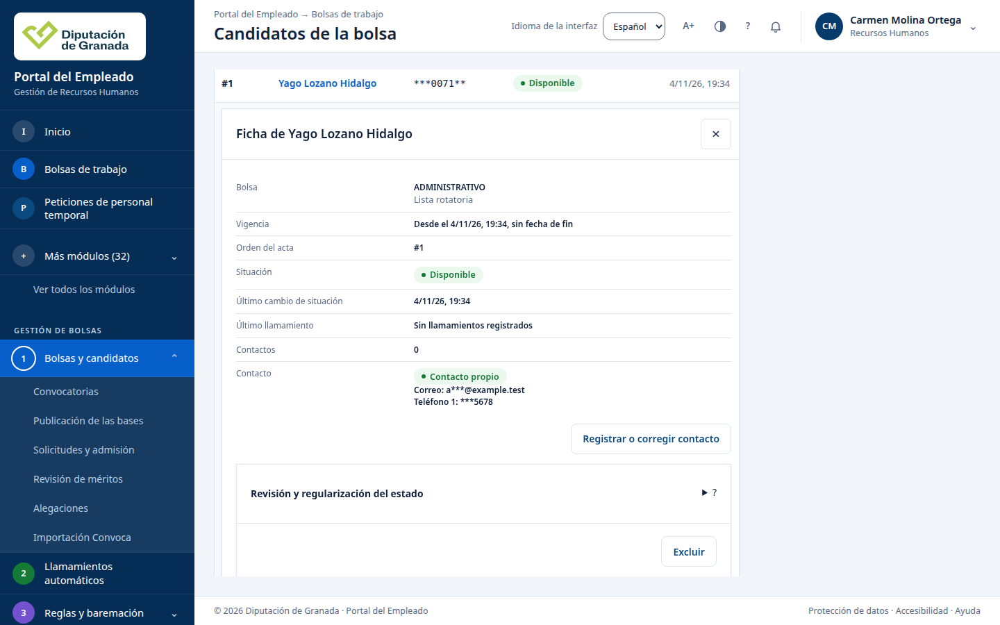

# RRHH: consultar una petición, su historial y sus documentos

Actualizado el 2 de noviembre de 2026. Use su acceso de Recursos Humanos en la copia local que le faciliten, con datos inventados. Puede consultar el expediente, sus documentos y firmas, anotar la fiscalización recibida y continuar desde una aceptación confirmada. Los límites del recorrido están en [Pendientes](PENDIENTES.md).

## Abrir la ficha

1. Entre en **Peticiones de personal temporal** desde Inicio.
2. Escriba el número en **Buscar** y pulse la referencia de la fila. En el ejemplo se abrió `2026/93001`.
3. Revise la fase, el estado y **Siguiente paso**. La línea de fases indica lo hecho, la fase actual y lo que falta.

En **Datos de la petición**, compruebe centro, categoría, grupo, motivo, período y jornada. Pulse **Ver todos los datos** cuando necesite el análisis y la vía de cobertura. El coste mostrado es la estimación registrada en el análisis.

## Leer las actuaciones registradas

Baje a **Historial**. Cada entrada muestra la actuación y cuándo se registró. Abra **Ver detalle técnico** solo si se lo pide Informática. En el ejemplo se leen el alta, el análisis, la decisión de cobertura, la asignación y el informe jurídico generado. La ficha se recuperó después de abrirla de nuevo desde la lista.

Para regresar, pulse **Volver a la lista**. Si actualiza la página y aparece la lista, busque de nuevo el mismo número antes de seguir.

## Descargar los documentos del expediente

Baje hasta el panel **Documentos generados**, dentro de la misma ficha. Cada documento aparece en su tarjeta con la marca **Borrador sin firmar** y dos botones: **Descargar PDF** y **Descargar Word**. Los archivos llevan el logotipo de la Diputación. El PDF del informe del ejemplo indica en su primera página que es un borrador no firmado ni validado.

1. Abra el expediente desde **Peticiones de personal temporal** y compruebe el número y la fase.
2. En **Documentos generados**, localice la tarjeta del documento. Si indica **Borrador sin firmar**, descargará un borrador.
3. Pulse **Descargar PDF** o **Descargar Word**. Si indica **No se puede preparar en la fase actual**, espere al paso que muestra la ficha.
4. Abra el archivo y compruebe el número de expediente, la persona y las fechas antes de utilizarlo.

El informe puede descargarse como borrador antes del nombramiento. Los documentos de cese y modificación necesitan que se haya registrado la actuación correspondiente. La descarga del cese en ambos formatos se comprobó con su persona, fecha y número propios. No acredita que todo el recorrido hasta el cese funcione en un mismo expediente.

## Comprobación del 2 de noviembre de 2026

En una copia nueva se volvió a ver el panel **Documentos generados** de un expediente que aún no estaba en **Nombramiento**. El informe definitivo aparece como **Borrador sin firmar** con **Descargar PDF** y **Descargar Word**. La resolución, la diligencia, la toma de posesión, la notificación y la comunicación al centro muestran **No se puede preparar en la fase actual**: sus botones están apagados.

Después de reiniciar la copia, la ficha conservaba el historial (fiscalización, subsanación e informe jurídico) y los mismos datos de la petición, incluida la retención de crédito que indicó el centro, marcada «sin comprobar». La ficha tiene además el apartado **Qué se envía a Intervención por Firmadoc**, con la lista de lo que recibirá Intervención.

## Alcance de este acceso

Este recorrido comprobó la **consulta** de la ficha, del historial y de los documentos. No comprobó una acción propia para **resolver** ni para **firmar** con este acceso. Las descargas de «Borrador sin firmar» conservan esa condición. Un documento firmado se distingue por su estado y su descarga propia.

Si el panel de documentos muestra «No se pudieron consultar los borradores publicados», pulse **Reintentar consulta**. Si el mensaje continúa, conserve el número del expediente y comunique el mensaje a Informática.

## Consultar cómo van las firmas

1. Abra la ficha y localice **Estado de firma de los documentos**.
2. Revise **Documento**, **Estado**, **Quién debe firmar** y **Desde**. Puede distinguir **Pendiente de firma**, **Firmado en VEC** y **Devuelto**.
3. Abra **Circuito de firma** y pulse **Ver pasos** si necesita saber qué firma falta. Una firma anterior no sirve para un informe nuevo tras subsanar.
4. Si aparece **Descargar PDF firmado**, úselo solo con un acceso autorizado. La técnica puede consultar el estado, pero su descarga de documentos firmados sigue teniendo denegaciones pendientes.

## Anotar el resultado recibido de Intervención

Intervención fiscaliza fuera de VEC. La persona de Recursos Humanos autorizada anota el resultado recibido; no debe repetir la fiscalización.

1. Abra el expediente y revise **Qué se envía a Intervención por Firmadoc**: petición, retención si existe, proyecto y código para programas, informe firmado, resolución sin firmar, coste y estado de la partida.
2. En **Registrar resultado de fiscalización**, elija **Favorable**, **Favorable con observaciones** o **Desfavorable (reparo)**.
3. Complete **Observaciones** cuando haya observaciones o reparo.
4. En el apartado del informe de Intervención recibido por la plataforma de expedientes, anote **Fecha del informe** y **Referencia del informe** tal como constan en el documento recibido. Conserve el original. El plazo de subsanación cuenta desde la fecha del informe.
5. Pulse **Registrar resultado**, lea la confirmación y acéptela una sola vez.
6. Espere **El resultado y su recibo han quedado confirmados.** Conserve el **Justificante** y consulte **Siguiente paso** en el recibo y en la cabecera.

Si no se conoce el resultado, use **Recuperar resultado original**. No registre otra fiscalización para intentar desbloquear la ficha. El resultado y el cambio de fase se conservaron tras reiniciar en el recorrido comprobado.

Con reparo, registre la subsanación y use **Emitir informe tras subsanación**. El técnico y la Jefatura deben firmar el informe nuevo antes de anotar otra fiscalización. Se completó esta vuelta el 2 de noviembre; otro caso siguió fallando en la comprobación previa de firma. Si falla, conserve el mensaje y avise a Informática.

## Revisar una aceptación de Mi bolsa

1. En la ficha, localice la aceptación presentada en **Mi bolsa** y compruebe persona, fecha, plazo y **Justificante de la respuesta**.
2. Marque **He comprobado la aceptación y su justificante** y **He revisado el plazo de respuesta**.
3. Pulse **Confirmar aceptación** y revise la confirmación antes de aceptarla. No necesita aportar un correo para una respuesta presentada en Mi bolsa.
4. Espere **Aceptación confirmada en el expediente**. Conserve **Justificante de la confirmación**.
5. Consulte la situación en Bolsa. **Pendiente de incorporación** debe constar allí; el recibo del expediente por sí solo no acredita ese cambio.

El recibo, la respuesta y las fechas se conservaron tras reiniciar. No confirme otra vez una aceptación que ya consta.

## Preparar la propuesta desde la aceptación

1. Con la aceptación confirmada, abra **Propuesta de nombramiento**.
2. En **Preparar la propuesta de nombramiento**, revise **Lo que ya se ha hecho** y pulse **Revisar y registrar propuesta**.
3. Revise la persona y los documentos cargados. Pulse **Guardar la propuesta** y confirme una sola vez.
4. Espere **Propuesta guardada** y conserve el recibo. Si no se actualiza la ficha, pulse **Ver expediente actualizado**; no guarde otra propuesta.

La propuesta es un borrador: no firma ni nombra a nadie. Su recibo y la cabecera **Nombramiento** se conservaron tras reiniciar. Después se registra la resolución, la firman tres cargos y se sigue con la incorporación y el alta en Personal. Ese camino se recorrió entero el 4 de noviembre en una copia nueva, en el mismo expediente, y se conservó tras reiniciar. Los pasos están en el [manual de Jefatura](jefatura_rrhh.md).

## Comprobar el contacto de una persona

1. Abra la ficha de la persona en Bolsa y revise **Contacto**.
2. **Contacto propio** distingue los datos aportados por la persona de los que llevan **Origen CONVOCA**.
3. Compruebe que el correo y el teléfono parcialmente ocultos tienen contenido. Al volver a abrir la ficha, deben conservarse el contacto y su fecha original.

El registro de contacto propio y su conservación después de reiniciar ya están comprobados. Si el contacto no coincide, consulte a la persona antes de usarlo para un aviso.

## Consultar una respuesta recibida por otro canal

La respuesta por otro canal ya registrada se consulta en la misma ficha. Revise la persona y el justificante conservado; **Ver seguimiento en Bolsa** abre su participación. Tras reiniciar se recuperó el mismo justificante, con su fecha original. Este registro no crea un acceso nuevo para la persona aspirante.

## Revisar solicitudes y leer alegaciones

1. En **Solicitudes para entrar en bolsa**, elija la convocatoria y pulse **Ver solicitudes**.
2. Pulse **Ver solicitud** y revise **Requisitos de acceso**.
3. Para admitir, pulse **Admitir a la convocatoria**, revise el resumen y pulse **Confirmar admisión**. Admitir no incorpora a la persona a la bolsa.
4. Para rechazar, pulse **Rechazar solicitud**, elija **Motivo del rechazo (obligatorio)**, revise el resumen y pulse **Confirmar rechazo**.
5. Compruebe el estado de la misma solicitud antes de volver a actuar.

La admisión, el rechazo y la incorporación a la bolsa se vieron en Chrome el 4 de noviembre en una copia nueva. La incorporación pide el número del acta definitiva: escríbalo tal como consta. Si la pantalla no lo acepta, no insista; avise a Informática y conserve el mensaje.

En **Alegaciones**, elija la convocatoria o la bolsa y pulse **Ver alegación**. Lea **Qué solicita y por qué** y su justificante. **Ver solicitud** abre la decisión a la que se refiere. La consulta no resuelve la alegación.

## Publicar una oferta desde la bolsa

Una oferta se publica desde Bolsa o desde la ficha de un expediente. Desde el expediente, la pantalla avisa «Va a publicar una oferta de 2 plazas», pide confirmar y deja la oferta vinculada al expediente, con un justificante por plaza. Se vio el 4 de noviembre, antes y después de reiniciar.

1. En la bolsa, abra **Gestionar ofertas** y el apartado **Nueva oferta**.
2. Complete **Categoría**, **Centro**, **Fecha de inicio**, **Fecha de fin (opcional)**, **Número de plazas** y **Descripción y requisitos**.
3. Consulte **Inicio del plazo** y **Cómo se cuenta el plazo**. Use la regla vigente; no cambie la política para acortar el plazo de un expediente.
4. Pulse **Revisar oferta**, coteje el resumen y pulse **Confirmar y publicar oferta** una sola vez.
5. Espere **Oferta publicada** con su vencimiento y conserve el **Recibo**. Si no conoce el resultado, use **Reintentar la misma publicación**, sin cambiar los datos.

Revise el estado de los avisos antes de actuar sobre el plazo de cada persona.

## Ofrecer a todas las personas disponibles

Se comprobó una oferta de una plaza con dos aceptaciones: al cierre se formalizó con la persona de mejor posición y la otra siguió disponible. También se comprobó una oferta independiente de dos plazas con dos aceptaciones.

Para consultar y continuar una oferta ya publicada:

1. Abra **Gestionar ofertas** en la bolsa correspondiente y localice la oferta por categoría, centro y fecha de inicio.
2. Revise el cierre y **Personas que aceptaron, por orden**. La llegada de la respuesta no altera el orden de la bolsa.
3. Cuando termine el plazo, revise la propuesta para la plaza. Pulse **Formalizar con el n.º** seguido del orden que muestra la pantalla y compruebe la persona antes de confirmar.
4. Conserve el recibo y compruebe que solo la persona elegida pasa a **Pendiente de incorporación**. Las demás conservan su situación.

Aceptar la oferta no equivale a firmar el contrato. La formalización conjunta de varias plazas en un solo expediente y la mejora de empleo no están terminadas: se explican en [Pendientes](PENDIENTES.md).

## Lo que VEC hace por su cuenta

Al publicar una oferta, VEC manda un correo electrónico a todas las personas disponibles de la bolsa. Después le enseña cuántos avisos están pendientes, enviados, sin confirmación y fallidos. El plazo de cada persona puede contar desde que sale su correo.

Al emitir un llamamiento, VEC manda un correo a la persona llamada y guarda si salió. El plazo de respuesta empieza cuando usted anota el contacto.

Cuando una persona acepta en **Mi bolsa**, VEC guarda su respuesta con un recibo. Su situación en la bolsa cambia cuando usted confirma la aceptación, no antes.

Si el plazo de un llamamiento vence sin respuesta, VEC se lo propone para cerrar. Lo cierra usted al confirmar.

Cada paso que usted confirma deja un justificante. VEC anota también quién consulta los datos de contacto de una persona.
