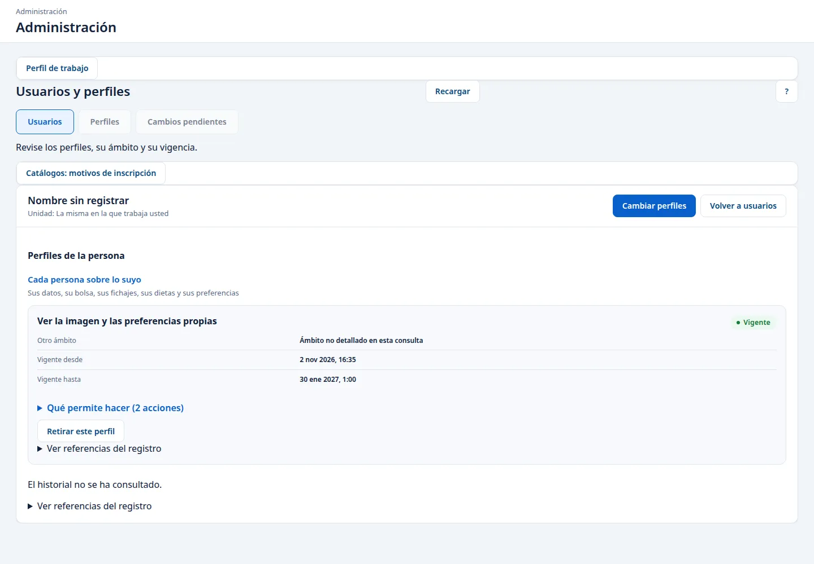

# Administración: módulos y fichas de usuario

Actualizado el 27 de octubre de 2026. Entre en Administración con el acceso de administración de la copia local que le faciliten, con datos ficticios. Administración tiene una dirección propia, distinta de la del portal. Esta guía recoge dos tareas comprobadas en pantalla: encender o apagar un módulo y consultar la ficha de un usuario. El resto de la administración (copias, catálogos, conectores, cambiar perfiles) sigue pendiente; su estado está en [los recorridos pendientes](PENDIENTES.md).

## Apagar o encender un módulo

1. Abra **Estado de módulos**. En **Configuración actual** verá cada módulo con su **Estado actual** (**Habilitado** o **Deshabilitado**). Los que dicen **Configurable** se pueden cambiar desde aquí. **Administración de sistema** aparece como **Fuera de este interruptor**.
2. En **Cambiar un módulo**, elija el módulo en **Módulo (obligatorio)** y el estado nuevo en **Estado propuesto (obligatorio)**.
3. Escriba en **Motivo (obligatorio)** por qué hace el cambio, en 500 caracteres como máximo y sin datos personales. Pulse **Revisar solicitud**.
4. En **Confirmar el cambio**, compruebe el módulo, el estado actual, el estado propuesto y el motivo. Si algo no cuadra, pulse **Corregir solicitud**. Si está bien, pulse **Confirmar cambio** una sola vez.
5. La pantalla muestra **Cambio registrado.** y un **Justificante**. Anote ese justificante. Pulse **Actualizar consulta** para ver la tabla con el estado nuevo.

Al apagar un módulo, su entrada desaparece del menú del portal para todo el mundo y sus pantallas dejan de abrirse. Los datos del módulo se conservan.

Al encenderlo de nuevo, el menú y las pantallas vuelven tal como estaban. Encender un módulo no da permisos a nadie: cada persona sigue viendo solo lo que su perfil le permite.

En la prueba se apagó y se volvió a encender el módulo de dietas en una copia nueva. El menú del portal de Recursos Humanos y el del centro cambiaron en los dos sentidos, y el estado y los dos justificantes seguían ahí tras reiniciar la copia.

Desde el 27 de octubre de 2026, este interruptor de **Estado de módulos** es la única forma de apagar o encender un módulo. Se ha retirado la manera antigua de ocultarlos desde la configuración del servidor. Este cambio todavía no se ha comprobado en el navegador; queda para el recorrido final.

## Consultar la ficha de un usuario

1. Abra **Usuarios y perfiles**. Tiene tres pestañas: **Usuarios**, **Perfiles** y **Cambios pendientes**. Quédese en **Usuarios**.
2. En **Consultar usuarios** puede filtrar por **Vigencia** y pulsar **Buscar**. La búsqueda por nombre y los filtros de **Perfil** y **Unidad** se ven en pantalla, pero todavía no están disponibles; la propia pantalla lo avisa. **Quitar filtros** deja la lista como al principio.
3. Pulse el nombre de la persona en la columna **Persona**. Se abre su ficha.
4. En **Perfiles de la persona** verá cada perfil con su estado (por ejemplo, **Vigente**), su organización, su unidad, **Vigente desde** y **Vigente hasta**.
5. Pulse **Volver a usuarios** para regresar a la lista.

Donde la ficha dice **La misma en la que trabaja usted**, la organización o la unidad de esa persona es la suya. La ficha ya no enseña claves internas del sistema. Si necesita esas referencias para una consulta con Informática, están dentro de **Ver referencias del registro**.

Cada consulta de una ficha queda registrada. Si intenta abrir la ficha de una persona que no está en su ámbito, no se muestra ningún dato. Que ese intento quede anotado como denegado está programado, pero todavía no se ha visto en una copia.

El 2 de noviembre de 2026 se abrió de nuevo una ficha en una copia nueva. Muestra el perfil «Ver la imagen y las preferencias propias», con su estado **Vigente**, la fecha desde la que vale y la fecha hasta la que vale, y la lista de acciones que permite. La ficha tiene los botones **Cambiar perfiles** y **Retirar este perfil**. **Cambiar perfiles** no abre ningún formulario: no se puede cambiar un perfil desde aquí.

## Perfiles que reúnen varias funciones

En la pestaña **Perfiles** se crean perfiles que juntan dos o más funciones ordinarias de un mismo módulo. Hacen falta dos personas con acceso de administración:

1. Una pulsa **Crear perfil** (o **Modificar perfil** en uno que ya existe), elige las funciones y envía la propuesta.
2. La otra la aprueba en **Cambios pendientes**. Quien propone no puede aprobar su propia propuesta.

Al modificar un perfil se crea una versión nueva. Solo se ofrecen funciones del mismo módulo y con el mismo tipo de ámbito que la versión anterior.

Para asignar el perfil a una persona basta una sola persona de administración, desde la ficha de esa persona. Nadie puede asignárselo a sí mismo. Estos perfiles se suman a los que la persona ya tiene; no hay que activarlos a mano.

Cuando se aprueba una versión nueva:

- Quien ya tenía la anterior la conserva hasta que se le retire en su ficha. La ficha lo avisa.
- La versión anterior ya no se puede asignar a nadie; solo se ofrece la nueva.
- Si después se deshabilita la versión nueva, el perfil no se puede asignar hasta que se apruebe otra versión.

## Lo que todavía no puede hacer

- Ver el nombre de cada persona. Por ahora la lista dice **Persona 1: Nombre sin registrar**, **Persona 2: Nombre sin registrar**, y la ficha dice **Nombre sin registrar**. Falta el dato y su lectura.
- Ver el nombre real de la organización, la unidad o la bolsa. La ficha pone **La misma en la que trabaja usted** o **Nombre de la bolsa no disponible**.
- Asignar o retirar perfiles desde la ficha. No se ha comprobado; en la prueba, la ficha avisaba «Los cambios de perfiles no están disponibles en esta consulta.»

## Lo que VEC hace por su cuenta

VEC manda correo electrónico por un servidor de correo que se configura en el arranque: dirección, puerto, remitente y certificado de la entidad. La conexión es siempre protegida. El enlace que lleva el aviso de oferta se configura aparte. Todos los correos se mandan en el momento de la acción; no hay una cola que se procese después.

VEC no tiene tareas programadas dentro de Bolsa ni de Contratación temporal. Los plazos se calculan al leer. La comprobación y el sellado de la auditoría se lanzan con dos órdenes aparte.

Para cada correo VEC guarda el mensaje y su resultado.

## Si algo sale mal

En **Estado de módulos**:

- Si aparece «La configuración ha cambiado. Actualice los estados y revise el cambio.», otra persona cambió el módulo antes que usted. Pulse **Actualizar consulta** y prepare el cambio de nuevo si sigue haciendo falta.
- Si aparece «No se pudo confirmar el resultado. Reintente con el mismo cambio para recuperar el justificante.», pulse **Reintentar el mismo cambio**. No prepare otro cambio hasta tener el justificante.
- Si aparece «Elija un estado distinto del actual.», el módulo ya está en el estado que ha elegido.
- Si aparece «El servicio de cambios no está disponible. Puede consultar los estados, pero no modificarlos.», puede mirar la tabla pero no cambiarla. Avise a Informática.
- Si aparece «No tiene acceso a esta consulta. Solicite la autorización administrativa correspondiente.», su acceso no tiene permiso para esta pantalla.

En **Usuarios y perfiles**:

- Si al abrir una ficha aparece «No se han podido actualizar los datos. La información anterior se ha retirado. Pulse Recargar para consultar de nuevo.», pulse **Recargar**. Es también lo que ve hoy al pedir la ficha de alguien fuera de su ámbito.
- Si aparece «No tiene autorización para esta consulta. Se ha retirado la información de la pantalla.», su acceso no permite consultar usuarios.
- Si el problema sigue, conserve el mensaje visible y la hora y comuníquelo a Informática por el cauce habitual.
