# RRHH: tramitar la petición de personal temporal

Actualizado el 20 de octubre de 2026. Use el acceso de RRHH de la copia local
que le faciliten, con datos ficticios. Las imágenes y los ejemplos conservados
del 8 y 9 de octubre son históricos. Esta guía distingue los pasos del recorrido
actual de los que todavía esperan una comprobación completa con reinicio.

El recorrido principal parte de una petición ratificada y de una persona que
ya está en la bolsa. Inscripción, méritos y alegaciones se enseñan aparte.
No hace falta inscribir de nuevo a quien ya participa.

## Entrar en Inicio

Abra **el portal de Recursos Humanos** con su acceso de RRHH. La primera pantalla se titula «Inicio». En «Lo pendiente» verá los plazos y las incidencias. Más abajo aparecen las peticiones por fase y un resumen de bolsas de trabajo.

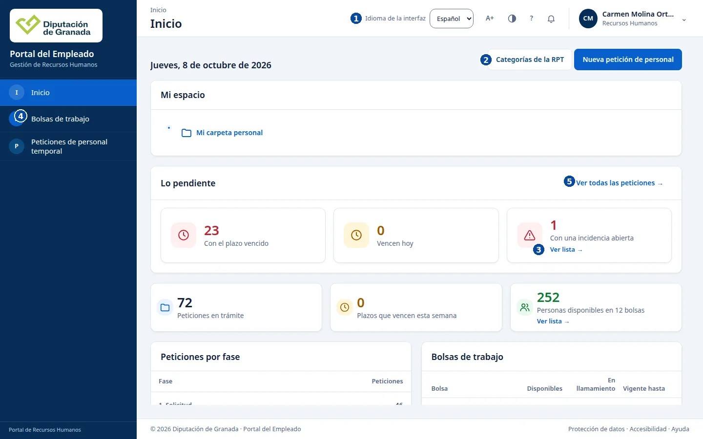

En una pantalla estrecha, los mismos apartados se colocan uno debajo de otro:

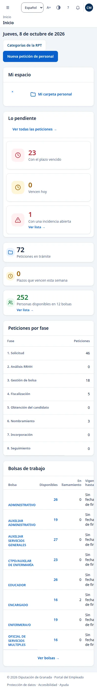

## Cambiar el idioma · 1

Abra «Idioma de la interfaz» **(1)** y elija «English» o «Español». El título y los nombres de los controles cambian al idioma elegido. Puede volver a elegir español desde el mismo selector.

## Consultar las categorías de los puestos · 2

Desde Inicio, pulse «Categorías de la RPT» **(2)**. RPT es la relación de puestos de trabajo. Se abre el «Listado de categorías», con un campo «Buscar categoría o grupo», otro de «Grupo o subgrupo» y el número de categorías encontradas. El día de la comprobación se mostraban 151.

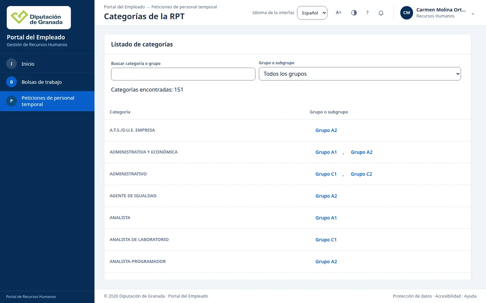

## Localizar una petición con incidencia · 3

En «Lo pendiente», pulse «Ver lista» bajo «Con una incidencia abierta» **(3)**. Se abre «Gestión de peticiones de personal temporal» con el filtro «Con una incidencia abierta» visible. La lista indica cuántas peticiones cumplen el filtro; el día de la comprobación mostraba «1 de 1 peticiones».

En la fila puede leer el número de expediente, el centro y la categoría, la fase, el estado y el plazo. El caso mostrado estaba en «Fiscalización», «Fase 4 de 8», con estado «Con incidencia» y plazo «Vencido». Pulse «Inicio» en el menú lateral para volver a la portada.

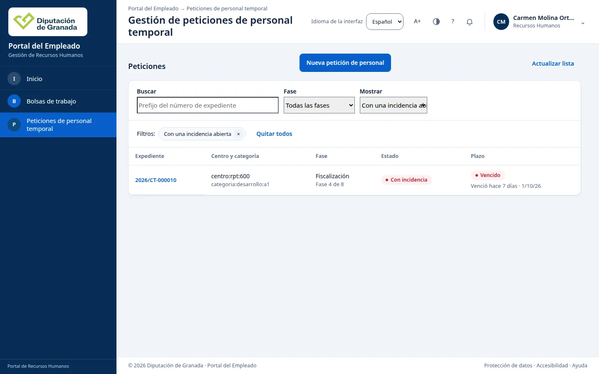

## Consultar el resumen de bolsas · 4

Pulse «Bolsas de trabajo» **(4)** en el menú lateral de Inicio. Se abre «Bolsas de trabajo activas». Sus indicadores muestran bolsas visibles, aspirantes, disponibles y personas en renuncia; la tabla desglosa las cifras por bolsa. El día de la comprobación mostraba 12 bolsas, 390 aspirantes y 252 disponibles. Es un resumen de bolsas, no una lista de personas filtrada.

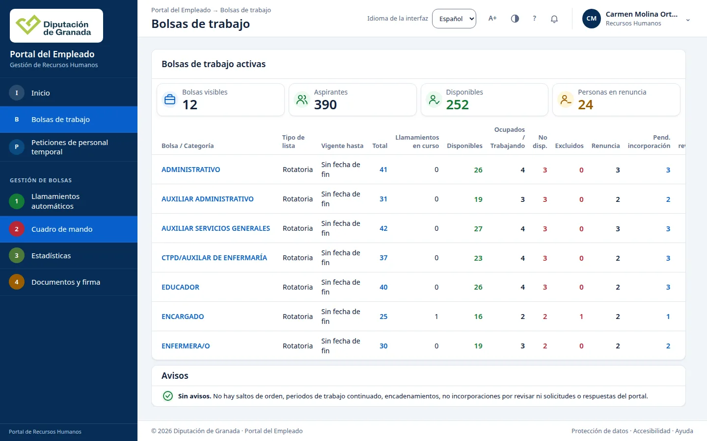

Para volver a Inicio, pulse «Inicio» en el menú lateral o use el botón Atrás del navegador.

## Ver los integrantes de una bolsa

En «Bolsas de trabajo activas», pulse la cifra de la columna «Disponibles» de la bolsa que necesita. Se abre «Candidatos de la bolsa» con la situación «Disponible» ya elegida y la relación ordenada de esas personas. En el ejemplo, ENCARGADO muestra 16 personas disponibles.

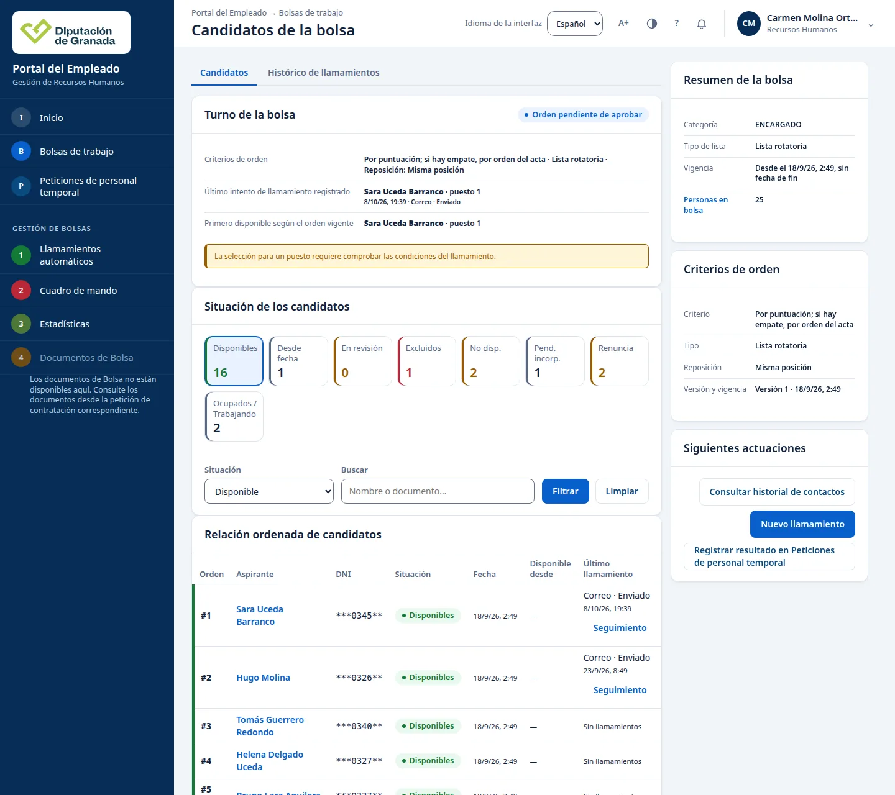

Use «Buscar» para localizar a una persona por nombre o documento y «Situación» para consultar otro estado. Pulse «Filtrar» para aplicar los cambios y «Limpiar» para quitarlos.

## Abrir la lista general de peticiones · 5

En Inicio, pulse «Ver todas las peticiones» **(5)** en la cabecera de «Lo pendiente». Se abre la lista con búsqueda y los filtros «Fase» y «Mostrar». Cada fila muestra el centro y la categoría por su nombre, además de la fase, el estado y el plazo. El día de la comprobación había 72 peticiones, 46 de ellas en «Solicitud».

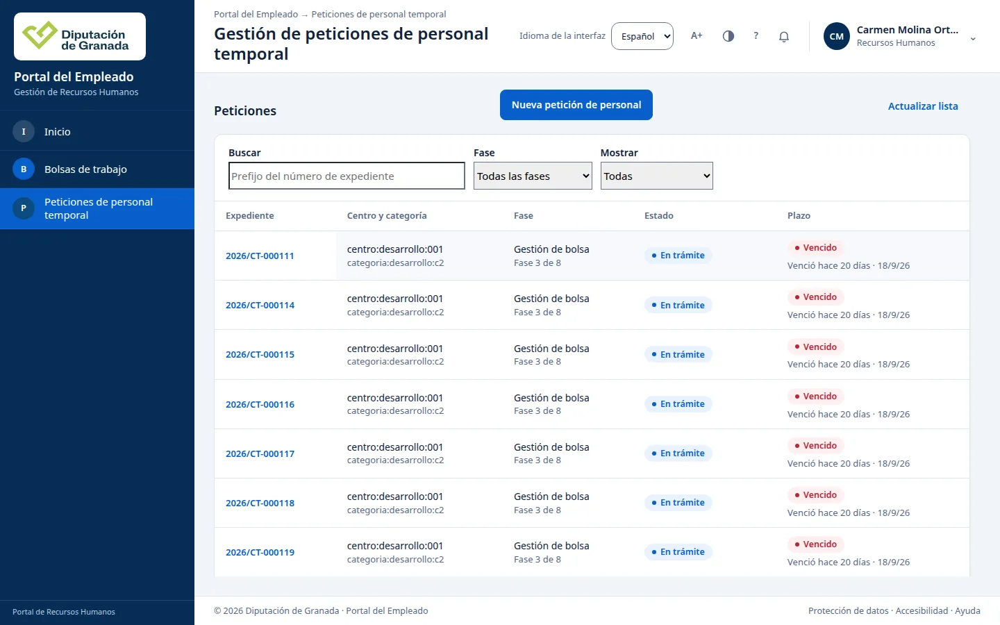

## Recibir una petición ratificada del centro

1. Abra **Peticiones de los centros** con el acceso de RRHH. Las peticiones ratificadas que aún no tienen expediente aparecen con el estado de entrega **Pendiente de preparación**. Localice la suya por la fecha y hora de la columna **Ratificación** y pulse **Revisar**. Las que ya tienen expediente muestran **Expediente creado** y su número.
2. Compruebe centro, categoría, grupo, motivo, período, número de personas y jornada. Compruebe también si el centro aportó una retención de crédito o documentos. Una retención que el centro marcó con **Sí** aparece como **Declarada; la comprueba RRHH**, con el número de operación de SICAL, la fecha y el importe; compruébela en SICAL o pídasela a Intervención. En el ejemplo, el centro pidió una persona de la categoría Administrativo, a jornada completa, y no aportó retención.
3. Pulse **Crear expediente en RRHH**. En la revisión escriba el número del expediente que proporciona la plataforma de expedientes electrónicos de la Diputación, marque la confirmación expresa y pulse **Crear expediente en RRHH** una sola vez. Si no dispone de ese número, deténgase.
4. La pantalla muestra el recibo del alta. Anote dos datos: el **Número visible**, que es el número del expediente, y la **Referencia del recibo**, que sirve para comprobar el alta si algo falla. Use **Abrir el expediente** para seguir con el mismo caso. En el ejemplo se creó `2026/93001`.

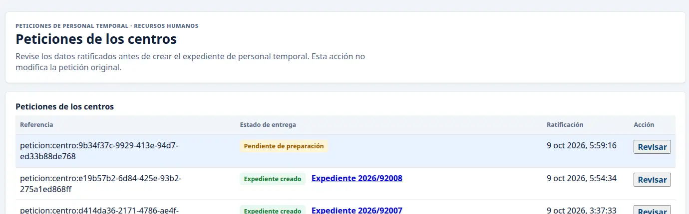

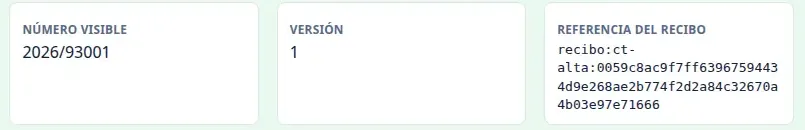

## Registrar el análisis de RRHH

Abra la ficha desde la lista y revise sus datos. En **Registrar análisis de RRHH**, elija la modalidad, la categoría, el grupo y la causa que correspondan a la petición. Compruebe fechas y jornada. La retención de crédito se elige en la lista que ofrece la pantalla. Que el centro no la aportara no significa que esté validada. Si no cuenta con una retención respaldada, detenga el análisis.

En el recorrido, RRHH seleccionó **Acumulación de tareas**, **Administrativo**, **C1**, **Necesidad temporal**, el período solicitado y jornada completa. Eligió una retención disponible para ese ejercicio y dejó la urgencia sin marcar. Pulse **Registrar análisis** una sola vez. La pantalla confirma **Análisis guardado** y **Justificante registrado**. Al reabrir la ficha, **Análisis RRHH** aparece como **Hecho**.

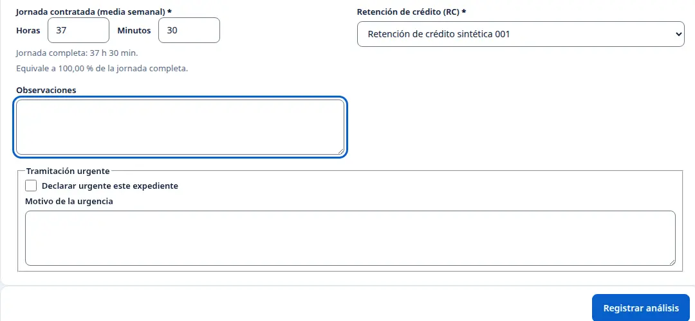

Para corregir el análisis antes de decidir la cobertura, use **Rectificar análisis de RRHH** en la misma ficha. El formulario se abre con los datos del último análisis, también el grupo y la retención de crédito. Si alguna opción ya no está en las listas vigentes, aparece sin elegir y hay que seleccionarla de nuevo. Cambie lo que haga falta, elija el motivo de la rectificación y pulse **Rectificar análisis**.

## Decidir la cobertura y asignar la unidad

1. En **Decidir la vía de cobertura**, lea las comprobaciones de la bolsa. Si la pantalla propone **Bolsa vigente** como vía viable para la categoría, selecciónela y pulse **Confirmar vía de cobertura**. Revise el aviso de confirmación antes de aceptarlo. La pantalla muestra **Decisión confirmada**.
2. Vuelva a la ficha del mismo expediente. En el ejemplo apareció **Asignar expediente a la unidad responsable**, con **Recursos Humanos** y **Responsable de peticiones de personal temporal**. Compruebe ambos datos, marque la casilla de revisión y pulse **Confirmar asignación** una sola vez. Para comprobar el resultado, vuelva a abrir el mismo expediente y consulte la actuación de asignación en **Historial**.

La cabecera de la ficha indica también el paso de la fase en el que está el expediente. Tras la asignación muestra «Fase 3 de 8: Gestión de bolsa · Asignación de unidad» y, cuando se prepara el informe jurídico, «Fase 3 de 8: Gestión de bolsa · Informe jurídico».

Con la unidad asignada, **Siguiente paso** dice «preparar el informe jurídico». **Ir al trámite de esta fase** lleva al apartado **Preparar informe jurídico**, que nombra el expediente por su número (por ejemplo, «Expediente 2026/94010, versión 4.»). Al confirmar el informe, la cabecera y **Siguiente paso** cambian en el momento a «revisar las firmas del informe». No hace falta volver a abrir la ficha: el recibo sigue en pantalla y el **Historial** de la ficha ya incluye el informe. En los dos historiales la fase se escribe igual que en la cabecera, por ejemplo «Gestión de bolsa · Informe jurídico».

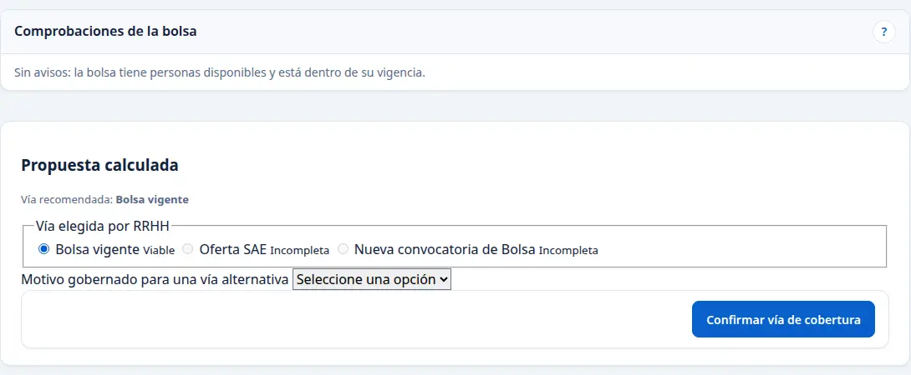

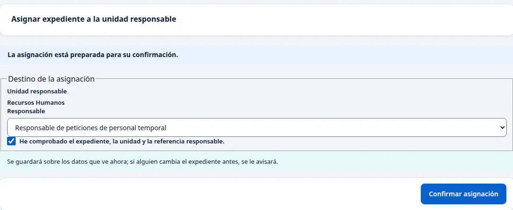

## Firmar el informe y recibir la fiscalización

1. En la ficha, abra **Firma** y compruebe que el documento es el informe de remisión a Intervención del expediente actual.
2. La técnica firma primero con su certificado; después firma la Jefatura del Servicio. Cada persona utiliza su acceso de firma y **Firmar con certificado**.
3. Espere el recibo de cada firma y compruebe que el PDF conserva ambas firmas verificadas. Preparar el informe no lo firma.
4. Remita a Intervención el expediente y su versión. Intervención registra su propia decisión; RRHH consulta el resultado en la ficha.
5. Con fiscalización favorable, continúe al llamamiento. La ficha puede seguir indicando la fase **Fiscalización**: no hace falta registrar otra fiscalización para avanzar.

Si hay reparo, tramite la subsanación de la unidad. Prepare el informe nuevo,
obtenga de nuevo las firmas de técnica y Jefatura y remita la versión actual a
Intervención. No reutilice las firmas del informe anterior. La nueva
fiscalización necesita su propio recibo. Este tramo con reparo, subsanación e
informe nuevo firmado se comprobó en una copia local el 20 de octubre.

## Abrir el llamamiento desde el expediente

El recorrido actual utiliza la bolsa constituida que corresponde a la necesidad
registrada, después de la fiscalización favorable.

1. Abra **Llamamiento** en la ficha y revise la bolsa, la categoría, el puesto y la persona que corresponde por orden.
2. Si aparece **Pendiente de comprobación**, no salte a la siguiente persona. Use **Comprobar en su ficha**, complete los datos acreditados que faltan y vuelva al mismo expediente.
3. Registre el llamamiento y su comunicación por la acción disponible; conserve el recibo. Un aviso de correo enviado no demuestra entrega ni aceptación.
4. Registre el contacto real por el canal que corresponda. Respete la franja y el plazo que muestra la pantalla; no escriba fechas anteriores para poder continuar.
5. La persona responde en **Mi Bolsa**. Consulte esa respuesta y su recibo antes de resolverla.

Si la persona aceptó en Mi Bolsa pero la ficha exige un correo para confirmar,
deténgase y conserve su recibo: está pendiente adaptar ese paso a la respuesta
del portal. No cree ni adjunte un correo para sustituir una aceptación web.
Cuando la respuesta sí llegó por correo, el formulario específico pide la
referencia, la fecha y el archivo del correo; registrar ese antecedente no
sustituye la revisión posterior de RRHH.

La confirmación de la aceptación, la propuesta y el resto del mismo caso
siguen pendientes de acreditación conjunta. Consulte [lo que falta](PENDIENTES.md).

## Antecedente: asistente de llamamiento del 9 de octubre

Este apartado y sus imágenes conservan el recorrido antiguo del asistente de
Bolsa. No sustituyen el llamamiento desde la bolsa constituida de la ficha ni
permiten omitir el informe firmado y la fiscalización previos.

Desde la ficha asignada, pulse **Abrir llamamiento en Bolsa**. El asistente conserva la petición de origen; compruebe que muestra la bolsa de la categoría correspondiente. En el ejemplo fue **ADMINISTRATIVO**, con 41 personas.

1. Pulse **Seleccionar esta bolsa**. En **Seleccionar candidatos**, marque solo a la persona que corresponda tras revisar el orden y las condiciones del llamamiento. En el ejemplo se marcó únicamente a **Yago Lozano Hidalgo**, puesto 1. Estar en la primera fila no sustituye esas comprobaciones. Si marca a alguien y antes queda una persona disponible que aún no ha sido llamada para esa necesidad, VEC no emite el llamamiento: el paso **Revisar y enviar** indica quién va antes y su número de orden. Pulse **Actualizar selección** y empiece por esa persona.
2. En **Configurar llamamiento**, compruebe la referencia, el centro y la fecha que ya trae la pantalla. Elija la modalidad y describa la necesidad con los datos de la petición. Mantenga el contacto ya registrado; no escriba un correo o teléfono nuevo para completar la pantalla.
3. Indique el plazo de respuesta que RRHH haya fijado para esa oferta. En el ejemplo se usó **«Un día hábil desde el contacto efectivo»**. Era la regla disponible para ese ejercicio; este manual no la presenta como plazo legal aprobado para otros casos.
4. En **Revisar y enviar**, compruebe que queda **una persona**, que el aviso nombra a la persona correcta y que los canales son los previstos. En el recorrido aparecieron correo al emitir y seguimiento por teléfono. Abra **Ver vista previa**, marque la confirmación para una persona y pulse **Emitir llamamiento** una sola vez.
5. Compruebe la confirmación **Llamamiento emitido** y **Justificante registrado**. Pulse **Empezar las llamadas** para consultar el seguimiento del mismo llamamiento. **Emitido, pendiente de respuesta** indica que está esperando contestación; consulte después la entrega del correo y la respuesta de la persona.

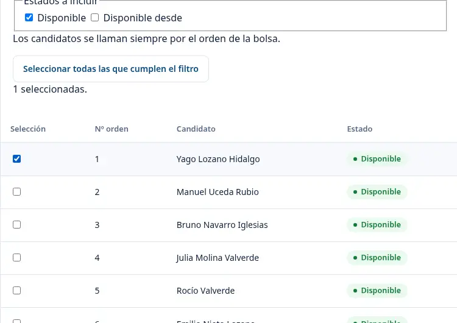

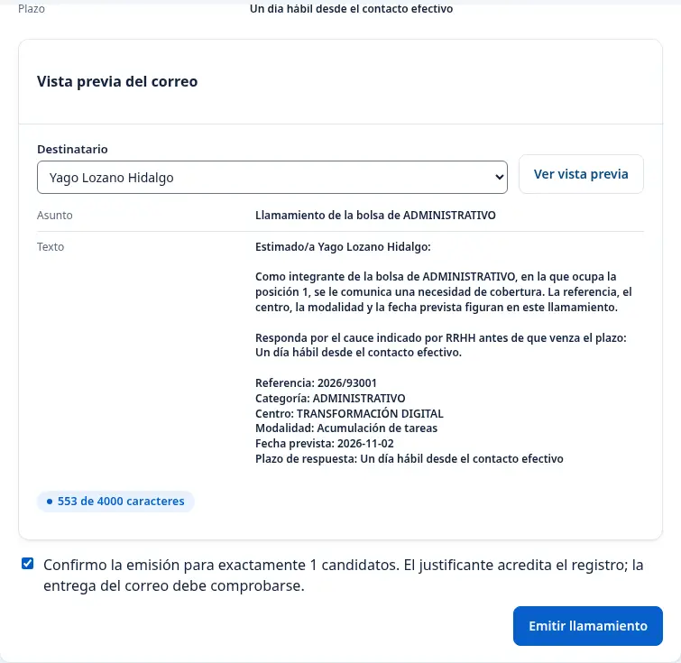

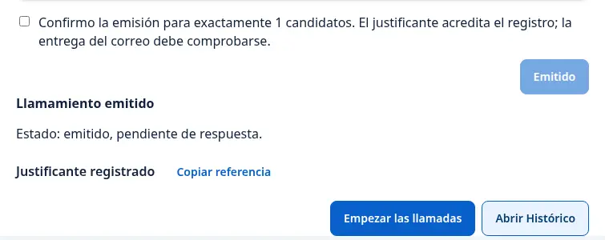

### Contacto telefónico en aquel recorrido

Pulse **Empezar las llamadas** desde el justificante del llamamiento. La lista muestra las personas de ese llamamiento por orden. Abra **Ver ficha y llamar** de la persona correspondiente.

Compruebe la franja que muestra la ficha. En el recorrido era de **09:00 a 14:00, en días hábiles**. Dentro de esa franja, seleccione el resultado que realmente ocurrió y pulse **Registrar resultado** una sola vez. La aplicación registra la fecha y la hora; no las cambie para simular un contacto. En el ejemplo se registró **Contactado**, sin anotación añadida. Al volver a consultar, la ficha conservó una llamada y el justificante.

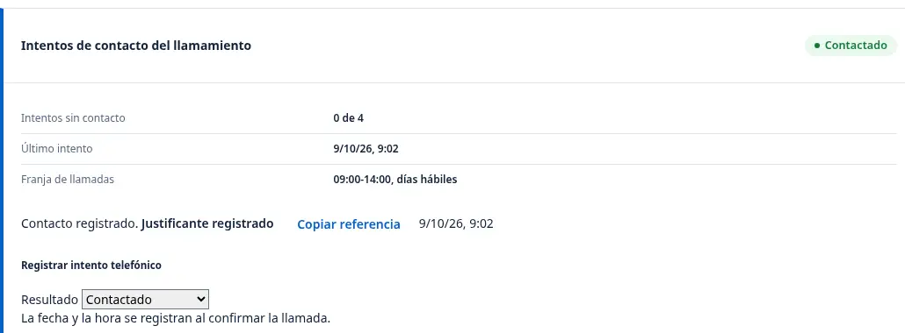

**Contactado** no significa que la persona haya aceptado o renunciado. Su respuesta se consulta por el cauce que le corresponde.

## Continuar tras la aceptación: propuesta y resolución

Estos pasos describen la continuación prevista en la ficha. Su comprobación
de principio a fin en el mismo expediente sigue pendiente.

1. Con la aceptación confirmada, abra **Preparar la propuesta de nombramiento**, revise los antecedentes y pulse **Guardar la propuesta**. Conserve el recibo; sigue siendo un borrador.
2. En **Resolución de formalización**, revise propuesta y documento. Complete número, fecha, motivo y las comprobaciones solicitadas. Pulse **Registrar validación manual** y espere el recibo. Este registro no firma la resolución.
3. En **Documentos**, descargue los PDF o Word que necesite. Compruebe expediente, contenido y si están pendientes de firma.
4. En **Firma**, la resolución sigue el orden Jefatura del Servicio, Diputado o Diputada y Secretaría General. Cada persona firma con su propio acceso y conserva su recibo. Los documentos restantes se descargan sin atribuirles una firma inexistente.

La firma en una copia parcial no acredita que el recorrido completo esté
terminado ni que se haya enviado nada al portafirmas externo.

## Incorporación, Personal, grabación manual y cese

El orden es importante: primero acredita la incorporación el centro; después
RRHH confirma el alta en Personal y prepara la grabación manual.

1. Espere el recibo con el que el centro acredita la incorporación y su documento. Una aceptación del llamamiento no sustituye esa acreditación.
2. En **Paso a Personal**, revise el plan de incorporación: persona, categoría, puesto, plaza, fechas y documento de formalización. Confirme solo si las comprobaciones son correctas y conserve el recibo de alta confirmado.
3. En **GINPIX**, descargue la ficha para grabarla manualmente en la aplicación de personal. Confirme en VEC el número y la fecha de esa grabación cuando se haya hecho. El recibo de VEC no acredita una transmisión automática a GINPIX.
4. Cuando proceda el cese, registre causa y justificante desde **Cese**, revise las fechas y conserve el recibo.
5. Compruebe en la bolsa que la persona vuelve a **Disponible** o **Disponible desde**, según la regla aplicable. Después cierre el expediente cuando la ficha lo permita.

El alta, la ocupación y el cese se realizan durante el recorrido: no se dan
por hechos porque la copia tenga ya preparada la bolsa. Falta acreditar este
tramo completo, su cierre y la recuperación tras reiniciar en el mismo caso.

## Inscripciones y alegaciones de aspirantes

En **Bolsas → Solicitudes y admisión**, elija la convocatoria, abra la solicitud
y revise requisitos y méritos declarados. Registre la decisión y su motivo.
Una admisión deja pendiente la incorporación a la bolsa: esta se registra
aparte con la bolsa constituida y el acta que corresponda.

En **Bolsas → Alegaciones**, seleccione la convocatoria o bolsa y abra la
alegación para leer lo solicitado y consultar su justificante. Consultarla no
la resuelve ni convierte su presentación en un registro oficial.

## Cancelar un expediente antes de la fiscalización

Mientras el expediente no se haya fiscalizado, la ficha muestra el apartado **Cancelación del expediente**. Pulse **Cancelar expediente**, elija el motivo en la lista («Seleccione un motivo») y, si quiere, escriba una observación. Mientras el formulario está abierto solo queda **Volver sin cancelar** para salir sin hacer nada. Después pulse **Cancelar el expediente**. La ventana de confirmación nombra el expediente por su número, por ejemplo «Expediente 2026/CT-000022, versión 3.».

Al confirmar, el apartado dice «Expediente cancelado.» y muestra la fecha, la fase en la que se canceló y el justificante, que se puede copiar. **Siguiente paso** pasa a «Expediente cancelado», y el **Historial** añade «Expediente cancelado». En **Fases del expediente**, las fases ya hechas siguen marcadas como hechas, la fase en la que se canceló dice «Cancelado en esta fase» y las siguientes, «No se hará». Con la pantalla en inglés, los motivos también salen en inglés y el historial dice «Case cancelled».

## Si algo sale mal

Si tras confirmar la cobertura aparece «La cobertura está confirmada, pero la asignación no está disponible. Conserve el recibo y solicite revisión», no confirme la cobertura de nuevo. Vuelva a la lista y abra el mismo expediente. En el recorrido, la ficha recuperada mostró el formulario de asignación. Si no aparece, conserve el número del expediente y el mensaje visible, y comuníquelos a Informática.

Si la ficha telefónica dice «Fuera de la franja», espere al horario indicado. No registre una llamada con otra hora ni abra otro llamamiento. Si una respuesta queda incierta, recupere el expediente o el justificante antes de repetir cualquier acción.
