# RRHH: de la petición del centro al primer contacto

Actualizado el 4 de noviembre de 2026. La navegación se comprobó el 8 de octubre de 2026. El recorrido desde una petición ratificada hasta el primer contacto se comprobó el 9 de octubre. Las cifras y personas de las imágenes pertenecen a esos ejemplos y pueden cambiar. Los apartados revisados el 27 de octubre dicen en cada caso qué se ha comprobado en pantalla y qué no.

## Entrar en Inicio

Abra [el portal de Recursos Humanos](https://vec.cidonia.cloud/portal-empleado/?lang=es#portal) con su acceso de RRHH. La primera pantalla se titula «Inicio». En «Lo pendiente» verá los plazos y las incidencias. Más abajo aparecen las peticiones por fase y un resumen de bolsas de trabajo.

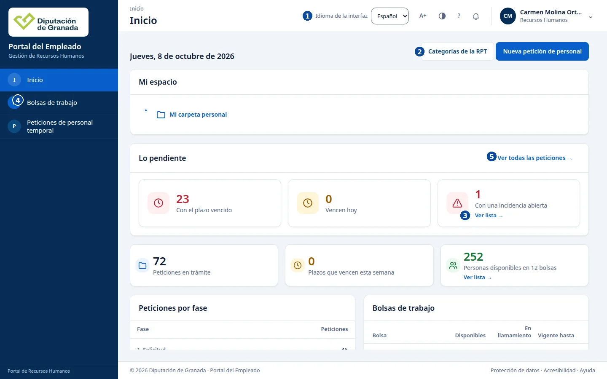

En una pantalla estrecha, los mismos apartados se colocan uno debajo de otro:

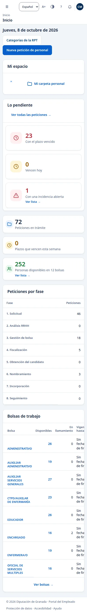

## Cambiar el idioma · 1

Abra «Idioma de la interfaz» **(1)** y elija «English» o «Español». El título y los nombres de los controles cambian al idioma elegido. Puede volver a elegir español desde el mismo selector.

## Consultar las categorías de los puestos · 2

Desde Inicio, pulse «Categorías de la RPT» **(2)**. RPT es la relación de puestos de trabajo. Se abre el «Listado de categorías», con un campo «Buscar categoría o grupo», otro de «Grupo o subgrupo» y el número de categorías encontradas. El día de la comprobación se mostraban 151.

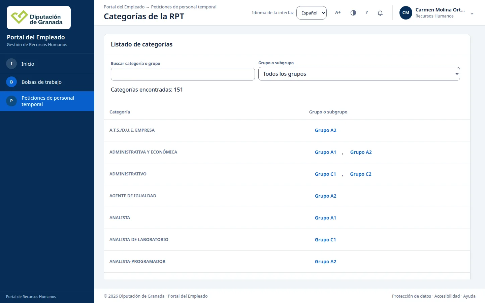

## Localizar una petición con incidencia · 3

En «Lo pendiente», pulse «Ver lista» bajo «Con una incidencia abierta» **(3)**. Se abre «Gestión de peticiones de personal temporal» con el filtro «Con una incidencia abierta» visible. La lista indica cuántas peticiones cumplen el filtro; el día de la comprobación mostraba «1 de 1 peticiones».

En la fila puede leer el número de expediente, el centro y la categoría, la fase, el estado y el plazo. El caso mostrado estaba en «Fiscalización», «Fase 4 de 8», con estado «Con incidencia» y plazo «Vencido». Pulse «Inicio» en el menú lateral para volver a la portada.

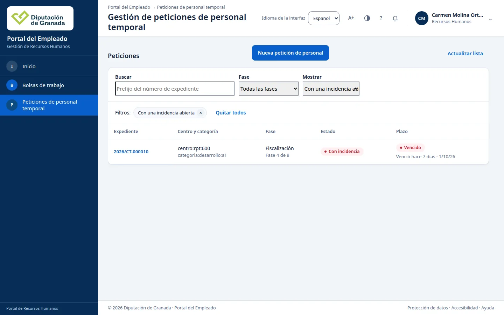

## Consultar el resumen de bolsas · 4

Pulse «Bolsas de trabajo» **(4)** en el menú lateral de Inicio. Se abre «Bolsas de trabajo activas». Sus indicadores muestran bolsas visibles, aspirantes, disponibles y personas en renuncia; la tabla desglosa las cifras por bolsa. El día de la comprobación mostraba 12 bolsas, 390 aspirantes y 252 disponibles. Es un resumen de bolsas, no una lista de personas filtrada.

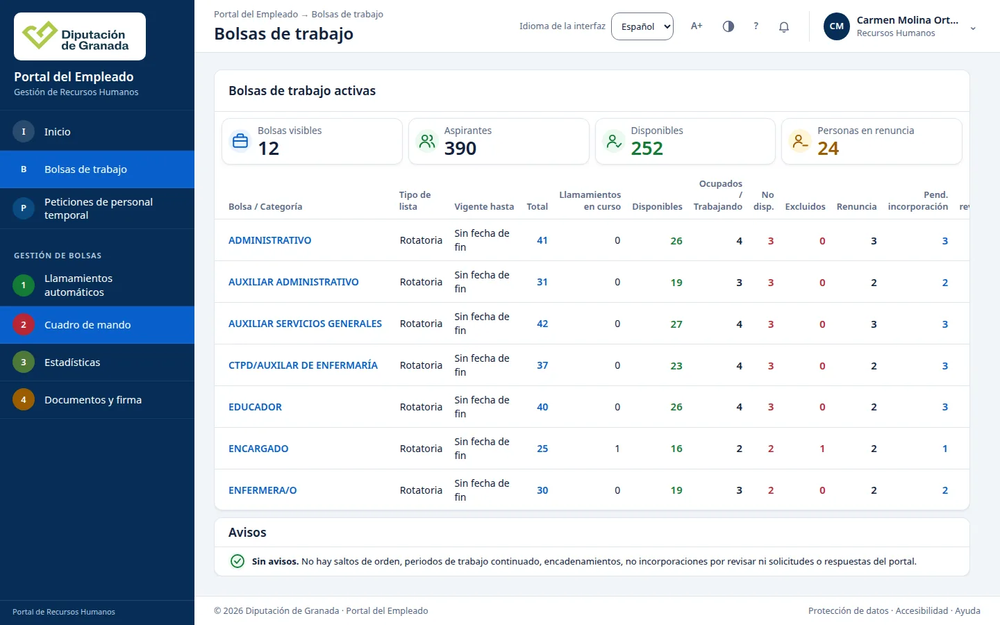

El 2 de noviembre de 2026 se vio la misma pantalla en una copia nueva, con 17 bolsas y 243 aspirantes. Si su pantalla es estrecha, la última columna de la tabla, **En revisión**, sale cortada; desplace la tabla hacia la derecha para leerla (está anotado en [los pendientes](PENDIENTES.md)).

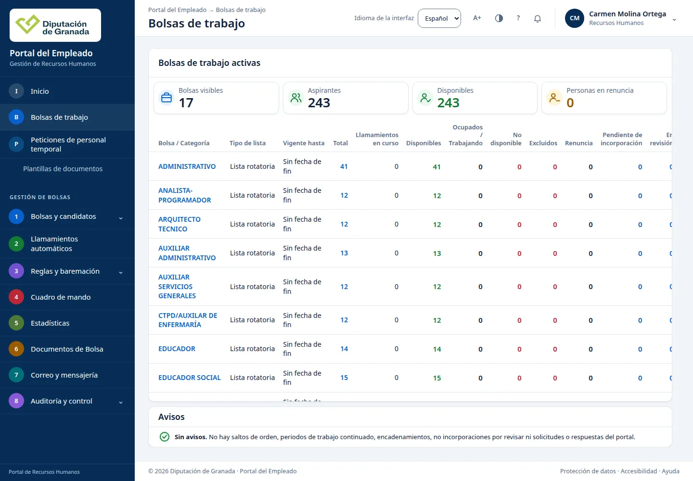

Para volver a Inicio, pulse «Inicio» en el menú lateral o use el botón Atrás del navegador.

## Ver los integrantes de una bolsa

En «Bolsas de trabajo activas», pulse la cifra de la columna «Disponibles» de la bolsa que necesita. Se abre «Candidatos de la bolsa» con la situación «Disponible» ya elegida y la relación ordenada de esas personas. En el ejemplo, ENCARGADO muestra 16 personas disponibles.

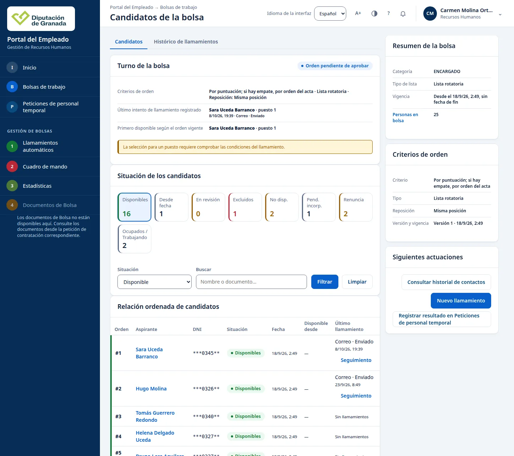

Use «Buscar» para localizar a una persona por nombre o documento y «Situación» para consultar otro estado. Pulse «Filtrar» para aplicar los cambios y «Limpiar» para quitarlos.

## Ver a una persona que espera tras un cese

Cuando una persona cesa, pasa un tiempo de espera antes de volver al turno de la bolsa. Durante esa espera, en la lista de candidatos y en su ficha:

- Su situación es **Sin ofertas hasta una fecha**. No cuenta en la situación **Trabajando**.
- En la columna **Orden** no tiene número. Debajo se lee «Fuera de turno: espera tras un cese».
- La columna **Fecha de vuelta a ofertas** y la ficha, en **Vuelve a recibir ofertas el**, dan el día de la vuelta, sin hora.

Desde el día de la vuelta, su situación es **Disponible** y recupera su número de orden, con la nota «Retorno al turno tras cese verificado». La ficha muestra ese día en **Recibe ofertas desde el**.

En «Mi bolsa», la persona ve la misma fecha en «Vuelve a recibir ofertas el», y su historial llama al cese «Cese comunicado a Bolsa», con la fecha del cese.

Esto se ha deducido del funcionamiento de la aplicación y de sus pruebas. Todavía no se ha comprobado en pantalla.

## Revisar las solicitudes para entrar en una bolsa

1. En el menú lateral, bajo **Gestión de Bolsas**, abra **Bolsas y candidatos** y pulse **Solicitudes y admisión**. También puede entrar por **Convocatorias**, que muestra solo la lista de convocatorias.
2. En **Solicitudes para entrar en bolsa**, bajo **Elija una convocatoria**, verá el número de convocatorias y una tarjeta por cada una. La tarjeta muestra la categoría, su estado (**Publicada**, **Sustituida** o **Retirada**), el **Fin del plazo** y cuántas solicitudes quedan pendientes, por ejemplo «1 solicitud pendiente». Las convocatorias con el plazo terminado llevan la marca **Plazo finalizado** y también se pueden abrir.
3. Pulse la tarjeta de la convocatoria. Se abre su lista, con el filtro **Estado** en **Pendiente**. Para ver otro estado, elíjalo y pulse **Filtrar**. Para elegir otra convocatoria, pulse **Cambiar convocatoria**.
4. La tabla muestra **Aspirante**, **Estado**, **Categoría** y **Presentada el**. Pulse el enlace de la primera columna, por ejemplo «Ver solicitud presentada el 10/10/26».
5. Debajo se abre **Revisar solicitud**, con la convocatoria, la categoría, el estado, la fecha de presentación, el **Plazo de solicitud** y los **Requisitos de acceso**. Pulse **Cerrar detalle** para volver a la lista.

Si no hay ninguna convocatoria, la pantalla dice «0 convocatorias» y «No hay convocatorias publicadas que pueda gestionar con este acceso. Si esperaba alguna, consulte con la persona responsable.».

Desde el detalle se puede **Admitir a la convocatoria**, **Rechazar solicitud** o, cuando se apruebe la lista definitiva, **Incorporar a la bolsa** con el **Número del acta de la lista definitiva (obligatorio)**. Cada decisión pide confirmarla antes de registrarse.

Lo que se comprobó en Chrome el 27 de octubre, en una copia de desarrollo, fue la lista de convocatorias, la lista de solicitudes de una convocatoria y el detalle, además del caso sin convocatorias. Admitir, rechazar e incorporar a la bolsa se vieron en Chrome el 4 de noviembre en una copia nueva, antes y después de reiniciar.

## Preparar un borrador de convocatoria

En el menú lateral, bajo **Gestión de Bolsas**, abra **Bolsas y candidatos** y pulse **Elaboración y borradores**. Se abre **Borradores de convocatorias**, con la lista **Mis borradores** y el botón **Nuevo borrador**. Cada borrador muestra **Título**, **Bolsa**, **Categoría**, **Plantilla de bases** y **Última modificación**.

Al pulsar **Nuevo borrador**, rellene el **Título**, elija la **Bolsa**, la **Categoría** y la **Plantilla de bases**, y añada si quiere un **Resumen (opcional)** y una **Descripción (opcional)**. Pulse **Guardar borrador**. Las bolsas que ofrece son las reales, y las categorías salen de la relación de puestos.

Hoy no se puede crear un borrador completo, porque aún no hay plantillas de bases publicadas. Mientras falten, el botón **Nuevo borrador** aparece desactivado y la lista avisa: «Todavía no se pueden preparar ni guardar borradores: falta la lista de plantillas de bases. Puede consultar los que ya tiene.». Los borradores anteriores se pueden abrir, pero **Guardar borrador** también aparece desactivado y su plantilla figura como «Ya no está en la lista».

Si el guardado falla, lo escrito sigue en el formulario. Por ejemplo, la pantalla dice «No se ha podido guardar. Lo que ha escrito sigue en el formulario: pulse «Guardar borrador» otra vez dentro de unos minutos.». Si la sesión ha caducado, avisa: «Su sesión ha caducado. Lo que ha escrito sigue en el formulario: vuelva a entrar en otra pestaña y guarde.».

Esta pantalla se ha visto en capturas del 26 y el 27 de octubre, sin un recorrido completo.

## Abrir la lista general de peticiones · 5

En Inicio, pulse «Ver todas las peticiones» **(5)** en la cabecera de «Lo pendiente». Se abre la lista con búsqueda y los filtros «Fase» y «Mostrar». Cada fila muestra el centro y la categoría por su nombre, además de la fase, el estado y el plazo. El día de la comprobación había 72 peticiones, 46 de ellas en «Solicitud».

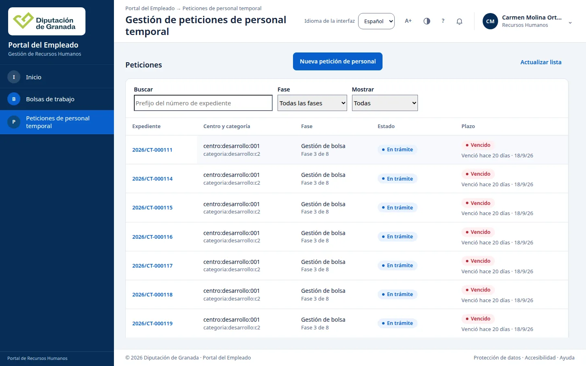

## Recibir una petición ratificada del centro

1. Abra [Peticiones de los centros](https://vec.cidonia.cloud/portal-empleado/peticiones-centro/?lang=es&vista=rrhh) con el acceso de RRHH. Las peticiones ratificadas que aún no tienen expediente aparecen con el estado de entrega **Pendiente de preparación**. Localice la suya por la fecha y hora de la columna **Ratificación** y pulse **Revisar**. Las que ya tienen expediente muestran **Expediente creado** y su número.
2. Compruebe centro, categoría, grupo, motivo, período, número de personas y jornada. Compruebe también si el centro aportó una retención de crédito o documentos. Una retención que el centro marcó con **Sí** aparece como **Declarada; la comprueba RRHH**, con el número de operación de SICAL, la fecha y el importe; compruébela en SICAL o pídasela a Intervención. En el ejemplo, el centro pidió una persona de la categoría Administrativo, a jornada completa, y no aportó retención.
3. Pulse **Crear expediente en RRHH**. En la revisión escriba el número que RRHH haya dado a este expediente en su registro habitual, marque la confirmación expresa y pulse **Crear expediente en RRHH** una sola vez. Si no dispone de ese número, deténgase.
4. La pantalla muestra el recibo del alta. Anote dos datos: el **Número visible**, que es el número del expediente, y la **Referencia del recibo**, que sirve para comprobar el alta si algo falla. Use **Abrir el expediente** para seguir con el mismo caso. En el ejemplo se creó `2026/93001`.

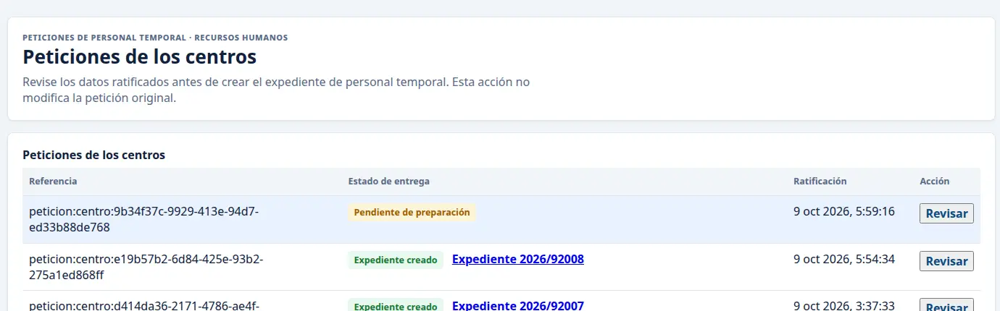

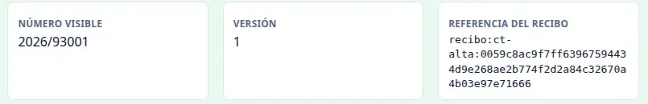

## Registrar el análisis de RRHH

Abra la ficha desde la lista y revise sus datos. En **Registrar análisis de RRHH**, elija la modalidad, la categoría, el grupo y la causa que correspondan a la petición. Compruebe fechas y jornada. La retención de crédito se elige en la lista que ofrece la pantalla. Que el centro no la aportara no significa que esté validada. RRHH contestó el 24 de octubre que la petición se admite sin retención, porque hoy solo se retiene en los programas con financiación, y que Intervención pide además el estado de la partida (respuesta 125). Si la pantalla no le deja seguir sin elegir una retención, deténgase y avise a Informática; que el análisis admita la falta de retención está pendiente.

En el recorrido, RRHH seleccionó **Acumulación de tareas**, **Administrativo**, **C1**, **Necesidad temporal**, el período solicitado y jornada completa. Eligió una retención disponible para ese ejercicio y dejó la urgencia sin marcar. Pulse **Registrar análisis** una sola vez. La pantalla confirma **Análisis guardado** y **Justificante registrado**. Al reabrir la ficha, **Análisis RRHH** aparece como **Hecho**.

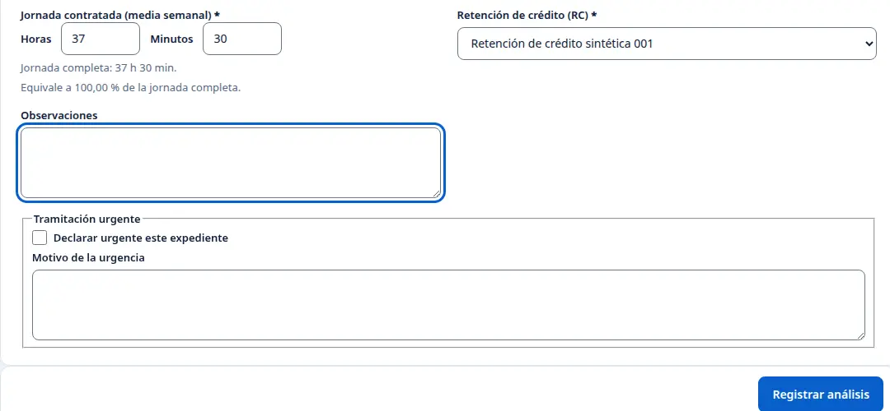

Para corregir el análisis antes de decidir la cobertura, use **Rectificar análisis de RRHH** en la misma ficha. El formulario se abre con los datos del último análisis, también el grupo y la retención de crédito. Si alguna opción ya no está en las listas vigentes, aparece sin elegir y hay que seleccionarla de nuevo. Cambie lo que haga falta, elija el motivo de la rectificación y pulse **Rectificar análisis**.

## Decidir la cobertura y asignar la unidad

1. En **Decidir la vía de cobertura**, lea las comprobaciones de la bolsa. Si la pantalla propone **Bolsa vigente** como vía viable para la categoría, selecciónela y pulse **Confirmar vía de cobertura**. Revise el aviso de confirmación antes de aceptarlo. La pantalla muestra **Decisión confirmada**.
2. Vuelva a la ficha del mismo expediente. En el ejemplo apareció **Asignar expediente a la unidad responsable**, con **Recursos Humanos** y **Responsable de peticiones de personal temporal**. Compruebe ambos datos, marque la casilla de revisión y pulse **Confirmar asignación** una sola vez. Para comprobar el resultado, vuelva a abrir el mismo expediente y consulte la actuación de asignación en **Historial**.

La cabecera de la ficha indica también el paso de la fase en el que está el expediente. Tras la asignación muestra «Fase 3 de 8: Gestión de bolsa · Asignación de unidad» y, cuando se prepara el informe jurídico, «Fase 3 de 8: Gestión de bolsa · Informe jurídico».

Con la unidad asignada, **Siguiente paso** dice «preparar el informe jurídico». **Ir al trámite de esta fase** lleva al apartado **Preparar informe jurídico**, que nombra el expediente por su número (por ejemplo, «Expediente 2026/94010, versión 4.»). Al confirmar el informe, la cabecera y **Siguiente paso** cambian en el momento a «revisar las firmas del informe». No hace falta volver a abrir la ficha: el recibo sigue en pantalla y el **Historial** de la ficha ya incluye el informe. En los dos historiales la fase se escribe igual que en la cabecera, por ejemplo «Gestión de bolsa · Informe jurídico».

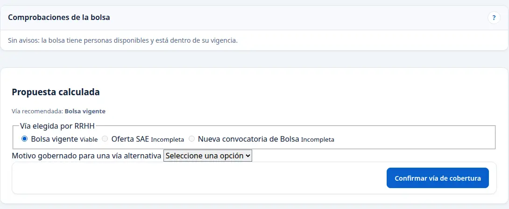

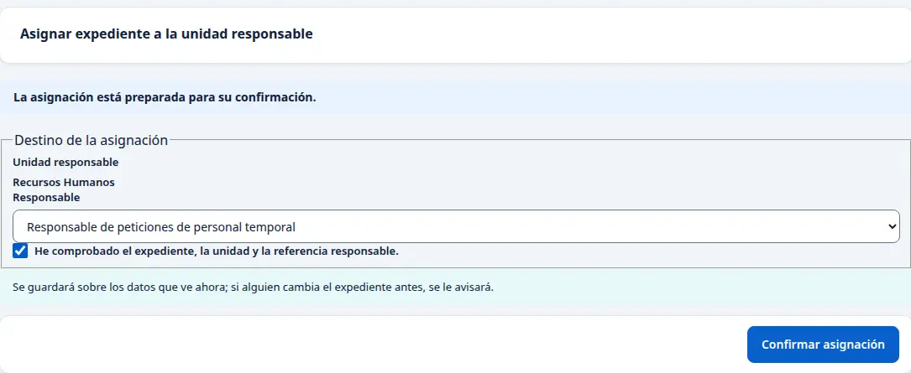

## Emitir un llamamiento para la persona elegida

Este apartado cuenta el llamamiento a una sola persona que se comprobó el 9 de octubre. RRHH decidió el 24 de octubre que la oferta llegue a la vez, por correo, a todas las personas disponibles de la bolsa, y que se formalice por orden entre quienes la acepten (respuestas 157 y 168). Solo se llama a una persona cada vez en el llamamiento directo por teléfono, cuando nadie ha aceptado la oferta. La ficha ya ofrece «Oferta a las personas disponibles», marcada al abrir, junto a «Llamar por orden». Lo que sigue corresponde a «Llamar por orden». El resto del cambio está pendiente.

Desde la ficha asignada, pulse **Abrir llamamiento en Bolsa**. El asistente conserva la petición de origen; compruebe que muestra la bolsa de la categoría correspondiente. En el ejemplo fue **ADMINISTRATIVO**, con 41 personas.

1. Pulse **Seleccionar esta bolsa**. En **Seleccionar candidatos**, marque solo a la persona que corresponda tras revisar el orden y las condiciones del llamamiento. En el ejemplo se marcó únicamente a **Yago Lozano Hidalgo**, puesto 1. Estar en la primera fila no sustituye esas comprobaciones. Si marca a alguien y antes queda una persona disponible que aún no ha sido llamada para esa necesidad, VEC no emite el llamamiento: el paso **Revisar y enviar** indica quién va antes y su número de orden. Pulse **Actualizar selección** y empiece por esa persona.
2. En **Configurar llamamiento**, compruebe la referencia, el centro y la fecha que ya trae la pantalla. Elija la modalidad y describa la necesidad con los datos de la petición. Mantenga el contacto ya registrado; no escriba un correo o teléfono nuevo para completar la pantalla.
3. Indique el plazo de respuesta que RRHH haya fijado para esa oferta. En el ejemplo se usó **«Un día hábil desde el contacto efectivo»**. Era la regla disponible para ese ejercicio; este manual no la presenta como plazo legal aprobado para otros casos. Para las ofertas por correo, RRHH fijó el 2 de octubre «dos días desde la notificación por correo». RRHH no dijo si son días hábiles o naturales. Mientras se decide si se pregunta a RRHH, VEC sigue contando 48 horas seguidas.
4. En **Revisar y enviar**, compruebe que queda **una persona**, que el aviso nombra a la persona correcta y que los canales son los previstos. En el recorrido aparecieron correo al emitir y seguimiento por teléfono. Abra **Ver vista previa**, marque la confirmación para una persona y pulse **Emitir llamamiento** una sola vez.
5. Compruebe la confirmación **Llamamiento emitido** y **Justificante registrado**. Pulse **Empezar las llamadas** para consultar el seguimiento del mismo llamamiento. **Emitido, pendiente de respuesta** indica que está esperando contestación; consulte después la entrega del correo y la respuesta de la persona.

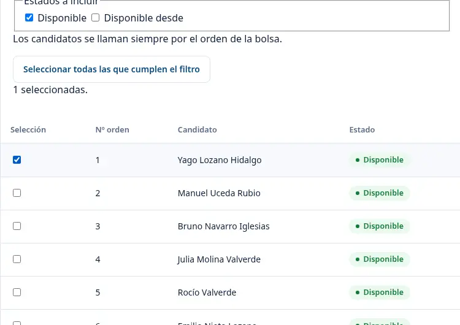

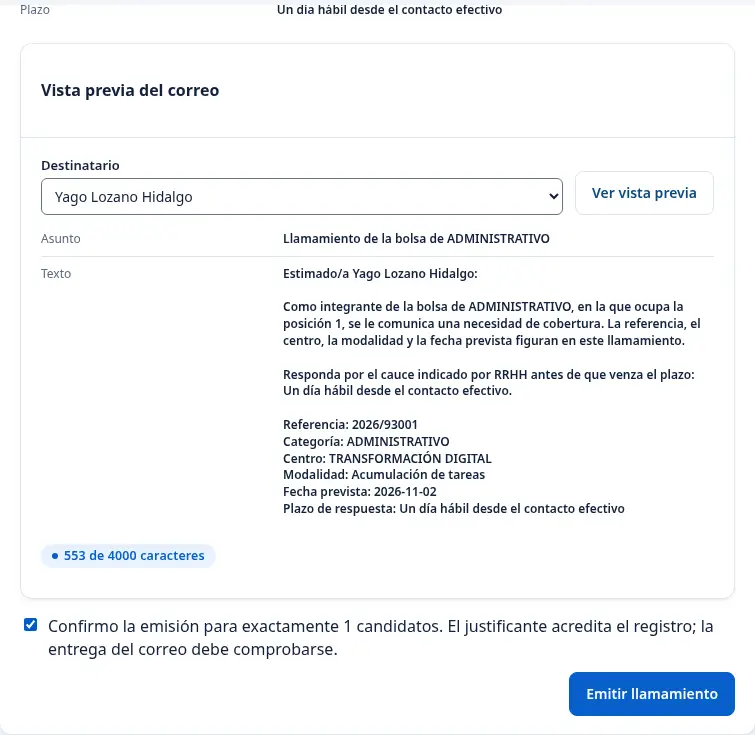

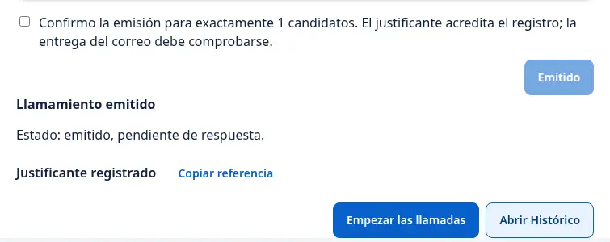

## Anotar el contacto telefónico

Pulse **Empezar las llamadas** desde el justificante del llamamiento. La lista muestra las personas de ese llamamiento por orden. Abra **Ver ficha y llamar** de la persona correspondiente.

Compruebe la franja que muestra la ficha. En el recorrido era de **09:00 a 14:00, en días hábiles**. También puede anotar una llamada hecha fuera de esa franja o en un día no hábil: RRHH pidió el 24 de octubre que se pueda (respuesta 156), y la ficha solo avisa. Seleccione el resultado que realmente ocurrió y pulse **Registrar resultado** una sola vez. La aplicación registra la fecha y la hora; no las cambie para simular un contacto. En el ejemplo se registró **Contactado**, sin anotación añadida. Al volver a consultar, la ficha conservó una llamada y el justificante.

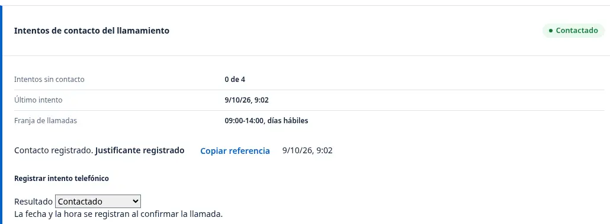

**Contactado** no significa que la persona haya aceptado o renunciado. Su respuesta se consulta por el cauce que le corresponde.

## Cancelar un expediente antes de la fiscalización

Mientras el expediente no se haya fiscalizado, la ficha muestra el apartado **Cancelación del expediente**. Pulse **Cancelar expediente**, elija el motivo en la lista («Seleccione un motivo») y, si quiere, escriba una observación. Mientras el formulario está abierto solo queda **Volver sin cancelar** para salir sin hacer nada. Después pulse **Cancelar el expediente**. La ventana de confirmación nombra el expediente por su número, por ejemplo «Expediente 2026/CT-000022, versión 3.».

Al confirmar, el apartado dice «Expediente cancelado.» y muestra la fecha, la fase en la que se canceló y el justificante, que se puede copiar. **Siguiente paso** pasa a «Expediente cancelado», y el **Historial** añade «Expediente cancelado». En **Fases del expediente**, las fases ya hechas siguen marcadas como hechas, la fase en la que se canceló dice «Cancelado en esta fase» y las siguientes, «No se hará». Con la pantalla en inglés, los motivos también salen en inglés y el historial dice «Case cancelled».

## Desistir de un expediente

Puede desistir mientras la persona no haya firmado. El apartado **Desistir del expediente** aparece al final de la ficha solo cuando el expediente está en trámite y en una fase que lo admite: fiscalización, subsanación de la unidad o nombramiento. En las demás fases el apartado no se muestra. Su ayuda («Ayuda sobre el desistimiento») recuerda que el expediente conserva sus documentos y su historia y que no se avisa a Intervención.

1. Pulse **Desistir del expediente**.
2. Elija el **Motivo (obligatorio)** y **Quién lo decide (obligatorio)**. En **Qué ha pasado (obligatorio)** escriba entre 20 y 2000 caracteres, sin datos de salud ni otros datos personales que no hagan falta.
3. Si la persona ya aceptó el nombramiento, marque la casilla **La persona no ha firmado**; con esa marca declara que todavía no ha firmado. Si no lo aceptó, deje la casilla sin marcar. Si se equivoca, al revisar la pantalla le pedirá que la marque o que la desmarque.
4. Pulse **Revisar el desistimiento**. Para salir sin hacer nada, pulse **Volver sin desistir**.
5. En **Revise antes de desistir**, compruebe el número del expediente, el motivo, quién lo decidió y lo que ha escrito. Si algo no cuadra, pulse **Volver para corregir**.
6. Pulse **Desistir** una sola vez. Mientras se guarda, la pantalla muestra «Registrando el desistimiento…».

Esto se comprobó en Chrome el 27 de octubre con un expediente en la fase de nombramiento. El mismo día se comprobó también con dos expedientes en la fase de fiscalización, con la ventana ancha y con una de 1024 píxeles. En ese caso tampoco se avisó a Intervención.

El 3 de noviembre se desistió de un expediente fiscalizado en el que una persona ya estaba adjudicada. La persona volvió a su posición en la bolsa y el historial explica por qué. Se vio también después de reiniciar.

## Retirar una oferta abierta

Si una oferta abierta impide desistir, el aviso de la ficha enlaza con ella en **Gestionar ofertas**.

1. Abra la oferta vinculada al expediente y elija retirar la oferta.
2. Seleccione un motivo de la lista y revise la confirmación.
3. Confirme una sola vez y conserve el justificante.

Si se pierde la respuesta, vuelva a consultar la misma oferta. La pantalla permite recuperar el justificante aunque ya aparezca retirada. No empiece una retirada distinta. Retirarla no completa el desistimiento: falta encadenar el cierre de su selección con ese trámite.

La pantalla se ha probado en Chrome con respuestas simuladas. Falta comprobarla con una copia con datos y tras reiniciar.

## Consultar el justificante del desistimiento

Al confirmar, el apartado pasa a llamarse **Expediente desistido** y lleva la etiqueta **Desistido**. Muestra el **Motivo**, **Qué pasó**, el **Justificante del desistimiento** y la **Situación en la bolsa**. Al recargar la ficha se ve lo mismo.

El justificante no se descarga. Pulse **Copiar referencia** y guarde esa referencia con el expediente; la pantalla responde «Referencia copiada».

En **Situación en la bolsa** puede leer, por ejemplo, «Ha vuelto a la bolsa», «Llamamiento cerrado» o «Sin llamamiento vinculado», que significa que no había nadie que devolver a la bolsa.

Después de desistir, la ficha ya no ofrece **Seguimiento del nombramiento**, **Resolución de formalización**, **Registrar incorporación** ni **Actualizar las opciones**. Si el expediente estaba en fiscalización, tampoco ofrece seguir con la lista de la oferta ni abrir llamamientos. Solo quedan **Volver a la lista**, **Copiar referencia** y **Consultar auditoría de este expediente**. El **Historial** añade «Expediente desistido» con la fase, por ejemplo «Expediente desistido · Fase: Fiscalización». El aviso de arriba enlaza con **Expediente desistido**. La etiqueta dice **Desistido** y el circuito de firma ya no ofrece firmar ni preparar la resolución. Si la lista general no dice «Desistido», avise: el estado correcto es ese.

## Cuando la persona no se incorpora

Si la persona adjudicada no se incorpora, en la ficha abra **Seguimiento del nombramiento** y siga los pasos del [apartado 5.8 del manual de Jefatura](jefatura_rrhh.md#58-si-la-persona-no-se-incorpora). La regla exige dos personas distintas de Recursos Humanos: usted propone y otra persona confirma con su propio certificado. Tras la confirmación, el expediente vuelve a Fiscalización y puede seguir con la siguiente persona de la bolsa. Se recorrió el 3 de noviembre.

## Cuando la bolsa se agota

Si no queda nadie en la bolsa, la ficha ofrece en **Documentos generados** la oferta al Servicio Andaluz de Empleo, en PDF y en Word. Solo aparece con la bolsa agotada. La titulación exigida sale del subgrupo; lo que RRHH no ha contestado queda marcado «a completar por RRHH». El envío lo hace RRHH por CONVOCA. Se vio el 3 de noviembre.

## Preparar la propuesta de nombramiento desde la ficha

En un nombramiento derivado, si pierde la respuesta al guardar la propuesta,
recupere el mismo intento. VEC devuelve la propuesta y el justificante originales,
con su fecha, aunque el expediente ya haya avanzado a Nombramiento.

Esta parte todavía no se ha comprobado con datos de una copia; solo se ha visto con respuestas de prueba. Cuando la plaza de una oferta ya está formalizada, la ficha debe mostrar **Preparar la propuesta de nombramiento** con el nombre de la persona y «Persona seleccionada en la plaza 1 de la oferta formalizada.». La propuesta se guardaría como borrador sin firma con **Guardar la propuesta**, pero ese guardado aún no se ha comprobado en una copia con datos. No lo dé por terminado. Además, una oferta antigua puede no ofrecer la propuesta.

## Lo que VEC hace por su cuenta

**Al publicar una oferta.** VEC manda un correo electrónico a cada persona disponible de la bolsa, en el mismo momento. La pantalla cuenta los avisos pendientes, enviados, sin confirmación y fallidos. Si algunos quedan pendientes, pulse **Enviar avisos pendientes**. VEC pide confirmar antes si puede haber duplicados.

**Al emitir un llamamiento por orden.** VEC manda un correo electrónico a la persona llamada, con su nombre, su posición en la bolsa, la bolsa y el plazo. Lo manda a la dirección que ella ha confirmado en **Mis correos** o, si no tiene, a la del alta. La ficha del contacto guarda a qué dirección fue y si salió. El plazo de respuesta lo abre anotar el contacto.

**Al anotar el aviso en un expediente.** VEC guarda la comunicación con su recibo y manda un correo con el número del expediente, la categoría y el centro. Repetir la misma anotación no manda otro correo.

**Plazos.** VEC calcula el plazo cuando usted abre la pantalla y lo marca como **En plazo**, **Vence hoy** o **Vencido**. El último día cuenta entero. Al vencer un plazo sin respuesta, VEC propone **Sin respuesta en plazo**. Usted comprueba que no ha llegado nada, marca las dos casillas y confirma. Solo entonces el llamamiento se cierra y puede llamar a la siguiente persona.

**Situación de las personas.** Cuando usted confirma una aceptación, VEC pasa a la persona a **Pendiente de incorporación**. Al acreditarse la incorporación y el cese, VEC cambia la situación en la bolsa. Tras el cese calcula la fecha desde la que la persona vuelve a recibir ofertas.

**Fase del expediente.** Cada vez que usted confirma un paso, la cabecera de la ficha cambia de fase y dice cuál es el siguiente. Si una segunda persona confirma una no incorporación, el expediente vuelve a Fiscalización.

**Avisos de la bolsa.** La pestaña **Avisos** reúne los casos que piden su atención: saltos de orden, encadenamientos de contratos, solicitudes y respuestas que llegan por el portal y no incorporaciones por revisar.

**Documentos.** Si no queda nadie en la bolsa, la ficha prepara la oferta al Servicio Andaluz de Empleo en PDF y en Word. El resto de borradores se preparan cuando usted los pide, con un código para comprobarlos después.

**Justificantes y constancias.** Cada paso confirmado deja un justificante. Si repite la misma operación, VEC le devuelve el mismo justificante. Cuando usted abre el correo o el teléfono completos de una persona, VEC anota quién, cuándo y con qué perfil.

## Ver el turno de una bolsa y la ficha de una persona

**Visto el 2 de noviembre de 2026** en una copia nueva.

Desde **Bolsas de trabajo**, pulse la cifra de **Disponibles** de la bolsa. En **Candidatos de la bolsa**, la pestaña **Candidatos** muestra primero **Turno de la bolsa**: los criterios de orden, el último intento de llamamiento y quién es la primera persona disponible según el orden vigente. Debajo, **Situación de los candidatos** cuenta las personas en cada situación. A la derecha están el resumen de la bolsa, los criterios de orden y el acceso al historial de contactos.

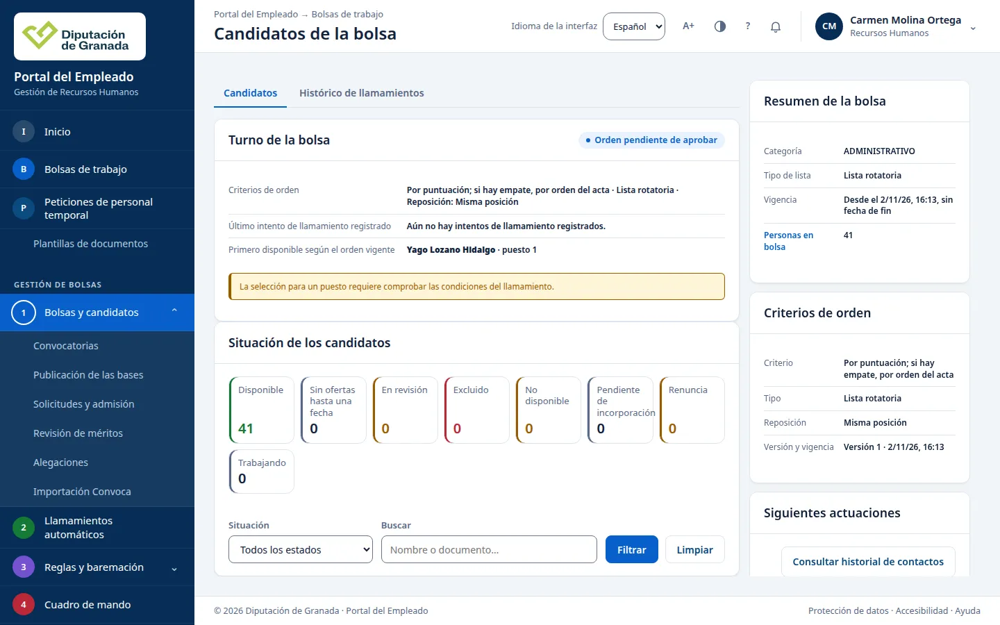

Si el orden de la bolsa aún no está aprobado, la pantalla lo avisa con **Orden pendiente de aprobar**. Mientras tanto, la selección para un puesto pide comprobar antes las condiciones del llamamiento.

Pulse el nombre de una persona para abrir su ficha. Muestra la bolsa, la vigencia, el número de orden, la situación, el último llamamiento, los contactos hechos y el contacto de la persona con los datos tapados en parte.

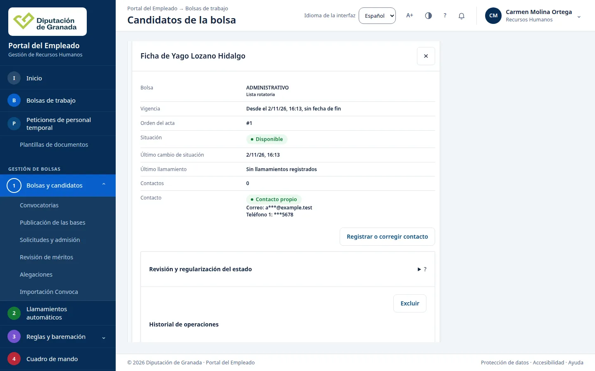

## Cambiar la situación de una persona

**Visto el 2 de noviembre de 2026** en una copia nueva.

1. En la ficha de la persona, pulse **Cambiar situación**.
2. En **Nueva situación**, elija la que corresponda. En el ejemplo se eligió **Renuncia**.
3. Escriba el **Motivo**. Si la situación lo pide, indique también la fecha de disponibilidad.
4. Pulse **Revisar cambio de situación**, compruebe los datos y confirme.

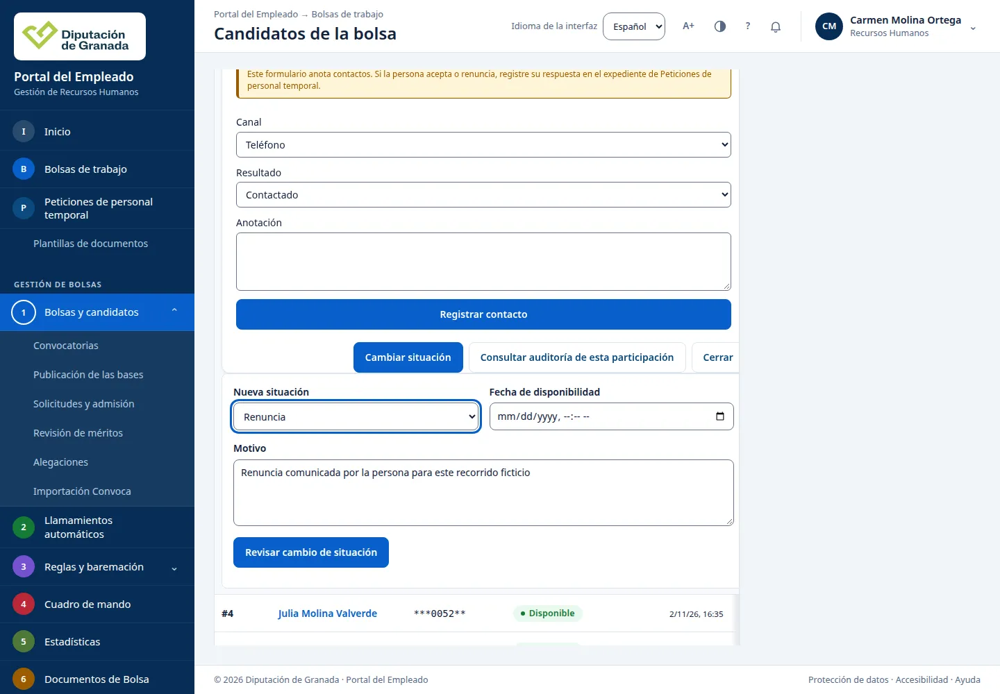

La ficha muestra después la situación nueva (**Renuncia**), la hora del cambio y el aviso **Cambio registrado. Justificante registrado**. Pulse **Copiar referencia** para conservar el justificante. Si la persona renuncia con justificante, **Consultar justificante de renuncia** lo abre.

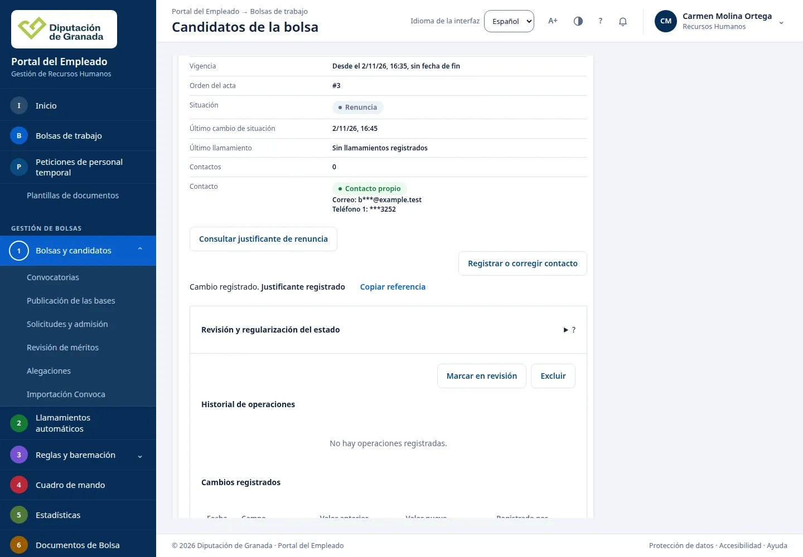

El formulario de contacto de esa misma ficha solo anota llamadas y correos. Si la persona acepta o renuncia a una oferta concreta, esa respuesta se registra en el expediente de la petición.

## Consultar los documentos de una bolsa

**Visto el 2 de noviembre de 2026** en una copia nueva.

En el menú, abra **Documentos de Bolsa**. Elija la bolsa, el tipo de documento o escriba un texto y pulse **Buscar documentos**. Cada fila indica el documento, la fecha, la versión de la bolsa y su estado. En el ejemplo aparece la **Constitución de la bolsa**, con **Ver recibo** y **Ver lista de la bolsa**.

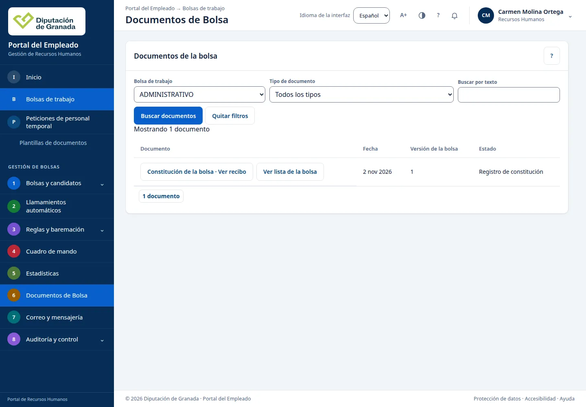

## Consultar la espera que se aplica tras un cese

**Visto el 2 de noviembre de 2026** en una copia nueva.

En **Reglas y baremación**, abra **Reglas y versiones**. En **Política de cese de Bolsa** se ve cuánto espera una persona antes de volver a recibir ofertas: **5 meses naturales** en el régimen general y **9 meses naturales** en la acumulación de tareas. La tabla **Modalidades y causas** indica qué regla se aplica a cada modalidad.

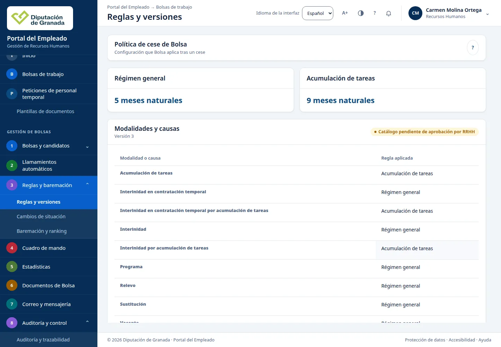

La pantalla muestra la etiqueta **Catálogo pendiente de aprobación por RRHH**. Esas esperas se pueden consultar, pero todavía no figuran como aprobadas.

## Preparar las bases y anotar su publicación

**Visto el 2 de noviembre de 2026** en una copia nueva.

1. En **Bolsas y candidatos**, abra **Elaboración y borradores** y pulse **Nuevo borrador**.
2. Escriba el **Título** (sin números de DNI ni de NIE), elija la **Bolsa** y la **Categoría**. Si añade otra categoría, pulse **Añadir otra categoría**.
3. En **¿Cómo presentan su solicitud las personas aspirantes?**, elija **Una solicitud por categoría** o **Una sola solicitud para varias categorías**. Esta elección decide lo que verá la persona aspirante al inscribirse.
4. Guarde el borrador. Resumen y descripción son opcionales.

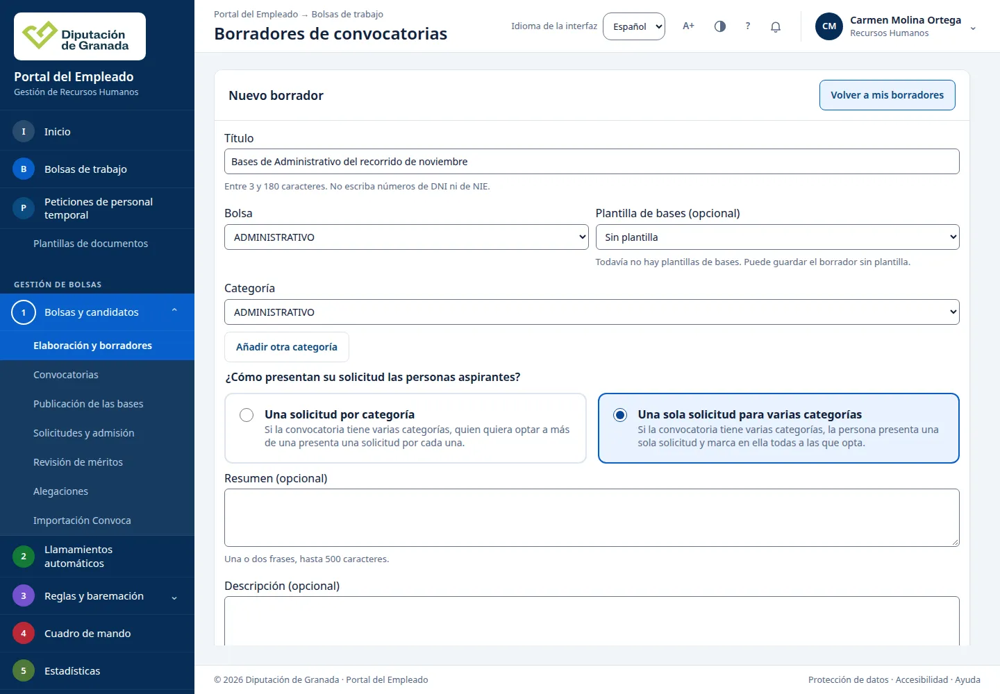

Las bases se publican fuera de VEC. Cuando ya estén publicadas, abra **Publicación de las bases**. La lista muestra cada convocatoria, su versión, la apertura del plazo y si la publicación consta como **Registrada**. Pulse **Corregir** en la fila que necesite. Indique dónde se publicó, la referencia del anuncio, la fecha y, si quiere, el enlace. Pulse **Registrar publicación**.

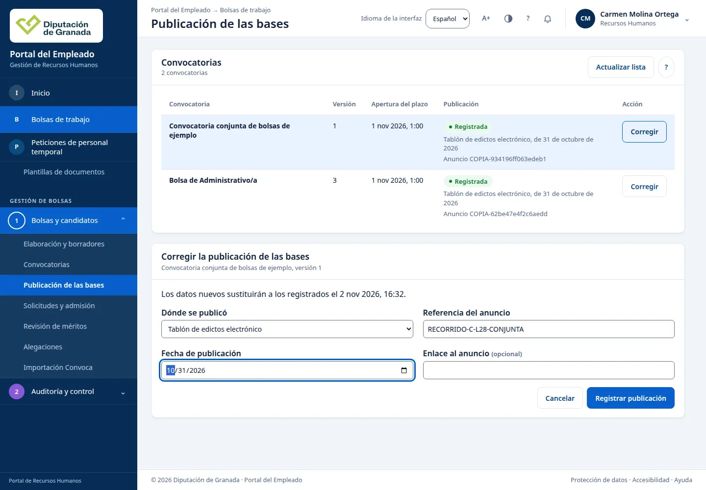

La pantalla confirma **Publicación registrada** con la hora y un **Justificante de publicación**. Si un dato no es correcto, pulse **Corregir** en su fila: la corrección sustituye a la anterior y no se pierde la historia.

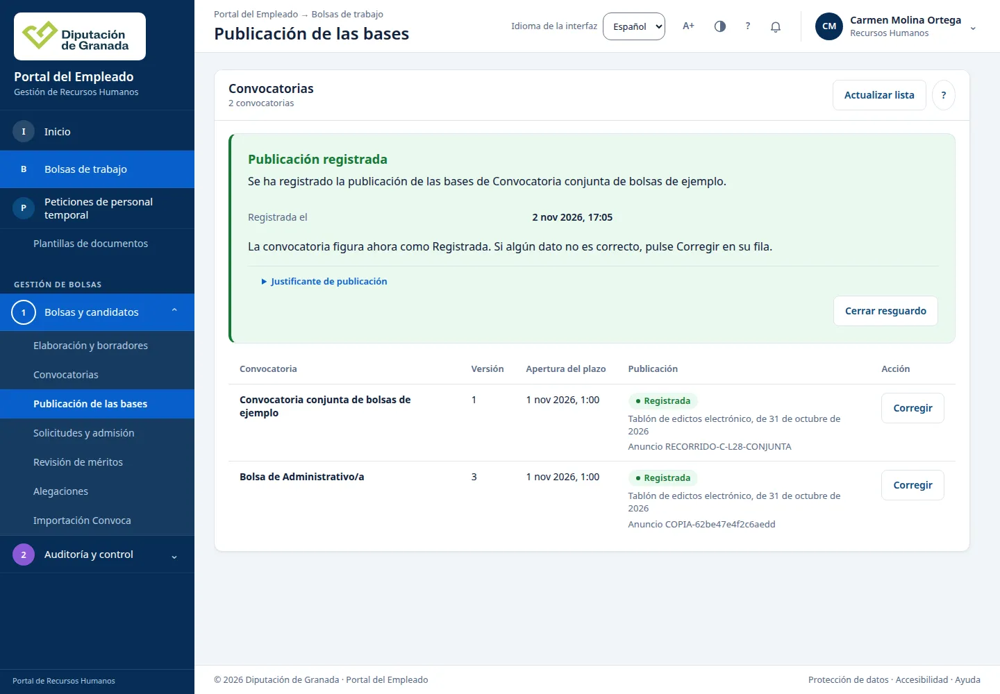

## Registrar una petición nueva desde RRHH

**Visto el 2 de noviembre de 2026** en una copia nueva.

RRHH también puede abrir una petición por su cuenta, sin esperar a que la presente un centro.

1. En **Peticiones de personal temporal**, pulse **Nueva petición de personal** (o la pestaña **Nueva petición**).
2. En **Datos**, escriba el número de expediente de la plataforma de expedientes y elija el centro, la persona de contacto, la categoría, el grupo o subgrupo y el motivo. Complete los demás datos que pida el formulario. Pulse **Revisar solicitud**.

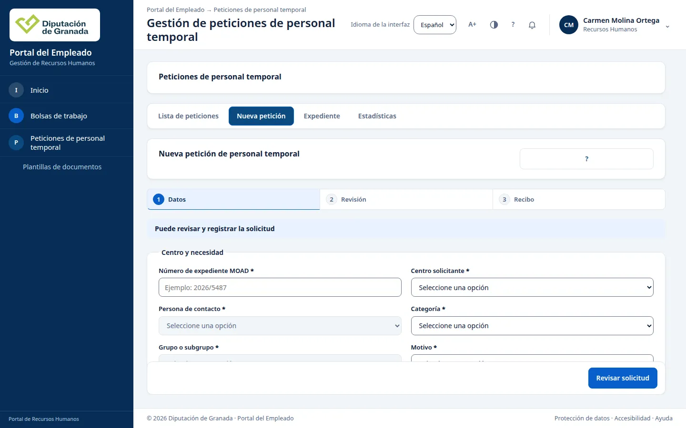

3. En **Revisión**, compruebe todos los datos. El aviso recuerda que al confirmar se solicita el alta del expediente, y que debe mirar sobre todo el período y la retención. Pulse **Confirmar y registrar** una sola vez.

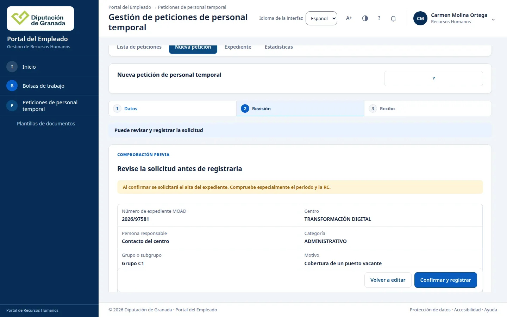

4. En **Recibo**, la pantalla dice **Solicitud registrada** y da el número de expediente, la versión, el justificante y la fecha. Conserve el justificante. Debajo se abre ya **Registrar análisis de RRHH**.

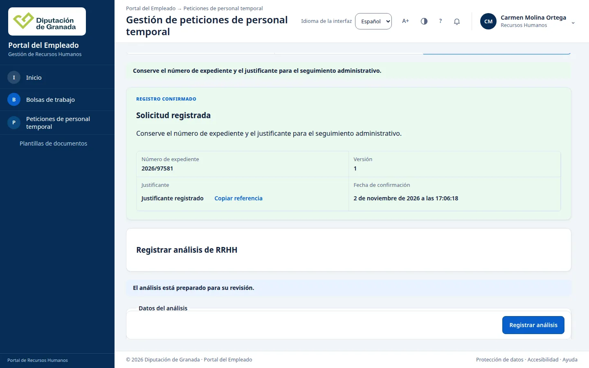

## Buscar un expediente en la lista

**Visto el 2 de noviembre de 2026** en una copia nueva.

La lista de **Peticiones de personal temporal** dice cuántas peticiones están en trámite. Filtre por **Buscar**, **Fase**, **Centro**, **Categoría** o **Mostrar**. Cada fila indica el expediente, el centro y la categoría, la fase, el estado y el plazo. Un plazo **Vencido** sale en rojo con los días que lleva vencido. Pulse la referencia para abrir la ficha.

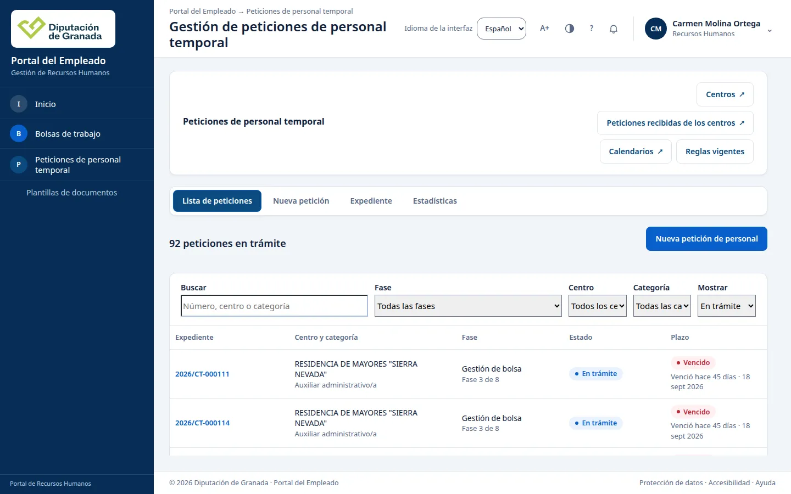

## Seguir un expediente: fases y siguiente paso

**Visto el 2 de noviembre de 2026** en una copia nueva.

La ficha del expediente empieza con la fase actual y el estado. **Siguiente paso** dice qué hay que hacer, quién lo hace y hasta cuándo. **Fases del expediente** muestra las ocho fases: lo hecho lleva una marca verde, la fase actual va resaltada y las siguientes dicen **Falta**. **Ir al trámite de esta fase** lleva al apartado donde se hace el paso.

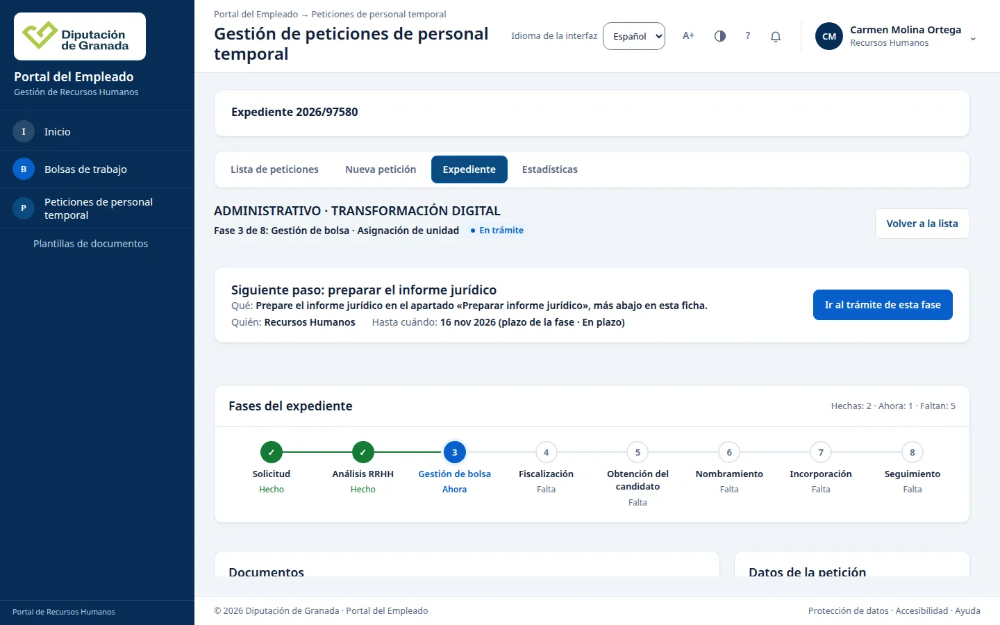

Tras registrar el análisis, la ficha muestra **Análisis guardado**, un justificante y la fecha. Tras decidir la cobertura, muestra **Vía de cobertura aplicada**: la vía elegida (en el ejemplo, **Bolsa vigente**), la versión nueva del expediente y su justificante. Luego aparece **Asignar expediente a la unidad responsable**: compruebe la unidad y la persona responsable, marque la casilla de revisión y pulse **Confirmar asignación**.

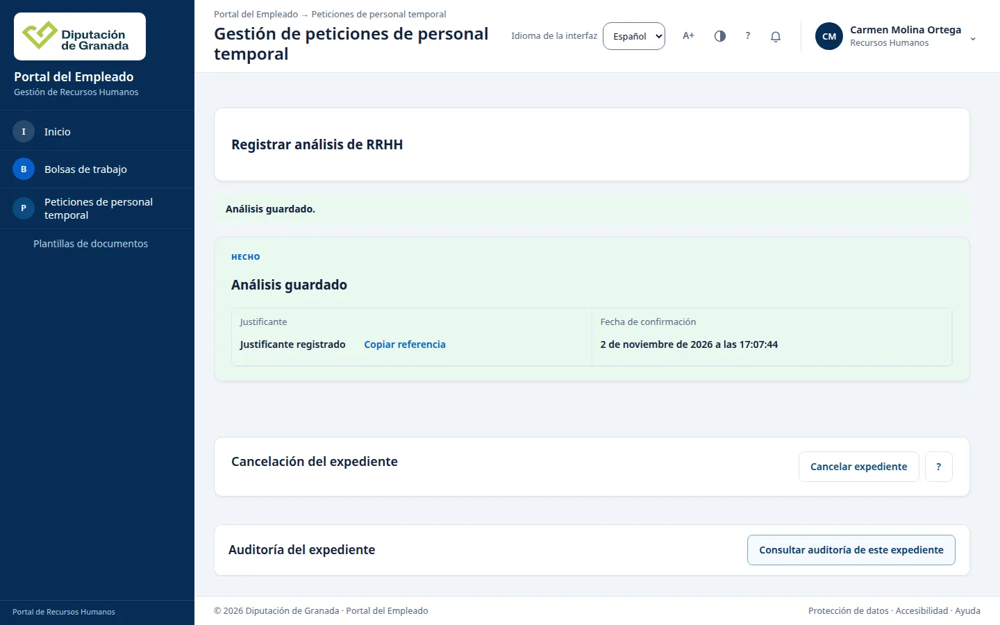

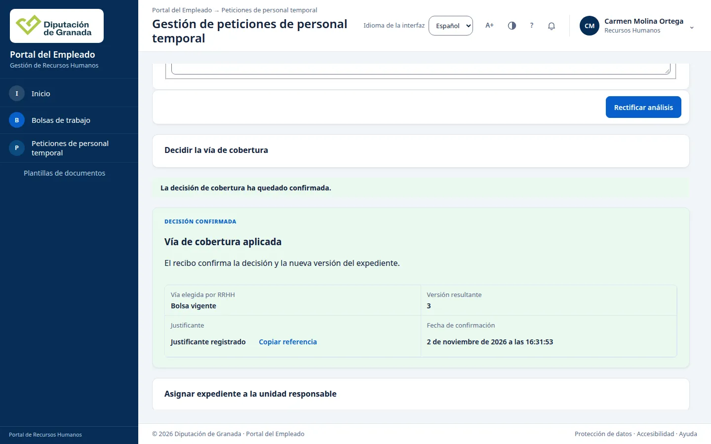

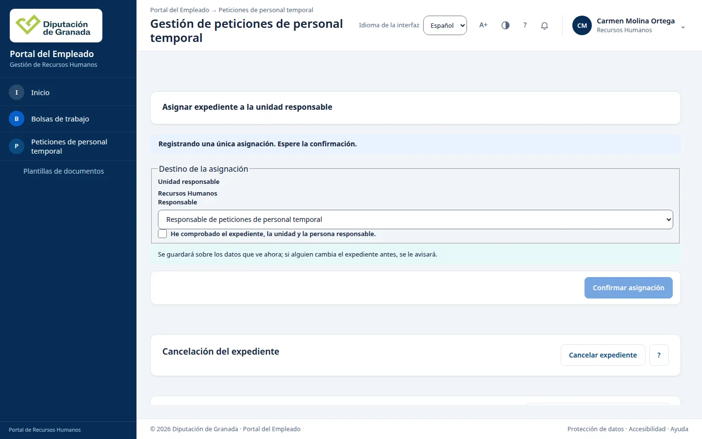

## Si Intervención pone un reparo

**Visto el 2 de noviembre de 2026** en una copia nueva, hasta emitir el informe nuevo. Falta firmar ese informe: está en [los pendientes](PENDIENTES.md).

Cuando Intervención registra un reparo, el expediente pasa a **Con incidencia**. La ficha muestra **Incidencia en «Fiscalización»**, el texto del reparo y el aviso de que queda pendiente la subsanación de la unidad. **Ver actuaciones** abre lo ya registrado.

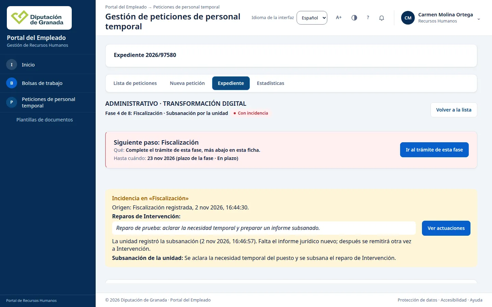

Para subsanar:

1. En **Registrar subsanación**, escriba cómo se arregla el reparo. La pantalla prepara la operación y avisa: «La operación está preparada y aún no se ha enviado». Los textos del reparo no se pueden cambiar.
2. Pulse **Enviar subsanación preparada** una sola vez. Si no sabe si se envió, use **Descargar archivo de recuperación** antes de repetir nada.

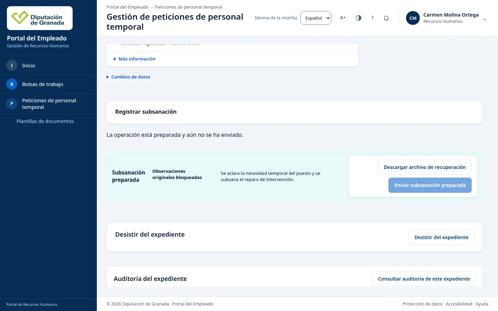

3. La pantalla muestra el **Recibo de subsanación** con la versión nueva, el estado («Subsanación por la unidad · Reparo pendiente de resolver») y el justificante.

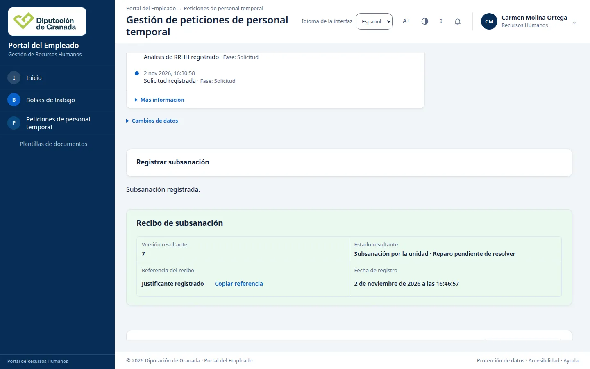

4. Emita el **Informe jurídico tras la subsanación**. La pantalla confirma **Informe jurídico nuevo emitido** con su versión, su justificante y la fecha, y recuerda que hay que firmarlo en **Circuito de firma** antes de fiscalizar de nuevo.

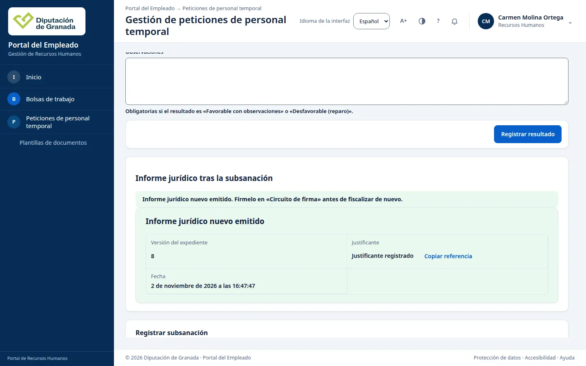

**Todavía no puede completar el paso siguiente.** Cuando se intentó firmar ese informe nuevo y volver a Intervención, la firma no se pudo registrar. No siga por esta vía hasta que se anuncie que funciona.

## Ver el circuito de firma y los borradores

**Visto el 2 de noviembre de 2026** en una copia nueva.

En la ficha, **Circuito de firma** dice qué documento falta por firmar, quién debe firmarlo y desde cuándo. En el ejemplo, el informe definitivo está como **Borrador sin firmar** y debe firmarlo la persona técnica de RRHH responsable del expediente; la resolución y la diligencia esperan a que se confirme el orden de firma. El estado general es **Pendiente de Portafirmas**.

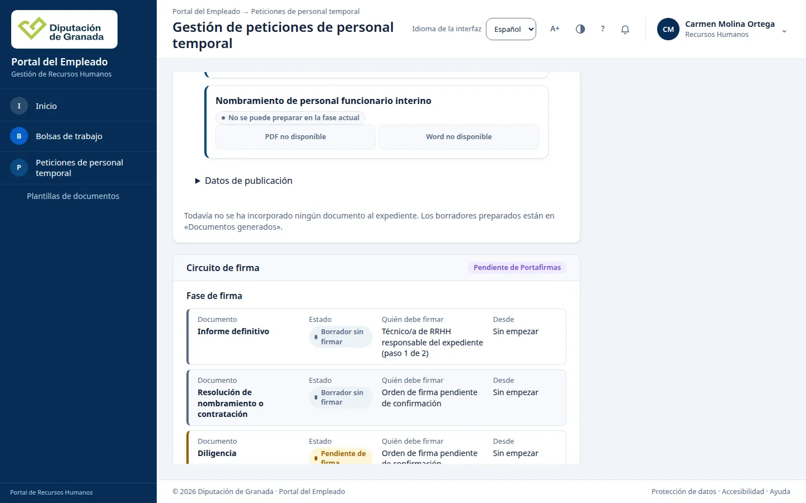

## Si algo sale mal

Si tras confirmar la cobertura aparece «La cobertura está confirmada, pero la asignación no está disponible. Conserve el recibo y solicite revisión», no confirme la cobertura de nuevo. Vuelva a la lista y abra el mismo expediente. En el recorrido, la ficha recuperada mostró el formulario de asignación. Si no aparece, conserve el número del expediente y el mensaje visible, y comuníquelos a Informática.

Si la ficha telefónica dice «Fuera de la franja», es solo un aviso y puede anotar la llamada (respuesta 156 de RRHH). No la registre con otra hora ni abra otro llamamiento. Si una respuesta queda incierta, recupere el expediente o el justificante antes de repetir cualquier acción.

Si al desistir aparece «No se ha podido confirmar el resultado. Compruebe la misma operación antes de volver a desistir.», recargue la ficha. Si ya muestra **Expediente desistido**, no lo repita. Si aparece «La persona ya se ha incorporado. Para terminar su relación use el cese.», ya no se puede desistir de ese expediente.

En el **Registro de Personal**, la pestaña **Vacantes** puede mostrar «No se pueden calcular las plazas vacantes en esta fecha: falta publicar la plantilla, la relación de puestos o la cobertura de las plazas, o hay más de una publicada. Pida a quien publica los datos de Personal que lo revise.». No es un corte de conexión, y por eso no aparece **Reintentar**: repetir la consulta no lo arregla. Pida la revisión a quien publica esos datos. Este aviso todavía no se ha comprobado en pantalla.
