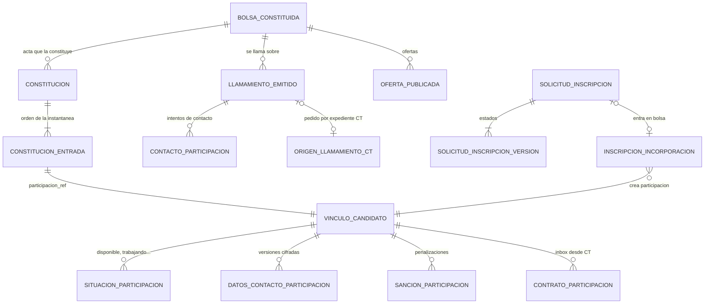
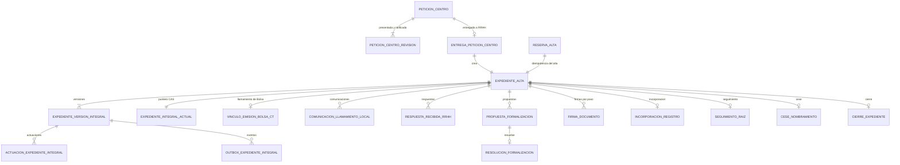
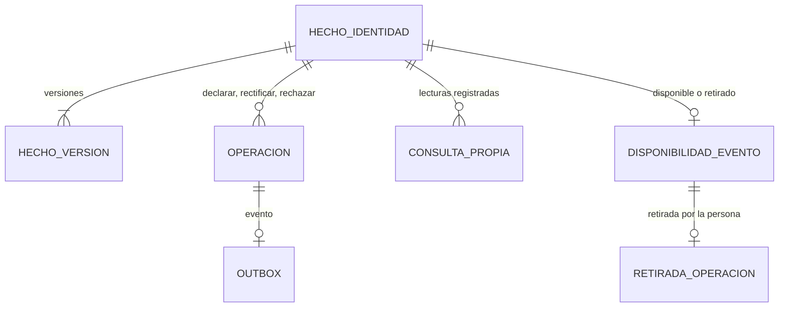
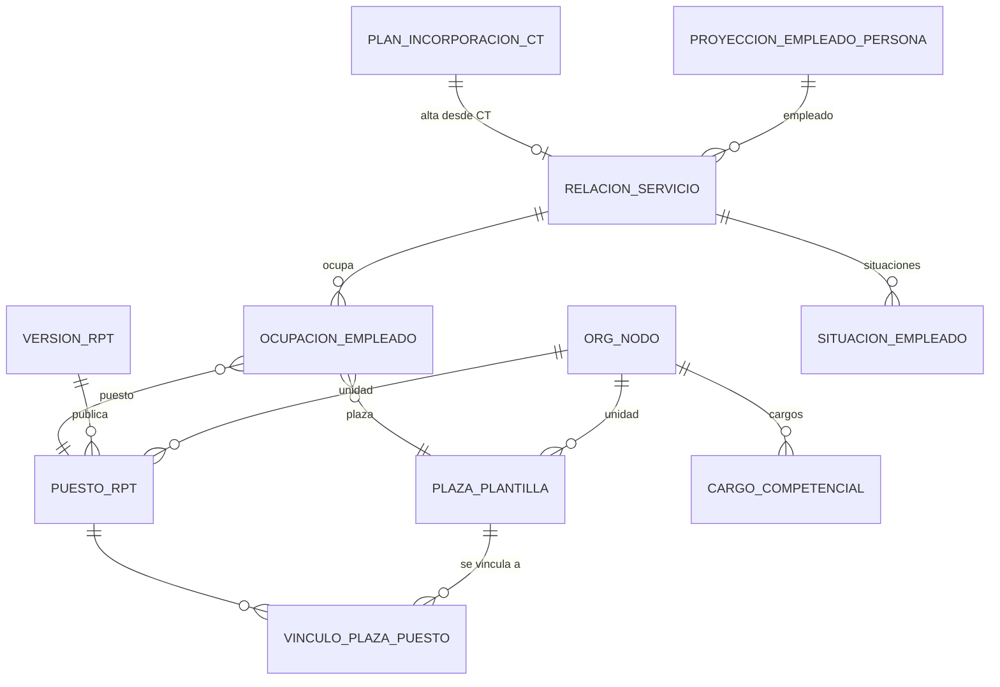
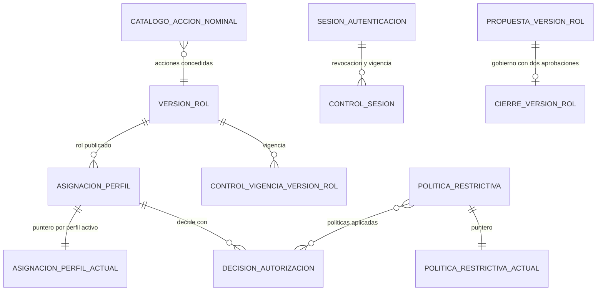
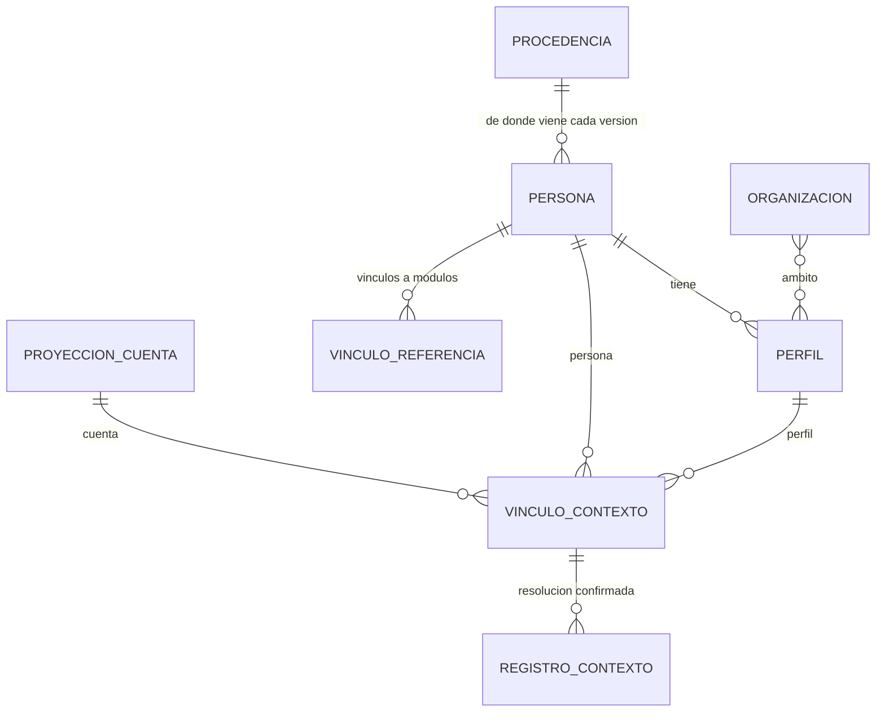

# Esquema del backend de VEC

Fuentes absorbidas el 13/10/2026: la parte de persistencia y API de
`docs/portal_vec/arquitectura_tecnica.md` (retirado), los contratos de datos de
`docs/portal_vec/contrato_modulos_vec.md` (reducido a una nota), parte de
`docs/portal_vec/seguridad_persistencia_postgresql.md`, las reglas de datos de
`AGENTS.md`, E06 y E10 de `ESPECIFICACIONES_AGENTES.md` y la decisión sobre
reglas configurables de la memoria de dirección.

Este documento explica cómo guarda VEC sus datos y cómo se llega a ellos:
esquemas PostgreSQL por módulo, tablas que conviene conocer, roles, historia,
auditoría, migraciones y API HTTP. Es lectura obligatoria antes de tocar SQL,
persistencia, autorización o rutas de API.

Desde el 13 de octubre de 2026 reúne en un solo sitio las reglas de datos que
estaban repartidas (ver «Fuentes absorbidas» al final). Si este documento y el
código no coinciden, manda el código y las órdenes vigentes de `AGENTS.md`;
anota la diferencia en tu entrega.

Documentos hermanos, que no se repiten aquí:

| Documento | Qué cubre |
| --- | --- |
| `docs/producto/PRD.md` | Qué es VEC, módulos y prioridad |
| `docs/producto/TRD.md` | Pila, procesos, arranque, configuración, despliegue y seguridad general |
| `docs/producto/FLUJO_APP.md` | Quién hace qué y en qué orden |
| `docs/producto/DISENO_UI_UX.md` | Pantallas y textos visibles |
| `docs/producto/PLAN_IMPLEMENTACION.md` | Qué falta y en qué orden |

## 1. Idea general en cinco frases

1. Hay una base PostgreSQL 18 principal (sintética, en cidonia) con **un esquema
   por módulo**; cada esquema tiene su directorio en `deploy/postgresql/<modulo>/`.
   La proyección pública de Bolsa vive en una base aparte
   (`deploy/postgresql/bolsa_publica/README.md`).
2. La aplicación **no lee ni escribe tablas**: solo ejecuta funciones
   `SECURITY DEFINER` del propietario del esquema. Las tablas tienen RLS forzada
   y ningún rol de aplicación tiene permisos sobre ellas.
3. Cada efecto (y cada lectura de datos personales) consume una **decisión de
   autorización V3** dentro de la misma transacción que escribe estado,
   historia, recibo, auditoría y outbox.
4. Nada se borra ni se sobrescribe: versiones de solo adición, un puntero
   «actual» que avanza por CAS (comparar y cambiar sobre la versión esperada),
   e idempotencia con recibo.
5. Los módulos no se tocan las tablas: se hablan con funciones nominales
   concedidas una a una, referencias opacas y outbox/inbox.

En Go, cada módulo sigue la arquitectura hexagonal de `TRD.md` (apartado 2):
`internal/modules/<modulo>/{domain,application,ports,adapters}`. Los contratos
con la base están en `ports/` y su implementación en `adapters/postgres/`. Lo
común (autorización, contexto del actor, sesiones, auditoría, documentos) está
en `internal/vec/` (`internal/vec/adapters/postgres/`, `internal/vec/auditoria/`,
`internal/vec/documentos/`).

## 2. Mapa de esquemas

Recuento de migraciones `*.up.sql` en `origin/main` a 13/10/2026. Que una
migración esté en Git no significa que esté instalada en la principal.

### 2.1 Núcleo común (identidad, autorización, auditoría)

| Directorio | Esquema | Para qué sirve | Tablas que conviene conocer | Migr. |
| --- | --- | --- | --- | ---: |
| `contexto_actor_v1` | `vec_contexto_actor_v1` | Quién es el actor: cuenta, persona, perfil, vínculos a módulos y organización. No autentica ni autoriza. | `persona_versiones/_actual`, `perfil_versiones/_actual`, `proyeccion_cuenta_*`, `vinculo_contexto_*`, `vinculo_referencia_*`, `organizacion_*`, `registros_contexto`, `procedencias`, `candidato_externo_*`, `denominacion_persona_*` | 46 |
| `identidad_sesiones_v1` | `vec_identidad_sesiones_v1` y `vec_identidad_externa_v1` | Alta seudonimizada de cuentas, alias HMAC, consumo de aserciones de un solo uso, vínculo de certificado ADMIN. Sin DNI ni nombres en claro. | `cuenta`, `estado_cuenta_actual`, `alias_hmac_cuenta`, `consumo_asercion`, `vinculo_certificado_admin_*`; externos: `cuenta`, `sesion`, `aprobacion_alta` | 20 |
| `autorizacion` | `vec_autorizacion` | Núcleo RBAC/ABAC: versiones de rol, asignaciones de perfil, políticas restrictivas, decisiones, sesiones, gobierno de perfiles y catálogo de acciones. | `version_rol`, `asignacion_perfil`/`_actual`, `politica_restrictiva`, `decision_autorizacion`, `sesion_autenticacion_v1`, `control_sesion_actual_v1`, `catalogo_accion_nominal_v1`, `propuesta_version_rol_bolsa_*` | 86 |
| `autorizacion_atestada_v3` | `vec_autorizacion_atestada_v3` | Consumo de la capacidad V3: gobierno de claves, consumo único de cada decisión, consumidores nominales por módulo y la **cadena de auditoría común**. | `consumo_decision_v3`, `atestacion_decision_v3`, `auditoria_consumo_v3`, `eslabon_auditoria_v5`, `pendiente_sellado_auditoria_v5`, `sellado_auditoria_v5`, `capturas_sello_periodico_v1`, `revocacion_*` | 296 |
| `autorizacion_atestada_v2`, `confianza_atestacion_v2`, `ejecucion_documental_v4` | homónimos | Generaciones anteriores (VEC-AD-2 y ejecución documental V4). Se conservan; no se amplían. | — | 4 / 2 / 2 |
| `catalogos_configurables` | `vec_catalogos_configurables` | Catálogos versionados que RRHH puede cambiar: categorías de la RPT y sus usos, plan de firma. | `publicacion`, `entrada_publicada`, `categoria_control`, `uso`, `historia`, `plan_firma_*` | 12 |
| `documentos` | `vec_documentos` | Metadatos y custodia de documentos; los bytes van al almacén de objetos. D20 añade `subida_local`, historia, frontera, lecturas y outbox; D22 acota el justificante de renuncia y su lectura por RRHH. | `documento`, `documento_firmado`, `identificador_documental`, `referencia_externa`, `tipo_reservado_firmado`, `outbox`; en la rama de justificantes, `subida_local`, `subida_local_historia`, `frontera_subida_local`, `subida_local_lectura`, `subida_local_outbox` | 16 en `origin/main`; D20 y D22 pendientes de integración |
| `usuarios_vec` | `vec_usuarios`, `vec_usuarios_correos_avisos` | Preferencias, correos propios e imagen de la persona. | `preferencias_*`, `correos_*`, `imagen_*` | 21 |

### 2.2 Módulos de negocio

| Directorio | Esquema | Para qué sirve | Tablas que conviene conocer | Migr. |
| --- | --- | --- | --- | ---: |
| `bolsa_llamamientos` | `vec_bolsa_llamamientos` | Corazón de Bolsa: constitución, participaciones, situación, contactos, llamamientos, sanciones, ofertas, inscripción, alegaciones. B119 relaciona la respuesta con el justificante documental y conserva su preparación. | ver §8.1; en la rama de justificantes, `preparacion_justificante_renuncia_b119` y `respuesta_justificante_documental_b119` | 148 en `origin/main`; B119 pendiente de integración |
| `bolsa_convocatorias` | `vec_bolsa_convocatorias` | Borradores y versiones de convocatorias y bases. | `borrador_convocatoria_*`, `version_convocatoria`, `preparacion_bases_*_v3` | 16 |
| `bolsa_baremacion`, `bolsa_reglas_baremo`, `bolsa_calculo_experiencia` | homónimos | Baremaciones de una persona, reglas de baremo versionadas y cálculo oficial de experiencia. | — | 10 / 7 / 2 |
| `bolsa_importacion_convoca` | `vec_bolsa_importacion_convoca` | Importación de actas de CONVOCA (filas cifradas, original en custodia externa). | — | 10 |
| `bolsa_panel`, `bolsa_registro_accesos` | homónimos | Proyección del panel interno y registro de accesos de Bolsa. | — | 6 / 4 |
| `bolsa_publica` | `vec_bolsa_publica_datos` (+ `_lectura`, `_publicacion`) | Proyección pública, en base separada, que lee `cmd/vec-publico`. | `convocatoria_publica`, `bolsa_publica`, `posicion_bolsa_publica` | 4 |
| `contratacion_temporal` | `vec_contratacion_temporal` | Expediente de contratación temporal de punta a punta. | ver §8.2 | 343 |
| `personal` | `vec_personal` | Organización y RPT históricas, empleados, relaciones, ocupaciones, cargos. | ver §8.4 | 64 |
| `meritos` | `vec_meritos` | Registro Único de Méritos (RUM): hechos declarados y su historia. | ver §8.3 | 6 |
| `aspirantes` | `vec_aspirantes` | Ficha propia del aspirante externo, cifrada, con índice ciego. | `ficha`, `historia`, `valor`, `documento`, `recibo`, `acceso` | 4 |
| `cronos_v1` | `vec_cronos_v1` | Marcajes, saldo, permisos (reescritura de Cronos). | — | 11 |
| `dietas_borradores` | `vec_dietas` | Borradores y liquidación de Dietas (en reescritura). | — | 22 |
| `calendarios` | `vec_calendarios` | Calendarios laborales por centro. | — | 8 |
| `provision` | (ninguno) | Solo contrato pendiente; sin SQL instalable. | — | 0 |

`contacto_usuario_vec` solo tiene `roles_up.sql`.

## 3. Propiedad de los datos y cómo se hablan los módulos

**Regla:** ningún módulo lee ni escribe tablas de otro. Tampoco la aplicación
lee tablas directamente: solo invoca funciones. Esto lo exige `docs/producto/TRD.md`
(apartado 2, arquitectura hexagonal) y lo hace cumplir la base con ACL y RLS.

Cada esquema tiene un dueño único, que es su rol `vec_<esquema>_propietario`.
Para compartir un dato, el dueño publica una **función nominal**:

- es `SECURITY DEFINER`, pertenece al propietario, fija `search_path`
  (`pg_catalog` o `pg_catalog, pg_temp`) y cualifica cada objeto con su esquema;
- se revoca a `PUBLIC` y se concede `EXECUTE` a un rol concreto con firma exacta.
  Ejemplos en el código: Personal concede funciones a
  `vec_contratacion_temporal_propietario` y a `vec_dietas_propietario`; los
  consumidores V3 de `vec_autorizacion_atestada_v3` se conceden al propietario
  de cada módulo;
- devuelve solo lo que el consumidor necesita: referencias, versión, huellas,
  nunca filas completas ni tipos fila.

Formas de intercambio admitidas:

| Forma | Cuándo | Ejemplo real |
| --- | --- | --- |
| Función nominal del dueño | Consulta o comprobación síncrona dentro de la misma transacción | Bolsa `consultar_persona_aceptacion_ct_v1` para CT; Personal comprueba el plan de incorporación de CT |
| Referencia opaca | Para nombrar algo de otro módulo sin copiarlo | `per_…` persona, `can_…` candidato, `cta_…` cuenta, `prf_…` perfil, `expediente_ref`, `llamamiento_ref`, `recibo_ref` |
| Outbox → relevo → inbox | Hechos que otro módulo debe conocer después | CT publica incorporaciones y ceses; un relevo Go las entrega a `contrato_participacion` de Bolsa (B13). Una entrega divergente va a `contrato_participacion_cuarentena` y no detiene el relevo |
| Consumidor V3 | Autorizar el efecto | Cada módulo llama a su `consumir_…_v3_atestada` antes de mirar sus filas |

Los cuerpos de outbox llevan un `esquema` versionado (por ejemplo
`vec.bolsa.alegacion.presentada.v1`) y huellas SHA-256. Cada módulo tiene sus
propias tablas `*_outbox`; **no existe un bus común**.

Llamadas externas (correo, firma, almacén de objetos, antivirus) nunca van dentro
de una transacción SQL abierta: primero se registra una intención durable;
un trabajador la reclama, usa una clave remota idempotente, guarda el resultado
y permite reconciliar si la respuesta fue ambigua. Ejemplo:
`despacho_correo_llamamiento_{outbox,intento,resultado}_v1` en CT.

### Reglas, plazos y categorías configurables

Órdenes de Alberto del 25/09 y del 29/09: lo que RRHH no ha decidido todavía se
guarda como dato modificable, y cada cambio deja constancia de quién lo hizo.

- Toda regla, plazo, catálogo, circuito, rol o texto que cubra una duda va en
  configuración o en un catálogo versionado, modificable sin tocar código ni
  migraciones. El código solo lee la regla. No se inventa una firma legal ni un
  proveedor (SMS, servidor de correo).
- Plazos, horas y días hábiles o naturales son campos que RRHH edita con su
  perfil fijo. Cada cambio publica una versión nueva del catálogo de reglas, con
  auditoría (quién, cuándo, antes, después y motivo). Estudio:
  `docs/estudio_requisitos/plazos_configurables_2026-09-30.md`; tabla
  `regla_ajuste_version_v1` en CT.
- Ningún consumidor fija categorías en el código: las lee de la RPT vigente
  (`vec_catalogos_configurables`). RRHH puede dar de alta, deshabilitar y
  rehabilitar; solo se borra una categoría que nadie usa, y la historia es de
  solo adición. Una categoría deshabilitada no se ofrece en altas nuevas, pero lo
  que ya la usa sigue funcionando. Pasar la RPT a base de datos con historia,
  edición y enlace entre puesto y persona es la «RPT v2»
  (`docs/plan_modulos/organizacion_rpt.md`).

## 4. Roles PostgreSQL

Patrón común de `roles_up.sql` (ejemplo legible: `deploy/postgresql/aspirantes/roles_up.sql`):

| Rol | Tipo | Qué hace |
| --- | --- | --- |
| `vec_<esquema>_propietario` | `NOLOGIN` | Posee tablas, funciones y políticas. Nadie inicia sesión con él. |
| `vec_<esquema>_migrador` | `NOLOGIN`, `SET TRUE` hacia el propietario | Aplica migraciones con `SET LOCAL ROLE …_propietario`. La aplicación no conoce su credencial y nunca migra al arrancar. |
| `vec_<esquema>_ejecutor` (`_interno`, `_externo`, `_consultor`, `_relevo_…`, `_registrador_frontera`) | `NOLOGIN` | Grupo de la aplicación. Solo recibe `USAGE` del esquema y `EXECUTE` de funciones concretas. |
| `vec_autorizacion_atestada_v3_publicador_externo` | `NOLOGIN`, sin membresías superiores | Preparación administrativa de la confianza externa (AD263). Un LOGIN nominal exclusivo llama a `gestionar_publicacion_externa_v1`; no puede asumir el propietario AD3. Consulta y publicación quedan en la auditoría común. AD265 actualiza las listas de sus lectores técnicos existentes. |
| LOGIN nominales | `LOGIN`, fuera de Git | Uno por pool y superficie. Miembro **directo y exclusivo** de un único grupo, con `INHERIT TRUE`, `SET FALSE`, `ADMIN FALSE`. Méritos es la excepción documentada: dos membresías (`vec_meritos_ejecutor` y `_externo` o `_interno`). |
| Grupos transversales | `NOLOGIN` | `vec_auditoria_encadenador` (sella la cadena), `vec_auditoria_periodica_sellador`/`_configurador`. |

Reglas:

- Ningún rol de aplicación es `SUPERUSER`, ni posee objetos, ni tiene
  `CREATEDB`, `CREATEROLE`, `REPLICATION`, `BYPASSRLS`, `pg_read_all_data` o
  `pg_write_all_data`.
- `PUBLIC` no tiene nada: `REVOKE … FROM PUBLIC` en cada función y tipo nuevo;
  el esquema nace revocado. Algunos `roles_up.sql` se niegan a seguir si la base
  concede `CREATE` a `PUBLIC`.
- RLS habilitada **y forzada** en toda tabla con datos de negocio, personales,
  recibos o auditoría. Las políticas son por operación y por rol
  (`CREATE POLICY … TO <rol>`, nunca `TO PUBLIC`), sin `USING (true)`
  general. Lo normal es que la única política positiva sea la del propietario.
- Tablas de historia, auditoría y recibos: sin `UPDATE`, `DELETE` ni `TRUNCATE`
  (disparadores que lo rechazan).
- No hay SQL dinámico construido con datos de entrada.
- Superficies separadas, pools separados: el LOGIN del portal externo no puede
  ejecutar funciones internas, y al revés.
- Cada pool tiene su DSN privado en una variable `VEC_<…>_DATABASE_URL`, con
  `sslmode=verify-full`. Las credenciales y DSN no entran en Git
  (`deploy/principal/03_entorno.md` explica el inventario sin secretos).
- Las altas de LOGIN, su retirada y los cambios de membresía los hace el DBA
  (Dirección) por el circuito central; nunca una petición HTTP.

## 5. Contrato de transacción

Toda llamada a una función de escritura, y la mayoría de lecturas auditadas, va así:

- `SERIALIZABLE READ WRITE`, zona horaria `UTC`;
- antes de llamar, el adaptador fija con `SET LOCAL` `statement_timeout`
  (1 ms–15 s) e `idle_in_transaction_session_timeout` (1 ms–20 s); la función
  lo comprueba y deniega si falta. La función pone su propio `lock_timeout`
  (1–2 s);
- reintento completo, con transacción nueva y la misma clave, solo ante
  `40001` (serialización) o `40P01` (interbloqueo), hasta tres veces. Cualquier
  otro error falla sin reintento;
- un `COMMIT` perdido no se convierte en fallo ni en cancelación: se reconcilia
  consultando la misma operación;
- fechas en UTC con microsegundos; lo que no cabe en microsegundos se rechaza
  antes de calcular huellas;
- una actualización que afecta a cero o a más de una fila nunca es éxito.

Errores que devuelve la base (y que el adaptador traduce a códigos cerrados,
sin SQL ni nombres internos):

| SQLSTATE | Significado habitual |
| --- | --- |
| `42501` | Denegado (permiso, decisión, sesión o ámbito) |
| `22023` | Petición mal formada |
| `55000` | Estado o preimagen incompatible (migraciones: «PARO») |
| `40001` / `40P01` | Repetir con la misma clave |
| `P1xxx` | Códigos propios por módulo (p. ej. Aspirantes `P1409` conflicto, `P1411` ficha existente, `P1404` sin ficha) |

## 6. Historia, versiones e idempotencia

**Versiones de solo adición y puntero actual.** El estado de un objeto se
guarda como una fila nueva por versión en `<objeto>_version`, `_versiones` o
`_historia`; otra tabla `<objeto>_actual` apunta a la vigente. Ejemplos:
`expediente_version_integral` + `expediente_integral_actual` (CT),
`persona_versiones` + `persona_actual` (ContextoActor),
`asignacion_perfil` + `asignacion_perfil_actual` (Autorización).

**CAS.** El cliente envía la versión que vio (`version_esperada`, o `If-Match`
en algunas rutas de Bolsa). La función bloquea el puntero, compara y avanza una
sola versión. Si no coincide: conflicto, nada se escribe.

**Bitemporal donde importa.** Personal guarda `vigente_desde/vigente_hasta`
(cuándo vale) y `conocido_desde` (cuándo lo supo VEC), con `acto_ref` y
`fuente_ref` + huella.

**Idempotencia semántica.** Cada operación lleva una clave
(`clave_idempotencia` en el cuerpo o cabecera `Idempotency-Key`, según la ruta).
En CT la clave original no llega a la base: se guarda su HMAC ligado a
organización, actor y perfil (`ambito_hmac`), con generaciones de clave
rotables. Reglas:

- misma clave y mismo contenido → se devuelve **el recibo original**, sin
  escribir ni completar nada;
- misma clave con otro contenido, otro actor o perfil → conflicto (`409` en HTTP);
- un replay solo devuelve el recibo si todas las piezas (versión, auditoría,
  outbox, huellas) existen y cuadran; si falta algo, falla cerrado.

**Recibo.** Cada efecto devuelve referencia (`recibo_ref`), versión resultante,
instante, huellas y referencias de auditoría y evento. Nunca datos personales,
claves ni secretos. El adaptador Go recalcula huellas y coteja el recibo antes
de confirmar; si algo no cuadra, hace `ROLLBACK`.

**Anotación y cambio de estado son operaciones distintas**
(`programar-backend-vec`): registrar un justificante no cambia la fase del
expediente.

## 7. Autorización y auditoría en la base

### 7.1 Decisión V3

El flujo de autorización completo está en `docs/producto/TRD.md` (apartado 6) y
en `docs/producto/FLUJO_APP.md` (apartado 6). Lo que afecta a la base:

1. Go obtiene del PDP una decisión exacta (acción, recurso, ámbito, finalidad,
   perfil activo, actor, vigencia) y una capacidad breve firmada con HMAC.
2. Pasa a la función de su módulo el material canónico de la operación y las
   **diez piezas** de la exportación V3.
3. La función llama al consumidor nominal de `vec_autorizacion_atestada_v3`,
   que comprueba MAC, audiencia, vigencia, revocaciones y que la decisión **no se
   ha consumido antes**, y deja consumo y auditoría.
4. Solo después lee o escribe sus filas, en la misma transacción.

El consumidor informa si el consumo es nuevo o recuperado; un consumo
recuperado solo sirve para devolver un recibo ya existente. Las lecturas de
datos personales (ficha, contactos, detalle de expediente, consulta propia de
méritos) también consumen V3 y quedan registradas.

F1-36A prepara AD286 (`comprobar_consumo_recuperacion_firmas_ct_v2`) para
revalidar el consumo V3 con la unidad histórica, CT228 para recuperar el acto
original exacto y su corte, y AUT103 para publicar por el gobierno de cargos
la operación `consultar_detalle_selectores`. Esta mantiene la acción
`expediente.consultar`, agrega solo `selectores_recuperacion_firmas` y conserva
las concesiones de cuadro y descarga. La ruta nominal de recuperación usa su
audiencia ya existente y el permiso positivo `recuperar_r5` del cargo de firma,
con los 48 campos exactos; consultar o firmar no sustituyen ese permiso.
No incluye AUT102, CT229, la fuente
ampliada de la ficha ni el panel; estos pertenecen a B y C.

Los perfiles, roles y concesiones se publican por migración o desde
administración con su propio gobierno (dos aprobaciones, CAS, recibo,
auditoría). Una concesión nunca se crea por una petición de negocio.

AD282 permite configurar la vigencia de claves y confianza nuevas del
gobierno ADMIN en desarrollo, con un máximo de 90 días y sin superar la
raíz. Conserva el operador nominal, la aprobación fijada por huellas, el
consumo, la auditoría y los recibos existentes. La herramienta rechaza en
producción plazos superiores a 24 horas, también al aplicar material
preparado antes en desarrollo. El plan de aplicación mantiene su caducidad
breve.

### 7.2 Auditoría encadenada y sellada

- **Cadena común** en `vec_autorizacion_atestada_v3` (AD207, sellado diferido):
  cada asiento calcula su huella sin bloqueo común y entra en
  `pendiente_sellado_auditoria_v5`. El sellador (`vec_auditoria_encadenador`)
  le da posición contigua y calcula el eslabón SHA-256 encadenado al anterior
  en `eslabon_auditoria_v5`. Si el sellador deja de latir más de 10 s
  (`sellado_auditoria_v5`), los asientos nuevos se rechazan y la operación no
  se confirma: el sistema falla cerrado. Hay una cadena interna y otra externa
  (`*_externa_v5`).
- **Sello periódico** (AD186): `capturas_sello_periodico_v1`,
  `recibos_sello_periodico_v1`. Herramientas: `cmd/vec-auditoria-checkpoint`,
  `cmd/vec-auditoria-verificar`.
- **Registros propios de módulo**, también encadenados, para lo que el
  módulo necesita consultar: `registro_acceso_rrhh` (CT), `auditoria` y
  `auditoria_actual` (Bolsa), `acceso_operacion` y `auditoria_operacion`
  (Méritos), `acceso` (Aspirantes).
- **Denegaciones en la frontera** (401/403): tablas `denegacion_frontera*` o
  `auditoria_frontera_*`, con motivo y correlación, sin datos de persona.
- Se audita también la lectura. Nunca se guardan documentos, secretos ni datos
  de respuesta en la auditoría: solo referencias y huellas.

Lo pendiente de auditoría (exportación judicial firmada, consulta nominal) está
en `docs/plan_modulos/auditoria.md`.

## 8. Módulos principales

Diagramas simplificados: solo entidades y relaciones que un programador
necesita. Las columnas de huella, decisión, auditoría y recibo están en casi
todas las tablas y se omiten.

### 8.1 Bolsa (`vec_bolsa_llamamientos`)

Una **bolsa constituida** nace de un **acta** (`constitucion`) que fija una
**instantánea** ordenada de entradas. Cada entrada es una **participación**
(`vinculo_candidato`: `participacion_ref` ↔ `candidato_ref`). Sobre la
participación cuelgan situación, datos de contacto cifrados, contactos,
sanciones y el histórico de contratos que llega desde CT. Los **llamamientos**
se emiten sobre la bolsa (también a petición de un expediente CT:
`origen_llamamiento_ct_v1`). La **inscripción** de un aspirante en una
convocatoria (`solicitud_inscripcion`) acaba, si se admite, incorporada a una
bolsa (`inscripcion_incorporacion`).



Políticas versionadas que RRHH puede cambiar sin tocar código:
`politica_orden_bolsa`, `politica_transiciones_situacion`, `politica_avisos_bolsa`,
`politica_cese_bolsa`, `politica_segregacion`, `politica_ofertas_version`.

El apartado opcional `criterios_ofrecimiento` de la política conserva su fuente,
modalidad, causa y condiciones. El origen nativo de CT guarda la versión aplicada
y los eventos usados; la concesión de lectura de origen versión 2 declara esos
campos expresamente. El enlace contractual de B13 admite también
`origen_llamamiento_ct_v1`, con cotejo de expediente, organización y categoría.
Una fecha o causa ausente mantiene la comprobación pendiente cuando afecta al
ofrecimiento; no acredita disponibilidad ni una excepción.

El seguimiento `GET /api/vec/bolsa/bolsas/{bolsa}/candidatos` puede pedir
`llamamiento` y `exclusiones_desde`. El bloque `exclusiones_origen` usa una acción
nominal propia, acotada a bolsa y llamamiento y auditada en la misma transacción.
Devuelve el motivo, la posición, la versión de regla y hechos por tipo y fecha.
Sin concesión o ante un fallo, se cierra solo ese bloque. Una comprobación
pendiente anterior a la siguiente persona elegible detiene la selección de CT
antes de reservar y produce un diagnóstico 409 con bolsa, posición y versión.
Esta entrega conserva la detención: el acto que acredite los hechos y habilite
la excepción, junto con el control del plazo en CT, pertenece al corte siguiente.

Ojo: las tablas de propuesta de las migraciones Bolsa `000001` y `000002`
(`necesidad_autoritativa`, `propuesta`…) **no están instaladas en la principal**; comprobar su existencia
antes de usarlas (`revisar-sql-vec`). Los datos de contacto van cifrados; en
listados se muestran enmascarados y la consulta completa en la ficha deja
constancia de quién la hizo.

Puertos Go: `internal/modules/bolsa/ports/` (unos 86 ficheros);
adaptadores en `internal/modules/bolsa/adapters/postgres*`.

### 8.2 Contratación temporal (`vec_contratacion_temporal`)

Un **centro** presenta una **petición** que otra persona ratifica
(`peticion_centro_revision`; no hay tabla `peticion_centro` propia, la
petición es la serie de sus revisiones) y se entrega a RRHH
(`entrega_peticion_centro_*`), que la convierte en un
**expediente** (`expediente_alta`, a partir de una `reserva_alta`). El
expediente tiene una **historia integral** de versiones y un puntero actual.
Cada paso deja una **actuación** y un **evento outbox** encadenados. Los pasos
del procedimiento (análisis, informe jurídico, fiscalización, vínculo con el
llamamiento de Bolsa, comunicación, respuesta, propuesta y resolución de
formalización, firmas, incorporación, seguimiento, cese, cierre) tienen cada uno
su tabla de solo adición que apunta a `expediente_ref` y a la versión.



Otras tablas útiles: `registro_acceso_rrhh` y `publicacion_version_rrhh`
(bandeja y detalle RRHH con cursor), `regla_ajuste_version_v1` (plazos
configurables), `vinculo_categoria_rpt_ct_v1`, `numeracion_*`,
`plan_incorporacion_personal_b2_v1`. CT **no escribe** agregados de Bolsa ni de
Personal: pide el llamamiento a Bolsa y la incorporación a Personal por sus
funciones nominales (`programar-backend-vec`).

F1-36B, aún en rama, añade AUT102 y CT229 después de AD286, CT228 y AUT103
del corte A. AUT102 comprueba por fachada nominal la asignación propia de cargo
en la unidad histórica; solo restringe una ficha ya autorizada. CT229 forma
los selectores desde firmas originales y guarda
`prueba_selectores_recuperacion_rrhh_v1`, anexo privado e inmutable uno a uno
con el acceso y recibo de ficha CT43. Conserva el sello de detalle y añade el
sello del anexo; consumo V3, auditoría y recibos pertenecen a una transacción.
No se activan roles ni asignaciones nuevos con estas SQL.

CT230 adapta la confirmación O6 al recibo nativo
del llamamiento constituido. Conserva las marcas canónicas de procedencia y
evidencia y admite la ausencia de retención temporal solo bajo su contrato
nominal completo; la rama anterior mantiene sus controles. `retener_hasta`
es vigencia de la evidencia HMAC de Bolsa, no conservación del expediente.
La conservación real de O6 sigue pendiente de CT-CUM-06 y de la política
VEC-DOC-CONS-01. Activación y límites en
[`recibo_nativo_o6_ct230_20261016.md`](../../deploy/principal/recibo_nativo_o6_ct230_20261016.md).

CT231 añade una variante de fila de CT140 para la selección O6 confirmada
pendiente de comunicación. Conserva la ruta, el lector y los once campos de
permiso existentes; devuelve solo los ocho aplicables a la selección, con su
versión y recibo reales. Los campos exclusivos de comunicación quedan ausentes.
La selección se obtiene de Contratación, sin consultar tablas de Bolsa. No añade
consumidor de autorización ni permisos por defecto. Activación y límites en
[`seleccion_pendiente_aviso_20261016.md`](../../deploy/principal/seleccion_pendiente_aviso_20261016.md).

Puertos Go: `internal/modules/contrataciontemporal/ports/`; adaptadores en
`adapters/postgres/`. Detalle técnico por migración:
`deploy/postgresql/contratacion_temporal/README.md`.

### 8.3 Méritos (`vec_meritos`, RUM)

El Registro Único de Méritos guarda **hechos** declarados por una persona
(formación, experiencia…) con versiones. No acredita, no puntúa ni consulta
Documentos: esa autoridad es de otros módulos. Cada operación (declarar,
rectificar, rechazar) queda en `operacion` con su recibo; la consulta propia
queda en `consulta_propia_v1`.



La persona consulta su propia cartera de méritos; cada consulta queda en
`cartera_acceso_v1` (M4).

`persona_ref` es la referencia opaca de ContextoActor. Contrato del adaptador
y roles: `deploy/postgresql/meritos/README.md`. Plan: `docs/plan_modulos/formacion.md`
y `docs/plan_modulos/carrera_formacion.md`.

### 8.4 Personal (`vec_personal`)

Dos bloques, ambos **bitemporales**:

- **Organización y RPT**: nodos de organización, versiones de RPT, puestos,
  plazas de plantilla y su vínculo, cargos competenciales (quién firma qué).
- **Empleados**: la proyección empleado↔persona, la relación de servicio, las
  ocupaciones (qué plaza/puesto ocupa) y las situaciones administrativas.



Todas son `*_historia` con `revision`, `vigente_desde`, `vigente_hasta`,
`conocido_desde`, `acto_ref` y `fuente_ref`. Personal conserva relaciones e
incorporaciones; CT le entrega un plan (`plan_incorporacion_ct`) y Personal
lo ejecuta. Las categorías de la RPT se gobiernan en `vec_catalogos_configurables`,
no aquí. Plan del módulo: `docs/plan_modulos/personal.md` y
`docs/plan_modulos/organizacion_rpt.md`.

### 8.5 Autorización (`vec_autorizacion`)



Una decisión guarda acción, recurso, módulo, finalidad, perfil activo,
asignación, versión de rol y huella del catálogo de políticas evaluadas, y su
validez (`valida_hasta`). RBAC es necesario; las políticas ABAC solo restringen.
Los perfiles no se suman y no hay comodines. Reglas completas:
`docs/producto/FLUJO_APP.md`, apartado 6.

### 8.6 ContextoActor (`vec_contexto_actor_v1`)

Resuelve, a partir de la cuenta (`cta_…`) y el perfil (`prf_…`) que ya acreditó la
frontera de identidad, quién es la persona y a qué módulos está vinculada. No
acepta DNI, certificado, correo ni nombres para buscar a nadie.



Cada entidad tiene `*_versiones` y `*_actual`, ventanas
`[vigente_desde, vigente_hasta)` y una procedencia inmutable. Cero o más de un
vínculo exacto deniega igual: no hay perfil por defecto. La resolución
(`registros_contexto`) guarda los bytes canónicos y su huella, que luego
recotejan los consumidores. Autorización y ContextoActor deben estar en la
misma base. Detalle: `deploy/postgresql/contexto_actor_v1/README.md`.

## 9. Migraciones

### 9.1 Dónde y cómo se llaman

```text
deploy/postgresql/<modulo>/
  roles_up.sql            una sola vez, DBA
  migraciones/NNNNNN_nombre.up.sql
  migraciones/NNNNNN_nombre.down.sql   solo en migraciones antiguas
  migraciones_autorizacion/            piezas que el módulo instala en vec_autorizacion
  pruebas_sql/                         ensayos en base desechable
  README.md                            contrato y orden de instalación
```

La numeración es **por esquema** (seis cifras) y tiene huecos: un número
reservado y abandonado no se reutiliza. Para hablar de una migración se usa un
código corto:

| Código | Esquema | Ejemplo |
| --- | --- | --- |
| `AD` (también `AD3-`) | `autorizacion_atestada_v3` | AD207 cadena de auditoría |
| `AUT` | `autorizacion` | AUT48 versión vigente del rol |
| `CT` | `contratacion_temporal` | CT187 rendimiento de listas |
| `B` | `bolsa_llamamientos` | B114 alegaciones |
| `BC` / `BIC` | `bolsa_convocatorias` / `bolsa_importacion_convoca` | BIC6 |
| `CA` | `contexto_actor_v1` | CA44 |
| `CC` | `catalogos_configurables` | CC13 motivos de cartera |
| `P` | `personal` | P48 |
| `M` | `meritos` | M4 |
| `D` | `documentos` | D19 |
| `IS` | `identidad_sesiones_v1` | IS15 |
| `U` | `usuarios_vec` | U14 |
| `CRN` | `cronos_v1` | CRN15 |

Los códigos de tarea son otra cosa: `RUM03` es la tercera tarea del Registro
Único de Méritos, `B6`/`B13` son tareas de Bolsa y coinciden a veces con el
número de su migración, `O2-05` y similares son objetivos del tablero histórico.

La rama del justificante de renuncia añade AD277 y AUT95 para la autorización
atestada de la subida, D20 para la custodia común, M7 como dependencia
documental, D22 para el justificante de Bolsa, B119 para vincularlo a la
respuesta y CT222 para la frontera con Contratación temporal. AUT99, AD281 y
D23 completan la autoridad externa de los actos propios de Bolsa. AD284 separa
su consumo de la confianza interna, AUT100 incluye el LOGIN documental exacto
en la revalidación de sesión y D24 conserva las longitudes de referencia sin
cuantificadores incompatibles con PostgreSQL. D25 alinea la huella de preparación
con el ámbito de la candidatura y conserva a Persona como principal y titular.
B123 identifica la clave primaria al recuperar una preparación para evitar una
colisión con el nombre de salida de la función; conserva su idempotencia y ACL.
B124 y D26 incorporan el ámbito técnico de la descarga. B125 revoca las
lecturas preliminares al ejecutor de Bolsa; D27 consume V3 antes de consultar
la relación sensible y coteja las huellas contra el ámbito real en la misma
transacción. El rol técnico mantiene `unidad_ref` y `ambito_ref`; la bolsa y
la participación se cotejan como atributos. La fuente conjunta v3 conserva
las acciones propias y la entrada RRHH versión 2; v1 y RRHH v2 quedan como
antecedentes. El catálogo activo no admite acciones duplicadas.
AD287 añade el tipo `preperfil_bolsa_rrhh` a la auditoría común, conservando
el CHECK previo. CA46 e IS21 ofrecen solo entre propietarios los perfiles de
la cuenta certificada revalidada; AUT101 es la fachada nominal de aplicación
y devuelve únicamente un perfil propio, vigente y único con el permiso
publicado de descarga y garantía alta, además de su acuse común. Un resultado
vacío o ambiguo deniega. La sesión de la descarga se crea con ese perfil y
el mismo par de autenticación/sesión; D27 conserva su autorización del recurso.
La PR recoge las revisiones y el
ensayo de la cadena en una copia de la principal; la guía `deploy/principal/justificante_renuncia_activacion.md`
fija el orden de activación. La lectura y descarga pertenecen a cualquier
técnica con permiso vigente de su rol, no a una cuenta nominal indicada en la
configuración técnica.

La activación externa sigue pendiente del productor de admisiones y del
versionador de rol por fuente declarada: el acto externo actual solo añade
preferencias. Las dos concesiones propias del justificante, las admisiones y
el motivo preparados como datos ficticios de copia no acreditan actos
gobernados. La concesión interna de RRHH usa el acto genérico vigente.

### 9.2 Reserva del número

Antes de crear el fichero, reserva el número en `RESERVAS_MIGRACIONES.md`, en la
raíz de la copia principal del repositorio y **fuera de Git**. Escribe una línea
con esquema, número, código, qué hace, rama y fecha. Si está cogido, toma el
siguiente libre. Nunca reutilices un número reservado por otra rama, aunque su
PR no se haya fusionado. Al fusionar, se marca «(en main)».

### 9.3 Cabecera obligatoria de una migración

Modelo: `deploy/postgresql/bolsa_llamamientos/migraciones/000114_alegaciones_dos_objetos.up.sql`.

```sql
\set ON_ERROR_STOP on
BEGIN;
SET LOCAL ROLE vec_<esquema>_propietario;
SET LOCAL search_path=pg_catalog,pg_temp;
SET LOCAL timezone='UTC';
SET LOCAL lock_timeout='5s';
SET LOCAL statement_timeout='30s';
SELECT pg_advisory_xact_lock(hashtextextended('vec_<esquema>:migracion:NNNNNN',0));
DO $pre$ BEGIN
  IF <preimagen no coincide> THEN
    RAISE EXCEPTION 'XXNN: PARO clave=… actual=… esperado=…' USING ERRCODE='55000';
  END IF;
END $pre$;
-- objetos, ACL, RLS, comprobación final
COMMIT;
```

**Guarda de preimagen.** La migración comprueba, antes de tocar nada, que la
base está en el estado que espera: versión de PostgreSQL 18, existencia de las
tablas y funciones de las que depende (`to_regclass`, `to_regprocedure`) y que
lo que va a crear no existe ya. Cuando reconstruye o depende de una función
instalada, compara su **huella**:
`encode(sha256(convert_to(pg_get_functiondef(…),'UTF8')),'hex')`, y lo mismo con
restricciones (`pg_get_constraintdef`). Si no coincide, para con `55000`.

**Reconstruir una función instalada.** Se parte del cuerpo real de la
principal (copia del clon), no del fichero de Git. Si se usa
`replace(pg_get_functiondef(…))`, la marca debe aparecer una sola vez en el
cuerpo real: muchas funciones tienen consumidores de Dietas, Personal o Cronos.
Se conservan firma, ACL, acciones y la historia; nunca se edita una migración
ya instalada.

**Al terminar**, la migración comprueba propietario, `search_path`, `SECURITY
DEFINER` y ACL exacta de lo que ha creado. Todo objeto nuevo nace con su
propietario, sus privilegios, su RLS, sus índices, sus restricciones y su prueba.

### 9.4 Fallos típicos que hay que revisar a mano

(Lista de `revisar-sql-vec`, que se mantiene allí; aquí solo el resumen.)

- `CASE … THEN` dentro de la condición de un `IF` de PL/pgSQL sin paréntesis.
- Alias usados que no existen en el `FROM`.
- Tablas o políticas que pueden no existir en la principal.
- Falta de `REVOKE … FROM PUBLIC`, políticas `TO PUBLIC`, `SECURITY DEFINER`
  sin `search_path` fijo.
- Falta de idempotencia, de `pg_advisory_xact_lock`, `lock_timeout` o
  `statement_timeout`.

### 9.5 DOWN, reaplicar y evolución

- **Nunca** se ejecuta un `DOWN` sobre una base con historia ni se reaplica un
  `UP` instalado. Las migraciones nuevas ya no traen `.down.sql`; las antiguas
  que lo traen solo sirven para bases desechables y se niegan a seguir si
  encuentran datos.
- Un error en algo instalado se corrige con **otra migración** (prospectiva),
  que conserva lo anterior.
- Evolución por expansión: primero se añade la variante nueva (`_v2`), se mueve
  el tráfico y la antigua se retira en otra migración posterior.
- El esquema no guarda binarios documentales ni secretos: referencias, huellas,
  versiones y estados.

### 9.6 Ensayo, revisión e instalación

1. Pon las SQL nuevas, en orden causal, en `deploy/principal/lista_sql_<rama>.txt`
   (ejemplo: `deploy/principal/lista_sql_auditoria_rrhh.txt`).
2. Ensáyalas en el **clon local de la principal** (copia de la base sintética)
   con la skill `ensayar-sql`. Debe terminar en `ENSAYO-OK`. Para `EXPLAIN` e
   índices, el servidor MCP `postgres-clon-local` (solo lectura, 127.0.0.1:55441).
   Nunca contra cidonia.
3. Revisión SQL independiente (agente `revisor-sql-vec`) sobre el mismo
   contenido. Lo que toca identidad, autorización o criptografía necesita dos
   revisiones (`ESPECIFICACIONES_AGENTES.md`, E10).
4. Dirección instala en la principal con la lista y comprueba el recibo. Una
   migración en Git **no demuestra** que esté instalada.
5. La aplicación **no migra al arrancar**. Algunos módulos publican al arrancar
   versiones de políticas desde el catálogo (filas de datos, no esquema).

### 9.7 Rendimiento

Lecturas por debajo de 300 ms p95 con volumen real y sin N+1: listas con una
sola consulta paginada por cursor (`cursor_cuadro_rrhh` en CT), índices por
`(unidad_ref, ambito_ref, …, ref)` como en B114 y CT187, y comprobación con
`EXPLAIN` en el clon. Ver `docs/producto/TRD.md` para la observabilidad.

## 10. Go: puertos y adaptadores PostgreSQL

- El caso de uso solo ve puertos (`ports/`) y errores de puerto. Transacciones,
  bloqueos, SQLSTATE y reintentos son detalle del adaptador.
- Un adaptador usa `pgx` v5, su pool propio y su DSN propio. Llama a una función
  con parámetros, nunca con SQL concatenado.
- Lo que el adaptador manda a la base son bytes canónicos versionados (no
  serialización por reflexión), y lo que recibe lo coteja antes del `COMMIT`.
- Si falta la configuración de una función (DSN, material, catálogo), falla esa
  función y no el arranque de VEC (`docs/producto/TRD.md`). No hay
  adaptadores ficticios en la composición real.
- Antes de crear un puerto o un adaptador, busca uno existente en el índice de
  código (codebase-memory) y reutilízalo.

## 11. API HTTP

### 11.1 Procesos y prefijos

| Prefijo | Quién lo sirve | Para qué |
| --- | --- | --- |
| `/api/vec/<modulo>/…` | `cmd/vec-server` como proceso interno (`VEC_PORTAL_PROCESO=interno`; vacío sirve ambos portales) | Portal de RRHH y del empleado: `bolsa`, `contratacion-temporal`, `personal`, `meritos`, `usuarios`, `dietas`, `cronos`, `calendarios`, `documentos`, `auditoria`, `aspirantes`, `seleccion` |
| `/api/vec/session`, `/api/vec/modules`, `/api/vec/menu`, `/api/vec/observabilidad/…` | proceso interno | Sesión, catálogo de módulos y menú (presentación; no conceden permisos), errores de cliente |
| `/api/vec/bolsa/mi-…`, `/api/vec/bolsa/mis-…`, `/api/vec/bolsa/area-personal/…`, `/api/vec/usuarios/area-personal/…`, `/api/vec/personas/mi-perfil/…` | solo proceso externo (`VEC_PORTAL_PROCESO=externo`) | Área personal del aspirante. Lista positiva en `internal/app/server/portal_proceso.go` |
| `/api/publico/…` | proceso externo y `cmd/vec-publico` | Consulta anónima pública. Rechaza `Authorization` y cookies |
| `/api/admin/…` (`perfiles/v1`, `seleccion-perfil/v1`, `copias/v1`) | `cmd/vec-admin`, subdominio propio con certificado mutuo | Administración |
| `/api/interna/cronos/…` | composición de Cronos | Empleado en Cronos (prefijo heredado) |

`/api/candidates/…` y `/api/demo` son del prototipo antiguo (`internal/candidate`);
no se amplían. `/api/v4/documents` no es una ruta de VEC: es el cliente del
gestor documental externo.

La candidata de Organización histórica conecta también
`GET /api/vec/personal/organizacion-historica` con el proceso combinado. Usa la
misma aplicación y función propietaria de Personal que `vec-interno`, con
sesión registrada, vínculo corporativo vigente, perfil y ámbito privados,
decisión nominal, consumo transaccional, auditoría y recibo. La configuración
opcional no concede permisos; ausente o incorrecta deja solo esta consulta en
503. No añade tablas, funciones SQL ni acceso de CT a las tablas de Personal.
Falta completar el ensayo de lectura y reinicio de esta candidata.

### 11.2 Reglas de frontera

- Rutas exactas registradas en una autoridad (`internal/vec/adapters/httpapi/rutas_exactas.go`
  y las composiciones de `internal/app/bootstrap/`); una ruta no registrada da 404.
- Se rechazan `Cookie`, `Authorization` no atestada, cabeceras de identidad
  libres, trailers y rutas no canónicas. Nunca se emite `Set-Cookie`.
- Respuestas JSON con `Cache-Control: no-store`, `X-Content-Type-Options: nosniff`
  y `Content-Security-Policy` cerrada.
- Límites de tamaño de cuerpo y de respuesta antes de reservar memoria.

`GET` y `HEAD /api/vec/bolsa/bolsas?perfil=propio` resuelven la sesión con el
perfil de Bolsa. La revalidación HTTP exige esa query exacta antes de emitir
capacidad; las demás consultas de la ruta base siguen cerradas. La ruta base exacta puede convivir con las plantillas no vacías de
detalle: el catálogo comprueba que son disjuntas con el mismo criterio del
emparejador. Las rutas duplicadas y las plantillas solapadas siguen cerradas.
Registrar la frontera no concede acceso; cada consulta conserva su decisión
y asiento de auditoría.

La descarga nominal de un PDF firmado de Contratación temporal usa
`POST /api/vec/contratacion-temporal/firmas-documento/descargas-v2` con
`expediente_ref`, `version_observada`, `documento` y `firma_ref`. Resuelve la
custodia desde una consulta de firmas autorizada en la misma petición,
descarga por la autoridad de Documentos y coteja versión, expediente,
productor, tipo, longitud y huella. El navegador verifica también los bytes.
Esta frontera conserva la garantía sustancial del certificado nominal; la
API general de Documentos mantiene su garantía alta. El contexto de firma
exige la proyección canónica de empleado de Personal.

El detalle autorizado y auditado incorpora `capacidades_ficha.firma_nominal`,
ligado al expediente y a su versión, organización, unidad y plan publicado.
Esa cobertura indica qué documentos consultar; no concede permiso de firma.
La ficha conserva los errores de consulta de cada documento y muestra los
cuatro documentos sin plan como pendientes, sin acciones de firma.

La fuente interna de B devuelve como máximo 128 pares de `firma_ref` y selector
(`expediente_ref`, `version_expediente`, `documento`, `paso_orden`,
`clave_idempotencia`, `catalogo_huella`, `via`) con el recibo adicional
(`acceso_ref`, `sello_detalle_sha256`, `sello_selectores_sha256`). En B no hay
serializador HTTP ni panel para exponerlos. Una ficha antigua sigue con su
contrato anterior; una lectura ampliada requiere ambos sellos, aun con lista
vacía, y `[]` nunca autoriza un comodín.

La lista de activación de #1137 ordena CT218, IS20, AUT97, CT219 y CT224. AUT97
reconstruye el validador nominal desde su preimagen y cambia únicamente el
alias SQL que colisionaba con la variable de asignación. No cambia permisos
ni decisiones. Solo se instalan las migraciones aún ausentes en cada copia.
CT224 admite el tercer paso en la consulta del acto nominal solo con unidad
concreta y paso publicado en el plan vigente. Conserva los pasos 1 y 2 sin
unidad; la recuperación histórica mantiene su contrato anterior. AD280 quedó
reservada sin uso y no forma parte de esta entrega.

CT226 añade la sonda `comprobar_catalogo_plantillas_base_v2` con organización
explícita. Coteja la última publicación de esa organización o la provisión
inicial común; una publicación ajena no desplaza la propia. Conserva los
cotejos de huella, fuente, auditoría y evento de CT218. El portal pasa la misma
organización que utiliza el repositorio de plantillas. CT226 deja una entrada
V1 de compatibilidad para la organización única de CT135. CT232 prepara su
retirada, tras comprobar su definición, permisos y ausencia de dependencias;
V2, la historia y los recibos siguen intactos. Las listas de activación son
`deploy/principal/lista_sql_codexh_firma_ajustes_f1_37_20261015.txt` y
`deploy/principal/lista_sql_codexh_plantillas_compat_f1_65a_20261016.txt`,
en ese orden.

La auditoría histórica admite la política de certificado personal de
desarrollo acreditada en la fecha original para una cuenta interna
ordinaria, con método certificado y garantía sustancial. No exige que esa
política siga activa para auditar una denegación posterior a su retirada.
Los actos y lecturas continúan comprobando su autorización vigente;
Administración mantiene garantía alta.

### 11.3 Contrato de errores

```json
{"error": {"codigo": "recurso_no_encontrado",
           "clave_i18n": "api.<ambito>.error.recurso_no_encontrado",
           "correlacion_ref": "…"}}
```

El texto lo pone el cliente con `clave_i18n` (nunca hay frases en el código).
`correlacion_ref` aparece en las rutas que ya lo incorporan. Códigos y estados
habituales (`internal/modules/contrataciontemporal/adapters/httpinterno/consulta_rrhh_errores.go`):

| HTTP | `codigo` |
| --- | --- |
| 400 | `peticion_no_valida`, `peticion_no_permitida` |
| 401 / 403 | sin sesión válida / denegado (se anota en la frontera) |
| 404 | `recurso_no_encontrado` |
| 405 / 406 / 415 / 413 | `metodo_no_permitido`, `representacion_no_aceptable`, `tipo_contenido_no_admitido`, `peticion_demasiado_grande` |
| 409 | conflicto de versión o clave reutilizada con otro contenido |
| 422 | `contenido_no_valido` |
| 502 | `resultado_no_confiable` (el recibo no cuadra) |
| 503 | `servicio_no_disponible` |
| 408 / 504 | `peticion_cancelada`, `plazo_agotado` |
| 500 | `error_interno` |

Nunca se devuelve SQL, DSN, nombres internos ni datos personales en un error.

### 11.4 Recibos

- Alta nueva: `201` con el recibo (`recibo_ref`, versión, instante, referencias).
- Repetición idéntica con la misma clave: `200` con el **mismo** recibo
  (`replay: true` o `estado_local` del tipo `replay_confirmado`).
- Misma clave, otro contenido: `409`, sin efectos.
- Lecturas: `200`; las consultas de datos personales consumen V3 y quedan auditadas.

## 12. Huecos y contradicciones conocidas

- Las fuentes históricas `docs/portal_vec/arquitectura_tecnica.md` y la parte
  antigua de `docs/portal_vec/contrato_modulos_vec.md` dicen cosas que ya no son
  ciertas: «no hay migraciones ni base de datos productiva», rutas
  `/api/convocatorias` y `/api/modules/bolsa`, ficheros Go de menos de 300 líneas
  (hoy rige el aviso de 500/800 de `TRD.md`, apartado 13), un bus de eventos común con
  sobre `event_ref`/`event_type` (hoy cada módulo tiene su outbox con `esquema`
  versionado) y permisos por `required_roles` (hoy denegación salvo concesión
  exacta). Manda este documento.
- Bolsa B41: con ciertas reglas en el catálogo, una base sin `000041` impide
  arrancar (`deploy/postgresql/bolsa_llamamientos/README.md`). Choca con la regla
  de que ninguna configuración nueva impide el arranque. Pendiente de revisar.
- Idempotencia: unas rutas usan la cabecera `Idempotency-Key`/`If-Match` (Bolsa)
  y otras `clave_idempotencia`/`version_esperada` en el cuerpo (CT). No hay
  decisión de unificar.
- `docs/portal_vec/seguridad_persistencia_postgresql.md` pide que Cronos tenga
  base, credenciales y red exclusivas; hoy `cronos_v1` se despliega como un
  esquema más. Decisión pendiente de Dirección.
- El manifiesto de Bolsa (`internal/modules/bolsa/manifest.go`) aún declara un
  permiso `bolsa.demo.action`.
- Provisión, Selectivos y otros módulos del PRD no tienen esquema todavía
  (`deploy/postgresql/provision/README.md`). Ver `docs/producto/PLAN_IMPLEMENTACION.md`.

## 13. Fuentes absorbidas y reglas compartidas con skills

ABSORBIDOS:

- `docs/portal_vec/arquitectura_tecnica.md` — parcial: absorbida la parte de
  persistencia y API (§3, §9, §10, §11). Quedan fuera, para `TRD.md`, la
  estructura de directorios, el frontend, la configuración y las pruebas. Lo
  demás es histórico.
- `docs/portal_vec/contrato_modulos_vec.md` — parcial: absorbidos los contratos
  de datos entre módulos (propiedad, intercambio, eventos, persistencia y
  retirada sin `DOWN`) en §3 y §9. Quedan fuera el manifiesto, el montaje web,
  la activación y el aislamiento de fallos (para `TRD.md`) y la revisión de
  identidad/firma (para `PRD.md`/`TRD.md`).
- `docs/portal_vec/seguridad_persistencia_postgresql.md` — parcial: absorbidas
  identidades técnicas, privilegios, RLS, transacciones, outbox y migraciones
  (§3–§6, §9). Quedan fuera las citas a la documentación de PostgreSQL y las
  pruebas de aceptación detalladas (§9 de ese documento).
- `AGENTS.md` — parcial: absorbidas las reglas de datos («Arquitectura no
  negociable», persistencia de «Seguridad y protección de datos», PostgreSQL
  de «Calidad»). Esas secciones ya no están en `AGENTS.md`.
- `ESPECIFICACIONES_AGENTES.md` E06 y E10 — parcial: absorbidas las reglas de
  efecto duradero y de SQL; la revisión doble se cita, no se copia.
- `.agents/skills/persistir-autorizar-vec/SKILL.md` — completo en contenido:
  sus pasos 2–5 están en §5–§7 y §9.5. La skill puede quedarse con el
  procedimiento y remitir aquí para las reglas.
- `.agents/skills/revisar-sql-vec/SKILL.md` — parcial: la reserva, el ensayo y
  la cabecera están en §9; la **lista de fallos típicos** se mantiene en la
  skill y aquí solo se resume (§9.4).
- `.agents/skills/programar-backend-vec/SKILL.md` — parcial: propiedad de
  agregados (CT no escribe Bolsa ni Personal), recibos y anotación frente a
  cambio de estado (§6, §8.2). El método de trabajo sigue en la skill.

Reglas que hoy están **a la vez** aquí y en una skill: no reaplicar ni `DOWN`
sobre historia; escrituras juntas en una transacción (versión, actuación,
recibo, auditoría, outbox); idempotencia y replay con recibo original;
`REVOKE … FROM PUBLIC`, `SECURITY DEFINER` con `search_path` fijo y políticas
nunca `TO PUBLIC`; ensayo en el clon y revisión independiente; reutilizar lo
existente antes de escribir.

## Cómo mantener este documento

- **Quién:** el agente que fusione un cambio que añada o retire un esquema, una
  tabla principal, un rol PostgreSQL, una forma de intercambio entre módulos o
  un prefijo de API. Lo actualiza en la misma PR (skill `documentos-producto-vec`).
  Dirección revisa el cambio al fusionar.
- **Cuándo:** en la PR que cambia el código, no después. Un cambio pequeño basta:
  una fila de tabla o una línea.
- **Qué no se pone aquí:** el detalle de cada migración (va en el `README.md`
  de su directorio), los números reservados (van en `RESERVAS_MIGRACIONES.md`),
  secretos, DSN, rutas privadas o datos personales.
- **Recuentos:** los números de migraciones de §2 se refrescan cuando se toque
  esa tabla, con `ls deploy/postgresql/<dir>/migraciones/*.up.sql | wc -l`.
- Si el código contradice este documento, manda el código: corrige el
  documento o anota la diferencia en §12.
