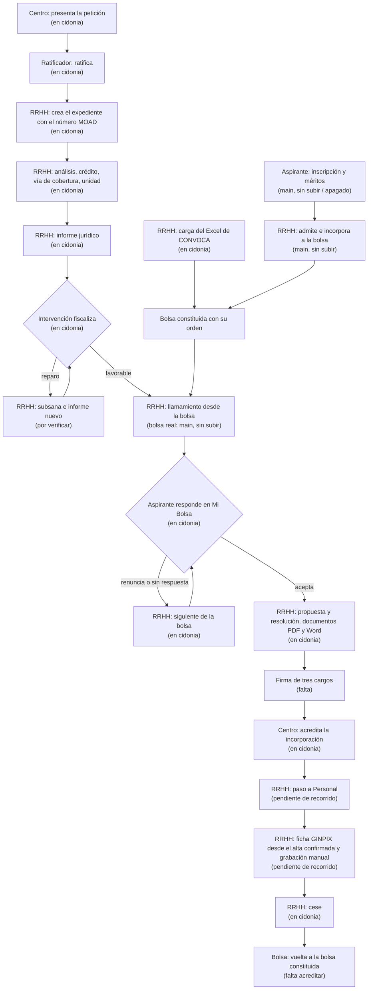
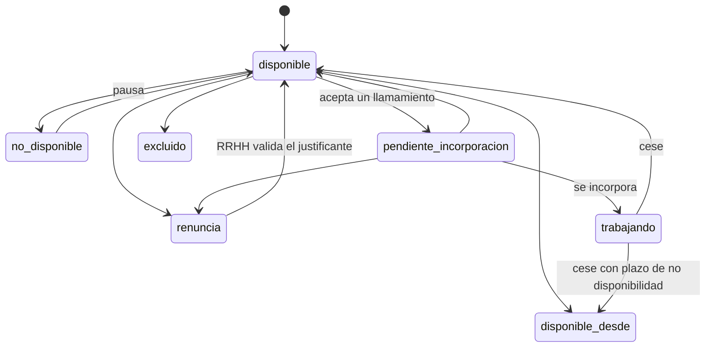
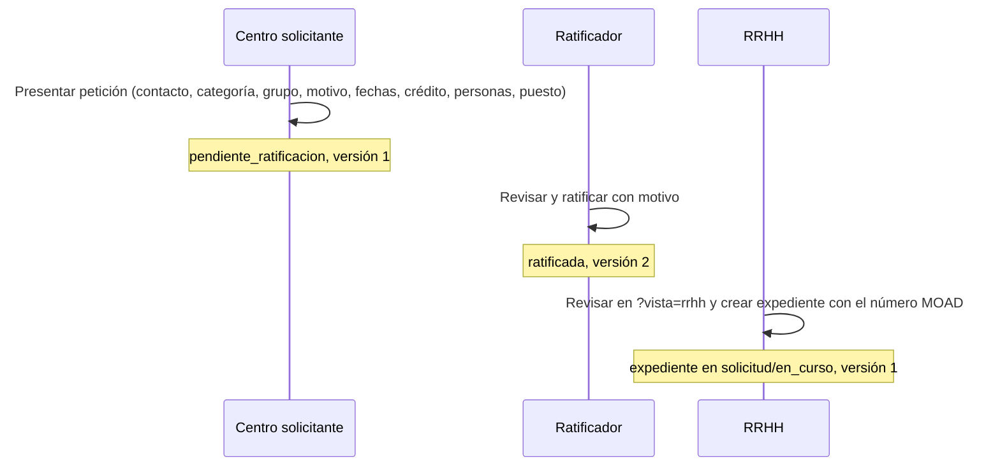

# Flujo de la aplicación

Fuentes absorbidas el 13/10/2026:
`docs/portal_vec/expediente_contratacion_temporal_rrhh.md` y
`docs/portal_vec/matriz_roles_y_ambitos.md` (retirados),
`GUIA_RECORRIDO_ALBERTO.md` (reducido a una nota) y la decisión sobre
llamamiento y canales de la memoria de dirección.

Quién entra en VEC, por dónde, qué ve y en qué orden actúa cada persona, desde
la inscripción de una aspirante en una bolsa hasta su cese y su vuelta a la
bolsa.

Escrito el 13 de octubre de 2026 sobre `origin/main@6c9ae43dc` (incluye #1088,
selección desde la bolsa constituida, y #1112, cuenta externa propia de la
aspirante). Lo que dice sobre cidonia sale del registro de dirección del 13/10
(subida HZ36). Si el código y este documento no coinciden, manda el código y
las órdenes vigentes de `AGENTS.md`; anota la diferencia en tu entrega.

Este documento sustituye a tres fuentes que estaban repartidas:
`docs/portal_vec/expediente_contratacion_temporal_rrhh.md` (flujo de CT),
`docs/portal_vec/matriz_roles_y_ambitos.md` (perfiles y ámbitos) y la parte de
recorrido de `GUIA_RECORRIDO_ALBERTO.md`. El manifiesto visual del flujo,
`config/contratacion_temporal_flujo_visual_rrhh_v2.json`, sigue siendo la fuente
de las fases que se pintan: es configuración que lee el código.

Otros documentos de producto, sin repetir aquí su contenido:

| Documento | Qué cuenta |
| --- | --- |
| `docs/producto/PRD.md` | Qué es VEC, para quién y con qué prioridad |
| `docs/producto/TRD.md` | Pila, arquitectura, seguridad y despliegue |
| `docs/producto/DISENO_UI_UX.md` | Cómo se ven y se usan las pantallas |
| `docs/producto/ESQUEMA_BACKEND.md` | Tablas, roles PostgreSQL, migraciones y API |
| `docs/producto/PLAN_IMPLEMENTACION.md` | Qué falta, en qué orden y quién lo hace |

## Cómo leer las marcas de estado

Cada tramo lleva una de estas marcas:

| Marca | Significa |
| --- | --- |
| **Funciona en la copia local** | Fusionado en `main` y visto funcionar en la copia local restaurada con el guion de F0-28 |
| **En main, sin subir** | Programado y fusionado, pero todavía no visto funcionar en la copia local |
| **Apagado** | Instalado o programado, pero su selector o su configuración no está puesto |
| **Falta** | No existe todavía, o existe solo en una rama o PR sin fusionar |
| *(por verificar)* | No se ha podido comprobar al escribir este documento |

Desde el 16/10 cidonia está congelada y se trabaja en la copia local, así
que el estado se mide allí. Donde el texto todavía dice «En cidonia», esa
marca se puso al verlo en cidonia antes del 16/10 y vale como *(por verificar
en copia local)* hasta que alguien lo vea funcionar en la copia.

Que algo esté en `main` no significa que funcione en la copia local, ni que
se haya recorrido de punta a punta. El estado al día de cada tarea está en
`docs/producto/PLAN_IMPLEMENTACION.md`, apartado 2.

## 1. Las superficies

VEC tiene cuatro superficies. Cada una tiene su entrada, su forma de
identificarse y sus pantallas. Un empleado que además está en una bolsa entra
como aspirante por la superficie externa y como empleado por la interna; sus
sesiones y perfiles no se mezclan ni se suman.

| Superficie | Quién | Dirección | Servidor | Cómo se identifica |
| --- | --- | --- | --- | --- |
| Portal interno de RRHH | Técnicos y jefatura de RRHH, Intervención, centros solicitantes, empleados | `/portal-empleado/` y sus páginas hijas | `vec-server` (en cidonia); `vec-interno` existe pero no se despliega | Certificado cliente |
| Área personal de la aspirante | Personas inscritas en bolsas | `/area-personal/` | `vec-server`, en proceso externo o combinado | Certificado cliente ligado a su cuenta externa |
| Portal público | Cualquiera, sin identificarse | `/acceso/`, `/bolsa/`, `/bolsa/listas.html`, `/verificar/`, `/canal-interno/` | `vec-publico` o `vec-server` en modo externo | Ninguna |
| Administración | Administradores de aplicación y de sistemas | `/admin/usuarios/` en su subdominio (`admin.cidonia.cloud`) | `vec-admin` | Certificado de una CA propia de administración |

Detalles que conviene saber:

- `vec-server` decide qué sirve con `VEC_PORTAL_PROCESO`
  (`config/portal_proceso.go`, `internal/app/server/portal_proceso.go`). Vacío:
  todo junto («combinado», como en cidonia). `interno`: todo menos el área
  personal y las API propias de la aspirante, que dan 404. `externo`: solo área
  personal, portal público y comunes. Un valor desconocido cierra todas las
  rutas.
- El modo combinado monta el área personal dentro del mismo proceso, con
  material de identidad externo propio
  (`internal/app/bootstrap/bolsa_portal_combinado.go`).
- `vec-server` en perfil de producción no arranca todavía
  (`ErrComposicionProductivaNoDisponible` en `internal/app/bootstrap/bootstrap.go`).
  Todo lo que se ve hoy es la composición de desarrollo con datos sintéticos.
- `bolsa-server` está retirado: solo imprime que se use `vec-server`.

## 2. Cómo se entra

### 2.1 Identidad

- La identidad sale del certificado cliente que verifica el servidor, nunca de
  cookies, `localStorage`, cabeceras libres ni campos del formulario. Ninguna
  respuesta emite `Set-Cookie`.
- En cidonia, delante de VEC hay un Caddy con usuario y contraseña web por
  perfil, configurado fuera de Git, y cada perfil sintético tiene su
  certificado de una CA de desarrollo. Las identidades salen de los ficheros
  privados `identidad/*.json` (`internal/app/bootstrap/identidad_desarrollo.go`).
  Es una excepción aprobada por Alberto el 24/09 solo para desarrollo y la
  presentación.
- En producción el acceso será con el directorio corporativo (Active
  Directory y Kerberos) más certificado. Falta: depende de Informática.
- El certificado identifica a la persona. No firma documentos ni equivale a una
  firma legal.
- La aspirante no tiene usuario y contraseña. Su «cuenta externa propia»
  (#1112) es una referencia distinta de su cuenta interna, ligada a la misma
  persona, candidatura y certificado. Los botones de Cl@ve, certificado y DNIe
  de `/acceso/` están desactivados y `/acceso/inicio/*` responde 503.

### 2.2 Perfil activo

- Una persona puede tener varios perfiles, pero cada petición actúa con uno
  solo. Los permisos de dos perfiles no se suman.
- En **Administración** hay selector de perfil activo
  (`web/static/administracion-perfiles/selector-perfil.js`, API
  `/api/admin/seleccion-perfil/v1`). Elegir perfil queda auditado y se guarda
  con control de versión en el servidor, no en el navegador. Su fuente durable
  auditada aún no está conectada; sin ella responde 503
  (`internal/app/administracion/README.md`).
- En el **portal interno no hay selector**. Cambiar de perfil es entrar con otro
  usuario web y otro certificado. Así lo hará Alberto en la presentación: un
  usuario por perfil (`candidato`, `centro`, `ratificador`, `rrhh`,
  `intervencion`).
- La cabecera muestra el perfil según el rol (`PERFILES_VISIBLES` en
  `web/static/portal-empleado/portal-catalogo-modulos.js`). Es solo una
  etiqueta: cada consulta la autoriza el servidor.

### 2.3 Administración en subdominio

`vec-admin` (`cmd/vec-admin/`, `internal/app/administracion/servidor.go`) exige
TLS 1.3 con certificado de la CA de administración, lista de revocación leída
en cada petición, nombre de host exacto, redes permitidas y cuenta privilegiada.
No admite sesiones reanudadas ni identidad por cabeceras. Solo arranca en
`desarrollo` o `cidonia`; en producción se niega hasta tener Kerberos.
**En cidonia** desde el 10/10.

## 3. Perfiles y qué ve cada uno

### 3.1 Tabla resumen

| Perfil | Rol técnico | Entra por | Ve y hace | Estado |
| --- | --- | --- | --- | --- |
| Aspirante | `candidato_bolsa` | `/area-personal/` | Mi Bolsa, perfil y contacto, méritos, alegaciones, inscripción (oculta), preferencias | En cidonia (Mi Bolsa); el resto, ver 4.1 |
| Centro solicitante | `solicitante_centro` | `/portal-empleado/peticiones-centro/` | Presenta peticiones, acredita la incorporación, cancela | En cidonia |
| Ratificador del centro | `ratificador_centro` | `/portal-empleado/peticiones-centro/` | Ratifica las peticiones de su centro con motivo | En cidonia |
| Técnico de RRHH | `tecnico_rrhh` | `/portal-empleado/` | Inicio con cuadro de mando, Bolsas, Contratación temporal, plantillas, reglas | En cidonia |
| Jefatura de RRHH, administrativo | `jefatura_rrhh`, `administrativo` | `/portal-empleado/` | Sin menú propio: lo que ven lo decide cada API | Falta definir |
| Intervención | `intervencion` | `/portal-empleado/` | Entra en CT y fiscaliza desde la ficha; no tiene bandeja propia | En cidonia |
| Firmantes (Jefatura de Servicio, Diputado/a, Secretaría General, Dirección de RRHH, persona nombrada) | perfiles lógicos `perfil:ct:*` | Ficha del expediente, panel de firma | Firmar o devolver con motivo | Falta (#1099) |
| Empleado | `personal_interno` | `/portal-empleado/` | Mis trámites, Personal, Cronos y Dietas por accesos de Inicio | Oculto: módulos aparcados |
| Administrador de aplicación | rol `administracion_perfiles` | `admin.*` | Usuarios, asignar y retirar perfiles | En cidonia, parcial |
| Administrador de sistemas | perfil de sistemas | `admin.*` | Instalación, versiones, copias | Copias por línea de órdenes |

Carmen Molina Ortega (usuario web `rrhh`) es la técnica de RRHH del recorrido y
usa el perfil fijo de técnico de RRHH. La aspirante del recorrido es el usuario
web `candidato`.

### 3.2 Portal interno de RRHH (`/portal-empleado/`)

El lateral se arma así (`web/static/portal-empleado/index.html`,
`portal-modulos-coordinador.js`, `portal-catalogo-modulos.js`):

1. **Inicio.** Para RRHH, cuadro de mando con pendientes vencidos, vencen hoy,
   incidencias, reparto por fase y bolsas (`portal-inicio.js`). Cada cifra abre
   su lista filtrada.
2. **Módulos**, desde `GET /api/vec/modules`. Hoy solo se ofrecen Bolsa y
   Contratación temporal; Personal, Cronos, Dietas y Documentos se ocultan del
   menú (`CLAVES_SIN_ENTRADA_PORTAL`) y se llega a ellos por dirección directa o
   por los accesos de Inicio. `VEC_PORTAL_MODULOS_VISIBLES` limita además qué
   módulos se cargan en cada despliegue; no es un permiso.
3. **Plantillas de documentos**, solo si RRHH tiene permiso.

Al abrir **Bolsas** aparece el menú «Gestión de Bolsas», fijo en el HTML y
filtrado por las capacidades que devuelve el servidor (`portal-menu-bolsa.js`).
Los grupos sin servicio se ocultan:

| Grupo | Pantallas |
| --- | --- |
| Bolsas y candidatos | Elaboración y borradores, Convocatorias, Solicitudes y admisión, Revisión de méritos, Alegaciones, Importación Convoca |
| Llamamientos | Llamamientos automáticos |
| Contratos | Contratos, ceses y reincorporaciones |
| Reglas y baremación | Reglas y versiones, Baremación y ranking |
| Consulta de candidatos | Ficha del candidato (contacto enmascarado en listas, completo en la ficha con constancia) |
| Cuadro de mando, Estadísticas | Cifras pulsables |
| Documentos de Bolsa | Documentos |
| Correo y mensajería | Correo |
| Auditoría y control | Auditoría y trazabilidad, Configuración, roles y permisos |

Al abrir **Contratación temporal**: cuadro de mando, lista de expedientes con
filtros, ficha del expediente con una sección por fase (análisis, cobertura,
asignación, informe, fiscalización, llamamiento, formalización, firma,
incorporación, seguimiento y cese), alta de expediente y estadísticas. Los
ficheros están en `web/static/portal-empleado/modulos/contratacion-temporal/`.

Páginas fuera del lateral, que se abren desde Bolsa o CT: reglas vigentes y
plazos (`/portal-empleado/reglas/`), organización y centros
(`/portal-empleado/organizacion/`), calendarios (`/portal-empleado/calendarios/`),
categorías de la RPT (`/portal-empleado/categorias-rpt/`) y peticiones del
centro en vista de RRHH (`/portal-empleado/peticiones-centro/?vista=rrhh`).

Los manifiestos Go de cada módulo (`internal/modules/*/manifest.go`) declaran
entradas de menú, pero el menú real de Bolsa es el fijo del HTML y el de CT lo
compone su propia vista. Los manifiestos sirven hoy para saber qué módulos
existen y qué permisos declaran.

### 3.3 Área personal de la aspirante (`/area-personal/`)

El catálogo `web/static/area-personal/vistas.json` decide qué pestañas se
muestran. Lo que no nombra queda cerrado. Hoy:

| Grupo | Pestaña | Estado |
| --- | --- | --- |
| Resumen | Inicio (remite a Mi Bolsa) | Activa |
| Resumen | Oportunidades para ti | Activa, siempre «no configurado»: no tiene fuente de datos |
| Mi información | Perfil y contacto | Activa |
| Mi información | Mis méritos | Activa |
| Tramitación | Mi Bolsa («Disponibilidad y llamamientos») | Activa; es la vista por defecto |
| Tramitación | Inscribirme | Oculta (`"inscripcion": false`) aunque código y API existen |
| Tramitación | Subsanaciones | Oculta, sin servicio |
| Tramitación | Alegaciones | Activa |
| Comunicaciones | Mensajes, Certificados | Ocultas, sin servicio |
| Comunicaciones | Ayuda y accesibilidad | Activa |

«Mis preferencias» (idioma, tamaño de texto, contraste, tema, filas por página,
avisos por correo) se abre desde el menú de la cabecera.

### 3.4 Portal público

- `/bolsa/`: convocatorias y categorías, sin identificarse.
- `/bolsa/listas.html`: listas de cada bolsa. Por persona solo se ven orden,
  documento enmascarado y situación. Qué campos se publican y para quién está
  pendiente del Delegado de Protección de Datos (dudas 17 y 83).
- `/verificar/`: comprobar un documento por su referencia. La pantalla existe;
  el servicio de cotejo en el servidor no se ha encontrado. Falta.
- `/canal-interno/`: enlaces al Sistema Interno de Información.

En cidonia *(por verificar)*.

## 4. Recorridos de punta a punta

### 4.0 Caso de aceptación de la presentación

Este es el único caso de aceptación del recorrido. Lo fijó dirección el 14/10
para la presentación, a partir de lo que hace hoy el código. Toda tarea que lo
contradiga se decide antes de programar (regla 3 de «Entrega y subida» en
`AGENTS.md`). El recorrido se da por bueno cuando cada paso de la tabla
produce en Chrome el resultado indicado, y lo sigue mostrando igual después de
reiniciar la aplicación y la base.

**Personas.** Todas son ficticias y entran con certificados de desarrollo, cada
una con su perfil:

| Papel | Persona | Perfil |
| --- | --- | --- |
| Aspirante | Antonio Reyes Álvarez | Aspirante externo (usuario web `candidato`) |
| Centro solicitante | Lucía Fernández Castillo, Jefatura de Servicio de Servicios Digitales y Asesoría Tecnológica a Municipios | Centro |
| Ratificador | Manuel García Robles, del mismo centro | Centro, ratificador |
| RRHH | Carmen Molina Ortega, técnica de RRHH (usuario web `rrhh`) | Técnico de RRHH |
| Intervención | Francisco Javier López Serrano | Intervención |
| Firmantes de la resolución | Jefatura del Servicio de RRHH, Diputado/a delegado/a de RRHH y Secretaría General | Cargos de firma del circuito v2, asignados por Administración. Las personas ficticias de los tres cargos, con su usuario web y su perfil del circuito, están en `scripts/operacion/firma_ct_tres_pasos/firmantes.json`; esa es la fuente, no esta tabla |

La técnica de RRHH firma también el informe con su perfil de firma. Los cuatro
firmantes son personas distintas. Ratificador y solicitante son personas
distintas, y ningún firmante firma dos pasos del mismo documento.

**Puesto y bolsa.** Categoría Administrativo de la RPT publicada, con su centro
y su puesto publicados: **centro 520, categoría Administrativo de la RPT (9),
puesto 9/01, plaza 2026/0033**. Los datos se cargan con un guion de datos
repetible (no con código), sin tocar los demás puestos. La bolsa es
`bolsa:administrativo:algicjlleggibhgagmjmoipmakdijibk` v1, ya constituida y con su orden. El alta,
la ocupación y el cese no se precargan: se hacen en pantalla en el recorrido. Antonio ya
figura en ella como disponible y en el puesto que le toca el llamamiento (lo deja así el guion
de datos). Si un dato no cuadra, se ajusta el dato, no el código (regla 5).

**Variante de vacante para comprobar los criterios de ofrecimiento**
(dirección, 15/10). Conserva la misma petición, expediente, puesto, bolsa y una
persona solicitada. El análisis usa modalidad y causa de vacante. Con la regla
publicada, la primera persona figura trabajando y carece de hechos fiables
para comprobar la excepción: RRHH ve la posición, la versión de la regla y el
motivo «Pendiente de comprobación»; la selección se detiene antes de crear el
llamamiento o pasar a otra posición. Después se prepara la primera persona
como disponible y la segunda trabajando para comprobar el ofrecimiento y los
motivos del seguimiento. Los cambios son datos de la copia; los actos y la
fiscalización de la variante se registran de nuevo con sus propios recibos.
La fiscalización de una modalidad anterior conserva su contexto original.
Esta variante sigue pendiente de completar el recorrido y el reinicio.

**Pasos.** El recorrido principal empieza en la petición del centro (paso 1) y
llega hasta el cese y la vuelta a la bolsa; es el que decide si la candidata
está completa. Sigue el orden que tiene hoy el código (4.3.2): el llamamiento va
después de la fiscalización favorable y la propuesta exige el expediente en
`fiscalizacion/en_curso`. Los pasos e1 a e5 (aspirante: inscripción, méritos,
admisión, incorporación y alegaciones) son una **demostración aparte, no
bloqueante**, con Mi Bolsa interna; pueden enseñarse antes o después del
recorrido principal. Alberto, 14/10: «el recorrido puede empezar por donde sea
conveniente».

| # | Quién | Pantalla | Qué hace | Resultado esperado |
| --- | --- | --- | --- | --- |
| e1 | Antonio (aspirante) | `/area-personal/?vista=inscripcion`, Inscribirme en una bolsa | Elige la convocatoria de Administrativo, declara que cumple cada requisito, revisa y presenta la solicitud | Recibo de presentación; solicitud `pendiente` («Pendiente de revisión» en Mis solicitudes) |
| e2 | Antonio | `/area-personal/?vista=meritos`, Mis méritos | Pulsa «Añadir título o mérito» y declara sus títulos y méritos | Cada mérito queda «Declarado, pendiente de revisión» |
| e3 | Carmen (RRHH) | `/portal-empleado/#solicitudes`, Bolsas → Solicitudes y admisión | Elige la convocatoria, revisa la solicitud de Antonio y la admite | Solicitud `admitida_a_convocatoria`; Antonio ve «Admitida. Pendiente de incorporación a la bolsa» |
| e4 | Carmen | La misma pantalla | Incorpora a Antonio a la bolsa `bolsa:administrativo:algicjlleggibhgagmjmoipmakdijibk`, ya constituida, con el número del acta | Solicitud `incorporada`; Antonio aparece en Mi Bolsa como **Disponible** con su posición |
| e5 | Antonio, después Carmen | `/area-personal/?vista=alegaciones`; RRHH en `/portal-empleado/#alegaciones`, Bolsas → Alegaciones | Antonio presenta una alegación sobre su participación; Carmen la consulta | Justificante de presentación en VEC; la alegación aparece en la bandeja de RRHH de esa bolsa |
| 1 | Lucía (centro) | `/portal-empleado/peticiones-centro/` | Presenta la petición: elige categoría Administrativo y el puesto de la RPT publicada, motivo, fechas, crédito y una persona | Recibo de presentación; petición `pendiente_ratificacion`, versión 1 |
| 2 | Manuel (ratificador) | La misma pantalla, bandeja del centro | Revisa y ratifica con motivo | Recibo de ratificación; petición `ratificada`, versión 2 |
| 3 | Carmen (RRHH) | `peticiones-centro/?vista=rrhh` | Teclea el número de expediente de MOAD y crea el expediente | Recibo de alta; expediente `solicitud/en_curso`, v1, con la necesidad de la RPT conservada |
| 4 | Carmen | Ficha del expediente, Análisis | Registra el análisis con el crédito | Recibo; `solicitud/en_curso`, v2 |
| 5 | Carmen | Ficha, Vía de cobertura | Elige bolsa vigente | Recibo; `asignacion_unidad/en_curso`, v3 |
| 6 | Carmen | Ficha, Asignación | Asigna la unidad gestora | Recibo; `asignacion_unidad/en_curso`, v4 |
| 7 | Carmen | Ficha, Informe jurídico | Prepara el informe | Recibo; `informe_juridico/en_curso`, v5 |
| 7b | Carmen y después Jefatura (firmantes) | Ficha, Firma | Firman con sus certificados el informe de remisión a Intervención, en ese orden; la fiscalización exige ambas firmas verificadas | Un recibo por firma y el PDF con las dos firmas verificadas |
| 8 | Francisco Javier (Intervención) | Ficha del expediente | Fiscaliza favorable | Recibo; `fiscalizacion/en_curso`, v6 |
| 9 | Carmen | Ficha, Llamamiento y comunicación | Abre el llamamiento desde la bolsa Administrativo y registra la comunicación | Recibo del llamamiento con Antonio como llamado; la fase no cambia; Antonio recibe el aviso por correo (hoy, buzón de pruebas) |
| 10 | Antonio (aspirante) | `/area-personal/`, Mi Bolsa | Acepta dentro del plazo de dos días | Recibo de su respuesta |
| 10a (si renuncia con causa justificada) | Antonio; después Carmen u otra técnica de RRHH con permiso vigente | Mi Bolsa; ficha del candidato en Bolsas | Antonio adjunta un PDF del justificante, confirma la renuncia y conserva el recibo. RRHH consulta y descarga el documento desde la ficha; también queda en el seguimiento | Documento custodiado tras antivirus; recibo de VEC y lectura de RRHH auditada. No cambia la rama de aceptación del paso 10 |
| 11 | Carmen | Ficha, Llamamiento | Resuelve la aceptación | Recibo de resolución del llamamiento |
| 12 | Carmen | Ficha, Formalización | Registra la propuesta de nombramiento | Recibo; `nombramiento/en_curso`, v7 |
| 13 | Carmen | Ficha, Formalización | Registra la resolución | Recibo; `nombramiento/en_curso`, v8 |
| 14 | Carmen | Ficha, Documentos | Descarga en PDF y Word los borradores | Cada documento se abre con el logotipo y los datos del expediente |
| 15 | Firmantes | Ficha, panel de firma (GrxFirma) | Firman la resolución en el orden Jefatura → Diputación → Secretaría General y recuperan el informe ya firmado en 7b. Los otros cuatro documentos (incluida la toma de posesión de Antonio) se generan y descargan sin firma, marcados «firma pendiente», sin simularla | Cada firma con su justificante y el PDF verificado; los cuatro restantes, descargables en PDF y Word |
| 17 | Lucía (centro) | `peticiones-centro/`, Incorporaciones | Acredita la incorporación de Antonio con fecha y documento | Recibo de incorporación acreditada del centro |
| 18 | Carmen | Ficha, Paso a Personal | Revisa el plan de alta con categoría Administrativo, puesto 9/01 y plaza 2026/0033, y lo confirma | Antonio aparece en Personal con su relación y su ocupación; recibo de alta B2 confirmado |
| 16a | Carmen | Ficha, GINPIX | Descarga la ficha para la grabación manual, después del alta en Personal | Ficha descargada con las referencias del recibo B2 confirmado |
| 16b | Carmen | Ficha, GINPIX | Confirma número y fecha de la grabación manual | Recibo local de confirmación GINPIX; no acredita una transmisión automática |
| 19 | Carmen | Ficha, Cese | Registra el cese con causa y justificante | Recibo de cese |
| 20 | (automático) Bolsa | Mi Bolsa de Antonio y Bolsas de RRHH | Bolsa recibe el cese | Antonio vuelve a la bolsa Administrativo como **Disponible** o **Disponible desde** la fecha que marque la política |
| 21 | Carmen | Ficha, Cierre | Cierra el expediente | `nombramiento/completado` |

La vía del aspirante es Mi Bolsa interna (HZ37); la entrada externa propia solo
si el ensayo la valida (corte 17:00 del 13/10).

**Documentos.** Los que genera hoy el código desde la ficha, con el expediente en
v7 o posterior (4.3.4), y el orden de firma del catálogo
`circuito_firma.v2.json` (4.3.6):

| Documento | Firman |
| --- | --- |
| Informe definitivo | Carmen (técnica de RRHH) y Jefatura del Servicio de RRHH |
| Resolución | Jefatura del Servicio (visto bueno), Diputado/a delegado/a de RRHH y Secretaría General (toma de razón): los tres cargos |
| Diligencia | Secretaría General |
| Toma de posesión | Antonio, Jefatura y Secretaría General |
| Notificación y comunicación al centro | Jefatura |

**Contradicciones conocidas y cómo se resuelven para la presentación.** RRHH
las confirmará después mediante `dudas.md`; hasta entonces manda lo que dice
esta tabla.

| Punto | Lo que hay escrito | Para la presentación |
| --- | --- | --- |
| Orden del ofrecimiento y la fiscalización | RRHH (02/10) y el circuito v2 ponen oferta y adjudicación antes del informe de Jefatura y de Intervención; el código hace el llamamiento después de la fiscalización favorable | Se sigue el orden del código. La pantalla puede pintar las doce fases del circuito v2, pero los pasos se hacen como en la tabla anterior |
| Momento de la propuesta | Circuito v2: tras la adjudicación; código: exige `fiscalizacion/en_curso` y un llamamiento aceptado | En el recorrido singular se registra después de fiscalizar y resolver la aceptación. Queda pendiente la continuación desde una oferta adjudicada |
| Dos o tres firmantes | RRHH habló de resolución firmada por la Diputada con visto bueno de Dirección o Jefatura (dos); el catálogo v2 pide tres pasos | Tres: Jefatura, Diputado/a y Secretaría General, como dice el catálogo |
| Petición firmada por técnico y Diputado/a | RRHH la pide firmada; el código la presenta y la ratifica otra persona del centro, sin firma | Presentación y ratificación sin firma, como hace el código |
| Autorización de la Dirección de RRHH | Paso 2 del orden de RRHH; el código no tiene un paso propio | No se representa; la vía de cobertura y el informe la sustituyen en la presentación |
| Unidad de Lucía | `docs/manuales/centro.md` la sitúa en TRANSFORMACIÓN DIGITAL | Se usa la que fija este caso; el manual se corrige cuando K confirme centro y puesto |
| Cuándo cuenta la incorporación | Duda 140: con el alta en Personal o con la toma de posesión | Se muestran las dos: acreditación del centro y alta en Personal |

**Variante de varias plazas, separada del caso de aceptación.** Dirección autorizó
el 15/10 ensayar una petición del mismo puesto Administrativo para dos personas:
Antonio y otra persona ficticia ya disponible en la bolsa. El ensayo previsto llega hasta la
publicación, respuesta y adjudicación de las dos plazas en Bolsa, conservando
los recibos de la oferta y de su vínculo con CT. La publicación desde CT N2
sigue preparada en código, sin ensayo conjunto de SQL, configuración, Chrome
y reinicio. **Pendiente:** continuar con la propuesta desde una oferta adjudicada;
el recibo de la oferta no acredita propuesta, nombramiento, incorporación ni
envío de correo. También siguen pendientes la consulta de Organización histórica, la correspondencia
entre la unidad que tramita y la del puesto y la asignación de los permisos
necesarios para la activación. Este ejercicio no cambia
los pasos 1 a 21 del caso singular.

### 4.0.1 Vista general

Es el recorrido que hará Alberto en la presentación, cambiando de perfil. Cada
caja indica quién actúa y su estado.



El orden del código y el orden que pidió RRHH no coinciden en un punto: ver
4.3.2.

### 4.1 Aspirante

#### Inscripción en una bolsa

Estado: **en main, apagado**. El código, la API y la bandeja de RRHH existen;
en cidonia hay tres convocatorias cargadas, pero falta encender la inscripción
de RRHH (`VEC_BOLSA_INSCRIPCIONES_ENABLED` y `identidad/consultas-rrhh.json` con
el perfil de técnico de RRHH) y poner `"inscripcion": true` en `vistas.json`.

1. La aspirante abre **Inscribirme** y ve las convocatorias con plazo abierto
   (`GET /api/vec/bolsa/inscripciones/convocatorias-abiertas`).
2. Elige convocatoria y categoría. Por cada requisito declara «lo cumplo».
3. **Revise su solicitud** y **Presentar solicitud**
   (`POST /api/vec/bolsa/inscripciones/propias`). Recibe un recibo.
   La solicitud queda **Pendiente de revisión**.
4. En **Mis solicitudes** sigue su estado.

RRHH resuelve en Bolsas → **Solicitudes y admisión**
(`/api/vec/bolsa/rrhh/inscripciones`): elige convocatoria, revisa cada
solicitud y la **admite** o la **rechaza** con motivo del catálogo. Cuando se
aprueba la lista definitiva, **Incorpora a la bolsa** indicando el número del
acta.

| Estado de la solicitud | Lo que ve la aspirante | Quién lo produce |
| --- | --- | --- |
| `pendiente` | Pendiente de revisión | La aspirante al presentar |
| `admitida_a_convocatoria` | Admitida. Pendiente de incorporación a la bolsa | RRHH |
| `incorporada` | Incorporada a la bolsa | RRHH, con número de acta |
| `rechazada` | Rechazada | RRHH, con motivo |

Fuente: `internal/modules/bolsa/application/inscripcion/contrato.go`.

#### Constitución de la bolsa

Una bolsa queda constituida, con su orden, por una de dos vías:

- **Carga del Excel de CONVOCA** (Bolsas → Importación Convoca,
  `/portal-empleado/modulos/bolsa/carga-convoca/`): RRHH sube el resumen de la
  lista definitiva, revisa la vista previa (las filas con error se excluyen) y
  confirma. Queda una referencia del acta de carga. **En cidonia** desde el
  10/10, con aprobación de dos administradores.
- **Constitución desde la convocatoria** con su acta
  (`internal/modules/bolsa/application/constitucion/`). Toda participación
  empieza **Disponible**.

Mi Bolsa solo muestra participaciones de bolsas constituidas y vinculadas a la
persona. Una fila importada sin vínculo verificado con su titular queda
pendiente: no se enlaza por parecido de nombre o documento.

#### Méritos (cartera)

Estado: **en main, sin subir** (#1081, #1105).

El corte F1-45 comprueba la consulta de la cartera desde **Mis méritos** con
`GET /api/vec/meritos/cartera`. La pantalla muestra los méritos y el total que
devuelve esa consulta. La valoración por categoría de bolsa y los puntos
esperan al motor común de baremación; no se calculan en el navegador.

1. En **Mis méritos**, la aspirante pulsa **Añadir título o mérito** y elige el
   tipo: titulación, curso de asistencia, curso de superación (con horas),
   experiencia, idioma u otro (`POST /api/vec/meritos/cartera/declaraciones`).
2. El mérito queda **Declarado, pendiente de revisión**. Puede retirarlo con
   motivo (`POST /api/vec/meritos/cartera/retiradas`).
3. RRHH lo consulta en Bolsas → **Revisión de méritos**
   (`GET /api/vec/meritos/rrhh/revision`). Es solo consulta: la acreditación y
   la baremación con puntos faltan, porque el circuito de acreditación no está
   acordado. El autobaremo de la aspirante tampoco existe.

#### Alegaciones

Estado: **en main, sin subir** (#1098, #1108).

1. En **Alegaciones**, la aspirante ve sobre qué puede alegar
   (`GET /api/vec/bolsa/alegaciones/objetos`): una decisión sobre su solicitud
   de inscripción o una actuación sobre su participación en la bolsa.
2. Escribe qué pide y por qué (hasta 4000 caracteres) y presenta
   (`POST /api/vec/bolsa/alegaciones`). Recibe un justificante de presentación
   en VEC. No es un asiento de registro oficial ni resuelve la alegación.
3. RRHH la ve en Bolsas → **Alegaciones**, por convocatoria o bolsa.

Si falta su configuración, la inscripción sigue funcionando y la pestaña muestra
«No se pudo abrir Alegaciones».

#### Mi Bolsa

Estado: **en cidonia** desde HZ13; acciones de la aspirante desde HZ15.

La pantalla muestra, por cada bolsa: categoría, estado de la bolsa, posición
«N de M», vigencia y situación; después el orden de sus bolsas, el histórico
(contratos, llamamientos y renuncias) y, a la derecha, el último llamamiento,
las ofertas y el contacto.

Situaciones de una participación (`internal/modules/bolsa/domain/situacion_participacion.go`):



RRHH puede además pasar una participación a **En revisión** cuando espera un
justificante para regularizarla; la aspirante ve «RRHH confirmará tu
situación».

«Baja» no es un estado: corresponde a renuncia o exclusión. No existe la
suspensión temporal (decisión de RRHH del 02/10). Desde `excluido` no se sale.

#### Preferencias entre bolsas

Estado: **en main**; en cidonia falta la autoridad externa de la aspirante
*(por verificar)*.

En «Orden de mis bolsas» la aspirante ordena sus bolsas
(`GET/PUT /api/vec/bolsa/mi-bolsa/preferencias`). Si aparece una bolsa nueva o
se retira una, debe marcar «He revisado el orden» antes de guardar.

#### Modalidades de ofertas publicadas

La elección voluntaria de modalidades, cuando se habilite, solo filtra las
ofertas publicadas que la persona ve y los avisos que solicita. No cambia la
prelación ni la selección; tampoco equivale a renunciar. En el llamamiento
directo se sigue el orden de la bolsa con independencia de esa elección
(Reglamento de bolsas, arts. 8.1, 8.2.a y 11.1).

#### Responder a un llamamiento

Estado: **en cidonia** con el llamamiento actual; con la bolsa constituida
real, falta acreditar el recorrido.

1. RRHH abre el llamamiento (4.3). Le llega un correo; hoy sale por un buzón de
   pruebas, no por el correo de la Diputación.
2. En Mi Bolsa aparece el formulario con su fecha límite. El plazo es de dos
   días desde la notificación (decisión de RRHH del 02/10).
3. La aspirante elige (`POST /api/vec/bolsa/mi-bolsa/respuestas`):
   - **Aceptar**: sin pantalla de revisión.
   - **Renunciar**: pasa por «Revise su renuncia» y «Confirmar renuncia».
   - **Renuncia justificada**: elige la causa del catálogo y adjunta un PDF desde
     Mi Bolsa. El límite es de 16 MiB; la aplicación lo comprueba antes de
     enviarlo y la API rechaza con 413 los cuerpos demasiado grandes. El fichero
     pasa por antivirus antes de quedar custodiado. La respuesta conserva su
     referencia y huella y entrega un recibo de VEC.
4. Recibe un recibo. Según las reglas, la respuesta es firme o queda «en
   revisión» hasta que RRHH la confirme.

La técnica de RRHH que tenga el permiso vigente de su rol, sea Carmen u otra,
consulta y descarga el justificante desde la ficha del candidato en las bolsas
de su ámbito. Una técnica de otro ámbito recibe una denegación. El seguimiento
también muestra la actuación. Un reintento conserva el mismo PDF y la misma
clave; una subida pendiente o rechazada no registra la renuncia. El área de la aspirante no ofrece la descarga de
su propio PDF después de presentarlo: debe conservar el original y el recibo.
Esta capacidad está pendiente de ensayo conjunto y activación; su presencia en
el código no acredita que esté instalada en cidonia.

Si no contesta, se entiende que no acepta, sin consecuencia. Para una oferta con
varias plazas, la aspirante solo pulsa **Aceptar**
(`POST /api/vec/bolsa/mi-bolsa/disposiciones`); se adjudica por orden entre
quienes aceptaron en plazo, una plaza por persona. Si nadie acepta, RRHH hace un
llamamiento directo por teléfono: la persona acepta, presenta renuncia
justificada o queda excluida.

La pausa y la reactivación a petición propia tienen API pero no formulario en
pantalla. Falta.

### 4.2 Centro solicitante y ratificador

Estado: circuito anterior **en cidonia**; la elección y conservación de la
necesidad RPT está **en main** con #1114, pendiente de verificar su instalación
en cidonia. Pantalla `/portal-empleado/peticiones-centro/`, API
`/api/vec/contratacion-temporal/peticiones-centro/*`.



1. El solicitante pulsa **Presentar petición**, elige el puesto y la categoría
   de la RPT publicada y rellena contacto, grupo, motivo, detalle, fechas,
   retención de crédito declarada, jornada y número de personas. **Revisar** y
   **Confirmar** una vez. Queda pendiente de ratificación.
2. El ratificador, otra persona del mismo centro, abre la bandeja, pulsa
   **Revisar**, comprueba solicitante, necesidad, crédito y documentación,
   escribe un motivo y ratifica. El solicitante no puede ratificarse a sí
   mismo.
3. RRHH abre `?vista=rrhh`, revisa la petición ratificada, teclea el número de
   expediente que da MOAD (VEC lo guarda, no lo genera) y pulsa **Crear
   expediente en RRHH**. Si ya consta **Expediente creado**, solo se consulta el
   recibo. Si quedó **Preparada para crear expediente**, se usa **Completar
   registro**.

La petición conserva la necesidad de la RPT publicada; otra persona ratifica
esos mismos datos y RRHH los utiliza al crear el expediente. El servidor
comprueba el puesto y la categoría con la publicación original, también si el
catálogo cambia después. La recuperación del mismo expediente y sus recibos
tras reiniciar consta en el [acta de #1114](../evidencias/codexk-peticion-necesidad-rpt-20261014/acta.md).

La relación de puestos de trabajo es un instrumento público de organización
([art. 74 del Estatuto Básico del Empleado Público](https://www.boe.es/buscar/act.php?id=BOE-A-2015-11719#a74));
las corporaciones locales deben formarla para sus puestos
([art. 90.2 de la Ley 7/1985](https://www.boe.es/buscar/act.php?id=BOE-A-1985-5392#a90)).
La elección de la necesidad publicada en este formulario es el recorrido que
implementa #1114. La duda 162 se retira porque esa capacidad ya está integrada.

El centro también puede:

- **Acreditar la incorporación** (`.../peticiones-centro/incorporaciones`):
  fecha, tipo de documento (toma de posesión; contrato firmado si es relevo),
  referencia y huella. Solo con el expediente en `nombramiento/en_curso` y sin
  confirmación previa. **En cidonia** desde HZ12.
- **Cancelar** la petición con motivo del catálogo (necesidad desaparecida,
  desistimiento, cobertura por otra vía, error, duplicada, falta de crédito)
  mientras el expediente esté en solicitud, asignación o informe jurídico.
  Selector `VEC_CT_CANCELACION_ENABLED` *(por verificar en cidonia)*.

### 4.3 RRHH: expediente de contratación temporal

#### 4.3.1 Qué es el expediente

Contratación temporal no sustituye a Bolsa: coordina las capacidades de otros
módulos mediante referencias opacas, puertos y eventos. Bolsa manda en
convocatorias, integrantes, posiciones, disponibilidad, reglas y llamamientos.
Personal manda en relaciones de empleo, ocupaciones e incorporaciones. El
expediente no copia sus datos ni escribe en sus tablas: pide y recibe por
outbox e inbox, con idempotencia y sin transacciones distribuidas.

```text
CT --solicita orden y llamamiento--> Bolsa
Bolsa --publica respuesta y aceptación--> CT
CT --solicita alta--> Personal
Personal --confirma relación y ocupación--> CT
CT --prepara ficha--> GINPIX (hoy carga manual)
```

Si un sistema externo no responde, la tarea queda esperando con reintento
recuperable. Nunca se toma como éxito.

Cada expediente guarda la referencia, versión y huella de la definición de flujo
con la que nació, su fase y estado, la unidad y el responsable de cada tarea,
las entradas y salidas, las actuaciones, documentos, recibos y decisiones, y
las referencias a datos de otros módulos. Fases, modalidades, causas, vías de
cobertura, unidades y documentos exigibles vienen de catálogos versionados, no
de listas en el código.

Datos mínimos de cada momento:

| Momento | Datos |
| --- | --- |
| Solicitud | Número visible (el de MOAD) y referencia opaca; centro y contacto por referencia; categoría y grupo; motivo y detalle; fechas previstas; retención de crédito declarada, con número, fecha, importe y documento si se aportan; puesto de la RPT; documentos y observaciones |
| Análisis | Modalidad; categoría y grupo validados; causa; fechas y jornada; validación de la retención con fuente y recibo; coste previsto cuando hay tabla de retribuciones; actor, unidad, instante y recibo |
| Vía de cobertura | Comprobaciones con resultado, fuente e instante; bolsa vigente, agotamiento, candidaturas disponibles, SAE y nueva convocatoria; vía elegida y motivo |
| Asignación | Unidad gestora, responsable, fecha de entrada en bandeja, recibo y aviso |

El alta es idempotente: la misma operación repetida devuelve el mismo recibo;
la misma clave con otros datos falla sin crear un segundo expediente. Si se
envía el mismo formulario con otra clave, responde 409 para no duplicar.

#### 4.3.2 Secuencia que sigue hoy el código

Esta es la secuencia persistida, con la versión que alcanza el expediente en
cada paso (`internal/modules/contrataciontemporal/domain/testdata/expediente_*.json`,
migraciones de `deploy/postgresql/contratacion_temporal/`):

| Paso | Quién | Ruta (`/api/vec/contratacion-temporal/…`) | Fase/estado y versión | Estado |
| --- | --- | --- | --- | --- |
| Alta (directa o desde la petición) | Técnico de RRHH | `solicitudes` o `peticiones-centro/rrhh` | `solicitud/en_curso`, v1 | En cidonia |
| Análisis con crédito | Técnico de RRHH | `analisis/registros` (rectificar: `analisis/rectificaciones`) | `solicitud/en_curso`, v2 | En cidonia |
| Vía de cobertura (bolsa vigente, SAE, nueva convocatoria) | Técnico de RRHH | `cobertura/propuesta`, `cobertura/decisiones` | `asignacion_unidad/en_curso`, v3 | En cidonia |
| Asignación a unidad | Técnico de RRHH | `asignaciones` | `asignacion_unidad/en_curso`, v4 | En cidonia |
| Informe jurídico | Técnico de RRHH | `informes-juridicos/preparaciones` | `informe_juridico/en_curso`, v5 | En cidonia |
| Fiscalización | Intervención | `fiscalizaciones/resultados` | favorable: `fiscalizacion/en_curso`; reparo: `subsanacion_unidad/incidencia`; v6 | En cidonia |
| Subsanación del reparo e informe nuevo | Técnico de RRHH | `subsanacion-reparos`, después `informes-juridicos/preparaciones` | `subsanacion_unidad/incidencia`, v7 y v8; nueva fiscalización v9 | Por verificar; exige `VEC_CT_SUBSANACION_POLITICA_FILE` |
| Llamamiento y respuesta | Técnico de RRHH y aspirante | `llamamientos/*` (ver 4.3.3) | No cambia de fase | En cidonia (bolsa real: sin subir) |
| Propuesta de nombramiento o contrato | Técnico de RRHH | `formalizacion/propuestas` | `nombramiento/en_curso`, v7 | En cidonia |
| Resolución | Técnico de RRHH | `resoluciones-formalizacion` | `nombramiento/en_curso`, v8 | En cidonia |
| Documentos PDF y Word | Técnico de RRHH | `expedientes/consultas` con `Accept` PDF o DOCX | Sin cambio | En cidonia |
| Firma | Firmantes | `firmas-documento/*`, `firma/preflight` | Sin cambio | Falta |
| GINPIX (ficha y confirmación manual) | Técnico de RRHH | `incorporaciones-ejercicio/ficha-ginpix`, `confirmaciones-ginpix` | `nombramiento/en_curso` | En cidonia |
| Incorporación acreditada | Centro | `peticiones-centro/incorporaciones/confirmaciones` | `nombramiento/en_curso` | En cidonia |
| Paso a Personal | Técnico de RRHH | `incorporacion-personal-b2/plan/v1`, `.../confirmar/v1` | Sin cambio | Encendido; falta un expediente que llegue |
| Cese | Técnico de RRHH | `ceses` | `nombramiento/en_curso` | En cidonia |
| Cierre | Técnico de RRHH | `cierres-expediente` (exige cese y GINPIX) | `nombramiento/completado` | En cidonia *(por verificar)* |
| Cancelación | RRHH o centro | `cancelaciones-expediente` / `peticiones-centro/cancelaciones` | Fase actual con estado `cancelado` | Por verificar |

Estados que admite la tabla: `en_curso`, `completado`, `incidencia` y
`cancelado`. El dominio nombra también `pendiente` y `espera_externa`, pero no
se guardan. Las fases no son una lista cerrada en el código: son claves de
catálogo validadas.

**Diferencia con el orden de RRHH.** RRHH fijó el 02/10 este orden
(`docs/estudio_requisitos/decisiones_rrhh_2026-10-02.md`):

1. Petición firmada por el técnico y por el Diputado o Diputada de la
   delegación solicitante.
2. Autorización de la Dirección de RRHH.
3. Comprobación de crédito.
4. Ofrecimiento por la aplicación.
5. Adjudicación a quien corresponda entre los que aceptaron.
6. Informe de la Jefatura de Servicio para Intervención.
7. Fiscalización.
8. Resolución firmada por la Diputada, con el visto bueno de la Dirección o de
   la Jefatura de Servicio de RRHH.
9. Grabación en GINPIX.
10. Firma de la toma de posesión o del contrato por la persona.

Es el circuito v2 (`config/contratacion_temporal_circuito_rrhh_v2.json`) y las
doce fases que pinta la pantalla
(`config/contratacion_temporal_flujo_visual_rrhh_v2.json`: solicitud,
autorización RRHH, crédito, oferta, adjudicación, informe de jefatura,
Intervención, resolución, GINPIX, firma de la persona, incorporación,
seguimiento). Pero la secuencia persistida hace el llamamiento **después** de
la fiscalización favorable, y la propuesta exige el expediente en
`fiscalizacion/en_curso`. Mientras no se cambie, el orden real es el de la
tabla anterior. Quién decide: dirección, con RRHH. Si el circuito v2 no está
configurado (`VEC_CT_CIRCUITO_RRHH_SOURCE_PATH`), se pintan las ocho fases del
flujo v1.

Si la persona aún no ha empezado a trabajar y hay devolución, rechazo o
sustitución, se repiten los trámites salvo volver a Intervención cuando no cambia
el contrato. Si ya empezó, se reinicia todo el proceso (decisión de RRHH).

#### 4.3.3 Llamamiento desde la bolsa

CT no tiene llamamiento propio: usa el de Bolsa sobre una bolsa constituida
(`internal/modules/contrataciontemporal/application/seleccion_llamamiento.go`).

1. RRHH abre en la ficha **Llamamiento y comunicación**. CT consulta la
   disponibilidad en Bolsa; si no hay bolsa disponible o la cantidad no
   cuadra, se detiene y lo dice.
2. CT pide a Bolsa el orden vigente y abre el llamamiento
   (`llamamientos/seleccion`). Si falla a medias, la misma operación lo
   recupera con la misma clave, sin duplicar.
3. RRHH registra la comunicación (`llamamientos/comunicaciones`). Este paso no
   envía correo: deja constancia y una intención de aviso.
4. La aspirante responde en Mi Bolsa, o RRHH registra la respuesta recibida por
   otro canal (`llamamientos/respuestas/registro`).
5. RRHH resuelve (`llamamientos/resoluciones`): aceptación, renuncia o
   expiración del plazo. VEC propone la expiración; RRHH la confirma.
6. Tras una renuncia o expiración, RRHH abre expresamente el siguiente
   (`llamamientos/siguientes`). No hay aviso automático al siguiente.

En la copia local, CT230 confirma y recupera el llamamiento nativo con su
misma clave y recibo después de reiniciar, sin duplicar la oferta. Este ensayo
no completa el recorrido del apartado 4.0.

CT231 recupera la selección confirmada pendiente de aviso como una fila de la
consulta existente de la ficha. Al volver a ella, RRHH ve su justificante y puede
continuar el aviso; mientras siga pendiente, no se ofrece seleccionar otra
persona. La fila no representa una comunicación anotada. En la copia local se
comprobaron recarga, reinicio, registro del aviso desde el formulario y sustitución
por la comunicación real con su recibo. Está pendiente de integración; el ensayo
no completa el apartado 4.0. Activación y límites en
[`seleccion_pendiente_aviso_20261016.md`](../../deploy/principal/seleccion_pendiente_aviso_20261016.md).

Con #1088 (**en main, sin subir**) la selección usa la bolsa constituida, su
orden y la fuente `deploy/principal/fuentes/bolsa_origen_ct_rrhh_v1.json`
(`VEC_CT_BOLSA_ORGANIZACION_SOURCE_PATH`; sin ella responde 503 y el resto
arranca). Exige que la solicitud conserve la necesidad de la RPT publicada.
Lo que hay en cidonia todavía usa el puente anterior.

El primer corte de la conexión añade a Bolsa el inicio de plazo por publicación
y el origen de una oferta procedente de CT. RRHH elige el inicio desde la
política de la bolsa y publica desde su formulario habitual. En la copia local
se han comprobado la publicación de dos plazas, su consulta y aceptación desde
Mi Bolsa y la recuperación de los recibos después de reiniciar. El recibo de
un reintento conserva fechas, política y oferta originales. Este corte no acredita
todavía la publicación desde la ficha de CT.

**Candidata R1a comprobada en copia local, pendiente de integrar.** La selección explica por
persona los hechos comprobados y el motivo aplicado, con el vínculo al contrato
de origen del llamamiento de CT. Si falta un contrato anterior o un dato para
comprobar la excepción de vacante, muestra «Pendiente de comprobación» y se
detiene en esa persona. RRHH no pasa a la siguiente ni causa una exclusión
definitiva por la falta de datos. La excepción corresponde al art. 9, apartado
cuarto (numerado 3 en el BOP n.º 9 de 16/01/2026): solo vacantes para los
vínculos tasados y con reducción del máximo de tres años por el tiempo previo
en acumulación o sustitución. El primer corte de F1-09 prepara ese acto en Bolsa: registra hechos con evidencia,
calcula el resultado con la política publicada y conserva cada rectificación y su
recibo. Sigue pendiente su habilitación, la API y la pantalla F1-57. Hasta completar
F1-10 no permite continuar la selección; el descuento permanece apagado.

La política `criterios_ofrecimiento` es opcional para el arranque. La candidata
requiere además la fuente `origen_ct_rrhh` v2 para consultar snapshot y eventos
de origen CT, y la concesión exacta al rol RRHH aprobada por dos
administradores. Si falta el apartado de criterios, la selección conserva el
orden y las reglas anteriores; la aplicación arranca. Si RRHH no tiene permiso
para consultar motivos, el bloque indica que no están disponibles. En la copia
local se guardó una política desde la pantalla y se conservaron versión, huella y
recibo tras reiniciar; la bolsa estaba sin configurar antes. El seguimiento
histórico mostró motivos y versión en castellano e inglés, en escritorio y móvil.
En otra copia desechable, con el mismo análisis y las decisiones conservadas,
CT detuvo con 409 la selección en la primera persona trabajando sin hechos:
mostró posición y versión, no creó llamamiento y permitió abrir la bolsa.
Alcance y límites en
[`habilitacion_criterios_ofrecimiento_20261015.md`](../../deploy/principal/habilitacion_criterios_ofrecimiento_20261015.md).

**Candidata de consulta de puestos.** El ofrecimiento usa la RPT publicada y
la historia autorizada del puesto de Personal. La consulta existente se conecta
al proceso combinado con el mismo perfil, ámbito y registro de lecturas. Si
falta su configuración o permiso, la selección conserva el expediente y queda
sin completar. El montaje se ensaya en la copia local; todavía no acredita el
ofrecimiento ni corrige por sí solo la separación entre unidad gestora y unidad
del puesto.

El segundo corte, **preparado en código y todavía sin ensayo integrado**, añade
una respuesta distinta al mismo `POST /api/vec/contratacion-temporal/llamamientos/seleccion`.
Para una persona conserva el llamamiento anterior. Para varias, CT obtiene del
expediente la cantidad solicitada, la necesidad y la bolsa constituida; exige
entre 2 y 100 plazas y que no superen las personas elegibles. La ficha no envía
cantidad, bolsa ni candidatos. CT toma una vez la captura vigente del orden de
Bolsa, reserva el comando original y pide a Bolsa una oferta de esa cantidad.
Bolsa publica y devuelve su recibo; CT confirma el vínculo con recibo propio.
La ficha muestra ambos, las plazas y el plazo, y lleva a «Gestionar ofertas»
en Bolsa. La publicación no demuestra un aviso por correo. El vínculo, su consulta y el
descarte comprueban la organización y la unidad gestora del expediente. El
centro y la categoría se cotejan con su necesidad; no definen esos permisos.
El cierre en Bolsa conserva el ámbito y la unidad de la bolsa.

La variante de dos personas del apartado 4.0 llega hasta la adjudicación en
Bolsa. **Pendiente:** continuación de la propuesta desde la oferta adjudicada.
La propuesta del recorrido singular exige un llamamiento aceptado; la oferta
adjudicada todavía no acredita que ese requisito esté cubierto.

Ante una respuesta incierta, RRHH conserva la solicitud original. Al recargar
la ficha, una consulta autorizada por expediente recupera el intento guardado
y sus recibos; no se publica otra oferta automáticamente. Si falla esa consulta,
se impide preparar otra oferta hasta poder comprobar el resultado. Si el servidor identifica una oferta indeterminada, RRHH
puede pulsar «Recuperar operación»: la petición añade `accion: recuperar_oferta`
sin cambiar los tres campos originales. Puede devolver la oferta ya publicada
con el mismo recibo. Si han pasado más de cinco minutos y Bolsa acredita que
no hubo publicación, B121 cierra la intención y CT registra un descarte con
dos recibos. Solo tras ver ese cierre RRHH puede confirmar «Preparar nueva
oferta»; la nueva solicitud obtiene otra clave al confirmar. Los justificantes
del cierre siguen visibles mientras se prepara y se recupera la siguiente.
Una falta de reserva no se presenta como cierre: se reintenta la solicitud
original. Los recibos y la recuperación aún necesitan instalación, arranque
y recorrido en Chrome de la candidata conjunta.

La guarda del tercer corte toma el bloqueo de cabecera compartido con la
reserva. Terminar una intención de oferta no permite cancelar un expediente
ya fiscalizado si la política vigente lo prohíbe. Siguen pendientes la retirada
de una oferta publicada y una intención durable de aviso por correo.


Reglas del llamamiento y sus canales (decisiones de Alberto del 02/10 al
08/10):

- Bolsa es la única autoridad de llamamientos. CT consume el llamamiento real de
  Bolsa sobre la bolsa constituida de la categoría, por referencias opacas; la
  correspondencia entre categoría de CT y bolsa va en un catálogo editable. No se
  aceptan cambios que amplíen el puente anterior.
- La política de cada bolsa fija el inicio del plazo: publicación efectiva en
  VEC (Reglamento, art. 8.1.a y b) o correo declarado por RRHH (decisión del
  02/10, duda 153 abierta). El aviso por correo no sustituye una publicación
  ni se considera notificado mientras solo exista una intención de envío.
- El canal de aviso es un puerto con adaptadores, que se listan y activan por
  catálogo. El llamamiento registra intentos y resultados sin depender del canal.
  SMS (lo pidió RRHH) será el segundo adaptador cuando Informática dé proveedor.
  Telegram queda preparado y apagado: alta voluntaria y revocable, vinculación
  por un código de un solo uso, credencial fuera de Git y el mínimo de datos; se
  enciende con el visto bueno del DPD. Un aviso no es una notificación
  administrativa.
- Sobre un mismo llamamiento se pueden sumar canales (correo hoy, teléfono
  mañana). Cada contacto guarda canal, fecha del servidor y resultado, y el
  historial los junta por fecha. Un contacto añadido no reinicia el plazo, salvo
  que lo diga la regla configurable.
- Anotar «contactado» tras una llamada abre la respuesta en «Mi Bolsa» y pone en
  marcha el plazo, igual que el correo (regla b29). Los demás resultados de una
  llamada no reinician el plazo.

El corte F1-21 separa la unidad que gestiona el expediente de la unidad a la que
pertenece el puesto. La comprobación de Personal usa la unidad del puesto en la
RPT publicada que conserva la petición; la autorización de Contratación y el
origen del llamamiento en Bolsa siguen usando la unidad gestora. Si el centro
no se puede vincular, el puesto pertenece a otra unidad o hay varios puestos
compatibles, el ofrecimiento queda bloqueado. Este ajuste requiere el montaje
de la consulta histórica de la PR #1150. El consumidor se comprobó en la copia
local junto con R1a y la confirmación nativa: conservó el justificante al reiniciar
y permitió anotar el aviso. Está pendiente de integración; no acredita todo el
apartado 4.0. Activación y límites en
[`puente_unidades_llamamiento_20261015.md`](../../deploy/principal/puente_unidades_llamamiento_20261015.md).

#### 4.3.4 Documentos

Desde la ficha, con el expediente en versión 7 o posterior, RRHH descarga en PDF
o Word los borradores de informe definitivo, resolución, diligencia, toma de
posesión, notificación y comunicación al centro. El catálogo de plantillas
(`data/catalogos/contratacion-temporal/plantillas_documentos.v3.json`) añade
contrato laboral, nombramiento, cese y modificación. **En cidonia** desde HZ16,
con el logotipo. Descargar no firma ni envía. Las plantillas Word definitivas
las tiene que dar RRHH (duda 124); hasta entonces se usan las del catálogo,
cambiables sin tocar código.

#### 4.3.5 Fiscalización con reparo

Intervención abre la ficha y registra favorable, favorable con observaciones o
desfavorable. Con el circuito de firma activo no puede fiscalizar hasta que el
informe esté firmado (409 `firma_remision_pendiente`). Con reparo, el
expediente vuelve al servicio: RRHH registra la subsanación, emite un informe
nuevo firmado por la Jefatura de Servicio y vuelve a Intervención, con un plazo
nuevo (RD 424/2017, arts. 10.2 y 12.4). El catálogo v3 fija 10 días hábiles
(5 si es urgente) para fiscalizar y 15 para subsanar, sin edición desde
«Reglas vigentes» (arts. 10.3 y 12.4; Ley 39/2015, art. 30.2). VEC cuenta
la subsanación desde que el servicio recibe el reparo; no registra su
aceptación por separado. Las instantáneas anteriores conservan su versión.
La fiscalización limitada previa también tiene cinco días, pero VEC aún no
identifica ese régimen de forma independiente.

#### 4.3.6 Firma de tres cargos

Estado: **falta** (#1099, equipo H). Ningún documento sale hoy firmado. La
firma se hace con GrxFirma desde el navegador (`afirma://`, panel en
`circuito-firma.js` y `firma-autofirma.js`) y se verifica con su validador como
servicio aparte (`VEC_FIRMA_VERIFICACION_*`). El 13/10 la autorización ya pasa,
pero el validador rechaza la firma; el arreglo está en la versión nueva de
GrxFirma.

Orden de firma del catálogo vigente
(`data/catalogos/contratacion-temporal/circuito_firma.v2.json`):

| Documento | Pasos |
| --- | --- |
| Informe definitivo | 1 Técnico/a de RRHH; 2 Jefatura del Servicio de RRHH (habilita la remisión a Intervención) |
| Resolución | 1 Jefatura del Servicio (visto bueno); 2 Diputado/a delegado/a de RRHH; 3 Secretaría General (toma de razón, habilita la notificación) |
| Diligencia | Secretaría General |
| Toma de posesión | 1 Persona nombrada; 2 Jefatura; 3 Secretaría General |
| Notificación, comunicación al centro | Jefatura |

Los «tres cargos» de la resolución son Jefatura, Diputado/a y Secretaría
General. Una misma persona no puede firmar dos pasos. Los cargos se publican
como perfiles (`cmd/vec-publicar-cargos-firma`) y Administración los asigna a
personas. Delegaciones y suplencias, que comunica Secretaría General, siguen
abiertas (dudas 122, 128 y 143). Qué se firma en Firmadoc y qué con AutoFirma,
duda 74.

#### 4.3.7 GINPIX, incorporación y paso a Personal

1. El centro acredita la incorporación (4.2).
2. RRHH revisa el plan de alta en Personal y lo confirma
   (`incorporacion-personal-b2/plan/v1` y `.../confirmar/v1`). El plan conserva
   categoría, puesto y plaza publicados. El recibo confirmado acredita el alta
   y la ocupación; no se utiliza el circuito antiguo de incorporación de ejercicio.
3. RRHH descarga la ficha GINPIX desde ese recibo B2 y, después de grabarla a
   mano, confirma número y fecha (`confirmaciones-ginpix`). La fecha no puede
   ser anterior al inicio. El recibo es local: no hay transmisión automática.
4. Si la persona no se incorpora (no se presenta, no aporta documentos o
   renuncia antes), RRHH lo registra (`no-incorporaciones`), con segunda
   persona si la regla lo exige. El expediente vuelve a `fiscalizacion`, Bolsa
   recibe la baja y se llama al siguiente.

Orden del caso 4.0: 17 → 18 → 16a → 16b. El recorrido completo con el recibo
B2 y su recuperación después del reinicio sigue pendiente del ensayo de P.

Cuándo cuenta como hecha la incorporación (con el alta en Personal o con la
toma de posesión) y la fecha de efectos del cese siguen pendientes de RRHH
(duda 140).

#### 4.3.8 Cese y vuelta a la bolsa

1. RRHH registra el cese con su causa y justificante por referencia y huella
   (`ceses`). **En cidonia** desde HZ10.
2. Bolsa recibe el cese por su relevo (`VEC_BOLSA_CESE_CT_ENABLED`) y devuelve
   a la persona a **Disponible** o **Disponible desde** una fecha. El plazo de
   no disponibilidad sale del Reglamento de bolsas (art. 9: cinco meses, nueve
   si fue acumulación de tareas) como política configurable.
3. RRHH cierra el expediente cuando constan cese y GINPIX (`cierres-expediente`),
   o lo cierra sin cese desde seguimiento.

Con la bolsa constituida real el recorrido completo, también tras reiniciar,
falta acreditarlo (CT213 y B115, equipo K). El justificante del cese aún no se
guarda en Documentos.

#### Reglas globales de situación de Bolsa — candidata F1-04/05

En «Bolsas → Reglas y baremación → Cambios de situación», RRHH consulta la versión actual y los cambios efectivos para todas las bolsas. Elige una situación de partida y marca los destinos permitidos por la versión normativa publicada. Los cambios obligatorios permanecen seleccionados. Escribe el motivo, revisa el conjunto, confirma y recibe una versión nueva con su recibo y la fecha y hora del acto. La revisión muestra todos los destinos que quedarán publicados, incluidos los obligatorios.

La consulta exige un permiso propio y deja un apunte de acceso. Publicar requiere otra autorización vigente, validada en la misma transacción que la política y su historia. La selección técnica no concede permisos ni cambia las reglas al arrancar. Si falta la selección o es inválida, solo esta función queda indisponible. El permiso de cese conserva su finalidad.

Tras una respuesta incierta, «Comprobar la misma publicación» conserva el cuerpo y la clave originales, también si otro reintento es denegado. El recibo recuperado corresponde al acto original; una consulta posterior muestra las reglas vigentes. En la copia causal con los permisos completos se publicaron desde Chrome las versiones 7 y 8. Después de reiniciar aplicación y PostgreSQL, la consulta conserva la versión 8 y el reintento devuelve el recibo y la fecha originales de la 7. Otro contenido con la misma clave devuelve conflicto; otro certificado sin permiso recibe denegación. Sin selección o con una inválida el portal sigue disponible y solo esta función queda indisponible. La carga de catálogo y concesiones de la copia no acredita su publicación administrativa; no cambia el caso único del apartado 4.0.

### 4.4 Administración

| Tarea | Cómo se hace hoy | Estado |
| --- | --- | --- |
| Ver personas y su ficha | `/admin/usuarios/`, lista y ficha | En cidonia |
| Asignar o retirar un perfil a una persona | Ficha → elegir perfil, unidad, vigencia y motivo → revisar y confirmar (`POST /api/admin/perfiles/v1/lotes-ordinarios`) | En main; en cidonia *(por verificar)* |
| Dar o quitar el perfil de administrador, alta y baja de Intervención | Propuesta de una persona y cierre por otra distinta (`/propuestas`, `/propuestas/{ref}/cierre`) | Solo API; sin pantalla. Falta |
| Publicar una versión nueva de un rol (por ejemplo, el rol de RRHH de Bolsa) | Propuesta y cierre por dos administradores (`/gobierno-version-bolsa*`, `/gobierno-roles/*`) | Solo API y línea de órdenes |
| Admitir o ratificar catálogos de acciones | `cmd/vec-catalogo-acciones-admitir`, `cmd/vec-ratificar-catalogo-admin`, con aprobación por huella | Línea de órdenes |
| Publicar cargos de firma | `cmd/vec-publicar-cargos-firma`; la asignación, por pantalla | Línea de órdenes |
| Activar o desactivar módulos | `/admin/modulos/` solo prepara; se aplica con `VEC_PORTAL_MODULOS_VISIBLES` y reinicio | Pantalla sin montar |
| Copias de seguridad | `cmd/vec-copias-*`; la pantalla `/admin/copias/` existe sin página ni ruta | Aparcado |
| Consultar la auditoría por persona | Módulo de auditoría del portal | Falta encenderla (equipo L) |

Reglas de Administración:

- Dos tipos de administrador. **Aplicación**: asigna perfiles y cargos, lleva
  catálogos y configuración funcional, activa módulos y consulta la auditoría.
  **Sistemas**: instala, gestiona versiones, hace copias y propone
  restauraciones, sin datos personales ni facultad de dar perfiles. Una
  restauración la propone Sistemas y la aprueba Aplicación.
- Nadie se asigna a sí mismo un perfil de administrador. El primero de cada
  tipo se crea en la instalación (arranque «2+1»: dos de Aplicación y uno de
  Sistemas); los siguientes requieren dos personas. Siempre queda al menos uno.
- El administrador no ve expedientes ni bolsas.
- Tras cambiar la versión de su rol, cada administrador vuelve a elegir perfil.
- Los catálogos funcionales de RRHH (plazos de CT, política de ofertas y de
  cese de Bolsa, baremo, plantillas) se editan desde el portal de RRHH con
  versión, motivo, recibo y auditoría, no desde Administración. Las categorías
  de la RPT hoy solo se consultan; su edición falta.

## 5. Reglas comunes de todos los recorridos

- Cada acción con efecto tiene dos pasos: **Revisar** y **Confirmar**. Se
  confirma una sola vez y se recibe un recibo con referencia, versión y fecha.
- Si aparece **Resultado pendiente**, no se cierra ni recarga la pestaña: se
  pulsa **Reintentar la misma operación**. La clave de la operación vive en la
  memoria de la página, no en el navegador. El reintento devuelve el recibo
  original, con su fecha, sin duplicar nada.
- Una versión antigua o una clave repetida con otros datos da 409 y no cambia
  nada.
- Un botón o enlace que RRHH ve funciona o explica en pantalla por qué no está
  y qué falta. Hoy el menú de Bolsa oculta los grupos sin servicio; lo que se
  está terminando no se quita del menú para esconderlo.
- Ninguna descarga firma, envía ni notifica. Registrar una comunicación no
  envía correo. Un recibo de VEC no es un asiento de registro oficial.
- La indisponibilidad de un servicio nunca se interpreta como autorización,
  validación, firma, entrega o éxito.
- Toda lectura y todo acto quedan en la auditoría, con la persona y el perfil.
- El contacto de un candidato va enmascarado en las listas y completo en su
  ficha, dejando constancia de quién lo consulta.
- Una configuración que falta apaga solo esa función, con su aviso; no impide
  arrancar la aplicación.

## 6. Perfiles, ámbitos y autorización

### 6.1 Regla general

- **Denegación por defecto.** Solo se permite lo que una concesión publicada
  autoriza expresamente: módulo, acción, tipo y referencia del recurso,
  dimensiones de ámbito, finalidad, campos y obligaciones. El menú, un nombre
  de rol enviado por el navegador o pertenecer a un grupo del directorio no dan
  acceso.
- Una lista vacía, un dato ausente, un código desconocido, una política
  caducada o un servicio caído producen el mismo resultado: denegar.
- No hay comodines ni «consultar todo». Las consultas globales son operaciones
  distintas, con su permiso, finalidad, límites y traza.
- Si aplican varias reglas, gana la más restrictiva. Las políticas por
  atributos solo reducen una concesión, nunca la crean. Los permisos de dos
  perfiles no se suman.
- Si una decisión trae un campo o una obligación (doble control, firma,
  registro reforzado) que el caso de uso no sabe cumplir, se deniega.
- Roles, concesiones y asignaciones son datos versionados, fechados y
  revocables. Una acción nueva no entra en roles antiguos por comodín.

En cada petición el servidor comprueba: superficie y sesión; identidad y, si
existe, persona representada; un único perfil activo; versión publicada del rol
y asignación vigente; módulo, acción y recurso exactos; ámbito y finalidad;
garantía de la autenticación; campos que puede leer o cambiar; restricciones y
obligaciones. Para producir un efecto vuelve a validarlo en la misma
transacción que escribe estado, auditoría y outbox. Los detalles técnicos
(control de concurrencia de la concesión, vigencias y defensa en PostgreSQL)
están en `docs/producto/ESQUEMA_BACKEND.md` y en
`docs/portal_vec/seguridad_persistencia_postgresql.md`.

### 6.2 Ámbitos

Una concesión se restringe con dimensiones que vienen de fuentes fiables:
organismo, módulo, unidad o centro; convocatoria, bolsa, oferta y fase;
tarea o expediente asignado; relación (titular, representante, tramitador,
miembro nombrado); finalidad y periodo; campos que se pueden mostrar o
exportar. Las dimensiones se combinan de forma restrictiva y deben coincidir
exactamente: una dimensión de más, de menos o desconocida deniega.

### 6.3 Perfiles de referencia

Son la línea base; las asignaciones definitivas las validan RRHH, Secretaría,
Seguridad y el Delegado de Protección de Datos.

| Grupo | Perfil | Puede | Límite |
| --- | --- | --- | --- |
| Exterior | Visitante | Convocatorias, bases, plazos, ayuda y documentos publicados | Nada protegido |
| Exterior | Aspirante | Sus datos, solicitudes, méritos, documentos, alegaciones y avisos | Solo lo propio; no altera una decisión |
| Exterior | Representante | Actuar por la persona en el trámite y periodo acreditados | No amplía la representación |
| Interno | Empleado | Autoservicio: datos, nóminas, dietas, permisos, fichajes, certificados | Solo lo propio |
| Interno | Administrativo de RRHH | Completar, requerir, subsanar y tramitar | Convocatoria, unidad, fase y tareas asignadas |
| Interno | Técnico de selección o baremador | Evaluar requisitos, documentos y méritos; preparar decisiones | Criterios y expedientes asignados; abstenciones |
| Interno | Revisor o inspector | Revisar decisiones y firmar rectificaciones motivadas | No borra decisiones anteriores |
| Interno | Responsable de RRHH | Supervisar y autorizar operaciones configuradas | No elude firma, quórum ni doble control |
| Interno | Gestor de convocatoria | Calendario, trámites, plantillas, reglas y catálogos | Publicar va aparte cuando lo exige la política |
| Interno | Gestor de comunicaciones | Plantillas, segmentos y envíos autorizados | Sin acceso indiscriminado a expedientes |
| Tribunal | Vocal, Presidencia, Secretaría, Suplente | Deliberar, votar, firmar; Secretaría custodia actas | Solo con nombramiento vigente; composición y orden de firma fijados en el acta |
| Control | Intervención | Fiscalizar | Módulo, expediente, periodo y finalidad |
| Control | Auditor interno y de seguridad | Consultar trazas y evidencias | Solo lectura, acotada. No implementado |
| Control | Delegado de Protección de Datos | Supervisar tratamientos y derechos | Acceso excepcional por caso |
| Control | Soporte | Diagnóstico técnico minimizado | No suplanta ni ve documentos |
| Administración | Identidades y acceso, seguridad, plataforma, base de datos, claves, configurador funcional | Su tarea técnica | Ninguno da acceso a datos de negocio; no hay superadministrador |

Cada módulo publica además sus perfiles sin tocar el núcleo. Bolsa: aspirante,
administrativo, baremador, revisor, tribunal y responsable de convocatoria.
Cronos: empleado, responsable jerárquico, gestor de presencia y de permisos,
auditor. Dietas: solicitante, responsable, tramitador, fiscalizador y pagador.
Nóminas: titular, gestor y auditor. Publicarlos no amplía roles existentes.

Contratación temporal separa solicitante, ratificador, RRHH, unidad, jefatura,
Intervención, formalización, firmantes y operación de GINPIX. Aprobar o
liquidar lo hace un perfil fijo asignado por Administración, no un acto
persona a persona.

### 6.4 Separaciones mínimas

- Quien prepara una regla sensible no la publica solo cuando hay doble control.
- Quien presenta no barema ni revisa su propia solicitud con otro perfil.
- Un conflicto o una abstención excluyen el expediente aunque el rol lo
  permita.
- Una decisión firme solo cambia con otra decisión firmada; la historia no se
  borra.
- Administrar plataforma, base, claves o identidades no da acceso funcional.
- Exportaciones masivas, publicaciones, roles, devoluciones y emergencias
  pueden exigir dos personas.
- Soporte no entra como el usuario. Una futura vista asistida tendrá que ser
  mínima, autorizada, visible para la persona y auditada.
- Las acciones con efectos distintos no comparten concesión: adoptar la primera
  decisión de baremación, rectificarla, revocar una aceptación y rehabilitar un
  rechazo son cuatro permisos separados.
- No hay superadministrador. Un acceso de emergencia es temporal, justificado,
  aprobado, avisado y revisado después.

### 6.5 Ciclo de vida de roles y asignaciones

Cada versión de rol guarda concesiones, garantía, campos, obligaciones, autor,
motivo, fecha y huella. Retirarla exige un acto propio que nombra esa versión.
Cada asignación guarda persona, perfil, versión de rol, ámbitos, vigencia,
emisor y revocación. El directorio corporativo puede proponer altas y bajas,
pero no convierte grupos en permisos sin más. Antes de publicar un cambio se
simulan los accesos que se ganan y se pierden. Una baja urgente retira
asignaciones y sesiones dentro del plazo que fije Seguridad.

Una concesión caduca en el primer límite que llegue: su vigencia técnica, el
fin de la asignación o el próximo cambio conocido de una política publicada.
Una vigencia corta no sustituye a la revalidación dentro de la transacción del
efecto.

### 6.6 Comprobaciones de aceptación

- Una dirección interna no se alcanza desde la entrada exterior.
- Una aspirante solo obtiene lo suyo o lo que representa.
- Dos perfiles de una persona no suman permisos.
- Un técnico sin asignación recibe denegación aunque tenga el rol.
- Una acción nueva está denegada para todos hasta publicar su concesión.
- Un administrador de plataforma no lee una baremación.
- Un baremador no rectifica, revoca ni rehabilita sin concesión aparte.
- Una cabecera de rol enviada por el cliente no cambia nada.
- Una asignación revocada o una política no disponible deniegan.
- Una concesión de Bolsa no sirve en Cronos.
- Cada decisión permite reconstruir persona, perfil, acción, recurso,
  finalidad, versiones e instante sin copiar datos personales de más.

## 7. Resumen de estado por tramo

| Tramo | Funciona en la copia local | En main, sin subir | Falta |
| --- | --- | --- | --- |
| Entrada por certificado y usuario web por perfil | Sí *(por verificar en copia local)* | | Directorio corporativo y Kerberos |
| Selector de perfil activo | Solo en Administración (sin fuente durable) *(por verificar en copia local)* | | Portal interno |
| Carga de bolsas desde CONVOCA | Sí *(por verificar en copia local)* | | |
| Inscripción y admisión | Datos cargados *(por verificar en copia local)* | Código y API | Encender y mostrar la pestaña |
| Méritos (cartera) | | #1081, #1105 | Acreditación y puntos |
| Alegaciones | | #1098, #1108 | |
| Cuenta externa propia | | #1112 | Provisión en cidonia |
| Mi Bolsa y respuesta al llamamiento | Sí *(por verificar en copia local)* | | Formulario de pausa y reactivación |
| Preferencias entre bolsas | *(por verificar en copia local)* | Sí | Autoridad externa en cidonia |
| Petición y ratificación del centro | Circuito anterior *(por verificar en copia local)* | #1114: conserva la necesidad RPT hasta el alta | Verificar la instalación de #1114 en cidonia |
| Alta, análisis, cobertura, asignación, informe | Sí *(por verificar en copia local)* | | |
| Fiscalización con reparo y subsanación | Fiscalización sí; reparo *(por verificar)*; todo *(por verificar en copia local)* | | |
| Llamamiento desde la bolsa constituida | Puente anterior *(por verificar en copia local)* | #1088 | Recorrido con la bolsa real |
| Oferta con varias plazas desde CT | | | Conexión CT con ofertas de Bolsa |
| Propuesta, resolución y documentos | Sí *(por verificar en copia local)* | | Plantillas Word de RRHH (duda 124) |
| Firma de tres cargos | | | #1099 y GrxFirma |
| GINPIX | Ficha y confirmación manual *(por verificar en copia local)* | | Transmisión automática (duda 127) |
| Incorporación acreditada por el centro | Sí *(por verificar en copia local)* | | |
| Paso a Personal | Encendido *(por verificar en copia local)* | | Expediente con categoría RPT (#1070) |
| Cese y vuelta a la bolsa | Cese sí *(por verificar en copia local)* | | Vuelta con bolsa constituida (CT213, B115) |
| Administración de perfiles | Lista y ficha *(por verificar en copia local)* | Lote ordinario *(por verificar en copia local)* | Pantalla de doble control, módulos y copias |
| Auditoría por persona | Instalada, apagada *(por verificar en copia local)* | | Configuración (equipo L) |

## 8. Diferencias encontradas entre fuentes

Para quien mantenga este documento. Ninguna se ha corregido en el código.

1. **Orden del circuito.** RRHH (02/10) y el circuito v2 ponen la oferta y la
   adjudicación antes del informe de jefatura y de Intervención. El código
   persistido hace el llamamiento después de la fiscalización favorable, como
   decía la especificación de julio. Ver 4.3.2.
2. **Número de firmantes.** El plan (fase 1) y `firmas.md` hablan de «firma de dos
   personas»; `circuito_firma.v2.json` pone tres cargos en la resolución
   (Jefatura, Diputado/a, Secretaría General); el catálogo de ejemplo del 02/10
   (`data/demo/reglas/ct_circuito_firma.rrhh.v2.json`) tiene dos (Dirección o
   Jefatura y Diputada), sin Secretaría.
3. **Perfil activo.** La matriz de roles exige un único perfil activo elegido
   por la persona; en el portal interno no hay selector y se cambia de usuario.
4. **Separación de superficies.** La matriz pide que una dirección interna no
   se alcance desde la exterior. En cidonia corre el proceso combinado, con
   ambas superficies en el mismo servidor, separadas por identidad y no por
   proceso.
5. **Estados del expediente.** La especificación de julio cita «pendiente» y
   «esperando a otro departamento»; la tabla solo admite cuatro estados.
6. **Inscripción.** La guía `deploy/principal/inscripcion_recorrido_20261013/LEEME.md`
   la da por integrada en pantalla, pero `vistas.json` la mantiene oculta.
7. **Varias plazas.** Los objetivos piden «oferta desde la bolsa con varias
   plazas» dentro del recorrido de CT; CT no usa las ofertas de Bolsa.
8. **Manual de administración.** La versión del 26/09 describía el panel
   antiguo como cerrado. Puesto al día el 15/10 (F0-26) con el apartado 4.4.
9. **Menú de Bolsa.** `internal/modules/bolsa/manifest.go` declara once
   entradas con rutas `/modules/bolsa/...`: dashboard, convocatorias,
   solicitudes, meritos, autobaremo, documentos, alegaciones, notificaciones,
   listados, auditoria y manifiestos. El menú real es el fijo de
   `web/static/portal-empleado/index.html` (tabla de 3.2), con vistas por
   `data-vista`: elaboración, convocatorias, solicitudes, méritos, alegaciones,
   importación Convoca, llamamientos, contratos, reglas, baremación, consulta,
   resumen, estadísticas, documentos, comunicaciones, auditoría y
   configuración. Coinciden en el asunto siete (dashboard con «Cuadro de mando»,
   convocatorias, solicitudes, méritos, alegaciones, documentos y auditoría),
   nunca en la ruta. Autobaremo, notificaciones, listados y manifiestos no están
   en el menú real (el más cercano a notificaciones es «Correo y mensajería»).
   Elaboración, importación, llamamientos, contratos, reglas, baremación,
   consulta, estadísticas, comunicaciones y configuración no están en el
   manifiesto. Ninguna pantalla del
   portal sirve las rutas `/modules/bolsa/...` ni consume `GET /api/vec/menu`, y
   las claves `ui.vec.menu.bolsa.*` del manifiesto no están en ningún catálogo
   de textos. Comprobado en `main` el 15/10; el código no se ha cambiado.

## 9. Fuentes

- Decisiones de RRHH: `docs/estudio_requisitos/decisiones_rrhh_2026-10-02.md`.
- Preguntas abiertas: `dudas.md`.
- Último acta de recorrido: `docs/estudio_requisitos/acta_recorrido_ct_bolsa_20261005.md`
  (se paró en la aceptación).
- Planes por módulo: `docs/plan_modulos/` (`bolsa.md`, `contratacion_temporal.md`,
  `firmas.md`, `administracion.md`).
- Guías de encendido: `deploy/principal/seleccion_bolsa_constituida/LEEME.md`,
  `deploy/principal/inscripcion_recorrido_20261013/`,
  `deploy/principal/habilitacion_*_20261013.md`, `deploy/principal/03_entorno.md`.
- Accesos por perfil para recorridos: `scripts/recorridos/accesos/README.md`.
- Manual de usuario de CT: `docs/manual_usuario/manual_contratacion_temporal.md`.
- Las evidencias antiguas (recibos, huellas, comandos de comprobación) siguen
  en la historia de Git de `GUIA_RECORRIDO_ALBERTO.md`; los pasos privados de
  instalación, fuera de Git.

## 10. Cómo mantener este documento

- **Quién:** el agente que cambia un paso, una pantalla, una ruta HTTP o quién
  actúa lo actualiza en la misma PR (skill `documentos-producto-vec`). Dirección
  (Claude) lo revisa al fusionar.
- **Cuándo cambiar las marcas de estado:** tras cada subida a cidonia, dirección
  pasa los tramos de «en main, sin subir» a «en cidonia» cuando los ha visto
  funcionar en Chrome, y anota el número de subida.
- **Qué no poner:** recibos, huellas, contraseñas, rutas privadas ni datos
  personales. Las evidencias van en el acta de cada recorrido.
- **Diferencias:** si encuentras que el código hace otra cosa, añádela al
  apartado 8 y avisa a dirección; no cambies el flujo solo en el documento.
- **Tamaño:** si un recorrido crece mucho, resúmelo aquí y deja el detalle en el
  plan de su módulo.
