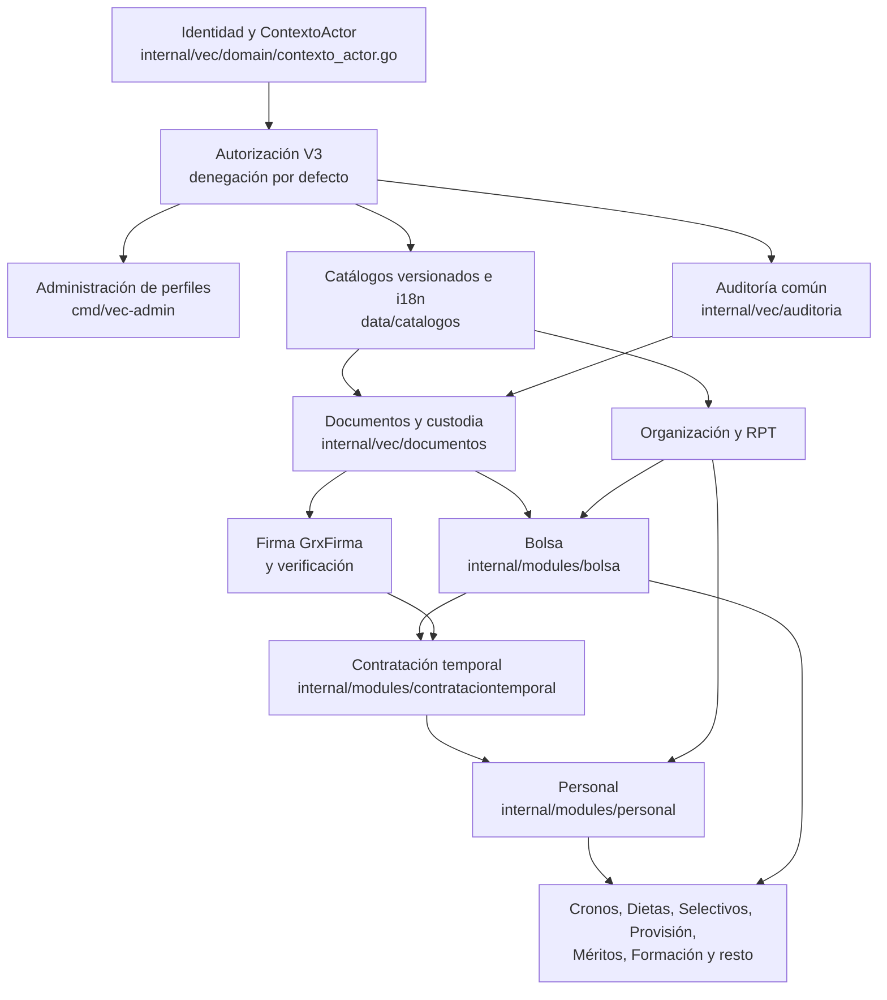

# Plan de implementación de VEC

Fuentes absorbidas el 13/10/2026: `docs/plan_modulos/OBJETIVOS.md` (retirado),
la hoja de ruta de
`docs/estudio_requisitos/catalogo_funcional_rrhh_y_hoja_ruta.md` (retirado),
`ESTADO_PROYECTO.md` (reducido a una nota), la condición de terminado de
`docs/portal_vec/expediente_contratacion_temporal_rrhh.md` (retirado), las
reglas de trabajo de `AGENTS.md`, E11 y E13 de `ESPECIFICACIONES_AGENTES.md` y
las decisiones de orden de módulos y baremador de la memoria de dirección.

Este documento es la única fuente de qué falta, en qué orden se construye,
cómo se sabe que cada fase está terminada y cómo se trabaja. Es lectura
obligatoria antes de elegir o encargar la siguiente tarea. Reúne lo vigente de
`docs/plan_modulos/OBJETIVOS.md`, `ESTADO_PROYECTO.md`, la hoja de ruta de
`docs/estudio_requisitos/catalogo_funcional_rrhh_y_hoja_ruta.md`, las reglas de
trabajo de `AGENTS.md` y los relevos de dirección; la lista exacta está en el
apartado 13.

No repite lo que cuentan los otros documentos de producto:

| Para saber… | Lee |
| --- | --- |
| Qué es VEC, para quién y qué módulos tiene | [`PRD.md`](PRD.md) |
| Cómo está construido, cómo arranca y cómo se despliega | [`TRD.md`](TRD.md) |
| Quién hace qué en cada recorrido y con qué perfil | [`FLUJO_APP.md`](FLUJO_APP.md) |
| Cómo se ven y se usan las pantallas | [`DISENO_UI_UX.md`](DISENO_UI_UX.md) |
| Esquemas, tablas, roles, migraciones y rutas de la API | [`ESQUEMA_BACKEND.md`](ESQUEMA_BACKEND.md) |

El detalle de cada módulo sigue en `docs/plan_modulos/<modulo>.md` (apartado
9). Las preguntas a RRHH y al DPD siguen en `dudas.md`. Si este plan y un plan
de módulo no coinciden, manda el más reciente: anota la diferencia y corrige
el otro en la misma entrega.

## Vocabulario mínimo

- **Migración SQL**: cambio versionado de la base, con número reservado por su
  módulo antes de escribirlo.
- **Selector**: configuración que habilita una función sin impedir el arranque
  cuando falta su dependencia.
- **V3**: motor de autorización que liga cada decisión a acción, recurso,
  finalidad y actor; se describe en [`TRD.md`](TRD.md).

## 1. Prioridad vigente

- **Ahora**: cerrar Bolsa y Contratación temporal (CT), con la firma de dos
  personas. Al 4 de noviembre de 2026, 163 de las 164 tareas activas de la
  fase 1 están terminadas y vistas en el navegador; falta la oferta de varias
  plazas en un mismo expediente, en revisión. Contratación temporal sigue el procedimiento que remitió RRHH
  (`docs/estudio_requisitos/decisiones_rrhh_2026-10-02.md`).
- **Bolsa no se borra ni se subordina**: mantiene convocatorias, candidaturas,
  posiciones, reglas y llamamientos. CT no tiene llamamiento propio: usa el
  llamamiento real de Bolsa sobre una bolsa constituida.
- **Después**: las cuatro tareas de simplificación de la fase 2 (F2-12 a F2-15,
  plan aprobado por la dirección del proyecto el 16/10) y luego el resto de Personal. Cronos y
  Dietas están aparcados desde el 08/10 y se retoman después, cada uno detrás
  de la base de Personal que necesite.
- **Aparcado**: el resto de módulos, hasta cerrar Bolsa y CT. Sus planes se
  conservan y se retoman uno a uno.

Cuando una tarea de Bolsa o CT necesita una capacidad común (VEC, Personal,
Documentos, firma, identidad):

1. se define una tarea dependiente y acotada;
2. se implementa en el módulo dueño de esa capacidad;
3. se prueba e integra;
4. se vuelve en seguida a Bolsa y CT.

No se amplía otro módulo por conveniencia ni se cambia la prioridad sin orden
de dirección. Las preguntas pendientes no detienen las partes que no dependen
de ellas; lo que RRHH no ha decidido se configura en un catálogo y se pregunta
en `dudas.md`.

Una capacidad se cierra al cumplir su criterio de fase y acreditarse en el
recorrido, con datos sintéticos.

## 2. Seguimiento de tareas

El estado, responsable y evidencia de cada tarea se mantienen en
[`TABLERO_TAREAS.md`](TABLERO_TAREAS.md). Estado de la fase 1 al 4 de noviembre
de 2026: 163 de 164 tareas activas terminadas, con el recorrido completo visto
en una copia nueva y tras reiniciar, el repaso de pantallas a 1440, 1024 y 390
píxeles hecho y la firma desde el móvil funcionando. Este plan fija prioridades, dependencias
y criterios de cierre.

## 3. Orden de construcción: base primero

Regla de la dirección del proyecto (03/10/2026): si un paquete es base de otros, se hace antes;
si no, se construye un tejado para una casa que no se sabe cuánto ocupará.
Dentro de esa regla van delante las bases que necesitan Bolsa y CT
(05/10/2026). Si un equipo se bloquea esperando una base, no se le busca
trabajo «encima»: se adelanta la base.

Una flecha de A a B significa «B usa A». Nada se construye antes que sus
flechas de entrada.

La orden del 08/10 (01:30) pone todo el esfuerzo en Bolsa, Contratación
temporal y lo que dependa de ellas. Sustituye a «todos los módulos en
paralelo» (07/10) y al orden general de la hoja de ruta del 24/09 mientras dure
esta prioridad. Primero va el recorrido Bolsa → CT → Personal → cese y las
bases que consume: identidad y administración, firma real de CT, auditoría,
Personal en lo que recibe del nombramiento y el paso de un proceso selectivo a
una bolsa.

Orden general de bases de VEC: identidad, usuarios, perfiles y
administradores → auditoría común → Personal y Organización/RPT → firmas →
selectivos, baremo y méritos → resto. Hoja de ruta tras Bolsa y CT: Selección,
Provisión, Cronos, Dietas, Formación, Méritos, Certificados, Acción social,
Nóminas y, al final, Prevención, Igualdad, Incompatibilidades, Régimen
disciplinario y Relaciones sindicales. El 07/10 la dirección del proyecto adelantó Cronos y
Dietas al primer puesto tras Bolsa y CT (apartado 1).

El portal muestra los módulos autorizados para cada perfil. Administración
gobierna su disponibilidad; las rutas aplican la misma decisión.

| Capa | Qué aporta a los demás | Dónde está |
| --- | --- | --- |
| Identidad y ContextoActor | Quién es la persona y con qué perfil actúa, desde el certificado; nunca desde cookies ni datos del navegador | `internal/vec/domain/contexto_actor.go`, `internal/vec/adapters` |
| Autorización V3 | Decisión por acción, recurso, finalidad y actor, consumida en la misma transacción que el efecto | `internal/vec`, migraciones `AUT` y `AD` |
| Administración de perfiles | Asignar y retirar perfiles con dos personas administradoras | `cmd/vec-admin` |
| Catálogos e i18n | Reglas, plazos, plantillas y textos por idioma, versionados | `data/catalogos/`, `internal/vec/reglas` |
| Auditoría común | Registro encadenado de todo, también lecturas | `internal/vec/auditoria` |
| Documentos | Custodia, descarga auditada, plantillas PDF y Word | `internal/vec/documentos` |
| Organización y RPT | Centros, puestos y categorías publicadas | `data/catalogos/rpt/`, `data/catalogos/estructura-organizativa/` |
| Bolsa | Bolsas, candidaturas, posiciones, llamamientos | `internal/modules/bolsa` |
| CT | Expediente de contratación temporal | `internal/modules/contrataciontemporal` |
| Firma | GrxFirma por `afirma://` y su validador | `internal/modules/contrataciontemporal/adapters` |
| Personal | Relación laboral que nace del nombramiento | `internal/modules/personal` |

Personal recibe el alta desde CT por su puerto, sin duplicar el procedimiento
de CT. Ningún módulo lee ni escribe tablas de otro; el detalle está en
`ESQUEMA_BACKEND.md`.

## 4. Hoja de ruta funcional

El catálogo funcional del 16/07/2026 (retirado el 13/10) era el inventario de
capacidades de cada materia; ese inventario está ahora en `PRD.md`, apartado 9.
Su orden de implantación queda absorbido aquí y ajustado a las órdenes
posteriores de la dirección del proyecto:

| Bloque del catálogo | Qué contenía | Dónde queda en este plan |
| --- | --- | --- |
| F0. Fundamento | Persona, cuenta, relación, organización y autoridad; política versionada, aritmética exacta y tiempo civil; autorización, segregación, auditoría y eventos; documentos, firma y archivo; portales externo e interno separados | Fase 0 |
| F1. Núcleo y Bolsa | Convocatoria y bases gobernadas; portal público y área del aspirante; solicitud, tasa, firma, registro y justificante; méritos reutilizables; baremo con autobaremo y revisión firmada; listas, disponibilidad y llamamiento; documentos y avisos; datos ficticios sin atajos desechables | Fase 1, más la parte de convocatorias y baremo de la fase 5 |
| F2. Selección y Bolsa completas | Órgano de selección, pruebas, admisión, subsanación, alegaciones, recursos, incorporación, indicadores e integraciones reales | Fase 5 |
| F3. Columna interna | Personal, RPT histórica, ocupaciones, vacantes, planificación, provisión, carrera, certificados, portal del empleado | Fases 2, 5 y 6 |
| F4. Tiempo y operación | Formación, espacio de responsables, Cronos, centros y turnos, teletrabajo, horas, dietas, geolocalización | Fases 3, 4 y 6. Cronos y Dietas se adelantan por orden del 07/10 |
| F5. Materias económicas y reservadas | Nómina, acción social, PRL, igualdad, protocolos, incompatibilidades, disciplina, relaciones laborales | Fase 6 |

Del catálogo se mantienen dos ideas: lo que no se desarrolla ahora no se
simula con reglas arbitrarias para aparentar cobertura, y la protección frente
a refactorizaciones futuras está en fijar límites, identificadores, versiones,
autoridad y contratos neutrales, no en programar todos los módulos por
adelantado.

## 5. Fases y criterios de cierre

Una fase está cerrada cuando su criterio se cumple **en la copia local, con datos
sintéticos, en el navegador y tras reiniciar**, no en una prueba aislada
(orden de la dirección del proyecto del 16/10: cidonia está congelada).

### 5.1 Puertas de cualquier capacidad

Antes de programar una capacidad funcional:

- fuente normativa y provincial identificada, con vigencia y ámbito;
- dueño del dato y órgano competente conocidos;
- procedimiento real y excepciones levantados, o configurados en catálogo si
  RRHH aún no ha decidido;
- perfiles, segregación, conservación y riesgos definidos.

Para darla por terminada:

- dominio y puertos no dependen del adaptador elegido;
- autorización probada, también las denegaciones y la separación entre zona
  pública, del empleado e interna;
- reglas, fuentes y versiones aparecen en resultados y auditoría;
- reintento, concurrencia, idempotencia y fallo parcial probados;
- recorrido real con PostgreSQL, casos negativos y reinicio;
- pantallas y documentos accesibles; ayuda tras el botón «?» actualizada;
- migración ensayada sobre copia de la principal; se comprueba que una segunda
  aplicación se detiene y que el volcado permite restaurar el ensayo;
- documentación afectada al día, incluido el manual de RRHH cuando cambie
  su recorrido;
- PR fusionada y prueba final en Chrome en la copia local;
- RRHH ha visto la fase funcionando y la da por buena.

### Fase 0. Base común

Identidad, autorización, administración de perfiles, catálogos, auditoría y
documentos, en lo que Bolsa y CT consumen. Criterio:

1. Cada perfil del recorrido (aspirante, centro, ratificador, RRHH,
   Intervención, firmantes) entra con su certificado sintético y ve solo lo
   suyo; un perfil ajeno recibe 403 con apunte de denegación.
2. Las personas administradoras asignan y retiran esos perfiles desde
   `vec-admin`, con auditoría, sin SQL a mano.
3. La auditoría de RRHH está encendida (`VEC_RRHH_AUDITORIA_ENABLED`) y la
   consulta por persona devuelve sus lecturas y actos.
4. Cada catálogo que el recorrido usa está publicado con versión y huella.

### Fase 1. Bolsa y Contratación temporal

Se cierra cuando se cumplen estas cuatro condiciones en la copia local.
1. **Recorrido completo de RRHH en Chrome, con reinicio.** Certificados
   sintéticos de personas distintas; petición del centro, ratificación, alta,
   análisis con crédito, oferta desde la bolsa con varias plazas, aceptación,
   informe, fiscalización con un reparo y su subsanación, resolución firmada
   por dos personas, GINPIX, paso a Personal, cese y vuelta de la persona a su
   bolsa. Después se reinician aplicación y PostgreSQL y se repiten las
   consultas: mismos recibos, mismas fechas, ningún duplicado. Queda un acta
   con la respuesta HTTP y una captura por paso.
2. **Selectores encendidos**: `VEC_BOLSA_BORRADORES_ENABLED`,
   `VEC_BOLSA_PORTAL_CANDIDATO_ENABLED`, `VEC_DOCUMENTOS_ENABLED`,
   `VEC_BOLSA_CESE_CT_ENABLED`, `VEC_PERSONAL_B2_GOBIERNO_ENABLED`,
   `VEC_CT_INCORPORACION_ACREDITADA_ENABLED`, `VEC_FIRMA_VERIFICACION_ENABLED`
   y `VEC_RRHH_AUDITORIA_ENABLED`. El aviso de dependencias al arrancar no
   muestra ninguna ausencia.
3. **Ningún «no disponible» sin motivo.** Cada botón o enlace que ve RRHH
   funciona o explica en pantalla qué falta. Sin respuestas 404 ni 503 de rutas
   de Bolsa o CT en el registro durante el recorrido.
4. **Lecturas rápidas**: cuadro de CT, lista de expedientes, ficha, bolsas,
   candidatos y ficha del candidato por debajo de 300 ms en el percentil 95,
   medido por HTTP en la copia local con el volumen de la principal. La base común
   (sesión, módulos, preferencias) por debajo de 100 ms.

El recorrido empieza en la petición del centro (`FLUJO_APP.md`, apartado 4.0).
El tramo del aspirante (inscripción, títulos y méritos en «Mi Bolsa» y admisión
por RRHH) se enseña aparte y no forma parte de la condición 1: el 14/10 la dirección del proyecto
aclaró que el recorrido puede empezar donde convenga. Sustituye a la nota del
13/10, que lo ponía al principio.

### Fase 2. Personal y Organización como base del resto

Lo que Personal y la RPT deben dar a Cronos, Dietas y los demás: ficha del
empleado con historia propia, situaciones, ocupación del puesto y documentos
ligados a cada hecho. Criterio: un alta que llega desde CT aparece en Personal
con su relación, puesto de la RPT y documentos; el cese la cierra; la consulta
histórica responde en menos de 300 ms; y Cronos y Dietas leen al empleado por
un puerto propio. Solo se construye lo que necesiten las fases 3 y 4.

### Fase 3. Cronos

Reescritura de la aplicación PHP actual de control horario, capacidades C1 a
C12 de `docs/estudio_requisitos/ficha_cronos_2026-09-23.md`. Criterio: las doce capacidades con
recorrido real en una copia de ensayo. Necesita las respuestas a las dudas 19 a 21, 41,
42, 47, 48 y 100 a 103.

### Fase 4. Dietas

Comisiones de servicio: solicitud, autorización, justificación y liquidación
(`docs/estudio_requisitos/ficha_dietas_2026-09-23.md`). Criterio: una comisión
sintética recorre las tres perspectivas (persona, jefatura que autoriza, RRHH
que liquida) con tarifas de un catálogo versionado. Dudas 22 a 26, 40, 44, 46,
49 a 51 y 104 a 108.

### Fase 5. Sustituir Convoca entero

**Baremador** (orden de la dirección del proyecto del 30/09): un motor común, primero para
Bolsa y sin olvidar Concursos de provisión, en su propia pestaña o módulo; las
bases son casi iguales. Lo imprescindible es configurar las puntuaciones
(topes, tablas, fecha de referencia) con versión y auditoría. Reglas versionadas
por convocatoria, méritos de oficio desde Personal y la RPT y precisión fija. Del
prototipo de baremador que existe aparte se reutilizan reglas y casos como
pruebas de conformidad, no su código ni su almacenamiento, y nunca sus datos
reales. Anonimizar no es solo cambiar nombres y DNI: también se desplazan
fechas, se alteran cifras y se generan identificadores inventados, fuera de Git
y consultándolo con el DPD. Estudios:
`docs/estudio_requisitos/integracion_baremador_concursos_provision.md` y
`docs/estudio_requisitos/baremacion_configurable_jornada_y_datos_de_oficio.md`.

Procesos selectivos, Provisión y Méritos: publicación de convocatorias,
inscripción, baremación con firma, alegaciones y recursos. Criterio: una
convocatoria sintética se publica, recibe inscripciones con méritos, se bareman
con firma de las personas designadas, admite alegaciones y termina en una
bolsa constituida o una adjudicación, sin usar Convoca.

### Fase 6. Resto de módulos

Por este orden orientativo, cada uno detrás de las bases que necesita:
Formación, Certificados, Acción social, Nóminas (consulta y luego cálculo),
Prevención de riesgos, Igualdad, Incompatibilidades, Régimen disciplinario,
Relaciones sindicales y Canal interno de información. Criterio: el general del
apartado 5.1.

### Fase 7. Paso a uso real

No es programación. Antes de tratar datos reales hacen falta evaluación de
impacto (EIPD), categorización del Esquema Nacional de Seguridad (ENS),
análisis de riesgos, registro de actividades y autorizaciones formales;
clasificación según el Reglamento europeo de IA antes de usar IA en
selección o baremación; Kerberos; correo de la Diputación; portafirmas y
GINPIX reales; y la auditoría de seguridad con herramientas de ataque, que se
reserva para cuando la aplicación esté terminada. Ninguna fase anterior
autoriza datos reales.

La preparación técnica de producción también va en esta fase (tablero, F7-17 a
F7-33): instalación desde cero en una base vacía, servidores separados,
retirada del montaje de desarrollo, servidor nuevo con CPU dedicada, prueba
de carga antes de cada hito, administración solo desde la red corporativa,
expediente electrónico, accesibilidad, respuesta a incidentes y análisis de
riesgos.

## 6. Tareas pendientes

Las tareas de todas las fases, con su equipo, su estado y cómo se comprueban,
están en [`TABLERO_TAREAS.md`](TABLERO_TAREAS.md); los criterios de cierre de
cada fase siguen en el apartado 5.

Pendientes del alta por acumulación sin ocupación de puesto:

- cese automático en la fecha de fin del alta sin puesto y aviso a Bolsa: hoy el cese es manual; riesgo de permanencia más allá del fin; decide dirección con RRHH.
- firma con documento de los actos de publicación de reglas de Administración: común a todas las reglas, se diseña aparte. Mientras tanto se usa el acto de dos administradores identificados por certificado, con huella, recibo y auditoría.

## 7. Decisiones funcionales para las siguientes capacidades

Cómo ve cada perfil estas capacidades se describe en [`FLUJO_APP.md`](FLUJO_APP.md).
El avance de las tareas se consulta en [`TABLERO_TAREAS.md`](TABLERO_TAREAS.md).

**Cartera de méritos y puntuación por bolsa.**

«Mis méritos» muestra los títulos, cursos y demás méritos de la cartera
personal, con sus datos y su estado. La lectura exige autorización y debe
recuperarse tras reiniciar. La valoración por categoría y los puntos corresponden
al motor común de baremación, fuera de la fase 1.

- La persona incorpora una vez sus títulos y cursos a una cartera personal en
  «Mi Bolsa», aunque aún no se apunte a ninguna bolsa. Puede pedir retirar un
  mérito con motivo; la retirada no borra lo ya decidido.
- Méritos es dueño del hecho (tipo, fecha, horas, origen, versión, evidencia);
  Documentos, del fichero; Bolsa, de la relación del mérito con cada categoría
  y de los puntos. Un mérito no tiene puntos universales: la misma persona
  puede tener 6,5 en una bolsa y 5,9 en otra.
- Al apuntarse, «Mi Bolsa» enseña por categoría si cada mérito cuenta, no
  cuenta o está pendiente, con motivo, regla, fecha de corte, puntos y total
  provisional.
- La ventana temporal de los méritos sale de las bases publicadas de cada
  convocatoria. No se fija «cinco años» en el código ni se toma por defecto la
  fecha de publicación.
- La persona ordena sus bolsas por preferencia. Ese orden no decide todavía
  adjudicaciones ni renuncias.

**Acreditación de títulos en PDF.**

- No se exige firma electrónica para subir un documento. Hay dos vías: original
  electrónico del emisor (firma, sello o código de verificación) o copia
  escaneada de un título en papel.
- La copia escaneada se recibe como pendiente de acreditación; puede contar en
  el autobaremo provisional, rotulada así, pero no da puntos definitivos. La
  firma del propio aspirante sobre la copia no acredita el título.
- Cuando haga falta cotejar, lo hace una persona habilitada para expedir
  copias auténticas. El cotejo se hace una vez por persona y documento y se
  reutiliza en todas sus bolsas; cada bolsa vuelve a aplicar sus reglas de
  puntos y fecha.

**Inscripción por categorías.** RRHH elige en cada convocatoria, antes de
publicarla, si hay una solicitud por categoría o una conjunta. Cada modalidad
tiene su recibo y su reintento. El borrador B105 solo cubre la separada.

**Revisión, firmas y cambios en una bolsa activa.**

- RRHH es el único editor de baremaciones. Designa la lista de firmantes; cada
  cambio crea versión nueva y obliga a firmar otra vez a todos.
- La pantalla distingue «preparado, pendiente de envío a firma», «enviado a
  firma» (aceptado por el portafirmas) y «firmado» (firma verificada y
  custodiada). Identificarse con certificado no es firmar.
- Si una decisión firmada cambia puntos de una bolsa activa, Bolsa recalcula el
  orden, avisa a RRHH de todas las personas y llamamientos afectados y para los
  llamamientos automáticos de ese tramo hasta que RRHH lo revise.
- El aviso por correo no sustituye la publicación o notificación formal que
  fijen las bases.

**Documentos y antivirus.** Gestor documental Mayan; los ficheros esperan en
cuarentena hasta pasar antivirus (ClamAV) y análisis de PDF. Al principio solo
se admite PDF. Ningún fichero dudoso llega a Mayan ni a RRHH. Informática
opera esos conectores con el perfil de administrador de sistemas.

**Justificante de renuncia justificada.** La persona aporta el PDF desde
«Mi Bolsa» y conserva su original y el recibo. Una técnica con permiso vigente
consulta y descarga el documento desde la ficha del candidato. La activación
requiere el gobierno de admisiones externas y del perfil correspondiente.

**Modalidad y causa en las ofertas.** La oferta conserva la modalidad y la
causa del análisis de Contratación, además de la referencia y versión del
expediente. La reserva y la publicación cotejan esa fuente. Las ofertas
históricas se recuperan con sus datos originales. La publicación desde la ficha
requiere unidad y ámbito autorizados; el filtrado por preferencias se trata
por separado.

## 8. Reglas que siguen vigentes de los relevos anteriores

De los relevos de septiembre, guardados ahora en
`docs/historico/AGENTS_historico_hasta_20261013.md`, siguen en vigor estas
reglas, aunque sus rutas, ramas y cifras sean historia:

- Una migración ya instalada con historia no se reaplica ni se revierte.
- El Word original del procedimiento que remitió RRHH no se edita: se cita y se
  trabaja sobre copias o extractos.
- Identificarse con certificado no firma documentos. Ninguna autenticación,
  borrador o evidencia sintética se presenta como firma legal.
- Toda sustitución provisional explica en pantalla qué se hizo y qué falta
  para el uso real, sin palabras como «prueba» o «demo».
- No se asignan permisos por nombre de cargo ni se mezclan solicitante,
  ratificador y RRHH en la misma identidad.
- Un recibo local no acredita la confirmación de un sistema externo (GINPIX,
  portafirmas, correo). La indisponibilidad nunca se interpreta como éxito.
- Puerta de F1-156 antes de cargar personas reales: la referencia de
  participación antigua se puede recalcular a partir del DNI enmascarado,
  porque no lleva clave (la forma está en
  `internal/modules/bolsa/ports/aceptacion_nativa_ct.go:35`). Una base no
  recibe datos reales si tiene alguna constitución de bolsa confirmada antes
  de activar la referencia nueva, salvo las actas inventadas de la receta de
  copias. Las referencias antiguas no se reescriben ni se construye una tabla
  de correspondencias. Si la puerta no se cumple, antes de cargar datos reales
  hay que construir esas correspondencias. El acta de activación, cuando
  exista con el código de F1-156, anotará el instante en que entra la
  referencia nueva en esa base. Comprueba la puerta dirección, y la dirección del proyecto antes
  de los datos reales. La prueba de diccionario se añadirá a las pruebas
  automáticas y no se retirará. Esto cambia una decisión anterior de dirección, que
  pedía las correspondencias, y queda pendiente de que dirección lo acepte por
  escrito.

### Activación de referencias aleatorias de Bolsa (F1-156)

Dirección registra en el acta de activación de cada base el instante en que
arranca por primera vez el binario que crea referencias aleatorias de
participación y sujeto. El instante se toma del reloj PostgreSQL y se coteja
con `vec_bolsa_llamamientos.constitucion.registrada_en`. Antes de cargar datos
reales, Dirección exige que no haya constituciones anteriores a ese instante o
que todas sus actas figuren en la lista explícita de actas ficticias de la
receta. El comprobador de `deploy/principal/recorrido_copia/` hace ese cotejo y
se detiene si falta el acta, cambia un fichero de la receta o aparece un acta
anterior sin acreditar. Si se detiene, Dirección construye y revisa las
correspondencias históricas antes de admitir datos reales.

Primero se instala B180 y después se activa el binario F1-156 en la misma
candidata. Tras registrar la activación, no se vuelve a un binario sin F1-156.
Si se revierte el binario, se registra una activación nueva y se repite el
cotejo. El responsable de esta puerta es Dirección; el recibo de B180 no la
sustituye.

## 9. Planes por módulo

Los planes amplían el alcance de cada materia. El avance de cada tarea se consulta
en [`TABLERO_TAREAS.md`](TABLERO_TAREAS.md).

| Módulo | Plan en `docs/plan_modulos/` | Fase |
| --- | --- | --- |
| Bolsa | `bolsa.md` | 1 |
| Contratación temporal | `contratacion_temporal.md` | 1 |
| Firmas | `firmas.md` | 1 |
| Regla común de funciones PostgreSQL | `comun.md` | 0 |
| Administración de perfiles | `administracion.md` | 0 |
| Auditoría | `auditoria.md` | 0 |
| Copias de seguridad | `copias_seguridad.md` | 0, aparcado |
| Organización y RPT | `organizacion_rpt.md` | 2 |
| Personal | `personal.md` | 1 y 2 |
| Portal del empleado | `portal_empleado.md` | 2 |
| Cronos | `cronos.md` | 3 |
| Dietas | `dietas.md` | 4 |
| Procesos selectivos | `selectivos.md` | 5 |
| Provisión | `provision.md` | 5 |
| Carrera y Formación | `carrera_formacion.md` | 5 y 6 |
| Formación | `formacion.md` | 6 |
| Certificados y analítica | `certificados_analitica.md` | 6 |
| Acción social | `accion_social.md` | 6 |
| Nóminas | `nominas.md` | 6 |
| Prevención de riesgos | `prevencion_riesgos_laborales.md` | 6 |
| Igualdad | `igualdad.md` | 6 |
| Incompatibilidades | `incompatibilidades.md` | 6 |
| Régimen disciplinario | `regimen_disciplinario.md` | 6 |
| Relaciones sindicales | `relaciones_sindicales.md` | 6 |
| Canal interno de información | `canal_interno_informacion.md` | 6 |

## 10. Cómo se trabaja

### 10.0 Entrega y datos

Los recorridos se ensayan en una copia local con datos inventados. Una
configuración opcional falla solo en su función y explica lo que falta. El caso
de aceptación está en [`FLUJO_APP.md`, apartado 4.0](FLUJO_APP.md#40-caso-de-aceptación-de-la-presentación).

### 10.1 Encargo y trabajo paralelo

Cada tarea tiene alcance, archivos propios y criterio de cierre. Un archivo
tiene un solo escritor. La revisión la hace alguien que no produjo el cambio;
solo dirección integra. Antes de programar se comprueban el código y las
ramas existentes para reutilizar lo que ya funciona.

### 10.2 Tamaño de cada tarea

Una entrega añade una capacidad útil y comprobable. Se retira el código que
quede sin uso y se evita duplicar controles entre capas. El tamaño de fichero
se vigila con `scripts/tamano_ficheros_base.txt`, que conserva sus líneas base.
Las reglas no decididas por RRHH se configuran en catálogos versionados.

### 10.3 Ciclo de entrega

El productor entrega código, pruebas focales, documentación afectada y guion
de activación. La base de datos se ensaya en el clon local con permisos reales;
los cambios de lógica de negocio, SQL con permisos, identidad o cifrado reciben
dos revisiones independientes. Los demás reciben una. La seguridad y la
usabilidad tienen revisión focal cuando corresponde. Dirección comprueba el
conjunto y lo integra; el recorrido final se hace en Chrome con reinicio.

### 10.4 Formato de la entrega

El informe, de una página como máximo, identifica tarea, hashes, archivos,
pruebas ejecutadas y omitidas, configuración, SQL por instalar y asuntos
pendientes con responsable y riesgo. Distingue código integrado, base de datos
instalada y recorrido comprobado. Solo dirección cambia el estado de una tarea
en [`TABLERO_TAREAS.md`](TABLERO_TAREAS.md).

### 10.5 Reglas de simplificación

Un control nuevo explica qué protege y qué prueba lo comprueba. Cada capa valida
lo que le corresponde una vez: SQL resuelve cerrojos, guardas y recibos; Go
valida la entrada y coteja el recibo antes de confirmar; la web presenta el
resultado. Se reutilizan los contratos existentes. Una función sin consumidor
no se monta. Una lectura nueva se agrega a la lista existente cuando encaja
en ella.

### 10.6 Método del lote único

Para oferta a todos, desistir y Administración hay un solo diseño SQL, un
responsable del orden y una lista de instalación común. Cada función se
reconstruye una vez en el conjunto. Servidor y pantallas avanzan con contratos
acordados. La revisión cubre el conjunto: un ensayo en PostgreSQL desechable,
dos revisiones SQL independientes y una revisión de seguridad.

Cada migración lleva su subida, una repetición que se detiene y pruebas focales.
La recuperación de un ensayo restaura el volcado; un problema después de
instalarse se corrige con otra migración. El recorrido final se comprueba con
datos inventados en Chrome a 1440 y 1024 píxeles y tras reiniciar. Los pasos
que requieran firma en una máquina virtual figuran como «sin VM» hasta que se
puedan comprobar. El estado de las piezas y del ensayo se lleva en
[`TABLERO_TAREAS.md`](TABLERO_TAREAS.md).

## 11. Dependencias externas

Las plantillas, delegaciones de firma, correo corporativo, integración con
GINPIX y SICAL y uso de datos reales dependen de RRHH, Informática o la
Diputación. Las preguntas están en `dudas.md`; el seguimiento de tareas y sus
bloqueos se mantiene en [`TABLERO_TAREAS.md`](TABLERO_TAREAS.md). Una respuesta
externa no se sustituye por un recibo local.

## 12. Hitos

Cada hito se acredita por su criterio de la sección 5. Bolsa y Contratación
temporal preceden a Personal y Organización; estos sustentan Cronos, Dietas y
los demás módulos. El uso real exige además las condiciones de la fase 7.
Las fechas y los responsables de las tareas están en
[`TABLERO_TAREAS.md`](TABLERO_TAREAS.md).

## 13. Cómo mantener este documento

Dirección actualiza aquí las prioridades, dependencias y criterios de cierre.
El estado de las tareas, hashes, ensayos y medidas va en
[`TABLERO_TAREAS.md`](TABLERO_TAREAS.md) y en las evidencias de cada entrega.
Los cambios de alcance se reflejan también en el documento de producto
correspondiente. No se incorporan secretos, rutas privadas ni datos personales.
