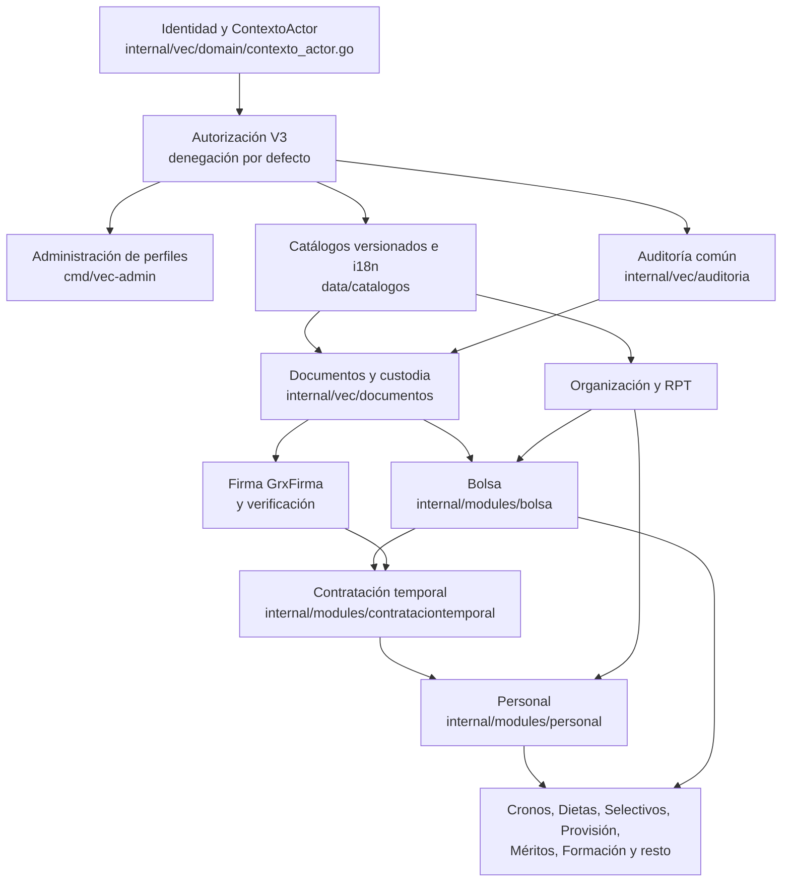

# Plan de implementación de VEC

Fuentes absorbidas el 13/10/2026: `docs/plan_modulos/OBJETIVOS.md` (retirado),
la hoja de ruta de
`docs/estudio_requisitos/catalogo_funcional_rrhh_y_hoja_ruta.md` (retirado),
`ESTADO_PROYECTO.md` (reducido a una nota), la condición de terminado de
`docs/portal_vec/expediente_contratacion_temporal_rrhh.md` (retirado), las
reglas de trabajo de `AGENTS.md`, E11 y E13 de `ESPECIFICACIONES_AGENTES.md` y
las decisiones de orden de módulos y baremador de la memoria de dirección.

Actualizado el 13 de octubre de 2026 sobre `origin/main@6c9ae43dc`.

Este documento es la única fuente de qué falta, en qué orden se construye,
cómo se sabe que cada fase está terminada y cómo se trabaja. Es lectura
obligatoria antes de elegir o encargar la siguiente tarea. Reúne lo vigente de
`docs/plan_modulos/OBJETIVOS.md`, `ESTADO_PROYECTO.md`, la hoja de ruta de
`docs/estudio_requisitos/catalogo_funcional_rrhh_y_hoja_ruta.md`, las reglas de
trabajo de `AGENTS.md` y los relevos de dirección; la lista exacta está en el
apartado 13.

No repite lo que cuentan los otros documentos de producto:

| Para saber… | Lee |
| --- | --- |
| Qué es VEC, para quién y qué módulos tiene | [`PRD.md`](PRD.md) |
| Cómo está construido, cómo arranca y cómo se despliega | [`TRD.md`](TRD.md) |
| Quién hace qué en cada recorrido y con qué perfil | [`FLUJO_APP.md`](FLUJO_APP.md) |
| Cómo se ven y se usan las pantallas | [`DISENO_UI_UX.md`](DISENO_UI_UX.md) |
| Esquemas, tablas, roles, migraciones y rutas de la API | [`ESQUEMA_BACKEND.md`](ESQUEMA_BACKEND.md) |

El detalle de cada módulo sigue en `docs/plan_modulos/<modulo>.md` (apartado
9). Las preguntas a RRHH y al DPD siguen en `dudas.md`. Si este plan y un plan
de módulo no coinciden, manda el más reciente: anota la diferencia y corrige
el otro en la misma entrega.

## Vocabulario mínimo

- **cidonia**: el servidor donde se instala VEC para que RRHH lo vea, con datos
  sintéticos. No es producción.
- **HZ*n***: número de cada subida a cidonia. Cada una tiene copia fría de la
  base y un guion de vuelta atrás.
- **Migración SQL**: cambio de la base. Su código empieza por las letras del
  dueño: `AD` administración e identidad, `AUT` autorización, `CT`
  Contratación temporal, `B` Bolsa, `P` Personal, `CA`, `CC` e `IS` cadenas de
  identidad y catálogos, `D` Documentos, `RUM` y `M` Méritos. Los números se
  reservan antes de escribirlas en el registro de reservas, que está fuera de
  Git. Nunca se reutiliza un número reservado por otra rama.
- **Selector**: variable de entorno que enciende una función, por ejemplo
  `VEC_BOLSA_CESE_CT_ENABLED`. Apagada, la función explica en pantalla por qué
  no está; nunca impide que arranque la aplicación.
- **Equipo**: un agente Codex con una letra (K, L, M, H, O, J…) que programa
  una tarea en su propia rama. Claude dirige, programa también, revisa,
  fusiona y sube a cidonia.
- **V3**: el motor de autorización. Cada decisión queda ligada a acción,
  recurso, finalidad y actor. Se describe en `TRD.md`.

## 1. Prioridad vigente

- **Ahora**: cerrar Bolsa y Contratación temporal (CT), con la firma de dos
  personas. Contratación temporal sigue el procedimiento que remitió RRHH
  (`docs/estudio_requisitos/decisiones_rrhh_2026-10-02.md`).
- **Bolsa no se borra ni se subordina**: mantiene convocatorias, candidaturas,
  posiciones, reglas y llamamientos. CT no tiene llamamiento propio: usa el
  llamamiento real de Bolsa sobre una bolsa constituida.
- **Después**: Cronos y luego Dietas (orden de Alberto del 07/10/2026), cada
  uno detrás de la base de Personal que necesite.
- **Aparcado**: el resto de módulos, hasta cerrar Bolsa y CT. Sus planes se
  conservan y se retoman uno a uno.

Cuando una tarea de Bolsa o CT necesita una capacidad común (VEC, Personal,
Documentos, firma, identidad):

1. se define una tarea dependiente y acotada;
2. se implementa en el módulo dueño de esa capacidad;
3. se prueba e integra;
4. se vuelve en seguida a Bolsa y CT.

No se amplía otro módulo por conveniencia ni se cambia la prioridad sin orden
de dirección. Las preguntas pendientes no detienen las partes que no dependen
de ellas; lo que RRHH no ha decidido se configura en un catálogo y se pregunta
en `dudas.md`.

Que haya código en `main` no significa que esté instalado en cidonia ni que se
haya recorrido en el navegador. Los datos son sintéticos y nada de esto es
producción.

## 2. Estado actual

Lo marcado *pendiente de verificar* no se ha podido comprobar al escribir.

### 2.1 Instalado en cidonia

Según el registro de dirección del 13/10/2026 a las 15:15 (*pendiente de
verificar contra el servidor*):

- **Subida HZ36.** También está arrancado el servidor de administración
  (`vec-admin`, en su subdominio con certificado), con la carga de bolsas desde
  el Excel de CONVOCA (B1), la fuente de respuestas B103 y la cuenta externa.
- **Reglas y catálogos**: reglas de CT v2, reglas de Bolsa v6, circuito v2,
  plantillas de documentos v3, catálogo de acciones v5, rol RRHH v10.
- **Bolsa**: candidatos, importación desde CONVOCA, correo (buzón de pruebas),
  baremación, documentos de Bolsa, convocatorias (vacía hasta abrir la
  inscripción), configuración, «Mi Bolsa» del aspirante, cifras globales
  pulsables (#921), cese con vuelta a la bolsa (selector encendido desde HZ10).
  «Mi perfil» de RRHH responde 403. Hay tres convocatorias de inscripción
  cargadas.
- **CT**: desde la petición del centro hasta la resolución, con el alta según
  la circular de mayo (CT193 y CT194), edición de plazos en «Reglas vigentes»
  (#919, CT190 y CT191), recuperación de una selección a medias entre CT y
  Bolsa (incidencia ORQ-1, #918), incorporación acreditada y plantillas PDF y
  Word.
- **Paso a Personal**: encendido desde HZ18. Ningún expediente antiguo puede
  llegar a él porque usan una categoría de desarrollo; hace falta uno con
  categoría de la RPT publicada (#1070, en curso).
- **Auditoría de RRHH**: instalada pero apagada; le falta configuración.
- **Contacto completo del candidato** en la ficha: responde 200.

La historia de subidas, con sus SQL, copias y guiones de vuelta atrás, la
conserva dirección fuera de Git.

### 2.2 Fusionado en `main` y todavía sin subir

El registro del 13/10 a las 15:15 cita #1093, #1096, #1097, #1100 y #1103.
Desde la madrugada del 13/10 se fusionaron además #1088 (seleccionar desde la
bolsa constituida para el llamamiento CT) y #1112 (cuenta externa propia del
aspirante). *Pendiente de verificar* cuáles están ya en cidonia.

La subida estaba bloqueada por la migración AD250 (#1081), que no encajaba con
la base real de cidonia. #1102 la sustituye por AD262, ensayada en una copia de
la principal del 13/10 (`deploy/principal/habilitacion_ad262_actual_20261013.md`).
*Pendiente de verificar* si AD262 está instalada.

### 2.3 En curso

PR abiertas, todas en borrador:

| PR | Qué | Equipo | Fase |
| --- | --- | --- | --- |
| #1099 | CT: preparar originales y conectar la firma nominal en VEC | H | 1 |
| #1070 | Comprobar el alta en Personal (B2) y detenerla sin bolsa constituida | K | 1 |
| #1008 | Textos: cómo corregir o publicar la categoría antes de vincularla | J | 1 |
| #882 | Formación: recuperar el idioma sin perder el borrador | T | 6, aparcado |
| #881 | Provisión: agrupar experiencia y separar el corrector provisional | T | 5, aparcado |

Ramas sin PR conservadas en el relevo de Claude del 12/10 (fichero
`RELEVO_CLAUDE_20261012.md` de la carpeta principal, fuera de Git). Ninguna
está instalada; verificar su hash antes de reanudar:

| Corte | Falta para usarlo |
| --- | --- |
| Firmantes de méritos (B7) | Una puerta completa; sin SQL, HTTP ni firma real |
| Cálculo de formación por categoría | Una puerta completa sobre el último hash; API y web |
| Analizador de PDF con ClamAV | Probar el lanzador controlado con un clamd real; montaje de cuarentena |
| Vista de cartera en «Mi Bolsa» | API real y montaje; no mostrar cifras ficticias |
| Documentos y S3 (D16 a D18) | Autorización nominal del aspirante externo y composición |
| Cliente del gestor documental Mayan | TLS del destino y configuración de Sistemas |
| Preferencias entre bolsas | PostgreSQL integrado, lectura autorizada y efecto en la adjudicación |
| Inscripción por varias categorías (B105) | **No instalar**: falta la modalidad conjunta configurable (apartado 7) |

### 2.4 Lo que todavía no funciona de punta a punta

- **El recorrido completo** de la presentación (aspirante → centro →
  ratificador → RRHH → Intervención → llamamiento desde la bolsa → aceptación
  → resolución firmada → incorporación → Personal → cese → vuelta a la bolsa).
  El único acta escrita es la del 05/10
  (`docs/estudio_requisitos/acta_recorrido_ct_bolsa_20261005.md`) y se paró en
  la resolución.
- **La firma de dos o tres personas.** Ningún documento sale hoy firmado.
- **El correo de la Diputación.** Se usa un buzón de pruebas; vale para la
  presentación, no para uso real.
- **La lectura rápida medida en cidonia.** El último dato del cuadro de CT en
  cidonia era de 363 a 372 ms en el percentil 95; las mejoras posteriores
  (#916, CT190) se midieron solo en local (unos 209 a 283 ms).
- **Los demás módulos** tienen código parcial en `main`, pero están aparcados
  y sin recorrido.

### 2.5 Lista del 8 de octubre, revisada

`OBJETIVOS.md` (08/10) fijaba once puntos. Así están el 13/10:

| Punto del 08/10 | Situación a 13/10 |
| --- | --- |
| 1. Encender en cidonia lo que existe | Cese con vuelta a la bolsa (HZ10), incorporación acreditada (HZ12) y paso a Personal (HZ18) encendidos. Faltan auditoría de RRHH y verificación de firma |
| 2. Fusionar PR abiertas de Bolsa y CT | #774, #905, #906, #907, #910 y #540 fusionadas; #909 cerrada sin fusionar |
| 3. ORQ-1, selección a medias | Resuelta con #918 (AD225, CT198, AD226, CT199), en cidonia desde HZ12 |
| 4. Repetir el recorrido completo | Pendiente (apartado 6) |
| 5. Carga de bolsas desde CONVOCA | #751 y #752 fusionadas; la pantalla #759 se cerró y la carga se hizo en `vec-admin` con dos administradores (10/10) |
| 6. Firma de dos personas | Pendiente; ahora la lleva el equipo H (#1099) |
| 7. Plazos de CT editables y tarjetas de plazo | Plazos con #919 (en cidonia desde HZ11). Tarjetas de plazo en Inicio (CT192): *pendiente de verificar* |
| 8. Velocidad | Pendiente de medir en cidonia |
| 9. Correo de la Diputación | Bloqueado por datos de Informática (duda 88) |
| 10. Cifras globales de Bolsa pulsables | Hecho con #921 (B94) |
| 11. Limpieza menor | Rutas muertas de cierre retiradas con #915; la duda 147 se resolvió por el Reglamento; *pendiente de verificar* el cambio de catálogo de reglas |

## 3. Orden de construcción: base primero

Regla de Alberto (03/10/2026): si un paquete es base de otros, se hace antes;
si no, se construye un tejado para una casa que no se sabe cuánto ocupará.
Dentro de esa regla van delante las bases que necesitan Bolsa y CT
(05/10/2026). Si un equipo se bloquea esperando una base, no se le busca
trabajo «encima»: se adelanta la base.



Una flecha de A a B significa «B usa A». Nada se construye antes que sus
flechas de entrada.

La orden del 08/10 (01:30) pone todo el esfuerzo en Bolsa, Contratación
temporal y lo que dependa de ellas. Sustituye a «todos los módulos en
paralelo» (07/10) y al orden general de la hoja de ruta del 24/09 mientras dure
esta prioridad. Primero va el recorrido Bolsa → CT → Personal → cese y las
bases que consume: identidad y administración, firma real de CT, auditoría,
Personal en lo que recibe del nombramiento y el paso de un proceso selectivo a
una bolsa.

Orden general de bases de VEC: identidad, usuarios, perfiles y
administradores → auditoría común → Personal y Organización/RPT → firmas →
selectivos, baremo y méritos → resto. Hoja de ruta tras Bolsa y CT: Selección,
Provisión, Cronos, Dietas, Formación, Méritos, Certificados, Acción social,
Nóminas y, al final, Prevención, Igualdad, Incompatibilidades, Régimen
disciplinario y Relaciones sindicales. El 07/10 Alberto adelantó Cronos y
Dietas al primer puesto tras Bolsa y CT (apartado 1).

Módulos visibles en cidonia hasta cerrar Bolsa y CT: Bolsa y Contratación, más
Documentos, Personal, Administración y Usuarios. Se limitan con
`VEC_PORTAL_MODULOS_VISIBLES` hasta que exista el interruptor de módulos en
Administración. Cronos sigue apagado.

| Capa | Qué aporta a los demás | Dónde está | Estado |
| --- | --- | --- | --- |
| Identidad y ContextoActor | Quién es la persona y con qué perfil actúa, desde el certificado; nunca desde cookies ni datos del navegador | `internal/vec/domain/contexto_actor.go`, `internal/vec/adapters` | En cidonia. Kerberos, pendiente |
| Autorización V3 | Decisión por acción, recurso, finalidad y actor, consumida en la misma transacción que el efecto | `internal/vec`, migraciones `AUT` y `AD` | En cidonia |
| Administración de perfiles | Asignar y retirar perfiles con dos personas administradoras | `cmd/vec-admin` | Arrancado en cidonia; asignación desde pantalla, parcial |
| Catálogos e i18n | Reglas, plazos, plantillas y textos por idioma, versionados | `data/catalogos/`, `internal/vec/reglas` | En uso por Bolsa y CT |
| Auditoría común | Registro encadenado de todo, también lecturas | `internal/vec/auditoria` | Instalada; la de RRHH, apagada |
| Documentos | Custodia, descarga auditada, plantillas PDF y Word | `internal/vec/documentos` | Encendido; antivirus y Mayan en ramas |
| Organización y RPT | Centros, puestos y categorías publicadas | `internal/vec/domain/catalogos_rpt_gobierno.go`, `data/catalogos/rpt/`, `data/catalogos/estructura-organizativa/` | Categorías de la RPT en el portal; la necesidad RPT en la petición del centro falta (duda 162) |
| Bolsa | Bolsas, candidaturas, posiciones, llamamientos | `internal/modules/bolsa` | Fase 1 |
| CT | Expediente de contratación temporal | `internal/modules/contrataciontemporal` | Fase 1 |
| Firma | GrxFirma por `afirma://` y su validador | `internal/modules/contrataciontemporal/adapters` | Fase 1, sin cerrar |
| Personal | Relación laboral que nace del nombramiento | `internal/modules/personal` | Recibe de CT en fase 1; el resto, fase 2 |

Personal recibe el alta desde CT por su puerto, sin duplicar el procedimiento
de CT. Ningún módulo lee ni escribe tablas de otro; el detalle está en
`ESQUEMA_BACKEND.md`.

## 4. Hoja de ruta funcional

El catálogo funcional del 16/07/2026 (retirado el 13/10) era el inventario de
capacidades de cada materia; ese inventario está ahora en `PRD.md`, apartado 9.
Su orden de implantación queda absorbido aquí y ajustado a las órdenes
posteriores de Alberto:

| Bloque del catálogo | Qué contenía | Dónde queda en este plan |
| --- | --- | --- |
| F0. Fundamento | Persona, cuenta, relación, organización y autoridad; política versionada, aritmética exacta y tiempo civil; autorización, segregación, auditoría y eventos; documentos, firma y archivo; portales externo e interno separados | Fase 0 |
| F1. Núcleo y Bolsa | Convocatoria y bases gobernadas; portal público y área del aspirante; solicitud, tasa, firma, registro y justificante; méritos reutilizables; baremo con autobaremo y revisión firmada; listas, disponibilidad y llamamiento; documentos y avisos; datos ficticios sin atajos desechables | Fase 1, más la parte de convocatorias y baremo de la fase 5 |
| F2. Selección y Bolsa completas | Órgano de selección, pruebas, admisión, subsanación, alegaciones, recursos, incorporación, indicadores e integraciones reales | Fase 5 |
| F3. Columna interna | Personal, RPT histórica, ocupaciones, vacantes, planificación, provisión, carrera, certificados, portal del empleado | Fases 2, 5 y 6 |
| F4. Tiempo y operación | Formación, espacio de responsables, Cronos, centros y turnos, teletrabajo, horas, dietas, geolocalización | Fases 3, 4 y 6. Cronos y Dietas se adelantan por orden del 07/10 |
| F5. Materias económicas y reservadas | Nómina, acción social, PRL, igualdad, protocolos, incompatibilidades, disciplina, relaciones laborales | Fase 6 |

Del catálogo se mantienen dos ideas: lo que no se desarrolla ahora no se
simula con reglas arbitrarias para aparentar cobertura, y la protección frente
a refactorizaciones futuras está en fijar límites, identificadores, versiones,
autoridad y contratos neutrales, no en programar todos los módulos por
adelantado.

## 5. Fases y criterios de cierre

Una fase está cerrada cuando su criterio se cumple **en cidonia, con datos
sintéticos y en el navegador**, no en un clon ni en una prueba aislada.

### 5.1 Puertas de cualquier capacidad

Antes de programar una capacidad funcional:

- fuente normativa y provincial identificada, con vigencia y ámbito;
- dueño del dato y órgano competente conocidos;
- procedimiento real y excepciones levantados, o configurados en catálogo si
  RRHH aún no ha decidido;
- perfiles, segregación, conservación y riesgos definidos.

Para darla por terminada:

- dominio y puertos no dependen del adaptador elegido;
- autorización probada, también las denegaciones y la separación entre zona
  pública, del empleado e interna;
- reglas, fuentes y versiones aparecen en resultados y auditoría;
- reintento, concurrencia, idempotencia y fallo parcial probados;
- recorrido real con PostgreSQL, casos negativos y reinicio;
- pantallas y documentos accesibles; ayuda tras el botón «?» actualizada;
- migración ensayada sobre copia de la principal, con copia y vuelta atrás;
- documentación al día en la misma PR (manual de usuario y el documento de
  `docs/producto/` que cambie);
- PR fusionada, subida a cidonia y prueba final en Chrome;
- RRHH ha visto la fase funcionando y la da por buena.

### Fase 0. Base común

Identidad, autorización, administración de perfiles, catálogos, auditoría y
documentos, en lo que Bolsa y CT consumen. Criterio:

1. Cada perfil del recorrido (aspirante, centro, ratificador, RRHH,
   Intervención, firmantes) entra con su certificado sintético y ve solo lo
   suyo; un perfil ajeno recibe 403 con apunte de denegación.
2. Las personas administradoras asignan y retiran esos perfiles desde
   `vec-admin`, con auditoría, sin SQL a mano.
3. La auditoría de RRHH está encendida (`VEC_RRHH_AUDITORIA_ENABLED`) y la
   consulta por persona devuelve sus lecturas y actos.
4. Cada catálogo que el recorrido usa está publicado con versión y huella.

Estado: 1 y 4 casi cumplidos; 2 parcial; 3 pendiente (equipo L).

### Fase 1. Bolsa y Contratación temporal (fase actual)

Se cierra cuando se cumplen estas cuatro condiciones en cidonia:

1. **Recorrido completo de RRHH en Chrome, con reinicio.** Certificados
   sintéticos de personas distintas; petición del centro, ratificación, alta,
   análisis con crédito, oferta desde la bolsa con varias plazas, aceptación,
   informe, fiscalización con un reparo y su subsanación, resolución firmada
   por dos personas, GINPIX, paso a Personal, cese y vuelta de la persona a su
   bolsa. Después se reinician aplicación y PostgreSQL y se repiten las
   consultas: mismos recibos, mismas fechas, ningún duplicado. Queda un acta
   con la respuesta HTTP y una captura por paso.
2. **Selectores encendidos**: `VEC_BOLSA_BORRADORES_ENABLED`,
   `VEC_BOLSA_PORTAL_CANDIDATO_ENABLED`, `VEC_DOCUMENTOS_ENABLED`,
   `VEC_BOLSA_CESE_CT_ENABLED`, `VEC_PERSONAL_B2_GOBIERNO_ENABLED`,
   `VEC_CT_INCORPORACION_ACREDITADA_ENABLED`, `VEC_FIRMA_VERIFICACION_ENABLED`
   y `VEC_RRHH_AUDITORIA_ENABLED`. El aviso de dependencias al arrancar no
   muestra ninguna ausencia.
3. **Ningún «no disponible» sin motivo.** Cada botón o enlace que ve RRHH
   funciona o explica en pantalla qué falta. Sin respuestas 404 ni 503 de rutas
   de Bolsa o CT en el registro durante el recorrido.
4. **Lecturas rápidas**: cuadro de CT, lista de expedientes, ficha, bolsas,
   candidatos y ficha del candidato por debajo de 300 ms en el percentil 95,
   medido por HTTP en cidonia con el volumen de la principal. La base común
   (sesión, módulos, preferencias) por debajo de 100 ms.

Desde el 13/10 el recorrido empieza antes: la persona aspirante se inscribe y
aporta títulos y méritos en «Mi Bolsa», RRHH la admite y constituye la bolsa,
y solo entonces el centro pide. Ese tramo forma parte de la condición 1
(detalle en `FLUJO_APP.md`).

Estado a 13/10: ninguna condición acreditada con acta. En la 2 faltan la
auditoría de RRHH y la verificación de firma (*pendiente de verificar* su
valor actual en cidonia).

### Fase 2. Personal y Organización como base del resto

Lo que Personal y la RPT deben dar a Cronos, Dietas y los demás: ficha del
empleado con historia propia, situaciones, ocupación del puesto y documentos
ligados a cada hecho. Criterio: un alta que llega desde CT aparece en Personal
con su relación, puesto de la RPT y documentos; el cese la cierra; la consulta
histórica responde en menos de 300 ms; y Cronos y Dietas leen al empleado por
un puerto propio. Solo se construye lo que necesiten las fases 3 y 4.

### Fase 3. Cronos

Reescritura de la aplicación PHP actual de control horario, capacidades C1 a
C12 de `docs/estudio_requisitos/ficha_cronos_2026-09-23.md`. Hoy, 0 de 12
cerradas formalmente; apagado en cidonia. Criterio: las doce capacidades con
recorrido real en cidonia. Necesita las respuestas a las dudas 19 a 21, 41,
42, 47, 48 y 100 a 103.

### Fase 4. Dietas

Comisiones de servicio: solicitud, autorización, justificación y liquidación
(`docs/estudio_requisitos/ficha_dietas_2026-09-23.md`). Criterio: una comisión
sintética recorre las tres perspectivas (persona, jefatura que autoriza, RRHH
que liquida) con tarifas de un catálogo versionado. Dudas 22 a 26, 40, 44, 46,
49 a 51 y 104 a 108.

### Fase 5. Sustituir Convoca entero

**Baremador** (orden de Alberto del 30/09): un motor común, primero para
Bolsa y sin olvidar Concursos de provisión, en su propia pestaña o módulo; las
bases son casi iguales. Lo imprescindible es configurar las puntuaciones
(topes, tablas, fecha de referencia) con versión y auditoría. Reglas versionadas
por convocatoria, méritos de oficio desde Personal y la RPT y precisión fija. Del
prototipo de baremador que existe aparte se reutilizan reglas y casos como
pruebas de conformidad, no su código ni su almacenamiento, y nunca sus datos
reales. Anonimizar no es solo cambiar nombres y DNI: también se desplazan
fechas, se alteran cifras y se generan identificadores inventados, fuera de Git
y consultándolo con el DPD. Estudios:
`docs/estudio_requisitos/integracion_baremador_concursos_provision.md` y
`docs/estudio_requisitos/baremacion_configurable_jornada_y_datos_de_oficio.md`.

Procesos selectivos, Provisión y Méritos: publicación de convocatorias,
inscripción, baremación con firma, alegaciones y recursos. Criterio: una
convocatoria sintética se publica, recibe inscripciones con méritos, se bareman
con firma de las personas designadas, admite alegaciones y termina en una
bolsa constituida o una adjudicación, sin usar Convoca.

### Fase 6. Resto de módulos

Por este orden orientativo, cada uno detrás de las bases que necesita:
Formación, Certificados, Acción social, Nóminas (consulta y luego cálculo),
Prevención de riesgos, Igualdad, Incompatibilidades, Régimen disciplinario,
Relaciones sindicales y Canal interno de información. Criterio: el general del
apartado 5.1.

### Fase 7. Paso a uso real

No es programación. Antes de tratar datos reales hacen falta evaluación de
impacto (EIPD), categorización del Esquema Nacional de Seguridad (ENS),
análisis de riesgos, registro de actividades y autorizaciones formales;
clasificación según el Reglamento europeo de IA antes de usar IA en
selección o baremación; Kerberos; correo de la Diputación; portafirmas y
GINPIX reales; y la auditoría de seguridad con herramientas de ataque, que se
reserva para cuando la aplicación esté terminada. Ninguna fase anterior
autoriza datos reales.

## 6. Tareas pendientes

Los dueños salen del registro de dirección del 13/10 y de las PR abiertas.
Antes de encargar, comprueba en el canal de coordinación que siguen vigentes y
busca en el índice de código y en las ramas abiertas si la pieza ya existe.

### Fase 0

| Tarea | Dueño | Cómo se comprueba |
| --- | --- | --- |
| Encender la auditoría de RRHH y la consulta por persona: falta su configuración | L | La consulta por persona devuelve lecturas y actos en cidonia |
| Acto de catálogo con las fuentes de política de cese, configuración, origen CT y contacto completo; versión del rol RRHH con el especializador genérico (#1100) | Claude | El rol RRHH publicado incluye esas acciones y el recorrido no da 403 |
| Asignar y retirar perfiles desde la ficha de usuario de `vec-admin` | K | Alta y baja de un perfil con dos administradores y auditoría |
| Quitar del arranque las escrituras directas en tablas de autorización y la herencia del grupo de gobierno de firmas | K | Arranque en un clon sin esas escrituras |
| Antivirus y análisis de PDF antes de custodiar ficheros subidos | Sin dueño actual | Ensayo con ClamAV real y la política de límites controlada |
| Correo de la Diputación configurable desde Administración | Bloqueado por Informática (duda 88) | Envío de prueba desde Administración, auditado |

### Fase 1

| Tarea | Dueño | Cómo se comprueba |
| --- | --- | --- |
| Instalar AD262 y lo fusionado sin subir | Claude | Subida nueva con copia fría y vuelta atrás; sin 404 ni 503 nuevos |
| Abrir la inscripción para RRHH con el perfil técnico de RRHH | Claude y O | RRHH ve y admite inscripciones de una convocatoria |
| Autoridad externa del aspirante y preferencias entre bolsas | O | La aspirante entra, aporta méritos y ordena sus bolsas en «Mi Bolsa» |
| Cartera de méritos, alegaciones y revisión por RRHH | M | Mérito aportado, alegación presentada y decisión de RRHH con recibo |
| Necesidad de la RPT en la petición del centro (duda 162) | K | La petición guarda el puesto publicado, no texto libre, y RRHH tramita esa misma petición |
| Llamamiento desde la bolsa real, alta en Personal (#1070) y cese con vuelta a la bolsa (CT213, B115) | K | La persona pasa a Personal y vuelve a «Disponible» tras el cese, también tras reiniciar |
| Fiscalización y firma de tres cargos (#1099) | H | Dos o tres firmas sobre el mismo PDF, verificado desde la ficha |
| Identidad del firmante, decisor y emisor, y composición de la firma en el arranque real | H | Las dos vías de firma se componen en el arranque real, sin actor ficticio |
| Encender la verificación de firma con el validador | Claude | Un PDF firmado se verifica desde la ficha |
| Textos de categoría antes de vincularla (#1008) | J | Revisión de usabilidad y fusión |
| Recorrido completo en Chrome con reinicio y acta | Claude | Acta nueva en `docs/estudio_requisitos/` |
| Medir las lecturas en cidonia y bajar el cuadro de CT de 300 ms | Sin dueño actual | Percentil 95 por HTTP en cidonia |
| Renuncia justificada con el fichero, no solo su huella | Sin dueño; comprobar antes | El justificante se descarga desde la ficha de RRHH |
| Inscripción con solicitud separada o conjunta, elegida por RRHH en cada convocatoria | Sin dueño; necesita antes la regla en Convocatorias | Las dos modalidades con su recibo y reintento |
| Documentos del expediente en un solo sitio de la ficha | *Pendiente de verificar* (había un commit local de S) | Todos se ven y descargan desde la ficha |
| Bandeja propia de Intervención | Preguntar a RRHH si hace falta | — |

Plan B para la presentación: grabar en una copia local el recorrido completo
con pasos reales, por si algún tramo de cidonia no llega a tiempo.

Se pueden retirar de `dudas.md` citando la norma: la 95 (RD 424/2017, arts.
10.2 y 12.4) y la 147 (Reglamento de bolsas, arts. 8 y 11).

### Fases 2 a 6

Las tareas están en el plan de cada módulo (apartado 9), bajo «Lo que falta».
No se encargan hasta cerrar la fase 1, salvo una tarea dependiente de Bolsa o
CT (apartado 1). Las PR #882 y #881 se conservan, no se fusionan ahora.

## 7. Decisiones de producto pendientes de construir

Decisiones tomadas con Alberto el 12/10 que todavía no están programadas
enteras. Cómo las ve cada perfil se describe en `FLUJO_APP.md`.

**Cartera de méritos y puntuación por bolsa.**

- La persona incorpora una vez sus títulos y cursos a una cartera personal en
  «Mi Bolsa», aunque aún no se apunte a ninguna bolsa. Puede pedir retirar un
  mérito con motivo; la retirada no borra lo ya decidido.
- Méritos es dueño del hecho (tipo, fecha, horas, origen, versión, evidencia);
  Documentos, del fichero; Bolsa, de la relación del mérito con cada categoría
  y de los puntos. Un mérito no tiene puntos universales: la misma persona
  puede tener 6,5 en una bolsa y 5,9 en otra.
- Al apuntarse, «Mi Bolsa» enseña por categoría si cada mérito cuenta, no
  cuenta o está pendiente, con motivo, regla, fecha de corte, puntos y total
  provisional.
- La ventana temporal de los méritos sale de las bases publicadas de cada
  convocatoria. No se fija «cinco años» en el código ni se toma por defecto la
  fecha de publicación.
- La persona ordena sus bolsas por preferencia. Ese orden no decide todavía
  adjudicaciones ni renuncias.

**Acreditación de títulos en PDF.**

- No se exige firma electrónica para subir un documento. Hay dos vías: original
  electrónico del emisor (firma, sello o código de verificación) o copia
  escaneada de un título en papel.
- La copia escaneada se recibe como pendiente de acreditación; puede contar en
  el autobaremo provisional, rotulada así, pero no da puntos definitivos. La
  firma del propio aspirante sobre la copia no acredita el título.
- Cuando haga falta cotejar, lo hace una persona habilitada para expedir
  copias auténticas. El cotejo se hace una vez por persona y documento y se
  reutiliza en todas sus bolsas; cada bolsa vuelve a aplicar sus reglas de
  puntos y fecha.

**Inscripción por categorías.** RRHH elige en cada convocatoria, antes de
publicarla, si hay una solicitud por categoría o una conjunta. Cada modalidad
tiene su recibo y su reintento. El borrador B105 solo cubre la separada.

**Revisión, firmas y cambios en una bolsa activa.**

- RRHH es el único editor de baremaciones. Designa la lista de firmantes; cada
  cambio crea versión nueva y obliga a firmar otra vez a todos.
- La pantalla distingue «preparado, pendiente de envío a firma», «enviado a
  firma» (aceptado por el portafirmas) y «firmado» (firma verificada y
  custodiada). Identificarse con certificado no es firmar.
- Si una decisión firmada cambia puntos de una bolsa activa, Bolsa recalcula el
  orden, avisa a RRHH de todas las personas y llamamientos afectados y para los
  llamamientos automáticos de ese tramo hasta que RRHH lo revise.
- El aviso por correo no sustituye la publicación o notificación formal que
  fijen las bases.

**Documentos y antivirus.** Gestor documental Mayan; los ficheros esperan en
cuarentena hasta pasar antivirus (ClamAV) y análisis de PDF. Al principio solo
se admite PDF. Ningún fichero dudoso llega a Mayan ni a RRHH. Informática
opera esos conectores con el perfil de administrador de sistemas.

## 8. Reglas que siguen vigentes de los relevos anteriores

De los relevos de septiembre, guardados ahora en
`docs/historico/AGENTS_historico_hasta_20261013.md`, siguen en vigor estas
reglas, aunque sus rutas, ramas y cifras sean historia:

- Una migración ya instalada con historia no se reaplica ni se revierte.
- El Word original del procedimiento que remitió RRHH no se edita: se cita y se
  trabaja sobre copias o extractos.
- Identificarse con certificado no firma documentos. Ninguna autenticación,
  borrador o evidencia sintética se presenta como firma legal.
- Toda sustitución provisional explica en pantalla qué se hizo y qué falta
  para el uso real, sin palabras como «prueba» o «demo».
- No se asignan permisos por nombre de cargo ni se mezclan solicitante,
  ratificador y RRHH en la misma identidad.
- Un recibo local no acredita la confirmación de un sistema externo (GINPIX,
  portafirmas, correo). La indisponibilidad nunca se interpreta como éxito.

## 9. Planes por módulo

Cada plan tiene arriba su estado y después lo que falta. La fecha es la del
último estado escrito en el plan; varios están desfasados respecto a este
documento (apartado 13).

| Módulo | Plan | Estado en una línea | Fase |
| --- | --- | --- | --- |
| Bolsa | `bolsa.md` (08/10) | En cidonia; falta recorrido completo y acreditación de méritos | 1 |
| Contratación temporal | `contratacion_temporal.md` (08/10) | En cidonia hasta la resolución; falta firma, Personal y recorrido con reinicio | 1 |
| Firmas | `firmas.md` (08/10) | Ningún documento sale firmado; equipo H | 1 |
| Regla común de funciones PostgreSQL | `comun.md` | Vigente: `search_path` fijo en toda función con privilegios del propietario | 0 |
| Administración de perfiles | `administracion.md` (05/10) | Asignación desde pantalla, parcial | 0 |
| Auditoría | `auditoria.md` (05/10) | Instalada; RRHH apagada; exportación judicial aparcada | 0 |
| Copias de seguridad | `copias_seguridad.md` (01/10) | Plan; ejecución desde Administración pendiente | 0, aparcado |
| Organización y RPT | `organizacion_rpt.md` (01/10) | Consulta publicada; ocupaciones y vacantes pendientes | 2 |
| Personal | `personal.md` | Ficha propia y actos de RRHH parciales; recibe de CT | 1 y 2 |
| Portal del empleado | `portal_empleado.md` (04/10) | Inicio y «Mis trámites» montados | 2 |
| Cronos | `cronos.md` (07/10) | Aparcado; 0 de 12 capacidades | 3 |
| Dietas | `dietas.md` (07/10) | Aparcado | 4 |
| Procesos selectivos | `selectivos.md` (07/10) | Aparcado; preparadores locales sin acta firmada | 5 |
| Provisión | `provision.md` (07/10) | Aparcado; bases transcritas | 5 |
| Carrera y Formación | `carrera_formacion.md` (02/10) | Aparcado | 5 y 6 |
| Formación | `formacion.md` (07/10) | Aparcado | 6 |
| Certificados y analítica | `certificados_analitica.md` (01/10) | Aparcado; ningún certificado emitido | 6 |
| Acción social | `accion_social.md` (04/10) | Aparcado; solo plan | 6 |
| Nóminas | `nominas.md` (04/10) | Aparcado; solo plan | 6 |
| Prevención de riesgos | `prevencion_riesgos_laborales.md` (04/10) | Aparcado; solo plan | 6 |
| Igualdad | `igualdad.md` (04/10) | Aparcado; solo plan | 6 |
| Incompatibilidades | `incompatibilidades.md` (04/10) | Aparcado; solo plan | 6 |
| Régimen disciplinario | `regimen_disciplinario.md` (04/10) | Aparcado; solo plan | 6 |
| Relaciones sindicales | `relaciones_sindicales.md` (04/10) | Aparcado; solo plan | 6 |
| Canal interno de información | `canal_interno_informacion.md` (07/10) | Aparcado; entrada pública en rama sin integrar | 6 |

## 10. Cómo se trabaja

### 10.1 Encargo y trabajo paralelo

- **Un identificador de tarea por agente.** Nadie toma otra tarea por
  iniciativa propia ni amplía la suya.
- **Rama y carpeta de trabajo propias**, fuera de `/tmp`, con la lista de
  ficheros que va a tocar declarada y sin solaparse con otro equipo. Si dos
  tareas necesitan el mismo fichero, van una detrás de otra, o primero se
  separa una pieza propia; nunca se edita el mismo fichero a la vez.
- **Quien programa no integra ni aprueba su propio trabajo.** Otro agente
  revisa y da su visto bueno (`GO`) o lo rechaza (`NO-GO`).
- **No se fusionan, rebasan ni limpian ramas ajenas.**
- **No repetir código hecho.** Antes de escribir se busca en el índice de
  código, en `main` y en las ramas y PR abiertas.
- **Cada encargo nombra las skills** que tocan: `usabilidad-vec`,
  `aspecto-vec`, `disenar-sistema-visual-vec` e `impeccable` para pantallas;
  `programar-backend-vec`, `persistir-autorizar-vec` y
  `programar-interfaz-vec` para programar; `revisar-sql-vec` y `ensayar-sql`
  para SQL; `humanizer` para textos que lee una persona; `security-audit` para
  autenticación, permisos, SQL o fronteras HTTP; `revisar-cambios-vec`,
  `documentar-entregar-vec` y `pr-vec` para cerrar. Y los documentos de
  `docs/producto/` que el equipo debe leer.
- **Modelo justo**: el más barato que baste para lo mecánico; esfuerzo alto
  solo para SQL, seguridad y revisiones. Pocos subagentes por equipo.
- **Nada en cola**: un encargo nuevo empieza ya con un equipo o subagente
  libre.
- **Plantilla del encargo**: objetivo y paso de RRHH al que sirve, ficheros
  propios y ficheros ajenos que no se tocan, invariantes que hay que conservar y
  pruebas que lo cierran. En trabajos largos, el agente vuelve a leer sus
  instrucciones cada 30 minutos para no desviarse.

### 10.2 Tamaño de cada tarea (minitareas)

- Una minitarea tiene una sola responsabilidad visible y un solo criterio de
  cierre.
- Código y pruebas forman un commit que compila y pasa sus pruebas focales; no
  se admiten cortes que dejen una API a medias, una migración sin quien la use
  o una ruta registrada sin autoridad.
- Señal de alarma: más de tres ficheros de producción, más de unas doscientas
  líneas nuevas o dos motivos distintos en el mensaje. Se divide o se justifica
  antes de programar.
- Una capacidad grande se expresa como un grafo de minitareas con
  dependencias, no como un identificador que acumula contrato, adaptador,
  composición, pantalla y recorrido.
- Dividir no significa entregar cambios cosméticos: la unidad mínima es una
  capacidad que compila, está protegida y se puede comprobar.
- Tamaño de fichero: objetivo de 500 líneas, aviso a partir de 800. No es un
  tope: un fichero coherente de 1.000 líneas es mejor que tres de 400 que solo
  se entienden juntos. Al pasar el aviso se congela el tamaño en
  `scripts/tamano_ficheros_base.txt` y se justifica en el mensaje del commit.
- Lo nuevo de CT y Bolsa va en ficheros nuevos; la lista de ficheros que no
  conviene engordar está en los planes de CT y Bolsa.
- **Lo que RRHH no ha decidido se configura** en un catálogo versionado y se
  anota como pregunta numerada en `dudas.md`, nunca como constante.
- **Ninguna configuración nueva puede impedir que la aplicación arranque.** Si
  falta, falla solo esa función y lo explica en pantalla.

### 10.3 Ciclo de entrega

Orden vigente de Alberto del 13/10: menos esperas y una mejora visible en cada
subida.

1. **PR pequeña** con código, pruebas focales y documentación juntos, la línea
   `CONFIG NUEVA:` (o «ninguna») y la lista de SQL a instalar si las hay.
2. **Pruebas en local, solo focales**: `gofmt`, `go test`, `go test -race` y
   `go vet` del paquete afectado, `git diff --check`, la batería web
   (`node --test` sobre los `*.test.mjs`) si toca la web, y ensayo en
   PostgreSQL 18 si hay migración.
3. **Revisión independiente**: las pantallas pasan por el revisor de
   usabilidad; el SQL, por el revisor SQL con ensayo en el clon local de la
   principal; lo que toca autenticación, permisos, SQL o fronteras HTTP, por
   `security-audit` y Semgrep con reglas locales.
4. **Fusión**: Claude lee el diff y fusiona cuando pasan las puertas rápidas de
   la CI (secretos, PostgreSQL y artefactos, unos dos minutos;
   `.github/workflows/ci.yml`). La puerta de calidad completa
   (`scripts/verificar_calidad.sh`, unos 35 minutos) corre en `main`; si
   falla, se arregla encima. No se repite la puerta completa sobre el mismo
   commit.
5. **Subida a cidonia** tras cada fusión con algo visible, sin esperar a
   juntar. Cada subida hace copia fría de la base, instala y deja una vuelta
   atrás automática; si la comprobación falla, se vuelve a la subida anterior.
   Las SQL se ensayan antes sobre una copia de la principal y se instalan una
   vez, en el orden de su lista causal (`deploy/principal/lista_sql_*.txt`).
   Las tareas de un solo uso dentro del pod llevan `--restart=no`.
6. **Prueba final** en Chrome (Playwright con el Chrome del sistema) a 1440 y
   390 px, sin errores de JavaScript y sin cookies ni almacenamiento del
   navegador usados como sesión.
7. **Limpieza**: quien creó carpetas de trabajo y ramas temporales las borra
   tras la fusión. Una rama con SQL pendiente de ensayo o con `NO-GO` se
   conserva.

Esto sustituye el ciclo anterior de `AGENTS.md`, que exigía la puerta completa
antes de cada integración. Lo que no funciona se termina con un equipo; no se
quita del menú para ocultarlo.

### 10.4 Formato de la entrega

```text
Tarea:
Estado: GO / NO-GO / bloqueada
Commit(s):
Archivos modificados:
Resultado:
Pruebas ejecutadas:
Pruebas omitidas y motivo:
Seguridad, privacidad, i18n y accesibilidad:
CONFIG NUEVA:
SQL a instalar y orden:
Limitaciones:
Riesgos:
Siguiente tarea desbloqueada:
Revisión independiente:
```

El agente no da su tarea por cerrada ni cambia porcentajes; lo hace dirección
al integrar.

## 11. Riesgos y bloqueos

| Riesgo o bloqueo | Qué frena | Quién lo resuelve | Mientras tanto |
| --- | --- | --- | --- |
| Plantillas Word de contratos, informes y resoluciones (duda 124) | Documentos definitivos | RRHH | Plantillas de catálogo cambiables |
| Oferta al SAE: datos, canal, criterios de Mesa General y documento que acredita la selección (72, 73, 126) | Oferta al SAE | RRHH | Acceso al SAE retirado de Inicio hasta tener gestión |
| Delegaciones de firma y suplencias; perfiles fijos (122, 128, 143) | Quién firma cada paso | RRHH y Secretaría General | Perfiles fijos asignados por administración |
| Portafirmas Firmadoc o AutoFirma (74) | Envío real a firma | RRHH e Informática | Firma con GrxFirma; el conector de Firmadoc existe apagado |
| SICAL y GINPIX (125, 127) | Confirmación de los sistemas externos | Informática | Registro de la operación en VEC, sin confirmación externa |
| Servidor de correo (88) | Avisos reales | Informática | Buzón de pruebas |
| Toma de posesión eficaz y fecha de efectos del cese (140) | Paso a Personal y cese definitivos | RRHH | Valor de catálogo |
| Plazo para aportar documentos tras aceptar; audiencia antes de la baja (18, 62) | Reglas de baja | RRHH | Plazo en el catálogo de cada bolsa |
| Urgencia, coste sin fecha de fin, plazo tras llamar por teléfono (63, 146, 151) | Reglas de CT y Bolsa | RRHH | Valores de catálogo |
| Que el correo valga como publicación (art. 8.1 del Reglamento de bolsas) | Plazos de la oferta | RRHH | Correo como aviso, sin efecto de publicación |
| Lista pública de cada bolsa (17, 83) | Qué ve cada persona | DPD | Solo integrantes identificados, documento parcialmente oculto |
| Uso del correo y teléfono de CONVOCA (45); conservación de actuaciones de aspirantes (97) | Contacto y archivo | DPD | Contacto enmascarado en listados, completo en la ficha con constancia |
| GrxFirma: identidad del firmante y composición real sin cerrar | Condición 1 de la fase 1 | Equipo H | Ningún documento sale firmado y la pantalla lo dice |
| Kerberos | Entrada del personal interno | Informática | Certificado personal como único factor, solo desarrollo y presentación |
| Datos reales tras EIPD y ENS | Uso real | Diputación | Datos sintéticos con nombres verosímiles |
| SQL que no encaja con la base real (caso AD250) | Todo lo fusionado detrás | Dueño de la SQL y Claude | Ensayar siempre sobre una copia actual; sustituir, nunca reaplicar |
| Cuota de los equipos | Ritmo de trabajo | Alberto y dirección | Pocos subagentes, esfuerzo medio por defecto, cierre ordenado al 95 % |
| Lectura del cuadro de CT por encima de 300 ms en cidonia | Condición 4 de la fase 1 | Sin dueño actual | Medir tras la próxima subida |
| Disco lleno por la caché de Go | Compilaciones y pruebas | Cada equipo | Vigilar espacio y limpiar la caché |

Nada de esto impide cumplir las cuatro condiciones de la fase 1 con valores de
catálogo, que se cambian sin tocar código. Las preguntas que una norma
publicada ya responde se retiran citando la norma.

## 12. Calendario orientativo por hitos

Sin fechas, salvo la que fijó Alberto. Cada hito empieza cuando el anterior
cumple su condición.

| Hito | Condición de llegada | Depende de |
| --- | --- | --- |
| H1. Subida desbloqueada | AD262 y lo fusionado sin subir instalados en cidonia, sin 404 ni 503 nuevos | Ensayo de AD262, hecho en copia |
| H2. Presentación a RRHH | Alberto recorre él mismo, cambiando de perfil, de la inscripción de la aspirante al cese y la vuelta a la bolsa. Prevista para el 13 o el 14 de octubre, según Alberto | H1 y las tareas de fase 1 de O, M, K y H |
| H3. Bolsa y CT cerradas | Las cuatro condiciones de la fase 1, con acta | H2 y la firma de punta a punta |
| H4. Base de Personal y RPT | Criterio de la fase 2 | H3 |
| H5. Cronos | Doce capacidades en cidonia | H4 y respuestas de RRHH |
| H6. Dietas | Comisión sintética en las tres perspectivas | H4 y respuestas de RRHH |
| H7. Convoca sustituido | Criterio de la fase 5 | H3, Méritos y firma |
| H8. Resto de módulos | Cada uno con su criterio | Las bases que necesita |
| H9. Uso real | Fase 7 | Decisiones de la Diputación |

Si un hito se retrasa por una respuesta pendiente, se sigue con las partes que
no dependen de ella y se anota en el plan del módulo; no se abre una línea de
trabajo paralela que la sustituya.

## 13. Cómo mantener este documento

**Quién**: Claude, como dirección, o el equipo que cierre una tarea del
apartado 6, en la misma PR que la cierra.

**Cuándo**:

- al cerrar o crear una tarea del apartado 6, o al cambiar su dueño;
- tras cada subida a cidonia: se actualiza el apartado 2.1 con el número de
  subida y lo que entró, y se vacía lo que ya no esté en 2.2;
- al cumplirse un criterio de fase o un hito;
- cuando Alberto cambie el orden o la prioridad (apartado 1).

**Cómo**: cambios pequeños, no reescrituras. La fecha y el commit de base de la
primera línea se actualizan siempre. Lo no comprobado se marca *pendiente de
verificar*. El detalle técnico de cada tarea (hashes, ensayos, cifras de
medición) va en el plan del módulo, no aquí. No se pegan secretos, rutas
privadas ni datos personales.

**Documentos que este plan sustituye.** Este plan es la única referencia de su
contenido. `OBJETIVOS.md` y el catálogo funcional se retiraron el 13/10 (su
versión anterior sigue en la historia de Git); `ESTADO_PROYECTO.md` quedó como
una nota que remite aquí:

- `docs/plan_modulos/OBJETIVOS.md`: absorbido entero.
- `ESTADO_PROYECTO.md`: absorbido el estado actual; la historia sigue en Git.
- `docs/estudio_requisitos/catalogo_funcional_rrhh_y_hoja_ruta.md`: absorbidos
  el orden de implantación (apartado 11), las puertas (12) y el alcance
  inmediato (13). El inventario de capacidades por materia está en `PRD.md`.
- `AGENTS.md`: absorbidos «Prioridad vigente», «Trabajo paralelo»,
  «Granularidad obligatoria», «Ciclo obligatorio de entrega» y «Entrega», y
  las reglas aún vigentes de sus relevos de septiembre (apartado 8). La
  arquitectura, la seguridad, la i18n y la calidad de `AGENTS.md` van en
  `TRD.md` y `DISENO_UI_UX.md`.
- `RELEVO_CLAUDE_20261012.md` (fuera de Git): absorbidas las decisiones de
  producto (apartado 7) y la tabla de ramas conservadas (apartado 2.3). Los
  hashes exactos y las rutas privadas siguen en ese relevo.
